---


cssclasses:


  - cn-study


---


# 英语认知句法理论全书


本书按基础、读写、应用与资源四个层次整编；各篇编号统一，配套题目按练习全书定位。


<div class="toc">


<h2>目录</h2>


<a href="#sec-1"><span class="toc-name">第1篇　体系总纲与学习路径</span><span class="toc-dots"></span><span class="toc-pg"></span></a>


<a href="#sec-2"><span class="toc-name">第2篇　句法基础：短语、构式与意义</span><span class="toc-dots"></span><span class="toc-pg"></span></a>


<a href="#sec-3"><span class="toc-name">第3篇　介词修饰链：限定关系与组装</span><span class="toc-dots"></span><span class="toc-pg"></span></a>


<a href="#sec-4"><span class="toc-name">第4篇　写作编码：句子、语篇与修订</span><span class="toc-dots"></span><span class="toc-pg"></span></a>


<a href="#sec-5"><span class="toc-name">第5篇　阅读解码：长句、篇章与题型</span><span class="toc-dots"></span><span class="toc-pg"></span></a>


<a href="#sec-6"><span class="toc-name">第6篇　高考写作应用：应用文与读后续写</span><span class="toc-dots"></span><span class="toc-pg"></span></a>


<a href="#sec-7"><span class="toc-name">第7篇　听说应用：实时表达与理解</span><span class="toc-dots"></span><span class="toc-pg"></span></a>


<a href="#sec-8"><span class="toc-name">第8篇　资源附录：听说材料与工具</span><span class="toc-dots"></span><span class="toc-pg"></span></a>


<a href="#sec-9"><span class="toc-name">第9篇　中英互译：双向认知转换与句法重构</span><span class="toc-dots"></span><span class="toc-pg"></span></a>


</div>


<h1 id="sec-1">第1篇：体系总纲与学习路径</h1>


---


## 1.1 这套体系在解决什么问题


只记术语、划成分和背规则，还不一定能独立造句或读懂长句。本书重点回答两个问题：怎样把意思组织成英文句子，怎样看清已有句子的结构和意思。


本书把语法知识落实到造句和阅读的具体步骤：


- 写作：确定想表达的意思 → 选择词语和句型 → 写成清楚的句子（本书也称“编码”）


- 阅读：识别句子结构 → 理解人物、事件及其关系 → 核对条件和范围（本书也称“解码”）


两者可共享部分句法知识与分析术语，但不是把同一套操作简单倒过来做。**造句与拆句可以互相促进**——本体系建议结合训练，不把先会写作视为阅读的必要条件。


> [!cn-practice]
> **配套练习与学习起步**：本节为体系导读。请进入练习全书第1篇 1.1节【使用规则】，明确每日“学一模、练一组、记错因”的学习闭环与自检规范。


---


## 1.2 全书结构与配套练习

本书与配套《练习全书》实行**物理篇章 1:1 镜面对映**。全书按“学习原则 → 短语与介词链 → 写作与阅读 → 高考及听说应用 → 中英互译”系统组织。读者在理论全书学习某一篇章，翻开练习全书即为完全对应的篇章，彻底实现“讲练合一、即学即练”。

| 篇次 | 理论全书内容与用途 | 配套练习全书（1:1 镜面对映体系 · 全理论靶向闭环） |
|---|---|---|
| 第1篇 | 体系总纲与学习路径 | 练习第1篇：学习记录、阶段自测与元认知监控（含提取反馈实战 5 题） |
| 第2篇 | 句法基础：短语、构式与意义 | 练习第2篇：短语判定、中心词、功能矩阵、作格交替、情态与疑问提问体系（124题） |
| 第3篇 | 介词修饰链：限定关系与组装 | 练习第3篇：介词空间意象图式、八组易混辨析、配价锁死、拓扑组装与瘦身（55题） |
| 第4篇 | 写作编码：句子、语篇与修订 | 练习第4篇：核心模型（14组）、7大关系动词、主位推进、Swales语步与红线（190题 + 14组） |
| 第5篇 | 阅读解码：长句、篇章与题型 | 练习第5篇：逆向解码模型（9组）、长句分层、学术段落、消歧与论证树图（151题 + 9组） |
| 第6篇 | 高考写作应用：应用文与读后续写 | 练习第6篇：空间动作链微技能（5组）、应用文体裁、续写动作链与 Martin 评价理论实战（20题 + 5组） |
| 第7篇 | 听说应用：实时表达与理解 | 练习第7篇：实时意群切分、语流同化弱读、句法降维、话轮修复与互动提问（25题） |
| 第8篇 | 资源附录：听说材料与工具 | 练习第8篇：跨学科长难句、学术段落与 BNC/COCA 语料库实操查证（50题） |
| 第9篇 | 中英互译：双向认知转换与句法重构 | 练习第9篇：汉英双向重构、互译十大认知红线诊断与段落互译（38题） |

理论模型的解释集中于基础和读写部分；应用篇保留不同文体的例句、任务与诊断。

### 1.2.1 全书认知句法拓扑总导图（Master Cognitive Architecture Map）

为帮助学习者在进入具体章节前建立全局视野，本书将九大篇章统合为一幅**四阶认知句法演进拓扑图**。无论句子多长、体裁如何变化，其底层加工始终遵循以下核心演进公式：

$$
\text{核心小句骨架 (SVO / SVC)} \longrightarrow \text{右向修饰限定 (介词链 / 定从)} \longrightarrow \text{高密信息压缩 (名词化 / 关系动词)} \longrightarrow \text{多维双向转码 (阅读解码 / 写作编码 / 听说实时流 / 汉英互译)}
$$

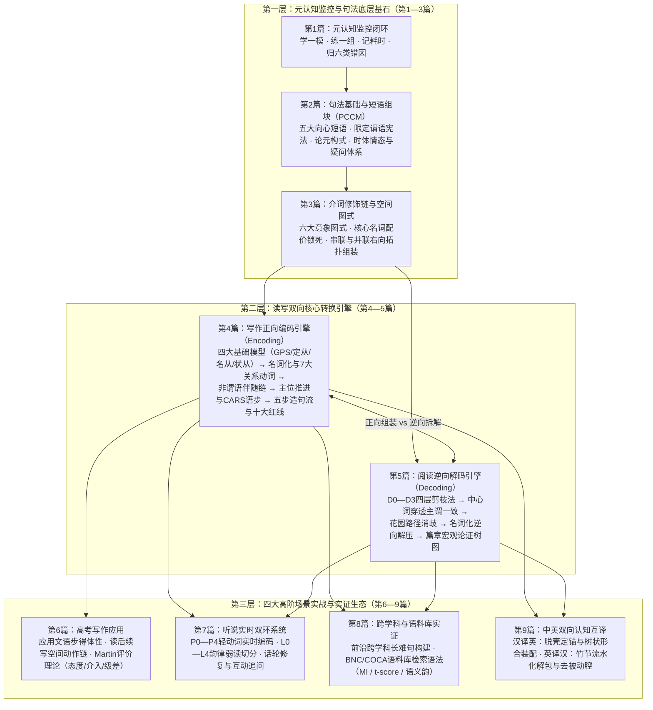

全书九篇由**三大认知主轴**紧密贯穿：

1. **纵向结构生长轴（第 2—3 篇 → 第 4 篇）**：解决“**英文长句是怎么长出来的**”——从最基本的向心短语组块与单一限定谓语骨架出发，向右挂载介词修饰链、定语从句与非谓语动作链，并通过语法隐喻（名词化）实现概念高密度打包。
2. **横向双向转码轴（第 4 篇 $\leftrightarrow$ 第 5 篇 $\leftrightarrow$ 第 9 篇）**：解决“**如何在输入与输出之间自如切换**”——写作与汉译英是“从概念命题到右分支形合树”的正向编码；阅读与英译汉则是“从表层长句剪枝剥离回核心命题与竹节流水”的逆向解码。
3. **场景调控与实证反馈轴（第 1、6、7、8 篇）**：根据**考场叙事**（第 6 篇）、**实时语音流**（第 7 篇）与**跨学科严谨学术**（第 8 篇）的不同时间与语体约束动态调整句法复杂度，并借助《练习全书》靶向训练题与 BNC/COCA 语料库完成实证闭环。

## 1.3 理论根基与出处


本书参考了构式、识解、语境锚定、句子加工等理论，也介绍信息结构和学习方法；各章附有来源链接。这些理论解释的问题不同，不能因为放在同一本书里，就认为已经组成一套经过验证的统一理论。GPS、介词修饰链和 D0—D3 是本书为了教学方便使用的名称和分析方法，含义分别见 4.2.1、3.2 和 5.2 节。若想进一步了解，可从下面的来源读起：


- 语言类型学（Typological Linguistics）：比较具体结构的语序，如英汉关系从句与名词的位置；不能把英语或汉语整体等同于单一的分支类型或思维方式


- 认知心理学（Cowan, 2001）：研究发现，在特定实验条件下，人平均能暂时保留约四个组块。这提醒我们，同时处理的信息有限；但它不能规定一句话最多有多少词，也不能证明阅读时必须使用本书的“剪枝法”


- 系统功能语言学（Halliday, SFL）：语法隐喻（Grammatical Metaphor）与名词化——学术英语密度来源


- 系统功能语言学（Halliday, SFL）：三大元功能（Metafunctions）——**概念功能**把经验切成过程与参与者，**人际功能**处理态度、情态与评价，**篇章功能**把前述材料组织成可理解的语流。本书用到的语法隐喻、主位结构与衔接手段，都可放回这三个维度定位；三者之间并非一一对应，同一个结构常常同时承担多种功能


- 文体学（Christensen, 《A Generative Rhetoric of the Sentence》, 1963）：累积句（Cumulative Sentence）理论——右分支挂载的美学依据


- 文体学（Williams, 《Style: Lessons in Clarity and Grace》）：总结性修饰、恢复性修饰——同位语高阶用法


- 布拉格学派（Mathesius 等）：主位-述位（Theme-Rheme）、已知信息到未知信息（Given-Before-New）


- 英语语法学（Quirk et al.）：尾重原则（End-Weight）、尾焦点原则（End-Focus）


- 二语习得与技能训练：自动化加工（Automaticity）可通过练习、提取与反馈逐步发展；理解规则有助于初学，但理解本身不等于熟练使用


> [!cn-practice]
> **配套练习提示**：本节为理论溯源，不设单独题组；请结合练习全书第1篇 1.5节【阶段达标自测】与 1.8节【自评与复测记录】检验理论掌握程度。


---


## 1.4 文体分层：不同写作任务对好句的要求


先明确写作任务：不同任务对表达有不同要求，同一句式是否合适取决于语境。三层可作为用途分类，但不是互斥的句法等级：


**第一层：高考（应用文 15 分 + 读后续写 25 分）**


- 训练重点：内容切题、语言准确得体、句式与词汇运用适当、行文连贯


- 可按语境选用的：情感描写、unwavering / meticulously 等词、修辞倒装与细节描写；这些形式本身不保证加分


- 禁止的：逗号拼接、双连词、悬空分词、主谓脱节


- 材料入口：本书第 6 篇（高考写作应用：应用文与读后续写）


**第二层：考研 / 雅思 / 托福**


- 评分诉求：观点清晰、论证完整、逻辑外显、语言准确


- 训练建议：段落中心明确、衔接清楚、控制不必要的嵌套；中心句位置、连接词数量与从句层数不设通用硬性规定


- 应该收敛的：不再追求大词密度，不再每段升华


- 材料入口：第4篇4.2-4.5节及4.7节


**第三层：学术论文 / 学位论文**


- 评分诉求：信息密度、客观克制、可验证、立场分寸


- 可选表达资源：名词化、准确的动词、与证据强度匹配的 hedging（may / appear to / suggest / seem 等模糊限制语）、被动与主动的语篇调度


- 坚决反对的：形容词堆砌、情绪化副词、无依据的绝对断言


- 材料入口：第4篇4.4节（名词化）与4.7节（语篇和立场）


> [!cn-danger]
> **跨层红线**：从考试作文转向学术写作时，应按论证需要调整语气，避免套用情感升华或堆砌大词。

> [!cn-practice]
> **配套练习**：在练习全书第1篇 1.5节建立四阶进阶档案；文体实操见第6篇 6.1节【高考应用文核心模型】与第4篇 4.1节【训练方法】。


---


## 1.5 四阶进阶路径与里程碑自测

本体系倡导“先输入建模，再工程组装，继而自动化解码，最终文体自如切换”的认知发展路径：

- **阶段一 · 建模与表征（建议约 2 周）**：
  - 核心学习：第 2 篇 2.1—2.10 节（短语与五大构式）、2.11—2.15 节（短语全景、时体、情态否定与提问体系）、第 4 篇 4.2 节（四大基础模型）与第 5 篇 5.2 节（D0—D3 逆向解码）。
  - 达成目标：能够准确识别五大短语类型、从句边界与小句限定性，理清核心论元与可选附加语，建立稳定的心智句法拓扑。
- **阶段二 · 组装与形合（建议约 3 周）**：
  - 核心学习：第 3 篇（介词修饰链与依附关系）、第 4 篇 4.3—4.6 节（右分支扩展与主位推进）及 4.9 节（五步工程化造句法）。
  - 训练任务：练习全书第 4 篇句子合并与造句练习每日 5—10 组。能按工程流组织准确、紧凑的长句（35—50 词），杜绝十大句法红线。
- **阶段三 · 解码自动化（建议约 3 周）**：
  - 核心学习：第 5 篇（阅读解码长句、篇章论证树与六类题型）、第 5 篇 5.8 节（句子加工、依存距离与花园路径消歧）。
  - 训练任务：练习全书第 5 篇长难句限时剪枝与题型逆向攻克，每日 5 句计时。在完整保留核心命题、否定算子与证据强度（Hedging）的前提下逐步提高阅读速度。
- **阶段四 · 文体切换与双向互译（持续深造）**：
  - 核心学习：第 6 篇（高考应用文与读后续写）、第 7 篇（听说实时意群切分与反应链）、第 8 篇（跨学科长难句与语料库实战）及第 9 篇（中英双向互译）。
  - 达成目标：同一命题能自由按高考口吻、学术论文规范与自然口语进行三层语体切换，实现母语思维与英文树状思维的无缝互译。

**四阶里程碑自测标准**：
- **阶段一过关**：面对 50 词左右的复合长句，能口述其 D0—D3 分层，准确圈出主干主谓宾，零误判。
- **阶段二过关**：给定中文复杂因果复句，能在 3 分钟内运用五步工程流写成合法英文复合句，且零红线错误。
- **阶段三过关**：连续 5 句复杂学术句的主干与必要限定理解 100% 正确，能准确指出干扰项的偷换与越界。
- **阶段四过关**：同一命题写出高考版、学术版与口语版，读者能一眼看出文风、词汇体与信息包装密度的显著差异。

> [!cn-practice]
> **配套练习**：练习全书第1篇 1.5节【阶段达标自测】。对照四阶过关标准建立自测台账。

---

## 1.6 每日训练闭环、提取间隔与错因反馈规范

知识不会自动转化为自动化直觉。只有通过科学的认知提取闭环，才能战胜“流利性元认知错觉（Illusion of Competence）”。

### 1.6.1 每日 30—40 分钟训练闭环
- **拆 3 句**：从当天阅读材料中挑选 3 个长句，运用 D0—D3 剪枝法剔除外围枝节，写出核心主干骨架并记录耗时（分层规范见 5.2 节）。
- **造 3 句**：运用五步工程流（骨架 → 名词化 → 介词链 → 右向扩展 → 终检），造 3 个符合学术或考场标准的句子，对照十大红线逐条排查。
- **回译 1 句**：将一句高质量英文译为中文，合上原文，数小时后仅看中文独立回译为英文，对比与原文的句法落差。
- **归因 1 条**：如实将当天出现的错因归入错题归因表（主语中心误判 / 动词关系读反 / 修饰或指代错位 / 范围泛化 / 过度推断 / 主谓脱节与悬空修饰）。

### 1.6.2 提取练习与间隔复习安排
- **区分三种认知状态**：
  - 看着答案觉得熟悉，只是视觉**再认（Recognition）**；
  - 合上书本能独立回忆并解释规则，才是**提取（Retrieval）**；
  - 换到全新场景和生词仍能精准运用，才是**迁移（Transfer）**。
- **阶梯式间隔复习表**：
  | 时间节点 | 认知动作 | 交付证据 |
  |---|---|---|
  | 初学当天 | 精读理论，独立做题，核对并归因修改 | 第一稿与错因标签 |
  | 次日（+24h） | 遮住答案，重新独立完成一题 | 能否脱稿提取规则 |
  | 3—5 天后 | 同一规则换词汇、换语境再做新题 | 能否跨语境迁移 |
  | 1—2 周后 | 混合不同构式，在无题型提示下独立选择 | 能否自行决策语法工具 |

### 1.6.3 精准反馈规范
“语法不好”属于无效反馈。建设性反馈必须精准定位到具体句法算子与槽位：
- ❌ 模糊评价：“这句英语写得很不地道，语法有错。”
- ✅ 精准反馈：“这里出现了**悬空修饰语（Dangling Modifier）**。句首分词短语 `Looking out of the window` 的逻辑主语必须是人，而主句语法主语却是 `the mountain`，语法上变成了‘大山向窗外看’。**修正动作**：将主句主语改为动作的真实发出者 `I`，即 `Looking out of the window, I saw...`，或将句首改写为时间从句 `As I looked out of the window...`。”

> [!cn-practice]
> **配套练习**：练习全书第1篇 1.1节【使用规则与快速索引】、1.2节【每日训练记录模板】、1.6节【提取、间隔与反馈实战】（第1—5题）。完成元认知自评并登记 1.8节复测台账。

---

<h1 id="sec-2">第2篇：句法基础：短语、构式与意义</h1>


> [!cn-theory]
> **体系定位**：本篇为第4篇写作编码与第3篇介词修饰链提供基础。第4篇讲句子组织，第3篇讲名词限定，本篇先讲词怎样组成句子中的一部分，也就是——


>
>
> **短语（Phrase）**，回答两个根本问题：


>
>
> **哪些词要放在一起理解？这一组词在句子中有什么作用？**


>
>
> **核心命题**：短语通常围绕一个中心词组织。例如 the book on the desk（桌上的那本书）以 book 为中心，on the desk 说明是哪本书。先判断短语类型，再结合完整句子判断它作主语、宾语还是其他成分。


>
>
> **配套练习**：见练习全书第2篇（2.1—2.11节，共124题）。


---


## 2.1 短语：句子里可以整体理解的一组词


### 2.1.1 为什么要把相关的词放在一起理解


读英语时，可以先看哪些词共同表达一部分意思，再把这些意思连起来。这样更容易看清句子，而不必逐个词猜它与前后词语的关系。


> [!cn-example]
> The boy in a blue coat is waiting at the door.
>
> 穿蓝色外套的男孩正在门口等候。


| 阅读单位 | 中文意思 | 帮助我们回答的问题 |


|---|---|---|


| The boy in a blue coat | 穿蓝色外套的男孩 | 谁？ |


| is waiting | 正在等候 | 在做什么？ |


| at the door | 在门口 | 在哪里？ |


in a blue coat 说明是哪一个男孩；at the door 说明等候的地点。先把相关的词放在一起理解，再看各部分之间的关系。


把相关信息组织成较大的理解单位，叫作**组块化（Chunking）**。这里的分组是阅读方法，不要求每一组都与一种语法短语完全重合，也不要求所有句子都分成三组。


**本节先练一个动作：读完一组词，能说出它的意思，再判断它与前后部分的关系。** 配套练习见练习全书第2篇 2.1节第1题。


> [!cn-theory]
> **进阶提示**：理解句子时，我们需要暂时记住前面读到的信息，这种能力叫作**工作记忆**。例如，读到主语后，如果中间还有一段说明，谓语又迟迟没有出现，就需要一直记着“谁”是主语。把相关的词合起来理解，可以减轻记忆负担。不过，句子是否难懂还与生词、插入的层次和指代是否清楚有关，不能只看长短。研究中常提到，人平均能在工作记忆中同时保留约四个组块；这个数字来自特定实验条件，并不表示句子超过某个词数就读不懂。


### 2.1.2 什么是短语：先看整体，再找中心词


**短语是句子中可以作为一个成分发挥作用的单位。** 它通常围绕一个中心词组织，可以只有一个词，也可以包含多个词。


> [!cn-example]
> The book on the desk is mine.
>
> 桌上的那本书是我的。


the book on the desk 共同指一本书，在本句中作主语。内部以 book 为中心，the 帮助确定所指，on the desk 说明是哪一本。


1. **整体表示什么、在句中做什么？** 本例整组指一本书，而不是分别谈书和桌子。


2. **哪个词是中心？** 围绕 book 组织，所以是名词短语。She 在 She smiled. 中也可作为名词短语，不能只按词数判断。


3. **内部还有没有其他结构？** the book that Maya bought（Maya 买的那本书）整体仍是名词短语，内部 that Maya bought 是说明 book 的从句。


短语可以包含小句，小句内部也可以包含短语。先确定正在分析的是哪一部分，再给它分类。

> [!cn-practice]
> **配套练习**：练习全书第2篇 2.1节【短语类型判定】（第1—12题）。重点辨析五大向心短语类型与中心词。

## 2.2 核心模型：短语向心组块模型（PCCM）


### 2.2.1 通用结构：左枝 + 中心词 + 右枝


先用“中心词前的成分 + 中心词 + 中心词后的成分”观察常见短语。这一教学模型称为“短语向心组块模型”，本书简称 PCCM。“向心”指整组词的性质由中心词决定；“组块”指把若干词当成一个整体来理解。前后成分都可能省略，并非每个短语必须写满三部分。


例如 the red book on the desk：the red 在 book 前，book 是中心，on the desk 在它后。“左枝、右枝”这里只是前后位置的简称。


$\text{短语(Phrase)} \;=\; \underbrace{[\,\text{左枝 Specifier/Modifier}\,]}_{\text{限定·指称·程度}} \;+\; \boxed{\text{中心词 Head}} \;+\; \underbrace{[\,\text{右枝 Complement/Adjunct}\,]}_{\text{补全·附加·修饰}}$


* <strong>中心词（Head）</strong>：短语的中心，帮助确定整组词的短语类型；


* **左枝（Left Branch）**：中心词之前的成分 —— 限定词（含冠词、指示词 this/that、物主词等）、程度副词、前置形容词（属修饰语，非限定成分）；


* **右枝（Right Branch）**：中心词之后的成分，包括补语（Complement）和附加语（Adjunct）。补语与中心词的意思和用法有关：有的必须写出，有的在意思已经清楚时可以省略；附加语则提供额外说明。因此，判断补语时要看中心词怎样使用，不能只试着删掉它。具体例子见 2.2.3 节。


  ```mermaid


  flowchart TD


      P["短语 Phrase（向心组块）"]


      P --> L["左枝 Left Branch<br/>限定词 / 程度副词 / 前置修饰"]


      P --> H["★ 中心词 Head<br/>决定短语身份"]


      P --> R["右枝 Right Branch<br/>补语 Complement（中心词选择）<br/>附加语 Adjunct（可选）"]


      L -.收窄指称/程度.-> H


      R -.补全语义/追加信息.-> H


  ```


### 2.2.2 整体替换与中心词识别：分两步判断


**第一步，看看这组词能否整体作为句子的一个成分。**


> [!cn-example]
> The book on the desk belongs to Maya. → It belongs to Maya.
>
> 桌上的那本书属于 Maya。→ 它属于 Maya。


the book on the desk 可整体换成 It，说明这组词在本句中像一个整体那样作主语。语法分析把“能出现在什么位置、能与什么成分替换”叫作**分布**；不是指空间上的分布。


**第二步，再看这组词围绕哪个词组织。** 本例主要谈 book，on the desk 说明这本书，所以 book 是中心词，整体是名词短语（NP）。不要因为桌子在后面，就把 desk 当成整个短语的中心。


替换只是辅助方法，不能单凭一次替换证明所有内部关系。不能替换成 It 的表达，也不因此就一定不是名词短语。


### 2.2.3 补语与附加语：需要什么，另外补充什么


先看一个完整句子：


> [!cn-example]
> She put the book on the desk yesterday.
>
> 她昨天把书放在了桌上。


put 在这里表示放置。只说 She put the book，通常会让人追问“放到哪里？”；on the desk 补足地点，是该用法中的补语。yesterday 另交代时间，删去它后仍能表达放置事件，是附加语。


| 判断方面 | 补语（Complement） | 附加语（Adjunct） |


|---|---|---|


| 与中心词的关系 | 与该词的具体用法紧密相关，如 put 需要放置位置 | 另外补充背景，如事件时间 |


| 本例 | on the desk | yesterday |


| 应检查什么 | 该词需要怎样的对象或补足内容？ | 是否另交代时间、地点、方式等？ |


“由中心词选择”指词的具体用法对后续成分有要求。例如 reliant on foreign capital（依赖外资）中，reliant 常与 on 搭配。


**删除测试只是线索。** 有的补语在特定语境中可省略，地点表达也不总是附加语。先看中心词的义项和搭配，再看上下文，不能把“能删／不能删”当作唯一标准。

> [!cn-practice]
> **配套练习**：练习全书第2篇 2.2节【中心词识别】（第13—22题）、2.3节【补语与附加语】（第23—30题）。先找中心词，再区分必选补语与外围附加语。


## 2.3 五大短语类型全景


中心词的五种词性，对应五大核心短语类型。


| 短语类型      | 缩写   | 中心词 | 左枝典型成分         | 右枝典型成分            | 整体可替换为     |


| --------- | ---- | --- | -------------- | ----------------- | ---------- |


| **名词短语**  | NP   | 名词  | 限定词 / 形容词 / 名词 | 介词短语 / 定语从句 / 同位语 | 代词 it/they |


| **动词短语**  | VP   | 动词  | 助动词 / 副词       | 宾语 / 补语 / 状语      | 动词 do      |


| **形容词短语** | AdjP | 形容词 | 程度副词           | 介词短语 / 不定式        | 形容词        |


| **副词短语**  | AdvP | 副词  | 程度副词           | —                 | 副词         |


| **介词短语**  | PP   | 介词  | —（程度修饰罕见）      | 名词短语（介词宾语）        | 副词 / 形容词   |


### 2.3.1 名词短语（Noun Phrase, NP）


**先看简单例子**：the book on the desk（桌上的那本书）。book 是中心名词，整组是名词短语（NP）。The book on the desk is mine. 中，这个短语作主语。下面的金融表达用于进阶练习。


名词短语以名词为中心，后面可以接介词短语、关系从句等说明。


* **结构**：`限定词 + 前置修饰 + 名词 + 右枝（介词链 / 定语从句 / 同位语）`


* **示例**：<code>the unprecedented acceleration <strong>of the contraction of liquidity in the interbank markets</strong></code>（银行间市场流动性紧缩的空前加剧）


* **结构拆解**：中心名词 `acceleration` → 左枝 `the unprecedented`（限定 + 评价）→ 右枝由三个介词短语逐层收窄（本书把这样一个介词短语简称为一"环"，见 3.2 节；链长判断详见第3篇）。


> [!cn-theory]
> 汉语常把较长的名词说明放在名词前；英语常用名词后的介词短语或从句表达这些说明。英语也有前置修饰，不能把所有修饰都移到名词后。写作时先确定中心名词，再按具体结构安排说明。


### 2.3.2 动词短语（Verb Phrase, VP）


**先看简单例子**：has finished the homework（已经完成作业）。finished 表动作，has 表完成形式，the homework 是动作涉及的对象。Maya has finished the homework. 表示“Maya 已经完成了作业”。


动词短语以实义动词为中心词，承载句子的动作与时态。


* **结构**：`助动词 + 副词 + 实义动词 + 宾语/补语 + 状语`


* **示例**：<code>has <strong>systematically undermined the credibility of the regulatory framework</strong></code>（系统性地削弱了监管框架的公信力）


* **结构拆解**：中心词 `undermined` → 左枝 `has systematically`（时态 + 方式）→ 右枝宾语 NP `the credibility ...`（动作对象）。


* **关键**：及物动词的右枝常嵌套一个完整名词短语，形成 **VP → NP → PP** 的层层包含。

> [!cn-theory]
> **语法体系口径对齐（狭义动词串 vs 广义向心短语）**：  
> * **传统学校语法**：常将“动词短语（Verb Group / Verbal Group）”特指为助动词与实义动词构成的**复合谓语动词串**（如 `has systematically undermined`）；
> * **生成语法与本书 PCCM 模型**：从认知向心组块出发，将及物动词后的必选宾语、表语及补语统统纳为该短语的**右枝必选补语**（即整块 `has systematically undermined the credibility...` 统一视作一个大动词短语 VP）。两者视角不同，但在拆解句法时本质相通：实义动词是能量源头，右侧成分由该动词的及物性严格限制。


### 2.3.3 形容词短语（Adjective Phrase, AdjP）

**先看简单例子**：`very proud of her work`（对她的工作很自豪）。`proud` 是中心形容词，`very` 说明程度，`of her work` 说明对象。在 `She is very proud of her work.` 中，整组短语充当系动词后的表语。

形容词短语以形容词为中心词（Head），常在句中充当前置定语、后置定语、表语或补足语。

* **基本拓扑**：`(程度副词) + 形容词中心词 + (后置介词短语 / 不定式补语)`
* **向心组块示例**：`heavily reliant on imported semiconductor components`（重度依赖进口半导体元器件）
* **结构拆解**：中心形容词 `reliant` → 前置程度副词 `heavily` → 后置必选补语 `on imported semiconductor components`。

#### 1. 形容词后置定语的三大铁律（Post-nominal Adjective Constructions）
传统教学常让学习者误以为形容词只能放名词前面（如 `a difficult task`）。但在高阶英语中，以下三种场景形容词**必须或强烈倾向于后置于名词之后**：

1. **自带介词短语或不定式补足语时（强制后置）**：
   当形容词携带后置补足语时，由于右侧负载沉重，英语严禁将其整体塞入名词前，必须整体移至中心名词右侧充当后置定语：
   - ❌ 错误（中式前置阻塞）：`*a [superior to conventional approaches] strategy`
   - ✅ 正确（右向组装）：`a strategy [superior to conventional approaches]`（一种优于传统策略的方案）
   - ✅ `a problem [difficult to resolve without international consensus]`（一个若无国际共识便难以解决的问题）
   - ✅ `data [available to researchers worldwide]`（向全球研究人员开放的数据）
2. **修饰复合不定代词时（强制后置）**：
   修饰 `something, anything, nothing, someone, anyone, everyone` 时，形容词必须后置：
   - `something [indispensable to scientific discovery]`（某种对科学发现不可或缺的要素）
   - `nothing [novel about the methodology]`（该方法并无任何新颖之处）
3. **“表语性形容词”与“位置敏感形容词”的前后语义剧变（核心辨析）**：
   部分以字母 `a-` 开头的表语性形容词（`alive, asleep, afraid, alike, aware`）只能作表语或后置定语（如 `the only person alive`，避免说 `*an alive person`）；更关键的是，有一组高频学术形容词**前置与后置意义截然不同**：

| 形容词 | 前置定语含义（通常表达稳定固有属性） | 后置定语含义（通常表达临时状态或特定事件关联） | 双语实战对比范例 |
| :--- | :--- | :--- | :--- |
| **`present`** | **现任的、当前的**<br>(current, existing) | **在场的、出席的**<br>(attending, physically there) | • `the present members`（现任委员/现有成员）<br>• `the members present voted unanimously.`（出席会议的成员一致投票赞成。） |
| **`concerned`** | **忧虑的、关切的**<br>(worried, anxious) | **涉事的、有关的**<br>(involved, affected) | • `concerned parents gathered at the school gate.`（忧心忡忡的家长聚集在校门口。）<br>• `The officials concerned were questioned by reporters.`（涉事官员接受了记者的质询。） |
| **`involved`** | **复杂的、晦涩的**<br>(complicated, intricate) | **参与的、卷入的**<br>(connected with, participating) | • `an involved argument that was hard to follow`（一段难以理解的复杂论证）<br>• `The companies involved refused to comment.`（涉事/参与该项目的企业拒绝置评。） |
| **`responsible`**| **有责任心的、可靠的**<br>(reliable, trustworthy) | **承担责任的、应负责的**<br>(blameworthy, in charge) | • `He is a responsible doctor.`（他是一位恪尽职守/负责任的医生。）<br>• `The officer responsible for the security breach resigned.`（对该安全漏洞承担直接责任的官员辞职了。） |

### 2.3.4 副词短语（Adverb Phrase, AdvP）

**先看简单例子**：`very slowly`（很慢地）。`slowly` 是中心副词，`very` 说明程度。在 `He walked very slowly.` 中，这组词修饰动词 `walked`。

副词短语以副词为中心词，主要修饰动词（VP）、形容词（AdjP）、其他副词（AdvP）或整个命题小句。

#### 1. 副词短语的三大句法层级与位置律
副词绝非随处乱放的零碎词，在认知句法中，副词短语严格分布在三大层级槽位上：

1. **第一层级：VP 内部方式/程度/频次副词（修饰动词谓语）**：
   - 紧贴实义动词之后（或助动词与实义动词之间），限定动作发生的物理方式与程度：
   - `The regulatory framework has fundamentally and irreversibly altered the market landscape.`（监管框架已经从根本上且不可逆转地改变了市场格局——`fundamentally` 与 `irreversibly` 并列修饰 `altered`）。
2. **第二层级：焦点副词（Focusing Adverbs：`only, even, precisely, merely, exclusively`）**：
   - **紧邻管辖原则**：焦点副词像聚光灯，紧挨着谁，谁就是全句的核心对比焦点。位置一旦位移，全句逻辑重心彻底颠覆：
     - `Only Maya read the report yesterday.`（**焦点在人**：只有 Maya 读了报告，其他人没读）。
     - `Maya only read the report yesterday.`（**焦点在动作**：Maya 只是读了读报告，没做批注或执行）。
     - `Maya read only the report yesterday.`（**焦点在对象**：Maya 昨天只读了那份报告，没读其他文件）。
     - `Maya read the report only yesterday.`（**焦点在时间**：Maya 昨天刚刚才读了报告，时间极近）。
3. **第三层级：句首 D0 评注与立场副词（Sentence / Stance Adverbials）**：
   - 位于句首（通常加逗号），修饰**后方整句命题**，表达说话人对全句命题的**元认知立场、证据确信度或论证转折**：
     - **认识确信度**：`Undoubtedly, the empirical findings validate our initial hypothesis.`（毋庸置疑，实证研究结果证实了我们最初的假设。）
     - **反差与悖论**：`Paradoxically, increasing highway capacity often exacerbates traffic congestion.`（具有讽刺意味的是，增加公路通行能力往往反而会加剧交通拥堵。）
     - **审慎让步**：`Admittedly, the sample size was relatively small.`（诚然，样本量相对较小。）
     - **统计立场**：`Statistically speaking, the correlation is highly robust.`（从统计学角度而言，该相关性极其显著。）


### 2.3.5 介词短语（Prepositional Phrase, PP）


**先看简单例子**：on the desk（在桌上）。on 是介词，the desk 是后接名词短语。The book is on the desk. 表示“书在桌上”。先练“介词 + 名词短语”。


介词短语以介词为中心词，补语最常见的是名词短语；某些介词也可接动名词结构或小句等。本篇先以“介词 + 名词短语”为主要练习形式。


* **结构**：`介词 + 名词短语（宾语）`


* **示例**：<code><strong>by means of rigorous quantitative modeling</strong></code>


* **结构拆解**：中心词介词 `by means of` → 右枝 NP `rigorous quantitative modeling`。介词短语既可作修饰（定语 / 状语），也可作补语，其功能分类与组装详见第3篇。


> [!cn-example]
> 注意介词短语的 **递归嵌套**： `by means of [the analysis of [the effects of [climate change on [migration patterns]]]]` —— 一个介词的宾语 NP 里又含新的 PP，这是短语内部层层包含的一个例子。

> [!cn-practice]
> **配套练习**：练习全书第2篇 2.1节【短语类型判定】（第1—12题）、2.11节【五大短语全景扩展：AdjP/AdvP与功能矩阵】（第89—104题）。


---


## 2.4 三类非限定动词短语：认识非限定结构


### 2.4.1 认知本质：从完整小句到非限定压缩


**先比较两组表达的认知焦点**：


* **独立小句（限定形式）**：`She opened the door. She saw Maya.`（她打开了门。她看到了 Maya。）


  * 两个动词 `opened` 与 `saw` 均为限定动词（Finite Verbs），各自被过去时态牢牢锁定，陈述两个彼此独立的先后事件。


* **认知压缩（非限定形式）**：`Opening the door, she saw Maya.`（开门时，她看到了 Maya。）


  * 主句是 `she saw Maya`；句首的 `Opening the door` 被**去时态化（Detensed）**，动词自身不再标明时态与人称，而是依附于主句，将“开门”处理为主体看到 Maya 时的**伴随背景动作**。


在认知句法中，所谓“限定（Finite）”，是指动词受到 **时间坐标（时态 Tense）** 与 **主语人称/数（Agreement）** 的双重约束，成为一个立足于现实时间轴上的独立判断命题；而“非限定（Non-finite）”，则是动词摆脱了主时态与人称束缚，被抽象为一种动作概念、过程体验或伴随状态，从而能够作为从属成分优雅地嵌入主句中。


本书沿用“不定式短语、分词短语”等传统教学名称。这些结构在现代句法学中通称为**非限定小句（Non-finite Clause）**：动词本身不标明主时态，但保留了动词的及物性、论元要求和相对时序。分析时既要看动词形式，也要追查动作主体和句中作用：


| 类型 | 核心形式 | 核心认知图式 | 隐含逻辑主体（PRO） | 典型句法功能 |


|---|---|---|---|---|


| **不定式小句** | `to + V` | 指向目标、潜能性、未来意图、心理距离 | 常与主句主语/宾语一致，或泛指 | 主语 / 宾语 / 定语 / 状语 / 补语 |


| **现在分词小句** | `V-ing` | 即时卷入、过程展开、生动体验、主动关系 | 通常是主句主语（主动关系） | 定语 / 状语 / 补语 |


| **过去分词小句** | `V-ed` | 能量终点、完成状态、被动受动、已成事实 | 通常是被修饰名词（被动/完成） | 定语 / 状语 / 补语 |


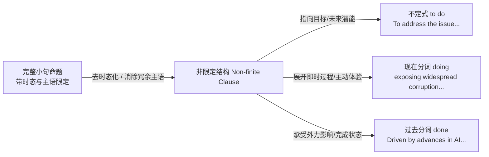


### 2.4.2 不定式（to do）vs 动名词/分词（-ing）的核心认知抉择


学习者最常困惑的问题是：“为什么有的动词后面接 to do，有的接 doing？为什么同一个词接两者意思完全不同？”


在认知语言学中，这一选择完全受 **心智距离与现实性假说（Psychological Distance & Realis / Irrealis）** 支配：


1. **`to + do` 的认知图式：指向性、潜能性、未来性与心理距离**


   * 介词 `to` 的物理原型是“朝向某个空间目标移动”。语法化为不定式标记后，`to` 依然保留了这种“朝着尚未发生的目标迈进”的矢量感。


   * 因此，`to do` 表达的是**未来的、潜在的、意图达成的、抽象的动作**，主体与该动作之间存在“尚未实现的心理距离”。


2. **`-ing` 的认知图式：即时性、过程性、真实体验与零心理距离**


   * 后缀 `-ing` 的本质是把观察镜头推入“动作内部（Internal Perspective）”。


   * 因此，`-ing` 表达的是**正在进行的、已经历过的、具体的、身临其境的真实体验**，主体与该动作之间“零距离直接卷入”。


<div class="subtopic-lead" id="s-2-4-2-1"><span class="subtopic-bar">▍</span> <strong>2.4.2.1 典型对比组（Minimal Pairs）的认知推导</strong></div>


* **`remember to do` vs `remember doing`**：


  * `Remember to lock the door.`（记得去锁门。）


    * *认知推导*：说话时尚未锁门，记忆指向未来有待执行的目标（to lock），心理距离延伸向未来。


  * `I remember locking the door.`（我记得当时锁过门。）


    * *认知推导*：锁门动作已经发生过，记忆调取的是脑海中那个正在锁门的真实卷入画面（locking）。


* **`stop to do` vs `stop doing`**：


  * `He stopped to smoke.`（他停下手头的事情，去抽烟。）


    * *认知推导*：`to smoke` 是目的状语，停下的目的是为了迈向抽烟这个新目标。


  * `He stopped smoking.`（他戒烟了。）


    * *认知推导*：`smoking` 是宾语，主体终止了长期处于其中的那个抽烟现实过程。


* **`try to do` vs `try doing`**：


  * `She tried to lift the heavy stone.`（她努力尝试搬起巨石。）


    * *认知推导*：指向搬石头这个艰巨目标，强调心智意志的努力，结果往往没搬动（潜能性）。


  * `She tried changing the battery.`（她试着换了块电池看看效果。）


    * *认知推导*：直接付诸具体行动体验一下，换电池本身已经做成了（现实性）。


* **动词与宾语搭配的认知理据**：


  * `want, decide, hope, promise, refuse` + **to do**：决定、希望、承诺均指向“尚未实现的未来意愿”。


  * `enjoy, admit, avoid, finish, practice` + **doing**：享受、承认、避免、完成必须建立在“已经存在或正在发生的过程体验”之上。你不可能享受一件从未经历过的事情。


### 2.4.3 动名词与分词：同一形式的名词化与修饰分流


传统语法把 `-ing` 割裂为“动名词（Gerund）”与“现在分词（Present Participle）”。在认知句法中，二者是同一种“过程化识解”在句法不同槽位上的功能延伸：


1. **作实体论元（名词性功能）**：


   * 将动态过程打包为一个“抽象事物”，充当主语、宾语或介词宾语：


     * `Solving this mathematical puzzle requires patience.`（主语：解开这个难题这一过程需要耐心。）


     * `The policy aims at curbing inflation.`（介词宾语：`at` 后面必须接名词性实体，因此动词必须采用 `-ing` 形式。）


   * **警惕介词 to 与不定式 to 的混淆**：


     * 当 `to` 是介词（表示朝向、致力于、归因于）时，其后必须接名词或 `-ing` 过程短语，绝不可误用动词原形：


     * `be committed to improving air quality`（致力于改善空气质量）


     * `look forward to hearing from you`（期待收到你的来信）


     * `object to changing the schedule`（反对更改日程）


2. **作修饰成分（形容词/副词性功能）**：


   * 作为定语或状语，描摹动作与主体的伴随关系：


     * 前置定语：`a developing nation`（正在发展中的国家，内视动态过程）


     * 句末结果状语：`The committee published the report, exposing widespread corruption among senior officials.`（委员会发布了报告，揭露了高级官员中普遍存在的腐败现象。exposing 承接主句动作，表达自然生发的结果或伴随事实）。


### 2.4.4 非限定动词的时体与语态坐标系


非限定动词虽脱离了主句的主时态（Past/Present），但其内部依然具备完整的**相对时序（Relative Time）** 与 **受动方向（Voice）**：


| 形式分类 | 不定式形式 | 现在分词 / 动名词形式 | 过去分词形式 | 认知时间与语态定位 |


|---|---|---|---|---|


| **一般主动** | `to do` | `doing` | — | 与主句谓语同时发生，或表示后续目的 |


| **一般被动** | `to be done` | `being done` | `done` | 与主句谓语同时发生，且承受外部动作 |


| **完成主动** | `to have done` | `having done` | — | **明确先于主句谓语动词发生** |


| **完成被动** | `to have been done` | `having been done` | — | **明确先于主句谓语发生，且为被动承受** |


<div class="subtopic-lead" id="s-2-4-4-1"><span class="subtopic-bar">▍</span> <strong>2.4.4.1 完成式（Having done）的时间先后定位</strong></div>


当非限定动作**明显早于主句谓语动作**，且需要明确两者因果或时间先后关系时，必须使用完成式，不能用一般式含混带过：


* `Opening the door, she saw Maya.`（开门与看见几乎同时发生，用一般式 `Opening`。）


* `Having finished the comprehensive evaluation, the panel submitted its final recommendations.`（专家组完成了全面评估之后，才提交了最终建议。评估工作先于提交动作彻底终结，用完成式 `Having finished`。）


* `Having been rejected three times, the proposal was completely rewritten by the research team.`（提案经历了三次被拒绝之后，才被研究团队彻底重写。被动 + 先于重写动作发生，用完成被动式 `Having been rejected`。）


<div class="subtopic-lead" id="s-2-4-4-2"><span class="subtopic-bar">▍</span> <strong>2.4.4.2 过去分词（V-ed）的受动与完成图式</strong></div>


过去分词具有天然的“被动受动”与“动作完成”双重属性：


* `Driven by rapid advances in artificial intelligence, the industry is undergoing a structural transformation.`（在人工智能快速发展的驱动下，该行业正经历一场结构性转型。）


  * *结构拆解*：`driven by ...` 与主句主语 `the industry` 构成明确的被动受力关系（行业受到人工智能发展的驱动）；整体作原因状语。


### 2.4.5 隐含主体（PRO）识别与悬垂修饰防御


非限定动词在形式上隐藏了主语，但在深层认知语义中，必须有一个施事或经历者在心智中被激活。这个在心理上存在的隐含主体，句法学称为 **PRO**：


1. **主语控制（Subject Control）**：


   * `Maya decided to launch the campaign.`（decide 的主体是 Maya，launch 的主体同样是 Maya。）


2. **宾语控制（Object Control）**：


   * `Maya persuaded Leo to launch the campaign.`（persuade 的主体是 Maya，但执行 launch 动作的主体是宾语 Leo。）


3. **句首分词短语的悬垂修饰错误（Dangling Modifiers）**：


   * **铁律**：位于句首的非限定状语短语，其默认的隐含主体必须是主句的语法主语！


   * 典型错误：`*Walking into the room, the lights went out.`（走进房间时，灯熄灭了。）


     * *诊断*：主句主语是 `the lights`，字面逻辑变成了“电灯走进了房间”，与常识冲突。


     * *修改方案一（落实主句主语）*：`Walking into the room, I noticed the lights go out.`（走进房间时，我注意到灯灭了。）


     * *修改方案二（展开为完整从句）*：`When I walked into the room, the lights went out.`（当我走进房间时，灯灭了。）


4. **目的不定式的悬垂防御**：


   * `To address the widening inequality between urban and rural regions, the government launched a comprehensive reform.`（政府启动改革，且政府是解决不平等问题的主体，逻辑严密。）


   * 若主句为被动句：`To address the issue, the policy must be revised.`（为解决这一问题，该政策必须予以修订。）


     * 虽未写出施事者，但语境中“政策修订者”不言自明；但若语境容易产生错配，应明确写出执行主体：`To address the issue, policymakers must revise the policy.`（为解决这一问题，政策制定者必须修订该政策。）


5. **合法的例外：评注性习语（Sentential Participles）**：


   * 少数固定表达已经语法化为全句评价标记，不与主句主语绑定：


     * `Strictly speaking, this conclusion is premature.`（严格来说……）


     * `Judging from recent market trends, inflation will persist.`（从近期趋势判断……）


     * `Considering the harsh conditions, the team achieved remarkable success.`（考虑到恶劣条件……）


### 2.4.6 非限定结构写作四步法与自检清单


在写作中装配非限定动词结构时，请依次执行以下四步决策：


1. **第一步：定意图（选 to do 还是 -ing？）**


   * 是表达“尚未实现的未来目标、目的、潜能”（选用 `to do`），还是表达“即时展开的过程、真实体验、伴随状态”（选用 `-ing`）？


2. **第二步：定时序（选一般式还是完成式？）**


   * 非限定动作与主句谓语是基本同时展开，还是明确先于主句动作彻底完成？（先于发生者选用 `having done` 或 `having been done`）。


3. **第三步：定方向（选主动还是被动？）**


   * 逻辑主体是动作的发出者（用主动式），还是动作的承受者（选用 `done`、`being done`、`to be done`）？


4. **第四步：核对悬垂（隐含主体是谁？）**


   * 将句首非限定动作的隐含主体与主句主语直接对齐；问自己：“主句主语能不能合情合理地做出这个动作？”
<div class="subtopic-lead" id="s-2-4-6-1"><span class="subtopic-bar">▍</span> <strong>2.4.6.1 更多经典 minimal pairs：同词两义只在“后看 vs 后做”</strong></div>

除 remember / stop / try 外，下面四个动词同样是“to do 后看、-ing 后做”的高频考点，逐一对照：

| 动词 | + to do（动作未发生 / 后看） | + -ing（动作已发生 / 正在做） |
|---|---|---|
| forget | `Don't forget to lock the door.`（别忘了去锁，锁门尚未做） | `I forgot locking the door.`（我忘了自己已经锁过门） |
| mean | `I meant to call you.`（我本打算打电话，意图未兑现） | `Missing the bus means waiting an hour.`（意味着要等，-ing 是已发生前提的结果） |
| regret | `I regret to tell you the news.`（遗憾地要告知，坏消息尚未说出口） | `I regret telling her the news.`（后悔告诉过她，告知已发生） |
| go on | `After graduation, he went on to study law.`（接着去做另一件事） | `He went on talking for an hour.`（继续做同一件事） |

**记忆钩子**：这些对立里，to do 一律站在“尚未兑现、朝向未来”的方向，-ing 一律站在“已经发生、属于过往或正在进行”的方向。判题时先问“说话时这个动作做了没有”，再选形式。

<div class="subtopic-lead" id="s-2-4-6-2"><span class="subtopic-bar">▍</span> <strong>2.4.6.2 同一命题的完整压缩轨迹：每删一个主语都要能找回</strong></div>

从一串松散的完整小句，逐步压缩成非限定结构，观察每一步保留了什么、删了什么：

1. **起点（三个独立小句，主语重复）**：
   `Maya finished the report. Then she left the office. She felt relieved.`
2. **压缩一（先后关系 → 完成式分词）**：
   `Having finished the report, Maya left the office.`
   *删去*：重复的主语与连词 Then；*保留*：finish 先于 leave 的时序（用 having finished 标记）。
3. **压缩二（伴随状态 → 现在分词）**：
   `Having finished the report, Maya left the office, feeling relieved.`
   *删去*：第三个小句的主语与谓语；*保留*：“感到释然”的逻辑主体仍是 Maya（feeling 挂在 Maya 上）。
4. **反向检查（被删的主语能否全部找回）**：having finished 的隐含主体 = Maya，feeling 的隐含主体 = Maya；两者都能在主句找到，压缩成立。

**边界**：如果压缩后某个非限定动作的隐含主体在主句中找不到（如 `*Having finished the report, the office was locked by Maya` 勉强可解但逻辑主体错位），就不要强行压缩，应恢复完整从句。

<div class="subtopic-lead" id="s-2-4-6-3"><span class="subtopic-bar">▍</span> <strong>2.4.6.3 与 6.3 节的教学分工</strong></div>

本节解决“非限定动词该选什么形式、隐含主体是谁”的**系统问题**；第 6.3 节（考场写作中的动作链与伴随）解决“在考场句子里如何把它用得自然、有节奏”的**应用问题**。学习顺序上先在本节把形式和逻辑练对，再到 6.3 节做句式组织；不能在没解决形式正误之前，先追求句式的高级感。


> [!cn-theory]
> **配套训练指引**：本节理论直接支撑练习全书第 2 篇非谓语动词专项训练及后续 6.3 节动作链条组织。阅读与写作时，遇到长难句修饰成分，先识别动词是否带有主时态，再运用本节四步法拆解其逻辑关系。

> [!cn-practice]
> **配套练习**：练习全书第2篇 2.4节【组块结构与小句限定性】（第31—40题）、2.5节【悬垂修饰与主被动纠错】（第41—50题）。


## 2.5 短语功能矩阵：短语如何充当句子成分


先分开<strong>“是什么结构？”与“在这句话里有什么作用？”</strong>：The book on the desk is mine.（桌上的书是我的。）中，the book on the desk 是名词短语，作主语；I bought the book on the desk.（我买了桌上的那本书。）中，同一个名词短语作宾语。


因此，名词短语是类型，主语／宾语是功能。下表的勾表示常见功能，不表示这类短语能随意放入所有勾选位置。形容词短语也可作状语，多表伴随状态或主语特征，如 `He went to bed, exhausted.`（他筋疲力尽地上床睡了）。


短语的**类型**由中心词决定，短语的**功能**须结合句型、位置和所表达的关系判断。同一类短语可承担多种成分，这便于我们复用同一组块。


| 短语类型       | 主语 | 谓语 | 宾语 | 表语 / 补语 | 定语 | 状语 |


| ---------- | -- | -- | -- | ------- | -- | -- |


| 名词短语 NP    | ✔  | —  | ✔  | ✔       | ✔  | ✔  |


| 动词短语 VP    | —  | ✔  | —  | —       | —  | —  |


| 形容词短语 AdjP | —  | —  | —  | ✔       | ✔  | ✔  |


| 副词短语 AdvP  | —  | —  | —  | ✔       | —  | ✔  |


| 介词短语 PP    | —  | —  | —  | ✔       | ✔  | ✔  |


| 不定式短语      | ✔  | —  | ✔  | ✔       | ✔  | ✔  |


| 分词短语       | —  | —  | —  | ✔       | ✔  | ✔  |


> [!cn-example]
> 名词短语也可作时间或度量状语，如 `We met last week.` 中的 `last week`、`The meeting lasted two hours.` 中的 `two hours`。表内标记概括常见功能，具体结构仍须结合语境判断。


>
>
> 同一个介词短语 `in the northern hemisphere`，位置不同则功能不同：


>
>
> - 后置修饰名词（定语）：<code>migration patterns <strong>in the northern hemisphere</strong></code>
>
> - 修饰全句（状语）：<code><strong>In the northern hemisphere</strong>, winter begins in December.</code>
>
> - 作表语补语：<code>The phenomenon is <strong>in the northern hemisphere</strong>.</code>

> [!cn-practice]
> **配套练习**：练习全书第2篇 2.11节【短语功能矩阵转化与成分识解】（第100—104题），重点识别短语在句中充当状语、表语、补语及同位语的多维功能。


---


## 2.6 短语嵌套与递归：右分支的来源


先看 the cover of the book（这本书的封面）：整组以 cover 为中心；of the book 说明是哪本书的封面；of 后的 the book 又是名词短语。分层看是 **[the cover [of [the book]]]**。结构能层层包含，这叫“嵌套”。先看清各层关系，再看专业例子；不能把所有介词只排成一条线。


短语有内部层次，可以包含其他短语。同类结构能够继续出现在内部时，称为**递归（Recursion）**；它可以形成较长的右分支，但并不是所有长句都靠这一种方式组成。


<div class="structure-map">


先看清本表分析的是下面这句自编教学句，表中成分按它在句中的位置排列：`An analysis of the vulnerabilities demonstrated that the internal attention mechanisms could be destabilized by minor input noise.`表中“依附”指一个修饰成分挂在哪个词上、说明的对象是谁；确定依附就是确定它的修饰对象。


| 层级与依附 | 原句成分 | 结构说明 |


|---|---|---|


| 主句主语 | An analysis of the vulnerabilities | NP；中心词 analysis |


| 主语内的右枝 | of the vulnerabilities | PP；of 的补语为 NP the vulnerabilities |


| 主句谓语 | demonstrated that ... | VP；中心动词 demonstrated，后接内容小句 |


| 内容小句的主语 | the internal attention mechanisms | NP；中心词 mechanisms |


| 内容小句的谓语 | could be destabilized | VP；情态 + 被动述谓 |


| 小句谓语的原因／施动信息 | by minor input noise | PP；依附 destabilized |


主句：analysis → demonstrated → 内容小句。小句：mechanisms → could be destabilized → by noise。分别判断这组词是什么结构、在句中做什么、属于主句还是内部从句。


</div>


> [!cn-theory]
> 本表所用的自编句如上；其中内容小句作 demonstrated 的补足成分；“宾语／补足成分”说明功能，不把该小句另归为名词短语。


>
>
> **再看一个逐层包含的例子**：the cover of the book on the desk（桌上那本书的封面）。按这个意思分层是 **[the cover [of [the book [on [the desk]]]]]**：cover 后的 of 引出 the book；book 后的 on 引出 the desk。阅读时先找外层中心词 cover，再看内部各部分说明谁。写作时先写清主要对象，只添加需要的说明。英语也有其他方向的嵌套；层次过多可能增加理解负担，见2.10节。

> [!cn-practice]
> **配套练习**：练习全书第2篇 2.4节【组块结构与小句限定性】（第31—40题）；练习全书第2篇 2.6节【短语 ↔ 从句改写与名词化】（第51—60题）。


---


## 2.7 短语与小句：先看谁做什么，再看动词形式


**小句表达“谁做什么、什么是什么或处于什么状态”的关系**，这也叫“述谓关系”。小句可以独立构成句子，也可以成为更大句子的一部分。


| 表达 | 怎么理解 | 本节分类 |


|---|---|---|


| Maya opened the door. | Maya 是主体，opened 表过去动作 | 限定小句 |


| Opening the door, Maya saw Leo. 中的 Opening the door | 开门者可从主句恢复为 Maya；opening 自身不表主句时态 | 非限定小句，传统也称现在分词短语 |


| the door near the stairs | 整组指一扇门，near the stairs 说明哪一扇 | 名词短语 |


这里的“限定”是动词形式术语，**不要与定语从句的“限制性／非限制性”混淆**。先分清分析范围，再看中心和内部关系，不能只按有没有 -ing 或有几个动词分类。


**常见改写**：


- the published report（已发表的报告）→ the report that was published。展开为关系从句，不增加发表时间。


- The mechanism failed, which caused delays.（机制失效了，这导致延误。）→ The failure of the mechanism caused delays.（机制失效导致延误。）把失效事件改用名词表达。


核对动作执行者、时间、否定、条件和可能性是否保留。练习全书第2篇 2.4节采用“限定小句、非限定小句、其他短语”的分类。

> [!cn-practice]
> **配套练习**：练习全书第2篇 2.4节（第31—40题）、2.6节【短语 ↔ 从句改写与名词化】（第51—60题）。


## 2.8 英汉短语认知差异

| 维度 | 汉语意合图式 | 英语形态挂接图式 | 认知机制差异说明 |
| :--- | :--- | :--- | :--- |
| **修饰走向** | 定语 / 状语多前置（左枝向左层叠） | 修饰多后置（右枝向右线性挂接） | 汉语“先画轮廓背景、后落中心点”；英语“先立核心实体、后添限定边界” |
| **修饰链条** | 「……的……的……的」多重长定语累积 | 中心名词先行，介词短语 / 分词 / 定从向右串接 | 避免核心中心词被埋没在长定语之后，降低短时工作记忆负担 |
| **动作呈现** | 动词并列连用（走过去拿起来打开看） | 单一限定主动词 + 非限定伴随（分词/介词/动名词） | 英语一小句严格保持单一主时态锚（Finite），次要事件降级为非限定枝蔓 |
| **信息重心** | 细节铺垫在前，核心结论与动作压在句末 | 主干骨架（SVO）先行凸显，扩展信息向右展开 | 英语遵循“核心命题先入为主”，背景与条件作为后置挂件或前置标志帧 |

> [!cn-theory]
> **经典短语镜像拆解案例**：
> * **汉语思维（前置堆叠）**：
>   “在昨天下午由国际专家组在市中心大厅举行的高峰论坛上提出的关于可持续能源转型的创新方案”
>   * *汉语句法特征*：核心概念“创新方案”被整整压制在全段末尾，读者心智必须悬置记忆长达 30 字的修饰语。
> * **英语认知句法重构（中心词先行 + 右向分流）**：
>   `the innovative proposal`（中心词 NP 先行落地）  
>   `+ on sustainable energy transition`（主题属性：第一层紧密介词补语）  
>   `+ presented at the summit forum`（动作来源：第二层分词非限定修饰）  
>   `+ held by the international panel in the city hall yesterday afternoon`（背景时空：第三层外围修饰）  
> * **整句合体**：
>   <code>the innovative proposal <strong>on sustainable energy transition</strong>, <strong>presented at the summit forum</strong> held by the international panel in the city hall yesterday afternoon</code>  
>   * *认知优势*：大脑在第 3 个词就锁定了核心指称（proposal），后续各层挂接成分在心智中像套盒一样逐级精准收窄。

> [!cn-practice]
> **配套练习**：练习全书第2篇 2.6节【短语 ↔ 从句改写与名词化】（第51—60题）及练习全书第9篇 9.1节【汉译英短语组块化】（第1—6题）。


## 2.9 短语识别三步法与组装三步法

### 2.9.1 阅读逆向解码：短语识别三步法

在面对高考与学术长难句时，切忌逐字直译。阅读解码的本质是逆向拆解多层嵌套的短语树：

1. **第一步 · 找限定动词（Finite Verb Anchor）**：
   * 扫描全句，精准圈出携带时态、人称约束的主干限定动词（如 `has demonstrated`, `revealed`）；
   * 将真正的主谓核心从伴随的非限定小句（`-ing` / `-ed` / `to do`）中彻底剥离出来，确立核心判断骨架。
2. **第二步 · 识别中心词（Head Identification）**：
   * 对句子中的复杂组块，透过表层修饰词，直接透视该短语到底在描述“哪个人、物、动作或属性”；
   * 准确判定组块类型（名词短语 NP、动词短语 VP、介词短语 PP、形容词短语 AdjP 或副词短语 AdvP）。
3. **第三步 · 理顺左右枝蔓（Branch Parsing）**：
   * **左枝（Left Branch）**：提取限定词（`the` / `every`）与修饰性形容词；
   * **右枝（Right Branch）**：严格区分中心词紧密依附的“必选补语（Complement）”（如 `reliance on imports` 中不可剥离的 `on imports`）与灵活补充环境的“外围附加语（Adjunct）”（如时间、地点状语），逐层剥茧还原句义。

### 2.9.2 写作正向编码：短语组装三步法

从构思到落笔的高效造句工程流：

1. **第一步 · 立骨架中心词（Establish the Core Head）**：
   * 明确当前信息块的核心概念，选定具有精确语义密度的中心词（如不写 `a bad thing that slows down work`，而锁定精确核心名词 `an obstacle` 或 `a bottleneck`）。
2. **第二步 · 依附分配前后修饰（Assign Modifiers & Complements）**：
   * 根据中心词的论元要求，优先补足其核心补语；再按信息重要性与篇章节奏，向左配置轻量修饰词，向右挂接介词短语或非限定小句；
   * 避免“头重脚轻”：长定语绝不强行塞进中心词前方，统一平稳向右挂接。
3. **第三步 · 锚定功能卡位（Anchor into Clause Slot）**：
   * 将组装完成的成熟短语投射进主句的目标槽位（主语、宾语、表语或状语）；
   * 严格核查主谓一致、逻辑主语一致性（坚决杜绝分词短语与主句主语脱节引起的悬垂错误）。

> [!cn-practice]
> **配套练习**：练习全书第2篇 2.2节【中心词识别】（第13—22题：逆向找中心词）；练习全书第2篇 2.6节（第51—60题：正向短语组装）。


## 2.10 复杂度控制与常见错误


### 2.10.1 嵌套深度控制


短语可以继续嵌套，但读者一次能处理的信息有限。嵌套过深时，读者容易看不清主干与修饰成分的关系。


> [!cn-theory]
> **复杂度提醒**：20 词、4 层仅可作为检查负担的个人练习提醒，不是通用容量上限。遇到长距离依赖、陌生词或嵌套时，检查主干是否仍清楚，必要时拆句或调整信息；短句也可能困难，长句也可能清楚。


### 2.10.2 常见错误与纠正


| 错误类型       | 错误示范                                                                                  | 正确表达                                                                    | 纠错机制            |


| ---------- | ------------------------------------------------------------------------------------- | ----------------------------------------------------------------------- | --------------- |


| **前置堆叠**   | `the by experts last year conducted survey`                                           | the survey **conducted by experts last year**                           | 修饰后置，短语向右挂      |


| **动词连用**   | `The government adopt measures control pollution.`                                    | The government adopted measures **designed to control pollution**       | 本例补出修饰结构；各小句分别确定谓语   |


| **悬垂分词**   | `Using the method, the result was clear.`                                             | Using the method, **we obtained a clear result.**                       | 分词逻辑主语须在主句落实    |


| **主被动错配**  | `Driving by demand, sales rose.`                                                      | **Driven by demand**, sales rose.                                       | 名词与分词被动关系用 V-ed |


| **补语介词错**  | `reliant to foreign capital`                                                          | reliant **on** foreign capital                                          | 形容词补语介词固定搭配     |


| **嵌套过深**   | `the report of the analysis of the effects of the policy of the reform of the system` | the report analyzing **the effects of the reform policy on the system** | 连续 of 过多即改写、拆句  |


| **短语误作从句** | `The report published last year was influential` 误判为两句                                | 主句的限定动词是 `was`，`published...` 是非限定分词小句（传统称过去分词短语）                                     | 区分限定小句、非限定小句与包含它们的词组        |


> [!cn-practice]
> **配套练习**：练习全书第2篇 2.5节【悬垂修饰与主被动纠错】（第41—50题）；完成本节后对照 2.12节核对详细解析。


---


## 2.11 构式与论元结构：从事件选择句型


### 2.11.1 构式赋义：句型是有意义的形式—意义配对


传统语法常把句型当作被动等待填充的容器（即“先有动词，动词决定后面跟几个词”）。认知构式语法（Construction Grammar，Goldberg, 1995）提出了根本性的逆向洞见：**句型构式本身就是形式与意义的固化配对（Form-Meaning Pairing），具有独立于具体动词的整体构式意义。**


动词与构式之间存在**双向融合机制（Semantic Fusion）**：动词带来具体的词汇意义（动作方式、心理体验、物理状态），而构式则自上而下赋予整体事件的心智解释模型（致使、位移、转移、结果状态）。当动词进入特定构式时，句型可赋予动词原本不具备的论元结构：


* **不及物动词进入使动运动构式**：


  * 常规用法：`Maya sneezed.`（Maya 打了个喷嚏。自主生理反应，仅需 1 个论元：主语 Maya。）


  * 构式融合：`Maya sneezed the napkin off the table.`（Maya 一声喷嚏把餐巾纸吹落到了桌下。）


  * *认知推导*：动词 `sneeze` 本身并没有“致使位移”的词义，是英语的“使动位移构式（Caused-Motion Construction: S + V + O + Path）”自上而下赋予了句子“气流能量迫使受事位移”的事件意义。


* **状态动词进入结果构式**：


  * 常规用法：`The river froze.`（河水结冰了。）


  * 构式融合：`The river froze solid.`（河水冻得坚实。结果构式赋予了状态彻底终结的意义。）


语法位置能够容纳某种成分，不等于任何动词都能自由进入该句型。动词自身的核心语义特征必须与构式语义相兼容（Semantic Compatibility）。例如，`Maya gave Leo a key` 合法，因为 `give` 包含“让渡所有权”的特征；而 `*Maya explained Leo the rule` 不成立，因为 `explain` 的核心特征是“言语阐释”，不具备物质交割的构式兼容性。[构式理论概述](https://www.cambridge.org/core/elements/constructionist-approaches/4F37E9A2B97EB663F532B4068702055C)


### 2.11.2 英语五大核心事件原型与基础句型映射


传统语法的“五大基本句型”，在认知句法中对应人类心智认知世界的五类**事件原型（Event Prototypes）**。写作时不是先挑公式，而是先辨识要呈现的事件属于哪种物理或心理交互模式：


| 事件认知原型 | 语法构式框架 | 核心论元与心智图式 | 自编教学例句 | 认知关注焦点 |


|---|---|---|---|---|


| **自发状态演变 / 非宾格过程** | **S + V** | 单一实体（经历体 Theme 状态自发转变） | `The door opened.` / `The bell rang.` / `Maya smiled.` | 聚焦状态自发转变或纯内敛动作，外部致因被隐去（非宾格与作格识解） |


| **性质归属 / 身份界定** | **S + V + P** | 主体 + 关系连接 + 属性/分类 | `The proposal sounds feasible.` | 静态特征归属或感官感知，无物理能量传递 |


| **及物影响 / 能量传递** | **S + V + O** | 施事发出能量 → 受事承受变化 | `Maya opened the door.` | 谁行动，什么对象承受其直接物理或心理影响 |


| **转移交割 / 间接受益** | **S + V + IO + DO** | 施事 → 接收者获得客体 | `Maya gave Leo a key.` | 谁转移、谁接收、什么实体完成了所属权转移 |


| **复合致使 / 状态转变** | **S + V + O + C** | 施事施加作用 → 受事达到新状态/位置 | `Maya painted the door blue.` | 施加外力致使对象产生结果性状态跃迁或空间位移 |


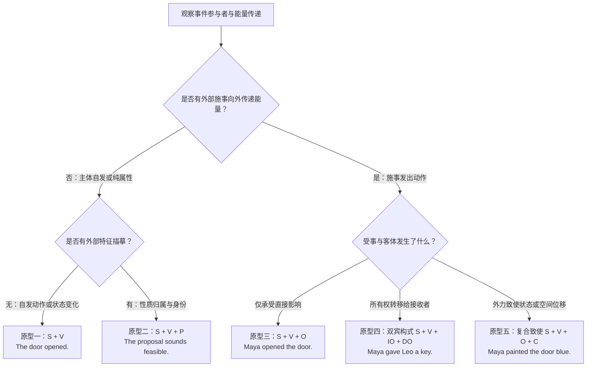


> [!cn-theory]
> **认知深潜：作格交替（Ergative Alternation）与非宾格假说**：  
> 请特别注意区别**纯不及物自主动作（Unergative）** 与 **非宾格状态演变（Unaccusative）**：
> * 在 `Maya smiled.` 中，Maya 是真正自主发出动作的“施事（Agent）”；
> * 在 `The door opened.` / `The ice melted.` 中，门或冰块在深层语义上并非主动发出动作的施事，而是承载状态演变的**经历体/客体（Theme / Patient）**。英语大量核心动词（`open, close, freeze, melt, break`）允许在及物使动（`Maya opened the door`）与非宾格自发（`The door opened`）之间自由切换，这被称为“作格交替（Ergative Alternation）”。其认知本质是说话人根据交际意图，决定是将外部致使力纳入视界，还是将其完全排除出镜头（绝对识解 Absolute Construal）。

<div class="subtopic-lead" id="s-2-11-2-1"><span class="subtopic-bar">▍</span> <strong>2.11.2.1 同一事件在五句型中的对照：每多出的成分都在回答一个问题</strong></div>

为避免把五句型当成五个无关公式，用同一组参与者（Maya、a key、Leo）从最简单的事件逐层扩展，观察每加一个成分是在回答一个什么问题：

| 句型 | 句子 | 相比上一层多回答的问题 | 少了会怎样 |
|---|---|---|---|
| ① S + V | `The key arrived.` | （最底层：发生了什么？） | —— |
| ② S + V + P | `The key is useful.` | 这东西是什么性质？ | 无法做属性判定 |
| ③ S + V + O | `Maya received the key.` | 谁对什么施加了影响？ | 能量传递对象缺失 |
| ④ S + V + IO + DO | `Maya gave Leo the key.` | 东西最终到了谁手里？ | 接收者缺失，转移事件不完整 |
| ⑤ S + V + O + C | `Maya made the key useful.` | 对象被弄成了什么状态？ | 结果状态缺失，致使事件不完整 |

**推导**：句型的选择不是“想用哪个就用哪个”，而是由**事件实际涉及的参与者和终点**决定。如果你只想陈述“钥匙到了”，用①；若要交代“Maya 把钥匙给了 Leo 并让它派上用场”，就必须一路补到⑤。

**边界**：判断一个成分“必不必要”，用两个问题一起核对——动词本身是否要求它（配价，如 `put` 必须有处所），以及删去后你要表达的事件是否还完整。不能把“中文里没说”当作“英语里可省”。

<div class="subtopic-lead" id="s-2-11-2-2"><span class="subtopic-bar">▍</span> <strong>2.11.2.2 动词与构式共同决定能补什么：不可越级填充</strong></div>

句型槽位对外开放，但每个槽位能放什么由**动词与构式共同限制**。下面三处错误都源于只看槽位、不看动词：

* `*Maya explained Leo the rule.` → `explain` 不进入双宾构式，应写 `Maya explained the rule to Leo.`（言语阐释没有“实物交割”）；
* `*Maya put the document.` → `put` 强制要求处所终点，应写 `Maya put the document on the shelf.`；
* `*Maya found the door blue.`（想表达“刷成蓝色”）→ `find` 只察知先在状态，不致使变色；要表达结果应写 `Maya painted the door blue.`

**迁移**：写作时先在脑中过一遍“事件有几个参与者、有没有终点或结果”，再倒推句型；拿不准某个动词能否进入某句型时，先查该动词的配价与例句，而不是用中文直译类推。
### 2.11.3 论元角色与句法位置的分离


**语法位置（主语、宾语、补语）是句法的结构槽位；语义角色（施事、受事、接收者、经历者、工具、客体）是参与者与事件的客观关系。** 两者绝不能画等号：


1. **主语不等于施事者（Agent）**：


   * `Maya opened the door.`（Maya 是施事者，作主语）


   * `The door opened.`（The door 是承受变化的客体/受事，作主语。这属于作格动词的中间构式用法，凸显变化本身而非开门的人）


   * `The key opened the door.`（The key 是工具/媒介，作主语，凸显工具在物理链条中的直接推动作用）


   * `The auditorium seats 500 people.`（The auditorium 是空间场所，作主语，凸显容器对容纳对象的承载能力）


2. **双宾语构式的论元对应**：


   * 在 `Maya gave Leo a key` 中：


     * `Maya`：施事者（给予者）→ 句法主语


     * `Leo`：接收者（Recipient）→ 间接宾语（IO）


     * `a key`：被转移的实体（Theme）→ 直接宾语（DO）


   * 改写为介词形式：`Maya gave a key to Leo.`


     * 认知差异：双宾语形式（`gave Leo a key`）在认知上强调“接受者已顺利拥有物品（Successful Transfer）”；介词形式（`gave a key to Leo`）则将注意力焦点导向“移动路径与目标终点（Path & Goal）”。


3. **名词化后的论元还原（承接4.4节）**：


   * 当动词压缩为事件名词时，核心论元并未消失，而是改换了句法标记：


     * 句子：`The army destroyed the bridge.`（army 为施事，bridge 为受事）


     * 名词化：`the destruction of the bridge by the army`


     * *还原机制*：`bridge` 由介词 `of` 标记（表达受影响对象），`army` 由介词 `by` 标记（表达动作发起者）。若漏掉 `by the army`，读者就无法恢复施事者。


### 2.11.4 配价限制、动词亚类与必选补足语


动词与构式共同限制表达。词汇本身对所要求的论元数量与形式存在**配价限制（Verb Valency）**。学习者必须掌握动词的亚类边界，不能仅凭中文直译类推：


<div class="subtopic-lead" id="s-2-11-4-1"><span class="subtopic-bar">▍</span> <strong>2.11.4.1 双宾构式的动词准入边界</strong></div>


能够进入“S + V + IO + DO”双宾构式的动词通常具备“意图促成所有权转移”的核心特征（如 `give, send, lend, offer, grant, teach`）。


* **不能进入双宾构式的言语传达动词**：


  * `explain, describe, suggest, announce, introduce, report` 等动词，其认知核心在于“向公众或特定对象公开阐述某个信息命题”，而不是把实体塞给某人。


  * 错误：`*Maya explained Leo the procedure.`


  * 正确：`Maya explained the procedure to Leo.`


  * 错误：`*He suggested me a feasible solution.`


  * 正确：`He suggested a feasible solution to me.`


[explain 的用法规范](https://dictionary.cambridge.org/dictionary/english/explain)

<div class="subtopic-lead" id="s-2-11-4-2"><span class="subtopic-bar">▍</span> <strong>2.11.4.2 使动运动 vs 自主位移的致使链</strong></div>


对比两个常见句子：


* `Maya pushed the box into the room.`（Maya 把箱子推进了房间。）


  * 论元结构：包含施事（Maya）、受事（the box）以及必选路径终点（into the room）。Maya 施加外力，迫使箱子发生位移。


* `The box moved into the room.`（箱子移进了房间。）


  * 论元结构：主语就是发生位移的实体（the box），仅陈述位移结果，未提及外部力量发起者。


<div class="subtopic-lead" id="s-2-11-4-3"><span class="subtopic-bar">▍</span> <strong>2.11.4.3 结果构式 vs 观察评注构式的本质区别</strong></div>


初学者常因看到“宾语 + 形容词”就混淆句意：


* `Maya painted the door blue.`（Maya 把门刷成了蓝色。）


  * 属于**结果补语构式（Resultative Construction）**：动作 `painted` 致使宾语 `the door` 产生状态质变，最终达到 `blue`。


* `Maya found the door blue.`（Maya 发现门是蓝色的。）


  * 属于**状态认知构式（Depictive / Mental Perception）**：`find` 只是主体对既有客观事实的察知，门原本就是蓝色的，并非 Maya 的察知动作导致门变蓝。


* 写作检查：问自己“后面的形容词是动作导致的新结果，还是动作发生前就已经存在的伴随状态？”


<div class="subtopic-lead" id="s-2-11-4-4"><span class="subtopic-bar">▍</span> <strong>2.11.4.4 必要论元（补语）vs 可选背景（状语附加语）</strong></div>


* **必要论元（Complement）**：删除后命题残缺或语法不成立。


  * 例如 `put`：`Maya put the document on the shelf.` 中的 `on the shelf` 是处所补语，必须保留；写成 `*Maya put the document` 属于语法残缺。


* **可选背景（Adjunct）**：删除后主干命题依然完整独立。


  * 例如 `read`：`Maya read the document on the shelf.` 中的 `on the shelf` 是修饰语，删除后 `Maya read the document` 仍然是完整自足的及物事件。


### 2.11.5 汉英事件识解差异与写作陷阱


英汉思维在论元与句型组织上有鲜明的分水岭。写作时须克服中式流水思维造成的论元残缺：


1. **克服“动词无节制连用”**：


   * 汉语偏好连动句：“政府采取措施控制污染。”（三个动词顺承）


   * 中式错误：`*The government adopt measures control pollution.`


   * 英语认知规则：单小句必须确立**唯一核心限定动词**，其余动词降格为非限定小句或介词短语：


     * `The government adopted measures to curb pollution.`（不定式表达目的）


     * `The government adopted measures designed to curb pollution.`（分词短语充当定语）


2. **克服“滥用泛化使役动词”**：


   * 汉语常用“使、让、令”驱动长句，导致中式习作中泛滥出现 `make sb do`、`let sth happen`。


   * 英语更倾向于使用**强及物动词或名词化重构（承接4.4节）**：


     * 初级直译：`His irresponsible behavior made everyone feel indignant.`


     * 句法跃升：`His irresponsible behavior provoked widespread indignation.`（及物动词 `provoke` 直击受事）
     * *文体分层与适用边界提示*：避免滥用 `make / let` 针对的是**学术论文、政论社论与严肃论说文**中将客观因果关系机械拟人化的中式语病；在**小说续写、日常书信与口语交际**中，`make` 与 `let` 构式（如 `make sb laugh`, `make sense`, `let me know`, `make a difference`）依然是纯正地道、富有生活气息的核心高频表达，切勿在文学叙事中因噎废食、强套生硬的学术大词。


3. **识别并恢复隐性受事与施事**：


   * 汉语常省略主语（如“必须认真对待这个问题”）。


   * 英语翻译时不可写出无主游离句（`*Must take this problem seriously.`），必须明确补齐主语实体（`We must address this problem with urgency.`）或采用合法的被动语态（`This problem warrants urgent consideration.`）。


### 2.11.6 句型选择四步法与写作核验清单


写作时，按以下四步将头脑中的思想事件精准装配为句法构式：


1. **第一步：锁定事件原型**。自问：这是一个自主事件、属性判定、及物冲击、所有权转移，还是外力致变？


2. **第二步：盘点核心参与者**。自问：谁施力？谁承受？涉及什么实体？是否有空间或状态终点？


3. **第三步：核对动词配价与构式约束**。自问：选定的动词能否进入该句型？是必须接双宾还是只接介词（如 `give` vs `explain`）？补足语是动作造成的新状态（`painted blue`）还是先在状态（`found empty`）？


4. **第四步：补齐时空背景与附加成分**。最后向右或向左挂接时间、地点、原因等可选附加语（状语），确保必要论元与修饰成分边界分明。


> [!cn-theory]
> **配套训练指引**：本节理论直接支撑练习全书第2篇 **2.7节（第61—65题）** （论元角色识别、双宾改写、致使位移辨析、结果补语判断与名词化论元恢复）。完成上述基础题后，可对照练习全书 **2.12节【2.12.7 构式与论元结构参考答案】** 进行复核。

> [!cn-practice]
> **配套练习**：练习全书第2篇 2.7节【构式与论元结构】（第61—65题）。重点体验及物致使 vs 非宾格作格交替（Theme经历体识解）。核对 2.12节【2.12.7】。


## 2.12 指称与语境锚定：名词到底指什么


### 2.12.1 认知本质：Langacker 的“语境锚定（Grounding）”机制


在词典中，一个孤立的名词（如 `notebook`, `desk`, `student`）仅仅是一个**概念类型（Type）**，它只是一套抽象特征的集合，并不直接指代现实或心智世界中的任何具体个体。


要在交流中让受话人准确知道“你在谈哪一个具体实体”，说话人必须对名词进行**语境锚定（Grounding）**。


所谓“锚定”，是指说话人运用**限定词（冠词、指示词、物主代词、量词）** 作为认知坐标，将抽象的概念类型与当前的说话现场（Ground——包括说话人、受话人、时间、空间和前文语境）链接起来，从而在受话人的心智模型中确立一个清晰的**具体实例（Instance）**：


$$\text{概念类型 (Type: notebook)} + \text{语境锚定 (Grounding: a / the / my)} = \text{具体指称实例 (Instance: the notebook)}$$


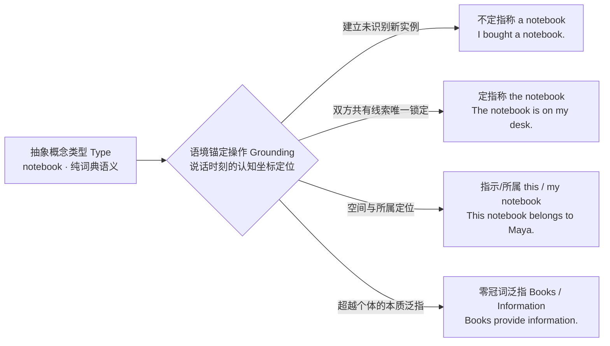


### 2.12.2 冠词系统的三向心智图式（a / the / 零冠词）


传统应试教学常把冠词简化为死板口诀：“第一次提到用 a，第二次提到用 the”。这种规则极易产生误导。认知句法表明，冠词的选择完全取决于说话人对 **受话人心智识别状态（Addressee's Epistemic Status）** 的预设：


| 冠词表达形式 | 核心认知图式 | 受话人心智状态 | 自编教学例句 | 认知功能推导 |


|---|---|---|---|---|


| **`a / an` + 单数可数** | 建立新实例 | 尚不能、也不需要锁定唯一实体 | `I bought a notebook yesterday.` | 引入新对象，仅声明其属于“笔记本”这一类别 |


| **`the` + 名词** | 坐标唯一锁定 | 能够凭借共有线索唯一锁定该实体 | `The notebook is on my desk now.` | 激活共享知识，指示受话人唯一检索目标对象 |


| **零冠词 + 复数/不可数** | 类别本质类指 | 关注概念整体，不区分具体个体 | `Books provide information.` | 展现“书籍”的普适功能与“信息”的抽象概念 |


| **`this / that / my`** | 视线聚焦定位 | 强化近远空间距离或权属锚定 | `This notebook belongs to Maya.` | 附加说话人的空间视线焦点或排他性所属关系 |


<div class="subtopic-lead" id="s-2-12-2-1"><span class="subtopic-bar">▍</span> <strong>2.12.2.1 定冠词 <code>the</code> 的四类唯一锁定线索</strong></div>


只要客观语境提供了“唯一锁定”的充分线索，即使是**第一次提到**，也必须果断使用 `the`：


1. **现场物理环境唯一（Situational Uniqueness）**：


   * 教室里只有一扇门，老师进门后第一次对学生说：`Please close the door.`


   * *认知推导*：双方身处同一个感知物理场，视线所及只有这扇门，直接使用 `the`，绝不能说成 `*close a door`。[冠词实际语境用法](https://dictionary.cambridge.org/us/grammar/british-grammar/a-and-the)


2. **常识与全局唯一（Cultural & Global Uniqueness）**：


   * `the sun`, `the moon`, `the internet`, `the government`。在人类常识共有心智库中具有唯一确定性。


3. **后置修饰收敛唯一（Cataphoric Narrowing）**：


   * `Books can provide information.`（泛指：书能提供信息，用零冠词）。


   * `The books on this shelf provide the information we need.`（特指：后置介词短语 `on this shelf` 将书的范围收窄为这一个确切架子，定语从句 `we need` 将信息收窄为特定内容，两者均使用 `the`）。


4. **语篇回指唯一（Anaphoric Tracking）**：


   * `I bought a notebook yesterday. The notebook is on my desk.` 第一句通过 `a` 建立新节点，第二句通过 `the` 沿线索回溯该节点。


### 2.12.3 可数性与心智离散性识解（Boundedness & Individuation）


名词的“可数”与“不可数”，本质上不是名词固有的物理属性，而是人类心智对其施加的**有界性识解（Boundedness Construal）**：


* **有界 / 离散识解（Bounded / Countable）**：心智将事物视为具有**明确外部物理轮廓、内部不均质、可逐一分割计数**的独立实体（如 `a report`, `two chairs`）。


* **无界 / 连续识解（Unbounded / Mass / Substance）**：心智将事物视为**无固定形状、连续流动、内部均质、不可分割**的物质或抽象概念（如 `water`, `advice`, `information`）。


<div class="subtopic-lead" id="s-2-12-3-1"><span class="subtopic-bar">▍</span> <strong>2.12.3.1 同一词汇的识解维度转换（Shifts in Construal）</strong></div>


当语境发生变化时，同一个词可以在“无界物质”与“有界包装”之间自由转换：


* **`coffee` 的识解对比**：


  * 无界物质（泛指）：`Coffee keeps me awake.`（咖啡作为一种连续液体饮料和化学物质，起提神作用；不可数，用零冠词）。


  * 离散有界包装：`I ordered a coffee at the counter.`（在咖啡馆柜台语境中，心智自动将连续液体打包为离散商业单元：“一杯咖啡”；可数，加 `a`）。[可数与不可数识解](https://dictionary.cambridge.org/grammar/british-grammar/nouns-countable)


* **其他经典转化**：


  * `paper`（纸张材料，不可数）vs `a paper`（一份报纸 / 一篇学术论文，有界个体）。


  * `experience`（阅历经验，抽象连续）vs `an experience`（一次难忘的经历，离散事件）。


<div class="subtopic-lead" id="s-2-12-3-2"><span class="subtopic-bar">▍</span> <strong>2.12.3.2 中式量词陷阱与单位词转换</strong></div>


汉语习惯说“一条建议”、“一条信息”，导致学习者极易犯下 `*an advice`, `*two advices`, `*an information` 等典型中式错误。


* **认知纠正**：在英语心智中，`advice` 与 `information` 纯粹是抽象扩散的知识形态（无界整体）。若要对其进行计数，必须借助 **外部度量单位词（Partitive Measure Words）** 进行离散化切分：


  * 错误：`*She gave me two advices and an information.`


  * 纠正：`She gave me two pieces of advice and a piece of information.`


### 2.12.4 泛指（Generic Reference）的三种认知视角


表达“某一类事物的普遍规律”时，英语提供了三种合法的认知构式，但其背后的观察视角截然不同：


1. **复数零冠词（最自然、最常用）**：


   * `Books provide information.`（书籍提供信息。） / `Lions are dangerous animals.`（狮子是危险的动物。）


   * *认知视角*：归纳视角。观察物理世界中的多个具体成员，归纳提炼出该类别的普遍真理。学术与考场写作首选。


2. **`the + 单数可数名词`（类型原型/象征）**：


   * `The computer has transformed modern education.`（计算机已经彻底改变了现代教育。）
   * `The lion is the king of the jungle.`（狮子是丛林之王。）


   * *认知视角*：符号与原型视角。将该类别提炼为一个高度抽象的技术发明或物种图腾，常用于科学报告或正式散文。


3. **`a / an + 单数可数名词`（任意代表）**：


   * `A teacher should be patient with students.`


   * *认知视角*：任意抽取视角。从该类别中随手挑选任何一个典型成员，其应当具备全群体的规范属性。


### 2.12.5 代词回指与认知可及性（Cognitive Accessibility）


当一个名词实体完成语境锚定后，后续语篇必须通过**代词回指链（Anaphoric Chain）** 维系认知连贯性。代词的选择取决于该实体在受话人心智中的**注意力激活度（Activation Level）**：


* **`it / they`（核心注意力聚焦点）**：


  * 适用于刚刚提到、在句子主干中占据核心位置、未受其他名词干扰的对象。


* **`this / these`（重新拉近聚焦）**：


  * 当段落中出现了多个竞争名词，或者需要将上文的一整套复杂事实（甚至整句话）作为一个新命题拉到眼前深入剖析时使用：


  * `Maya designed a new algorithm. This algorithm significantly reduced processing time.`（比单纯用 `It` 更明确有力，避免歧义）。


* **警惕“漂浮指代（Floating Pronouns）”**：


  * 写作中若前面并列提到了 `the proposal` 与 `the committee`，后句直接写 `It was delayed` 会让读者困惑究竟是提案被延期还是委员会被拖延。此时应主动重申核心名词：`The proposal was delayed.`


### 2.12.6 名词短语锚定四步法与写作核验清单


在写作中组装名词短语时，请依次执行以下四步自检：


1. **第一步：定指称意图**。是要泛指整个类别本质（首选复数零冠词 `Books`），还是要谈论特定的某个实体（选用 `a` 或 `the`）？


2. **第二步：判受话人状态**。受话人能否根据上下文、物理现场或生活常识唯一锁定目标？（若能，坚决用 `the`；若引入新事物，选用 `a/an`）。


3. **第三步：定有界性与词汇体**。该名词在此语境下是离散个体还是连续物质？单数可数名词**绝不能光秃秃单独出现**（必须有 `a/the/my` 等限定词）；抽象不可数名词（`advice, information, progress`）严禁添加 `a` 或复数 `-s`。


4. **第四步：查后置修饰的收窄效应**。后置的介词短语或定语从句是否把范围收敛为确定集合？（如 `the students in this class` vs `students in general`），确保冠词与修饰范围高度契合。
<div class="subtopic-lead" id="s-2-12-6-1"><span class="subtopic-bar">▍</span> <strong>2.12.6.1 一段连贯短文中的 a / the / 零冠词对照</strong></div>

冠词的正误只有放进上下文才看得出。下面这段短文里，首次出现用 `a`、双方能唯一锁定用 `the`、泛指类别用零冠词，逐处标注：

> Maya wanted to borrow (1) **a** book from (2) **the** library. (3) **A** book on the shelf caught her eye; (4) **the** book was about (5) **coffee**. (6) **Coffee** is one of (7) **the most popular** drinks in the world, but she was looking for a specific chapter rather than a general introduction.
>
> （译文：Maya 想从图书馆借一本书。书架上的一本书吸引了她的目光；这本书是关于咖啡的。咖啡是世界上最受欢迎的饮品之一，但她当时在找的是某个特定章节，而非泛泛的导论。）

* (1) **a book**：首次引入、听者不知道是哪一本 → 不定冠词；
* (2) **the library**：双方都知道的那家（本校图书馆），唯一可锁定 → 定冠词；
* (3) **A book**：再次引入一个新的具体对象 → 不定冠词；
* (4) **the book**：刚提到过的那本，听者已能锁定 → 定冠词；
* (5) **coffee**：物质名词，泛指这种物质，不加冠词 → 零冠词；
* (6) **Coffee**：句首泛指整个类别，零冠词（= the category）；
* (7) **the most popular**：最高级限定了唯一对象，必须用 the。

**推导**：判断顺序是“先看新旧（新→a，旧/唯一→the），再看类别（泛指整类→零冠词复数或不可数）”。每次加冠词都在回答“读者此刻能不能唯一锁定我指的对象”。

<div class="subtopic-lead" id="s-2-12-6-2"><span class="subtopic-bar">▍</span> <strong>2.12.6.2 泛指与特指：同一名词三种外衣的意思差</strong></div>

用同一个名词 `panda`，三种冠词外衣对应三种不同的指称范围：

| 形式 | 句子 | 指称范围 |
|---|---|---|
| 零冠词复数 | `Pandas eat bamboo.` | 泛指整个物种，最常用、最自然的泛指 |
| a + 单数 | `A panda eats bamboo.` | 用“任一个体”代表类别，偏定义口吻 |
| the + 单数 | `The panda is a protected species.` | 把该物种当作一个整体单位谈（多见于物种、发明） |
| 特指 | `The panda at the zoo is sleeping.` | 特指某一只（双方能锁定），不是泛指 |

**边界**：不要把 the + 单数一律当泛指——`The panda at the zoo` 是特指。定冠词表泛指只在“把整个类别当作一个单位”（物种、发明、仪器）时成立；拿不准时泛指优先用零冠词复数。


> [!cn-theory]
> **配套训练指引**：本节理论直接支撑练习全书第2篇 **2.8节（第66—70题）** （新旧信息冠词装配、泛指与特指辨析、不可数抽象名词度量纠错、同类词汇识解转换、物理现场唯一锁定）。完成训练后，请对照练习全书 **2.12节【2.12.8 指称、冠词与可数性参考答案】** 进行复核。

> [!cn-practice]
> **配套练习**：练习全书第2篇 2.8节【指称、冠词与可数性】（第66—70题）。重点训练 a / the / 零冠词的选择、可数性识解与代词可及性。核对 2.12节【2.12.8】。


## 2.13 时态、体与事件呈现：观察视界与心理距离


### 2.13.1 认知双轴：时（Tense）与体（Aspect）的分离


传统语法常把“时态”混为一个十二格或十六格的大表格，导致学习者误以为每个格子都是独立的公式。认知句法将事件的时间呈现拆解为两条正交的**认知双轴**：


1. **时（Tense）——时间坐标轴（说话人当前立足点与事件的“心理距离”）**：


   * 英语在动词屈折形态上本质只有两个“时”：**现在时（Present，心理近距离 / 与当前时刻连通）** 与 **过去时（Past，心理远距离 / 与当前彻底脱钩）**。（所谓的“将来”，是通过 `will` 等情态助动词或 `be going to` 构式构建的心理预期或当前意图）。


2. **体（Aspect）——观察视界轴（摄像机机位：如何审视事件的内部过程）**：


   * **简单体 / 一般体（Simple Aspect）**：从外部全景观照事件（Holistic / External Perspective），将事件视为一个闭合的、无内部延展的整体事实。


   * **进行体（Progressive Aspect）**：将镜头推入事件内部（Internal Perspective），置身于动作展开的中间过程，不看起点与终点，关注持续性与即时动态。


   * **完成体（Perfect Aspect）**：站在参照点向过去回溯（Retrospective Perspective），关注先发事件在当前参照点留下的结果、影响或经验投影（Current Relevance）。


| 时体交叉组合 | 核心认知图式 | 自编教学例句 | 摄像机机位与心智视界 |


|---|---|---|---|


| **一般现在** | 当前心理视界 + 稳态/规律 | `Maya writes reports every week.` | 鸟瞰全景：规律性日常习惯或客观事实，无起点终点拘束 |


| **现在进行** | 当前心理视界 + 内部展开 | `Maya is writing a report now.` | 推入特写：身临其境置身于动作发生的中间，正在动态演进 |


| **一般过去** | 过去脱钩视界 + 封闭事实 | `Maya wrote the report yesterday.` | 封存归档：事件在过去的封闭时间容器内发生并终结，与此刻无活性连接 |


| **现在完成** | 过去事件 + 当前心理投影 | `Maya has written the report, so we can review it now.` | 视线回溯：动作在此前发生，但其结果或影响跨越时空、直接作用于此时此刻 |


| **过去完成** | 过去参照点 + 更早回溯 | `Maya had written the report before the meeting began.` | 双层景深：以过去的某一时刻为基准，再向更深的历史维度回溯先行事件 |


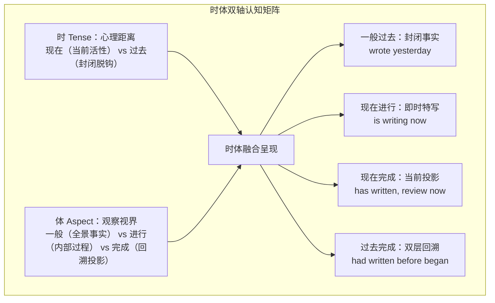


### 2.13.2 一般过去时 vs 现在完成时：心理视界与现实脱钩


这是受母语（中文“了/过”）干扰最严重的重灾区。中文的“写了报告”既可对应过去时也可对应完成时，但英语的区分取决于说话人**是否在心理上切断与现在的联系**：


1. **一般过去时（Past Simple）——“心理脱钩（Psychological Detachment）”**：


   * 事件被置于一个**已经关闭的过去时间容器**中（如 `yesterday`, `last year`, `in 2020`, `two hours ago`）。它陈述的是历史档案，不承诺对当前有何种必然影响。


   * `Maya wrote the report yesterday.`（报告是昨天写的。重点在于过去的动作事实）。


   * `I lived here for five years.`（我曾在这里住过五年。——*潜台词*：现在已经不在这里住了，居住事件已经成为封存的历史）。


2. **现在完成时（Present Perfect）——“现实关联（Current Relevance）”**：


   * 动作虽然发生在过去，但说话人的注意力焦点**完全锚定在现在**。说话人是为了说明、论证或解释当前的状态。


   * **时间状语禁忌**：现在完成时绝不能与明确封闭的过去时间点连用！


     * 错误：`*Maya has submitted the report yesterday.`


     * 纠正：`Maya submitted the report yesterday.`


     * *认知理据*：`yesterday` 强行将视界关闭在过去，而 `has submitted` 强行将视界连接到现在，两者在心智模型中产生撕裂。[一般过去与现在完成辨析](https://dictionary.cambridge.org/uk/grammar/british-grammar/past-simple-or-present-perfect)


   * `I have lived here for five years.`（我在这里已经住了五年。——*潜台词*：从过去一直持续到现在，目前依然住在这里）。


### 2.13.3 动作动词 vs 状态动词：进行体的认知识解机制


动词自身的词汇性质（词汇体）对时体选择有着天然的约束：


* **活动动词（Activity Verbs）**：`write, run, paint, discuss`


  * 特征：需要持续消耗能量，天然具有时间延展过程，因而天然契合进行体（`is writing`, `was discussing`）。


* **状态动词（Stative Verbs）**：`know, believe, belong, resemble, possess`


  * 特征：表示静态属性、认知状态或所有权，内部没有动态变化，默认采用一般体（`I know the truth.` 而非 `*I am knowing the truth.`）。[状态动词用法说明](https://dictionary.cambridge.org/us/grammar/british-grammar/present-simple-present-continuous)


<div class="subtopic-lead" id="s-2-13-3-1"><span class="subtopic-bar">▍</span> <strong>2.13.3.1 状态动词进入进行体的认知突显（Cognitive Salience）</strong></div>


“状态动词不用于进行体”不是绝对戒律。当说话人强行让状态动词进入进行体时，心智模型将产生特殊的修辞识解——**将某种稳态属性转化为“临时的、特意的、做作的动态表现”**：


* `He is silly.`（他这人很傻。——固有性格特征，稳态属性）。


* `He is being silly.`（他这会儿在故意装傻 / 胡闹！——临时性行为，带有情绪评价的动态过程）。


* `Maya lives in Shanghai.`（Maya 在上海生活。——长期定居的稳态事实）。


* `Maya is living in Shanghai.`（Maya 目前暂住在上海。——临时的过渡状态）。


### 2.13.4 过去完成时：参照点锚定与时序回溯


过去完成时（`had done`）绝不是“更正式、更高级的过去时”，也不是任何发生在过去的动作都可以随意套用。


**双锚点认知模型（Reichenbach 参照点理论）**：


在心智视界中，必须先确立一个**过去的参照基准点（Reference Point, R）**，然后再向更深的历史维度回溯一个**先于该参照点发生并对其产生影响的先行事件（Event Time, E < R）**：


* `Maya had written the report before the meeting began at ten yesterday.`（在昨天十点会议开始之前，Maya 就已经写好了报告。）


  * 过去参照点 R：昨天的会议在 10 点开始（began，一般过去时）。


  * 先行事件 E：写完报告并做好提交准备（had written，先于 10 点完成）。


* **免用过去完成时的认知经济性**：


  * 若上下文已经通过明确的时间连接词（如 `before`, `after`, `as soon as`）锁死了不可逆的先后时序，在现代英语中往往直接使用两个一般过去时即可，避免过度标记造成阅读负担：


  * `After she finished the report, she left the office.`（无需硬写 `had finished`，时序已经不言自明）。


### 2.13.5 背景画卷与前景突显：进行体与点事件交织（Ground & Figure）


在叙事与复杂语篇中，进行体与一般过去时的交织构成了认知心理学经典的“**背景—图形（Ground-Figure）** ”架构：


* **持续进行体充当背景画卷（Ground）**：持续消耗时间的活动在脑海中拉开一幅动态背景画布；


* **瞬间过去时充当突现图形（Figure）**：突发的单点事件刺入背景，成为视觉与认知焦点。


> [!cn-example]
> `Maya was writing the report when the lights went out.`（灯熄灭的时候，Maya 正在写报告。）
>
> * **背景画卷（Ground）**：`was writing the report`（当时正在伏案写报告，画面在持续延展）。
>
> * **突发图形（Figure）**：`the lights went out`（电灯骤然熄灭，单点突发动作插入）。
>
> * **审读推导**：从这句话中，读者能否确定报告已经写完了？**绝对不能！** 进行体只展示动作置身其中的中间过程，不承诺事件最终是否成功收尾。


### 2.13.6 时体改写四步法与写作核验清单


在学术写作、考场叙事或改写时，请按以下四步精准校准时体坐标：


1. **第一步：定基准参照点**。明确整段文字是站在当前立足点综述（用现在时域），还是在叙述已结束的实验/故事（用过去时域）？


2. **第二步：定事实视界（一般体 vs 进行体）**。是要总结全景事实，还是要突显正在展开的动态过程或临时状态？


3. **第三步：定因果投影（过去封闭 vs 现在完成）**。过去发生的事件是否需要向当前视界投影证据或结果？若带有 `yesterday / last year` 等封闭时间词，坚决使用一般过去时；若强调“因此我们现在可以……”，选用现在完成时。


4. **第四步：核对被动与时体维度分离**。时体与主被动是完全正交的两个维度：`was tested`（过去被测试，历史闭合）与 `has been tested`（已被测试，当前有效结论），不可因被动而混淆时间视角。
<div class="subtopic-lead" id="s-2-13-6-1"><span class="subtopic-bar">▍</span> <strong>2.13.6.1 同一叙事的五组最小对立：只差“与现在有没有关系”</strong></div>

用同一组事件，把每个句子分别写成一般过去时与现在完成时，体会两种形式对“当前立足点”的不同处理：

| 组 | 一般过去时（事件已封闭，与现在脱钩） | 现在完成时（事件向当前投影） |
|---|---|---|
| 1 | `Maya lost her key yesterday.`（昨天丢了，只陈述往事） | `Maya has lost her key.`（她现在还没有钥匙，进不了门） |
| 2 | `Leo lived in Paris for two years.`（过去住过，现在不住） | `Leo has lived in Paris for two years.`（至今已住两年，仍在巴黎） |
| 3 | `The shop closed at six.`（六点关了门，可能今天又开了） | `The shop has closed.`（此刻是关着的状态） |
| 4 | `I wrote three emails this morning.`（上午已结束，三封） | `I have written three emails this morning.`（上午尚未结束，可能再写） |
| 5 | `Did you ever see a whale?`（口语中翻旧账，重在往事） | `Have you ever seen a whale?`（问到目前为止的人生经历） |

**推导**：两种形式的事件本身完全相同，差别只在“说话人要不要把它和当前状态连起来”。出现封闭时间状语（yesterday, at six, last year）时，时间坐标已经与现在切断，只能用一般过去时；要表达“因此现在……”的关联，才用现在完成时。

<div class="subtopic-lead" id="s-2-13-6-2"><span class="subtopic-bar">▍</span> <strong>2.13.6.2 改写时如何保住时序：先排先后，再定时态</strong></div>

把一段叙事改写为不同时态（如直接引语改为转述、现在时改为过去时）时，最容易丢失的是**事件之间的先后关系**。按以下顺序处理：

1. **先列事件时序**：在草稿上标出每个动作是“先发生、同时发生、还是后发生”，例如：`A（先）→ B（同时背景）→ C（后）`；
2. **再按基准点定时态**：基准点在现在，用现在时/现在完成；基准点在过去，用过去时/过去完成；
3. **先于基准点的动作一律退一格**：在过去叙事中，更早的动作用过去完成，如 `Maya had locked the door before she left.`（lock 先于 leave）；
4. **同时展开的背景用进行体**：`When the lights went out, she was reading.`（read 是持续背景，went out 是打断它的点事件）。

**边界**：时序与时体是两件事——改写时即使整体时态平移，“谁先谁后”的关系不能改变。检查改写稿时，把每个动作的先后关系与原稿逐一核对；若出现“原本同时的两件事变成先后”，就是时态用错了。


> [!cn-theory]
> **配套训练指引**：本节理论直接支撑练习全书第2篇 **2.9节（第71—75题）** （一般现在与进行辨析、过去封闭时间纠错、居住状态时效判断、双锚点过去完成时装配、背景与突发焦点推导）。完成基础训练后，请对照练习全书 **2.12节【2.12.9 时态、体与事件视角参考答案】** 进行复核。

> [!cn-practice]
> **配套练习**：练习全书第2篇 2.9节【时态、体与事件视角】（第71—75题）。重点训练一般过去 vs 现在完成、进行体认知识解及叙事时态一致性。核对 2.12节【2.12.9】。


## 2.14 情态、否定与作用范围：力动态学与命题界限


### 2.14.1 认知力动态学：认识情态 vs 道义情态


情态动词（Modal Verbs）不是静态的可能性百分比量表（不能简单武断地规定 might=30%, may=50%, must=90%）。认知语言学（Talmy's Force Dynamics 力动态学）揭示，情态的本质是**心理世界中力量相互作用的呈现（Barriers, Forces, Tendencies）**。


英语的情态系统分流为两大认知视界：


1. **道义情态（Deontic Modality，根情态 / 社会权威力）**：


   * 关注现实人际关系中的**许可、义务、命令与社会阻力**。力量来源于外部权威、社会契约或说话人的意志强制：


   * `You must submit the form by Friday.`（外部规章权威施加的不可抗拒强制力：义务）。


   * `You may leave the room now.`（外部权威撤除屏障，赋予行动自由：许可）。


2. **认识情态（Epistemic Modality，知识情态 / 推理证据力）**：


   * 关注说话人根据手头证据对命题真实性进行的**心理确信度判断**。力量来源于逻辑推导的必然性或证据的充实度：


   * `The lights are off; they must be away.`（基于眼前证据进行无可辩驳的逻辑必然推导：推断）。


   * `The treatment may reduce symptoms in some patients.`（基于当前临床观察做出的审慎可能性估计：推断）。[情态意义与用法](https://dictionary.cambridge.org/grammar/british-grammar/modality-meanings)


3. **动力情态（Dynamic Modality，能力与客观倾向力）**：

   * 关注主语自身的**体能、智力、内在潜能、物理属性或客观自然倾向**。力量既非来自外部社会权威（道义），亦非来自说话人的逻辑推理（认识），而是源自**主语内部所蕴含的能量或物理规律**：

   * `Maya can speak four languages fluently.`（主语自身具备的智力习得能力：能力）。

   * `This auditorium can seat 1,200 spectators.`（物理空间的客观容纳属性：客观潜能）。

   * `Oil will float on water.`（自然法则决定的客观必然倾向：物理倾向）。


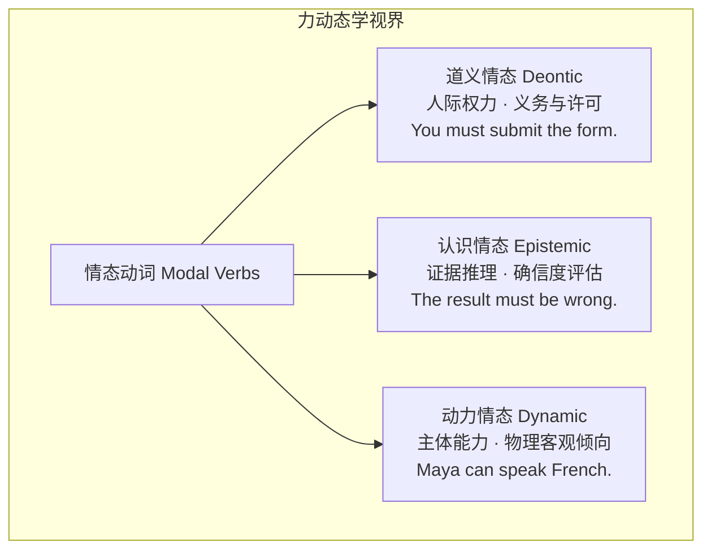


### 2.14.2 否定算子的作用范围（Scope of Negation）


否定副词（`not`, `never`）在句法树上是有明确管辖范围的**逻辑算子（Logical Operator）**。母语思维常导致否定范围错置，产生严重逻辑偏误：


<div class="subtopic-lead" id="s-2-14-2-1"><span class="subtopic-bar">▍</span> <strong>2.14.2.1 道义情态中的禁止 vs 无义务</strong></div>


* **`must not`（强力禁止）**：否定算子作用于后接的动作命题本身，禁止发生该行为：


  * `You must not enter.`（禁止进入！——义务要求你“不进入”）。


* **`do not have to`（撤销义务）**：否定算子作用于义务本身，解除社会压力：


  * `You do not have to enter.`（你不必进入。——不存在进入的强制义务，去不去由你决定）。[must 与无义务辨析](https://dictionary.cambridge.org/pl/grammar/british-grammar/must)


<div class="subtopic-lead" id="s-2-14-2-2"><span class="subtopic-bar">▍</span> <strong>2.14.2.2 否定算子与全称量词（Partial vs Complete Negation）</strong></div>


* **部分否定（Partial Negation）**：否定算子管辖全称量词 `all / every / both`：


  * `Not all students passed the exam.`（并非所有学生都通过了考试。——*推导*：有些学生通过了，有些学生没通过）。


* **全称否定（Total Negation）**：否定算子作用于个体存在量：


  * `No students passed the exam.`（没有学生通过考试。——*推导*：通过率为零）。


<div class="subtopic-lead" id="s-2-14-2-3"><span class="subtopic-bar">▍</span> <strong>2.14.2.3 否定命题 vs 否定主张（Negative Scope in Attribution）</strong></div>


在学术转述与考场阅读中，必须严密区分“对主句言语行为的否定”与“对宾语从句事实的否定”：


* `Scientists did not claim that the method was safe.`（科学家并未声称该方法是安全的。）


  * *严格逻辑推导*：被否定的是“作出安全主张”这一动作本身，意为“科学家并未声称过该方法安全”。


  * *禁忌反推*：**绝对不能由此推出“科学家声称该方法不安全”！** 科学家可能保持沉默，可能认为尚无定论。不能将主句谓语否定擅自挪入从句内部。


### 2.14.3 改写与命题保真四步法与写作核验清单

在学术改写、摘要压缩或主旨提炼时，按以下四步捍卫命题保真度：

1. **第一步：画出命题骨架**。清晰列出：`主体 + 态度标记（认识/道义情态） + 核心命题 + 条件/数量范围`。
2. **第二步：严守证据强度**。材料用 `may / might`（可能性），改写严禁升级为 `proves / confirms`（确定性）；材料用 `many`，改写严禁偷换为 `all`。
3. **第三步：标定否定算子落脚点**。明确否定词究竟是在否定主句态度、从句命题，还是仅仅部分否定量词范围。
4. **第四步：消除歧义分裂句**。若短语位置可能导致修饰歧义，果断改用带清晰层次的完整从句，确保主客体与情态作用范围绝无混淆。

<div class="subtopic-lead" id="s-2-14-3-1"><span class="subtopic-bar">▍</span> <strong>2.14.3.1 同一句话的情态与否定组合：只准在原命题范围内改写</strong></div>

把“义务 + 否定”的四种组合放在一起，注意每种组合允许推出什么、禁止推出什么：

| 组合 | 句子 | 允许推出 | 禁止推出 |
|---|---|---|---|
| must + 无否定 | `You must enter.` | 有进入的义务 | —— |
| must + not（否定动作） | `You must not enter.` | 禁止进入，义务要求“不进入” | 禁止反推“你没有义务进入”（恰恰相反，义务很重） |
| not + have to（否定义务） | `You don't have to enter.` | 没有进入义务，可去可不去 | 禁止反推“你被禁止进入”（你仍可选择进入） |
| can + not（否定能力/许可） | `You cannot enter.` | 没有能力或许可进入 | 与 must not 接近但语力来源不同（能力/许可 vs 义务） |

**推导**：否定词只在它实际管辖的范围内起作用。改写时先把“否定词”和“它否定的对象”分别圈出，再决定命题含义；把否定在义务和动作之间挪动，哪怕只差一个词，也是完全不同的命题。

<div class="subtopic-lead" id="s-2-14-3-2"><span class="subtopic-bar">▍</span> <strong>2.14.3.2 转述他人观点时的命题保真：不替对方补结论</strong></div>

在摘要与主旨提炼中，转述含否定的观点时最容易“替对方把话说满”。下面三步示范如何守住边界：

1. **原句**：`The authors did not prove that the treatment was effective.`
   被否定的是“prove（作出证明）”这个动作，不是 treatment 的有效性；
2. **允许的保真改写**：`The authors failed to provide proof of effectiveness.`（仍只说“没有证明”，不下疗效结论）；
3. **禁止的越界改写**：`*The authors proved that the treatment was ineffective.`（这把“没证明有效”偷换成“证明了无效”，是两个相反的命题）。

**边界**：同样的道理适用于 `not say / not believe / not confirm`——沉默或未证实都不构成对反面的支持。转述检查时，把原句的否定落脚点与改写稿逐一核对；若改写稿多出了原句没有的结论（即使“听起来很合理”），就必须删回。

<div class="subtopic-lead" id="s-2-14-3-3"><span class="subtopic-bar">▍</span> <strong>2.14.3.3 量词与否定：先还原管辖范围再改写</strong></div>

遇到 `all / every / some / none` 与否定同现，先按“否定管辖量词”还是“量词管辖否定”还原命题：

* `Not every experiment succeeded.` = 否定管辖 every → 部分否定：至少有一个没成功（也允许有成功的）；
* `Every experiment did not succeed.` = 口语歧义，规范理解应改为 `No experiment succeeded.`（全部失败）或 `Not every experiment succeeded.`（部分失败），写作中不要保留这种歧义；
* `Some students did not finish.` = some 管辖否定：存在没完成的学生（不能推出“全部没完成”，也不能推出“其余都完成了”）。

---

### 2.14.4 虚拟语气与反事实心智空间：从条件假设到省略倒装 (Subjunctive Mood & Counterfactual Mental Spaces)

在语言学与认知语法中，**虚拟语气（Subjunctive Mood）** 绝不是机械的死记硬背公式，而是人类心智在认知世界中构建**反事实心智空间（Counterfactual Mental Spaces，G. Fauconnier）** 的核心语法机制。

#### 1. 认知动因：时态后移是“认知距离（Epistemic Distance）”的外化
为什么表达与现在事实相反要用“一般过去时”、表达与过去事实相反要用“过去完成时”？
认知语言学揭示：**英语动词的过去标记（Past Tense Marker）不仅用于标示物理时间上的“过去”，更用于标示心智认知上的“疏离度（Remoteness）”**。说话人为了提醒听话人“我所说的场景并非当前现实，而是一个架空的心智假设空间”，刻意将动词的时态向更深处倒退一格（Tense Backshifting）。

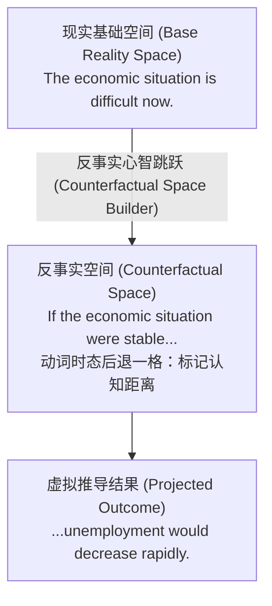

#### 2. 三大基本反事实空间与错综时间条件句（Mixed Conditionals）
1. **与现在事实相反（Hypothetical Present）**：
   - 规则：条件从句用 `were / did`，主句用 `would / could / might + do`。
   - `If the public transportation system were more reliable, fewer residents would commute by private car.`（如果公共交通系统更可靠一些，自驾通勤的居民就会更少——现实是当前不够可靠）。
2. **与过去事实相反（Counterfactual Past）**：
   - 规则：条件从句用 `had done`，主句用 `would / could / might + have done`。
   - `Had the meteorological department issued an early warning, the coastal towns would have evacuated residents in time.`（若气象部门早前发布了预警，沿海城镇本可以及时疏散居民——现实是当时未发布预警）。
3. **与将来设想相反（Hypothetical Future）**：
   - 规则：从句用 `were to do / should do / did`，主句用 `would / could + do`。
   - `Were the regulatory commission to impose a blanket ban tomorrow, the tech sector would experience severe disruption.`（假使监管委员会明天出台全面禁令，科技行业将遭受重创）。
4. **错综时间条件句（Mixed-Time Conditionals——考场与高阶学术阅读重难点！）**：
   - **模式 A（过去假设影响现在结果）**：从句针对过去（`had done`），主句针对当下现实（`would do now`）：
     - `If the government had invested in flood defenses five years ago, the city would not face such catastrophic damage today.`（如果政府五年前投资了防洪设施，这座城市今天就不会面临如此灾难性的破坏。）
   - **模式 B（持久稳态属性制约过去偶发事件）**：从句针对当前长期属性（`were / did`），主句针对过去动作（`would have done`）：
     - `If the research team were not so committed to rigor, they might have published flawed results last year.`（若该研究团队不是如此坚守严谨品质，他们去年可能就已经发表了存在缺陷的数据。）

#### 3. 省略 if 的虚拟条件倒装（Inverted Conditionals——学术与考场高分利器！）
在正式学术文体和考场议论文中，母语者极少保留繁琐的 `If`，而是直接**将助动词/系动词前置到句首，同时省去 `if`**。这是提分和阅读长难句断句的必杀技：
- **过去虚拟倒装**：`If S had done...` $\to$ **`Had S done...`**
  - `Had the central bank not intervened aggressively in 2008, the global banking system might have collapsed.`（若非央行在 2008 年大举干预，全球银行体系当时可能已经崩溃。）
- **现在/将来虚拟倒装**：`If S were to do...` $\to$ **`Were S to do...`** / `If it were not for...` $\to$ **`Were it not for...`**
  - `Were the polar ice caps to melt completely, sea levels would rise by tens of meters.`（假使极地冰盖完全融化，海平面将上升数十米。）
  - `Were it not for their unwavering support, the project could never proceed.`（若非他们坚定不移的支持，该项目绝不可能推进。）
- **可能/或然虚拟倒装**：`If S should do...` $\to$ **`Should S do...`**
  - `Should any discrepancy arise during the audit, the compliance officer must be notified immediately.`（在审计过程中万一出现任何出入，必须立即通知合规主管。）

#### 4. 介词短语与话语转折构成的“含蓄条件虚拟”（Implied Conditionals）
很多时候，条件并不以 `if` 从句出现，而是被浓缩进介词短语或副词转折中：
- **介词含蓄条件**：
  - `Without / But for / In the absence of + 名词短语, S would (have) done...`：
    - `Without prompt medical intervention, the patient would not have survived the cardiac arrest.`（若没有及时的医疗干预，患者在心脏骤停时绝无生还可能——实际得到了救治）。
    - `In the absence of stringent antitrust enforcement, market monopolies would inevitably stifle technological innovation.`（若缺乏严格的反垄断执法，市场垄断势必扼杀科技创新）。
- **连词转折含蓄条件**：
  - `Statement A; otherwise / or else, S would (have) done...`：
    - `The emergency backup generators activated instantly; otherwise, the hospital's intensive care units would have suffered a catastrophic blackout.`（应急备用发电机瞬间启动了；否则，医院重症监护室就会遭遇灾难性的停电断电。）

#### 5. 名词性从句中的虚拟语气（Mandative Subjunctive）
在表示“建议、要求、命令、坚持、紧迫性”的动词、名词或形容词后引出的 `that` 从句中，动词一律使用**动词原形（Base Form，英式英语常省略 `should`）**：
- **核心动词矩阵**：`insist, suggest, recommend, propose, demand, require, mandate, order, request`
  - `The environmental commission recommended that the chemical plant (should) suspend operations pending safety verification.`（环保委员会建议化工厂在安全核查完成前暂停运营——用原形 `suspend`，严禁加 `-s` 或过去式）。
- **紧迫性与重要性形式主语构式**：`It is imperative / vital / crucial / essential / desirable that S (should) do...`
  - `It is imperative that regulatory agencies (should) establish transparent carbon accounting metrics.`（监管机构亟需建立透明的碳核算指标。）
- **高频固定习语虚拟**：
  - `It is (high) time that S did / should do...`（该是……的时候了——从句用一般过去时）：`It is high time that local governments took decisive action against illegal dumping.`
  - `would rather S did / had done...`（宁愿/但愿某人做/做过某事）：`The committee would rather the preliminary findings had remained confidential until peer review was finalized.`

> [!cn-theory]
> **配套训练指引**：本节理论直接支撑练习全书第2篇 **2.10节（第76—88题）** （涵盖情态认知域辨析、否定辖域、反事实心智空间构建、错综时间虚拟、省略 `if` 的虚拟倒装、含蓄虚拟与强制性虚拟改写）。完成训练后，请对照练习全书 **2.12节【2.12.10 情态、否定与范围参考答案】** 进行复核。

---

> [!cn-practice]
> **配套练习**：练习全书第2篇 2.10节【情态、否定与范围】（第76—88题）。精准掌握道义/认识情态语义辖域、反事实心智空间、错综条件与省略 `if` 虚拟倒装。核对 2.12节【2.12.10】。

## 2.15 疑问构式与提问体系：从信息缺口到算子移位

在掌握了基本句型（2.11）、指称锚定（2.12）、时体视界（2.13）以及情态与否定算子（2.14）之后，我们迎来了基础句法的最后一块核心拼图——**疑问构式（Interrogative Constructions）与提问体系**。无论是日常口语交际、高考咨询信与建议信写作，还是学术演讲中的设问推进，精准、得体地提出问题都是一项不可替代的核心能力。

### 2.15.1 提问的认知本质与“算子前置”总公式（The Operator-First Engine）

从认知语言学视角看，**陈述句（Declarative）**提供一个封闭、自足的命题图景；而**疑问句（Interrogative）**则是在命题图景中标示出一个**信息缺口（Information Gap）**——说话人要么对整个命题的真假存疑（寻求“是/否”确认），要么对事件中的某个具体参与者、时空坐标或因果方式存疑（寻求填充未知变量 $x$）。

中英文在表达“疑问”时存在根本性的认知语序差异：
- **汉语采用“原位提问（Wh-in-situ）+ 句尾语气词”策略**：汉语提问时不改变陈述句原有的主谓宾语序，要么直接在句末加语气词“吗/呢”（如“你昨天交了报告**吗**？”），要么把疑问词直接放在原本答案所在的槽位上（如“你昨天把报告交给了**谁**？”）。
- **英语采用“句首亮明信号（Fronting & Inversion）”策略**：为了减轻听者在长句加工中的认知等待负担，英语要求**在句子最开头就立刻亮出“这是一个问句”的语法信号**——具体操作就是把**助动词算子**（Operator）提至主语之前，并把代表未知信息缺口的**疑问词组块**（Wh-Chunk）进一步提至助动词之前。

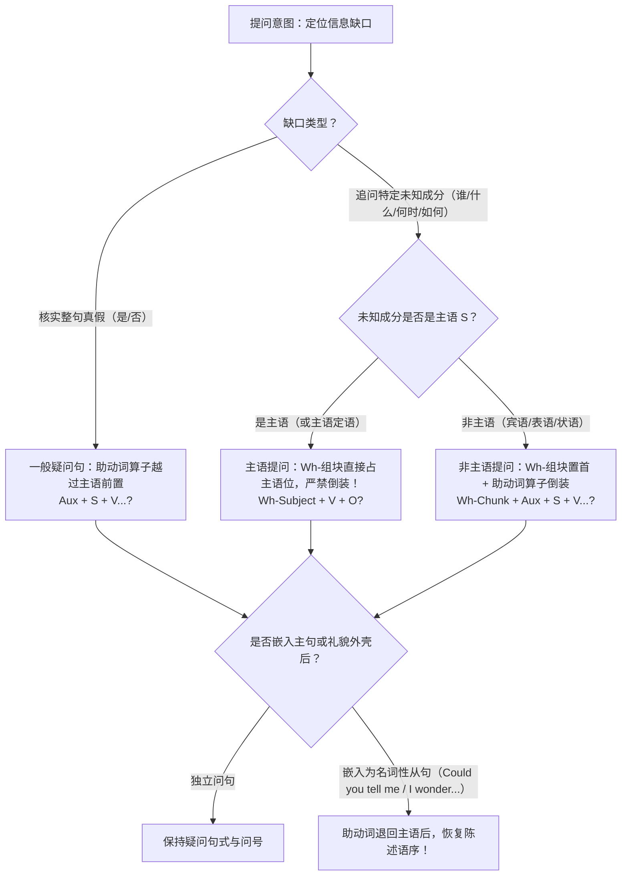

除“对主语提问”和“陈述语序升调问”外，几乎所有标准英文独立问句都严格遵循同一条**算子前置黄金总公式**：

$$\text{[疑问词组块 Wh-Chunk]} + \text{助动词算子 (Aux)} + \text{主语 (S)} + \text{谓语动词核心 (V)} + \text{其余成分？}$$

这里的**助动词算子**（Operator / Aux）共有四类来源：
1. **系动词 `be`（`am / is / are / was / were`）**：本身兼具算子功能，直接移至主语前；
2. **时体助动词 `have / has / had` 或进行/被动助动词 `be`**：提取第一个助动词移至主语前；
3. **情态助动词（`can / could / will / would / shall / should / may / might / must`）**：直接移至主语前；
4. **实义动词的 `Do-support`（助动词 `do / does / did` 支援机制）**：当原句只有光杆实义动词（如 `submitted`、`works`）而没有任何现成助动词时，英语严禁把实义动词直接提到主语前（不能写 `*Submitted Maya the report?`），必须临时召唤助动词 **`do / does / did`** 移至句首承担时态与人称标记，同时**原实义动词必须彻底还原为动词原形**！

---

### 2.15.2 第一类：一般疑问句（Yes/No Questions）与否定疑问句（Negative Questions）

#### 1. 一般疑问句的四通道转换矩阵

一般疑问句用于核实整个命题是否成立，句首不带 `Wh-` 疑问词，直接以助动词算子开篇，句末通常读**升调（$\nearrow$）**：

| 原陈述句谓语类型 | 陈述句原句 | 一般疑问句（算子前置） | 句法转换核心要点 |
|---|---|---|---|
| **系动词 `be`** | `The new protocol is reliable.`（新方案是可靠的。） | **`Is`**` the new protocol reliable?`（新方案可靠吗？） | 系动词 `be` 直接越过主语移至句首，无需借用 `do` |
| **时体助动词 `have / be`** | `The researchers have verified the raw data.`（研究人员已核实原始数据。） | **`Have`**` the researchers verified the raw data?`（研究人员核实原始数据了吗？） | 仅将第一个助动词 `Have` 提至句首，过去分词 `verified` 留在原位 |
| **情态助动词** | `Autonomous vehicles can operate safely in heavy fog.`（自动驾驶汽车能在浓雾中安全行驶。） | **`Can`**` autonomous vehicles operate safely in heavy fog?`（自动驾驶汽车能在浓雾中安全行驶吗？） | 情态动词 `Can` 直接移至句首，后方实义动词保持原形 `operate` |
| **纯实义动词（`Do-support`）** | `The committee approved the revised budget yesterday.`（委员会昨天批准了修订预算。） | **`Did`**` the committee `**`approve`**` the revised budget yesterday?`（委员会昨天批准修订预算了吗？） | 借用过去时助动词 `Did` 置于句首，原过去式 `approved` **必须还原为原形 `approve`** |

#### 2. 否定一般疑问句（Negative Yes/No Questions）与回答防坑指南

在一般疑问句中融入否定算子，即可构成**否定一般疑问句**。它在交际中绝不仅仅是单纯询问，而是自带强烈的**惊讶、质疑、反诘或期待对方给予肯定认同**的语用色彩：
- **缩略形式（日常交际与标准书面最常用，`-n't` 紧跟助动词一起前置）**：
  - `Don't you agree that early intervention is crucial?`（难道你不同意早期干预至关重要吗？——表达惊讶或寻求认同）
  - `Isn't this the very hypothesis that was refuted last year?`（这难道不正是去年被推翻的那个假说吗？——表达强烈质疑）
  - `Haven't the auditors finished reviewing the financial statements yet?`（审计人员难道还没审阅完财务报表吗？——表达意外与催促）
- **非缩略形式（极正式文体，`not` 留在主语之后）**：
  - `Did the regulatory agency not warn the firm about potential compliance risks?`（监管机构难道没有警告过该公司潜在的合规风险吗？）

> [!WARNING]
> **中英回答逻辑的重大陷阱：面对否定疑问句，严禁写出 `*Yes, I didn't`！**  
> 汉语的“是/对”与“不”针对的是**对方话语的表述是否正确**（“你昨天没交报告吗？” → “**对**，我没交”）；而英语的 `Yes` 和 `No` 严格绑定**客观事实本身的肯定或否定**，与问句是否带否定词毫无关系！  
> - 问句：`Didn't you submit the application form yesterday?`（你昨天没交申请表吗？）  
>   - **如果你交了**：**`Yes, I did.`**（**不**，我交了。——事实为肯定，前后必须同为肯定 `Yes + did`）  
>   - **如果你没交**：**`No, I didn't.`**（**对**，我没交。——事实为否定，前后必须同为否定 `No + didn't`）

---

### 2.15.3 第二类：特殊疑问句（Wh-Questions）全景矩阵与“组块打包移位”

当说话人已知事件的大致框架，但需要锁定其中某一个特定未知参数时，使用**特殊疑问句（Wh-Questions）**，句末通常读**降调（$\searrow$）**。

#### 1. 核心疑问词与 `How + Adj/Adv` 度量提问全家族

| 疑问词 / 疑问组块 | 追问的语义角色与认知维度 | 典型标准问句示范（附中文译文） | 辨析与用法要点 |
|---|---|---|---|
| **`who / whom`** | 人（主格 / 宾格） | `Who authorized the emergency transfer?`（谁批准了这笔紧急转账？）<br/>`Whom ( / Who) did the board appoint as the new director?`（董事会任命了谁担任新主任？） | 作主语必用 `who`；作动词或介词宾语时，正式书面语用 `whom`，日常口语可用 `who` |
| **`whose`** | 所属关系（谁的……） | `Whose research findings were cited in the opening keynote?`（开幕主旨演讲中引用了谁的研究成果？） | 常紧接名词构成 `Whose + N` 组块整体前置 |
| **`what` vs. `which`** | 事物/性质（无界开放 vs. 有界选择） | `What books do you enjoy reading in your spare time?`（你业余时间喜欢读什么书？——无预设范围）<br/>`Which of these three proposals do you find most feasible?`（在这三份提案中，你认为哪一份最可行？——明确限定范围） | 范围开放未知用 `what`；在给定的有限集合中挑选必用 `which` |
| **`when / where / why`** | 时间 / 空间 / 原因与目的 | `When will the updated guidelines take effect?`（更新后的指南何时生效？）<br/>`Where did the archaeological team unearth the bronze vessels?`（考古队在哪里发掘出了这些青铜器？）<br/>`Why did the inflation rate rebound so sharply in March?`（为什么通胀率在三月份如此急剧地反弹？） | 均为疑问副词，在句中充当状语，后接 `助动词 + 主语 + 谓语` |
| **`how`（单独使用）** | 手段方式 / 运行机制 / 状态评估 | `How does chronic sleep deprivation impair memory consolidation?`（慢性睡眠剥夺是如何损害记忆巩固的？）<br/>`How did the negotiations go yesterday?`（昨天的谈判进展得怎么样？） | 既可问“通过什么手段/机制”，也可问“状况/感受如何” |
| **`how long`** | 时间跨度（持续多久）/ 物体长度 | `How long has the interdisciplinary project been underway?`（这项跨学科项目已经开展多久了？） | 常与完成时或持续性动词连用，回答用 `for + 时间段` 或 `since + 时间点` |
| **`how often`** | 发生频率（多久一次） | `How often do the safety inspectors calibrate the sensors?`（安全检查员多久校准一次传感器？） | 回答用 `twice a week / every three months / regularly` 等频率状语 |
| **`how soon`** | 未来倒计时（再过多久才……） | `How soon can the relief supplies reach the flood-stricken county?`（救援物资再过多久能抵达受灾县？） | 聚焦“从现在算起多久之后发生”，常配一般将来时或 `can`，回答用 `in + 时间段`（如 `in two hours`） |
| **`how far`** | 物理距离或抽象进展程度 | `How far is the temporary shelter from the nearest hospital?`（临时避难所距离最近的医院有多远？） | 追问空间距离或事态发展的程度边界 |
| **`how many / how much`** | 数量（可数复数 / 不可数或价格程度） | `How many peer-reviewed studies were included in the meta-analysis?`（这项元分析纳入了多少项同行评审研究？）<br/>`How much funding did the municipal government allocate to public transit?`（市政府为公共交通拨款多少资金？） | `how many + 复数名词`，`how much + 不可数名词`（或单独作状语/问价格） |

#### 2. 核心难点突破一：对“主语”提问 vs. 对“非主语”提问（严防画蛇添足加 `do`！）

这是中国学习者在造特殊疑问句时最容易出错的分水岭：
- **当疑问词（或疑问词组块）本身充当句子的“主语（Subject）”时**：疑问词本来就位于句首主语 S 的位置上，没有发生跨过主语的移位，因此**直接保持“疑问主语 + 限定谓语动词 + 宾语”的正常陈述语序，严禁添加助动词 `do / does / did`！**
- **当疑问词充当“宾语、表语或状语”时**：疑问词从谓语后方跨越主语移到了句首，因此**必须触发助动词算子倒装（无助动词时添加 `do / does / did`）**。

请仔细对比以下四组**主语提问 vs. 宾语/状语提问**最小对立体：

- **对比组 A（`Who` 作主语 vs. 作宾语）**：
  - 对主语提问（谁引发了事故？）：✅ `Who caused the laboratory accident?`（❌ 严禁写 `*Who did cause the laboratory accident?`）
  - 对宾语提问（事故影响了谁？）：✅ `Who(m) did the laboratory accident affect?`（`accident` 是主语，`Who(m)` 是 `affect` 的宾语，必须加 `did` 倒装）
- **对比组 B（`What` 作主语 vs. 作宾语）**：
  - 对主语提问（什么导致了断电？）：✅ `What triggered the sudden power outage across the campus?`（❌ 严禁写 `*What did trigger...?`）
  - 对宾语提问（工程师发现了什么？）：✅ `What did the engineers discover during the routine inspection?`
- **对比组 C（`Which + 名词` 作主语 vs. 作宾语）**：
  - 对主语提问（哪个部门负责此事？）：✅ `Which department handles international student visas?`（`Which department` 整体是单数主语，谓语直接用三单 `handles`）
  - 对宾语提问（你联系了哪个部门？）：✅ `Which department did you contact yesterday?`
- **对比组 D（`How many + 名词` 作主语 vs. 作宾语）**：
  - 对主语提问（多少专家出席了会议？）：✅ `How many experts attended the summit?`
  - 对宾语提问（主办方邀请了多少专家？）：✅ `How many experts did the organizers invite to the summit?`

#### 3. 核心难点突破二：疑问组块整体打包移位（Wh-Chunk Pied-Piping）与介词前置/留尾

1. **向心名词组块整体移位**：当 `what / which / whose / how many / how much` 作为限定词修饰名词，或 `how` 修饰形容词/副词时，它们与被修饰词构成一个不可拆散的向心短语（Wh-Phrase）。提问时必须将**整个短语组块打包移至句首**，绝不能把名词孤零零留在后面：
   - ❌ 错误拆散：`*What kind did the team collect of evidence?` / `*How many did they interview witnesses?`
   - ✅ 整体打包移位：`[What kind of empirical evidence] did the research team collect?`（研究团队收集了什么类型的实证证据？）
   - ✅ 整体打包移位：`[How gravely] could this supply-chain disruption affect small manufacturers?`（这次供应链中断会对小型制造商造成多严重的影响？）
2. **对介词宾语提问的两种合法姿态**：当未知信息是介词（如 `to, with, for, on, from, about, in`）的宾语时，英语根据**语体正式度**提供两种问法：
   - **自然口语与通用文体——介词留尾（Preposition Stranding）**：疑问词单独移至句首，介词留在动词或形容词原位：
     - `What is your conclusion based on?`（你的结论是基于什么得出的？）
     - `Which hospital does Dr. Lin work at?`（林医生在哪家医院工作？）
     - `Who did you share the confidential report with?`（你把那份机密报告分享给谁了？）
   - **正式学术与公文文体——介词前置（Pied-Piping，吹笛者移位）**：将介词与疑问词一起打包提至句首（注意：指人时介词后必须用宾格 **`whom`**，指物时用 `what / which`，且表原因时不能写 `*For what`，而应写 `For what purpose` 或 `Why`）：
     - `On what assumptions is this macroeconomic forecast based?`（这一宏观经济预测是基于什么假设得出的？）
     - `To whom should applicants submit their supporting documents?`（申请人应当向谁提交证明材料？）
     - `Through which mechanisms does regular aerobic exercise enhance neuroplasticity?`（规律的有氧运动是通过哪些机制增强神经可塑性的？）

---

### 2.15.4 第三类：选择疑问句（Alternative Questions）与第四类：反意疑问句（Tag Questions）

#### 1. 选择疑问句（Alternative Questions）：提供显性候选集的二选一/多选一

选择疑问句使用并列连词 **`or`** 提供两个或多个候选选项，要求对方从中作出选择（**不能用 `Yes` 或 `No` 回答**，语调为 `or` 前升调 $\nearrow$、`or` 后降调 $\searrow$）：
- **模式一：一般疑问句直接串联选项**：
  - `Will the seminar be held in the main auditorium `**`or`**` online via video conference?`（研讨会将在主礼堂举行，还是通过视频会议在线举行？）
  - `Did the decline in sales result from rising prices, fierce competition, `**`or`**` shifting consumer preferences?`（销售额下滑是源于价格上涨、激烈竞争，还是消费者偏好的转变？）
- **模式二：特殊疑问句 + 句尾补充对比选项（学术与议论高频句型）**：
  - `Which factor plays a more decisive role in adolescent mental health, `**`family environment or peer relationships`**`?`（在青少年心理健康中，哪个因素起着更决定性的作用——家庭环境还是同伴关系？）

#### 2. 反意疑问句 / 附加疑问句（Tag Questions）：极性镜像与五大高阶特例

反意疑问句由“**陈述句主干 + 逗号 + 简短附加问句**（助动词 + 主语代词）”构成，基本铁律是“**前肯后否，前否后肯；时态、助动词与人称代词严格镜像对齐**”：
- 前肯后否：`The revised safety regulations will take effect next month, `**`won't they`**`?`（修订后的安全法规将于下月生效，不是吗？）
- 前否后肯：`Dr. Patel hasn't published the follow-up data yet, `**`has she`**`?`（帕特尔博士还没有公布后续数据，对吗？）

在考场与高阶应用中，必须重点掌握以下**五大核心特例**：
1. **特例一：含隐性否定词（`hardly / never / seldom / scarcely / rarely / few / little / nothing / nobody`）—— 视为“前否”，附加问句必用“肯定”！**
   - `The preliminary survey rarely captured rural households, `**`did it`**`?`（初步调查很少覆盖到农村家庭，是吗？——`rarely` 已表否定，后面严禁用 `*didn't it`）
   - `Few investors anticipated such an abrupt policy reversal, `**`did they`**`?`（几乎没有投资者预料到如此突然的政策转向，是吧？——`Few` 表否定）
2. **特例二：祈使句的附加疑问句**：
   - 普通肯定/否定祈使句（表请求或提醒）：用 **`will you`**（最通用）或 `won't you / can you`：
     - `Please double-check the citation format before submitting, `**`will you`**`?`（提交前请再核对一下引用格式，好吗？）
     - `Don't forget to back up the experimental logs, `**`will you`**`?`（别忘了备份实验日志，好吗？）
   - `Let's...`（包括听话人在内的共同建议）vs. `Let us...`（请求对方允许自己做某事）：
     - `Let's synthesize the key findings in a table, `**`shall we`**`?`（咱们把核心发现汇总成一张表，好吗？）
     - `Let us know if you need any further assistance, `**`will you`**`?`（如果您需要任何进一步帮助，请告知我们，好吗？）
3. **特例三：`There be` 存在句——保留 `there` 作附加问句的形式主语**：
   - `There appears to be a strong correlation between the two variables, `**`doesn't there`**`?`（这两个变量之间似乎存在很强的相关性，不是吗？）
4. **特例四：`I think / believe / suppose / imagine + 宾语从句` —— 反意疑问看“从句”，否定转移看“全局”！**
   - 当主句主语是第一人称 `I / We` 且谓语为 `think / believe / suppose` 时，整句话的真实信息重心在后面的**宾语从句**，因此附加疑问句的助动词和代词必须与**从句主谓**对齐；同时，如果主句带有否定 `don't`，该否定已经转移到了从句上，故附加问句必须用**肯定形式**：
     - `I don't think the current infrastructure can withstand a Category 5 hurricane, `**`can it`**`?`（我认为现有基础设施经受不住五级飓风，是吧？——对准从句 `the current infrastructure can`，且因主句有 `don't`，故后用肯定 `can it`！）
     - 对比第三人称主句（不发生重心转移，仍对准主句）：`She doesn't think the plan will work, `**`does she`**`?`
5. **特例五：句末语调决定交际功能**：
   - 附加问句读**升调（$\nearrow$）**：表示说话人真的不确定，真诚向对方求证；
   - 附加问句读**降调（$\searrow$）**：表示说话人心中已有定论，只是邀请对方点头附和、达成共识。

---

### 2.15.5 第五类：礼貌间接问句与嵌入式疑问句（Polite & Embedded Questions）

在正式邮件（如高考咨询信、学术联络信、职场沟通）或礼貌口语中，连续抛出赤裸裸的直接问句（如 `What is the fee? When does it start? Where should I go?`）会显得像审讯一样生硬唐突。地道英语通常在问句外层加装一层“**礼貌缓冲外壳**”（Polite Epistemic Frames），将其转化为**间接问句 / 嵌入式疑问从句**（Embedded Questions）。

#### 1. 两大黄金转换铁律（必考红线！）

当一个独立问句被嵌入礼貌外壳（如 `Could you tell me...`）或认知动词/形容词（如 `know / wonder / ask / explain / uncertain`）之后，它就不再是独立主句，而变成了**宾语从句**，必须同时执行两项语法转换：
1. **铁律一（语序还原）**：**助动词必须退回主语之后，恢复“主语 + 谓语”的陈述语序**（如果是借来的助动词 `do / does / did`，则必须彻底解散，把时态和单复数还给实义动词）！
2. **铁律二（引导词补齐）**：原句若是特殊疑问句，直接保留 `wh-` 疑问词作连接词；原句若是一般疑问句（无 `wh-` 词），必须补入从属连词 **`whether` 或 `if`**（表示“是否”）。

| 提问类型 | 直接问句（独立主句：助动词倒装） | 礼貌间接问句 / 嵌入式疑问句（从句：恢复陈述语序！） | 转换诊断与避坑要点 |
|---|---|---|---|
| **一般疑问句嵌入** | `Is the scholarship open to international applicants?`（该奖学金对国际申请人开放吗？） | `Could you please let me know `**`whether / if the scholarship is open`**` to international applicants?`（请问您能否告知该奖学金是否对国际申请人开放？） | 补入 `whether / if`，系动词 `is` 退回主语 `the scholarship` 之后 |
| **`be / 情态 / have` 特殊问句嵌入** | `When will the registration portal close?`（报名门户网站何时关闭？） | `I would appreciate it if you could tell me `**`when the registration portal will close`**`.`（如您能告知报名网站何时关闭，我将不胜感激。） | 情态动词 `will` 退回主语 `the registration portal` 之后（严禁写 `*when will the portal close`） |
| **`do / does / did` 特殊问句嵌入** | `Why did the committee reject the initial design?`（委员会为什么否决了初步设计？） | `Many stakeholders are wondering `**`why the committee rejected`**` the initial design.`（许多利益相关者都想知道委员会为何否决了初步设计。） | 助动词 `did` 解散消失，过去时标记还给实义动词变为 **`rejected`**（严禁写 `*why did the committee reject`） |
| **疑问词本身作主语的问句嵌入** | `What caused the server malfunction?`（什么导致了服务器故障？） | `The technicians are investigating `**`what caused`**` the server malfunction.`（技术人员正在调查是什么导致了服务器故障。） | 原句 `What` 本身就是主语（本来就是陈述语序），嵌入后语序保持不变 |

#### 2. 实用礼貌提问外壳语体梯度表（高考应用文与日常交际直接套用）

- **半正式通用级**：`Could you tell me + wh- / whether + 陈述语序?` / `Do you happen to know + wh- / whether + 陈述语序?`（您碰巧知道……吗？）
- **高分书信得体级**：`I was wondering if / whether + 陈述语序.`（我想请问是否……——注意此句型本身是陈述句外壳，**句末用句号 `.`**！）
- **动名词礼貌级**：`Would you mind telling / explaining to me + wh- + 陈述语序?`（您介意告诉我/向我解释……吗？）
- **正式公文/学术咨询级**：`I would be grateful if you could clarify + wh- / whether + 陈述语序.`（如蒙您澄清……，我将不胜感激。）

---

### 2.15.6 第六类：跨小句长距离提问（Long-Distance Extraction）与第七类：陈述问句、回声问句及修辞设问

#### 1. 跨小句长距离提问（`Wh- + do you think / say / believe + 陈述语序`）

当我们要对 `think / believe / suppose / say / imagine / expect` 后面**宾语从句中的某个成分**提问时（例如：“你认为谁会赢得比赛？”或“他说文件放在哪里了？”），英语严禁像中文那样把疑问词留在从句里（不能写 `*Do you think who will win?`），而必须执行**跨小句长距离提取（Long-Distance Wh-Extraction）**：
- **生成公式**：**`疑问词组块（Wh-Chunk）+ do/did + 主句主语 + think/say/believe + 从句剩余部分（陈述语序）？`**
  - ✅ `Who `**`do you think`**` will be appointed as the chief negotiator?`（你认为谁会被任命为首席谈判代表？——`Who` 从从句主语位置跨过 `do you think` 提至全句最前端）
  - ✅ `What `**`did the witnesses say`**` the suspect was carrying at the time?`（目击者说嫌疑人当时手里拿着什么？——`What` 原是 `carrying` 的宾语，提至句首；`did the witnesses say` 负责倒装，后面的 `the suspect was carrying` 严格保持陈述语序！）
  - ✅ `Where `**`do you suppose`**` we should allocate the remaining funds?`（你觉得我们应该把剩余资金分配到哪里？）

#### 2. 口语中的陈述疑问句（Declarative Questions）与回声问句（Echo Questions）

在真实口语交流中，说话人常常省略句法倒装，转而依靠**语音语调**完成特定交际提问：
- **陈述疑问句（保持陈述语序 + 句末高升调 $\nearrow$）**：用于对刚刚听到的消息表示惊讶，或对十拿九稳的推测作快速确认：
  - `You've already finished drafting the entire twenty-page report?` $\nearrow$（你已经把整整二十页的报告初稿都写完了？！）
  - `Wait — the flight was canceled without any prior notice?` $\nearrow$（等等——航班在没有任何事先通知的情况下就取消了？）
- **回声问句（Echo Questions：将疑问词留在原位并施加强烈重读）**：当没听清对方说的某个关键信息，或对对方说的数字/人名感到极度震惊不可思议时使用：
  - A: `The startup was acquired for forty billion dollars.` → B: `It was acquired for `**`HOW MUCH`**`?!`（它被花了**多少钱**收购的？！）
  - A: `Professor Miller resigned yesterday.` → B: **`WHO`**` resigned yesterday?!`（**谁**昨天辞职了？！）

#### 3. 学术与演讲中的修辞反问（Rhetorical Questions）与设问（Hypophora）

在议论文、演讲稿（见第 6 篇）及学术论文导论（见第 4 篇）中，问句不仅是索取信息的工具，更是调度读者注意力、强化论证张力的修辞利器：
- **修辞反问句（Rhetorical Question，问而不答，答案不言自明）**：形式上是问句，语用实质上是**极性相反的强力断言**（肯定反问 = 强烈否定；否定反问 = 强烈肯定）：
  - `If algorithms trained on historical data merely replicate past prejudices, how can we claim that automated decision-making is inherently objective?`（如果用历史数据训练出的算法只是在复制过去的偏见，我们又怎能声称自动化决策天生就是客观的呢？——实质断言：绝不能声称其客观！）
  - `Who can deny that preserving linguistic diversity is tantamount to safeguarding the collective memory of humankind?`（谁能断然否认保护语言多样性就等同于守护全人类的集体记忆呢？——实质断言：无人能够否认！）
- **设问句（Hypophora，自问自答，引导段落主位推进）**：作者先主动抛出读者心中的核心疑问，紧接着在下一句给出权威解答，瞬间聚焦论述重心：
  - `Why, then, do so many well-intentioned conservation policies fail at the local level? The answer lies not in a lack of scientific data, but in the exclusion of indigenous communities from the decision-making process.`（那么，为什么如此多初衷良好的环保政策会在地方层面折戟沉沙？答案并不在于缺乏科学数据，而在于将原住民社区排斥在了决策过程之外。）

#### 4. 五大高频特殊疑问构式与压缩问法（强调句提问 / 特征三问 / 原因三问 / 提议反诘 / `Wh- + to do`）

1. **强调句提问构式（Cleft Questions：`Is/Was it X that...?` 与 `Wh- + is/was it that...?`）**：
   - **一般强调疑问句**：`Was it because of the sudden sensor failure that the launch was aborted?`（是因为传感器突发故障，发射才被中止的吗？）
   - **特殊强调疑问句**：**`疑问词 + is/was it + that + 剩余陈述部分？`**（注意：一旦该强调问句被嵌入 `Could you tell me` 等主句后，必须还原为 **`疑问词 + it is/was + that...`** 陈述语序！）：
     - 直接强调问句：`Who was it that leaked the confidential merger proposal to the press?`（究竟是谁把那份机密并购提案泄露给媒体的？）
     - 嵌入强调问句：`Could you tell me what it was that prompted the chief engineer to resign?`（您能告诉我究竟是什么促使总工程师辞职的吗？——严禁写 `*what was it that...`）
2. **人物与事物特征三问辨析（`What is X like?` vs. `What does X look like?` vs. `How is X?`）**：
   - **`What is X like?`**（追问**内在品质、性格特征或整体印象**，其中的 `like` 是介词“像……”）：`What is the new visiting professor like?`（新来的客座教授是个怎样的人？→ `She is rigorous yet approachable.`）
   - **`What does X look like?`**（专门追问**外貌长相或视觉外观**）：`What does the newly built digital library look like?`（新建的数字图书馆外观长什么样？）
   - **`How is X?`**（追问**身体健康状况、近期进展或体验感受**）：`How is your grandmother recovering after the surgery?`（你祖母手术后恢复得怎么样？）
3. **原因与目的提问三剑客（`Why...?` vs. `What... for?` vs. 口语 `How come + 陈述语序?`）**：
   - **`Why + 助动词倒装...?`**（通用原因提问）：`Why did the municipal council postpone the subway extension project?`（市政议会为何推迟地铁扩建项目？）
   - **`What + 助动词倒装 ... for?`**（追问**主观意图或具体用途**，等价于 `For what purpose...?`）：`What did the laboratory purchase three additional liquid-nitrogen tanks for?`（实验室添置三个液氮罐是用来做什么的？）
   - **`How come + 陈述语序 (S + V)?`**（地道口语中表达惊讶的“怎么会……？为什么……？”，**后接完整陈述语序，绝不倒装**！）：`How come the veteran team lost the opening match so easily?`（这支老牌劲旅怎么会如此轻易地输掉揭幕战？——严禁写 `*How come did the team lose...?`）
4. **提议、假设与否定特殊疑问（`Why not do...?` / `Why didn't you...?` / `What if...?`）**：
   - **`Why not + 动词原形...?`（= `Why don't we/you + 动词原形...?`）**：用于提出积极建议（`Why not integrate interactive case studies into the orientation workshop?` 何不把互动案例研究融入迎新工作坊呢？）；
   - **`Why didn't you / Why haven't they...?`**：否定特殊疑问句，既可询问未做某事的原因，也可表达轻微责备或遗憾（`Why didn't the contractor reinforce the embankment before the monsoon season?` 承包商为什么没有在雨季到来前加固堤坝？）；
   - **`What if + 陈述句（一般现在/过去时）?`**：用于提出假设性风险或备选方案（`What if the primary communication satellite loses signal during the critical maneuver?` 万一主通信卫星在关键机动过程中失去信号怎么办？）。
5. **`疑问词 + 不定式（Wh- + to do）` 高密度压缩构式**：
   - 当疑问从句的主语与主句主语或宾语一致，且从句含有“应该（`should`）/ 能够（`can/could`）”情态意味时，可将整个从句压缩为 **`what / how / where / when / whether + to do`** 短语（注意：**`why` 后不能接 `to do`**，且表示“是否做某事”时**只能用 `whether to do`，绝不能用 `*if to do`**！）：
     - `The white paper outlines `**`how to reconcile`**` rapid industrial automation with workforce retraining.`（白皮书概述了如何协调快速工业自动化与劳动力再培训。）
     - `The ethics board remained divided over `**`whether to disclose`**` the preliminary trial data immediately.`（伦理委员会在是否立即披露初步试验数据的问题上仍存在分歧。）

---

### 2.15.7 提问构建四步法与八大常见错误自检表

在写作或口语中构建任何问句时，可按以下**四步法**快速核验：
1. **第一步（定意图）**：明确是核实真假（一般疑问）、追问特定缺口（特殊疑问）、二选一（选择疑问），还是委婉咨询（礼貌嵌入问句）。
2. **第二步（查主语）**：若为特殊疑问句，先看未知缺口是不是**主语（或主语定语）**——若是主语，直接用“疑问词组块 + 谓语”陈述语序；若非主语，将整个疑问词组块打包移至句首。
3. **第三步（提算子）**：在独立非主语问句中，提取 `be / have / 情态动词` 或召唤 `do / does / did` 置于主语前（用 `do / does / did` 时，实义动词务必还原为原形）。
4. **第四步（检嵌入）**：若问句前加了 `Could you tell me / I wonder / Do you know` 等主句外壳，立即将助动词退回主语之后恢复陈述语序！

| 错误类型编号 | ❌ 典型中式提问病句 | ✅ 地道英文修正句 | 核心病理诊断 |
|---|---|---|---|
| **错误 1：实义动词硬移位或漏还原** | `*Did the committee approved the plan?` | `Did the committee `**`approve`**` the plan?` | 助动词 `Did` 已承载过去时态，后方实义动词必须还原为原形 `approve` |
| **错误 2：系表/情态句多余加 `do`** | `*Does the new sensor is accurate?` | **`Is`**` the new sensor accurate?` | 句中已有系动词 `is`，直接将 `Is` 提至句首，严禁叠加 `Does` |
| **错误 3：对主语提问画蛇添足加 `do`** | `*What did happen to the database?` | **`What happened`**` to the database?` | `What` 本身就是主语 S，不发生跨主语移位，严禁加 `did` |
| **错误 4：疑问组块拆散未整体移位** | `*How many did you read articles?` | **`How many articles`**` did you read?` | `How many articles` 是完整的向心名词短语，必须整体打包移至句首 |
| **错误 5：嵌入问句未恢复陈述语序** | `*Could you tell me where is the hall?` | `Could you tell me `**`where the hall is`**`?` | 嵌入 `Could you tell me` 后成为宾语从句，系动词 `is` 必须退回主语后 |
| **错误 6：长距离提问疑问词滞留** | `*Do you think who will win the prize?` | **`Who do you think`**` will win the prize?` | 含有 `do you think` 时，疑问词 `Who` 必须提取至全句最开头 |
| **错误 7：否定疑问句回答前后矛盾** | `*— Didn't he call? — Yes, he didn't.` | `— Didn't he call? — `**`No, he didn't.`**`（对，他没打。）` | 英文回答严格按客观事实：没打就是 `No, he didn't`，绝无 `*Yes, he didn't` |
| **错误 8：隐性否定句反意疑问极性错** | `*She hardly ever complains, doesn't she?` | `She hardly ever complains, `**`does she`**`?` | `hardly` 已表否定（前否），附加问句必须用肯定形式 `does she` |

> [!cn-practice]
> **配套训练指引**：本节理论直接对应练习全书第2篇 **2.11.3节【疑问构式与提问体系全景实战】（第105—124题）**（涵盖一般/否定疑问句及回答、主语 vs 宾语特殊提问、`How` 度量家族、介词前置与留尾、反意疑问特例、礼貌间接问句、长距离提问、强调句提问、特征/原因三问及 `Wh- + to do` 压缩）。完成后请对照 **2.12.12节** 详细解析进行核验。

---

<h1 id="sec-3">第3篇：介词修饰链：限定关系与组装</h1>

*(Prepositional Modification Chains: From Head Noun to Layered Determination)*

> [!cn-theory]
> **体系定位**：本篇集中讲解介词修饰链的认知机理、搭配配价、拓扑结构与组装法则，作为第 4 篇高级分叉与复合嵌套的前置基石。重点通过**六大空间意象图式 + 八组高频易混介词辨析 + 核心名词配价锁死表 + 串联/并联拓扑组装 + 五大断链瘦身手术**，帮助学习者彻底掌握“中心名词先行、修饰向右逐层延展”的地道英语编码机制。
>
> **核心公式**（常见向心信息排列参考，实际顺序须结合名词配价与依附关系灵活调度，详见 3.4.5 与 3.7 节）：
>
> $$\text{中心名词 (Head Noun)} \to \text{属性/受事补语 (of/in/to)} \to \text{专题内容 (on/into/for)} \to \text{施动主体 (by)} \to \text{时空边界 (in/at/across/during)}$$
>
> **配套练习**：见练习全书第 3 篇（3.1—3.5 节，共 55 题）及第 9 篇（9.2 节中英长定语互译实战）。

---

## 3.1 介词为什么这样配：意象图式与概念隐喻

前两篇解决了“句子主干怎么搭”和“短语修饰往右挂”。本篇聚焦英语最核心的后置扩展工具——**介词修饰链（Prepositional Modification Chains）**。但在记忆功能分类表之前，必须先回答一个更根本的认知问题：**为什么“处于困境”是 `in trouble` 而不是 `*on trouble`？为什么“关于句法学的学术讲座”用 `a lecture on syntax` 而“调查事故原因”却用 `an inquiry into the accident`？**

本节运用认知语言学的**意象图式**（Image Schema）与**概念隐喻**（Conceptual Metaphor）揭示介词搭配的底层理据：前者提炼人类身体与物理空间互动的骨架关系，后者将空间骨架系统性地投射至抽象思维域。

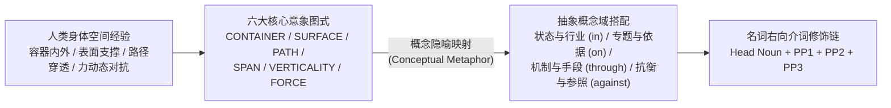

### 3.1.1 六大核心意象图式：身体经验压成的空间骨架

**意象图式**（Image Schema）是人类在日常感知与身体运动中反复体验而沉淀下来的基本空间拓扑模式。虽然不同语言对空间关系的切分角度不完全相同（遇到生疏搭配仍须核对词典），但掌握以下**六大核心空间图式**，能让你对 80% 以上的英语抽象介词搭配豁然开朗：

| 核心图式 | 底层物理空间经验 | 对应核心介词 | 抽象域高频搭配示范（附中文译文） |
| :--- | :--- | :--- | :--- |
| **1. CONTAINER 容器图式** | 具备清晰边界的三维封闭体，实体可处于内部、跨界进入或脱离出来 | `in`, `into`, `out of`, `within` | `in danger`（处于危险中）、`in debt`（负债）、`fall into panic`（陷入恐慌）、`translate theory into practice`（将理论转化为实践）、`out of control`（失控）、`within reach`（触手可及/力所能及） |
| **2. SURFACE 接触支撑面图式** | 物体紧贴支撑面并受其稳固托举，或沿着特定基准线运行 | `on`, `onto`, `off`, `along` | `on duty`（值班）、`on the market`（在售）、`a monograph on ethics`（关于伦理学的专著）、`on the basis of`（在……基础上）、`rely on`（依赖/指望）、`along these lines`（沿着这一思路） |
| **3. SOURCE-PATH-GOAL 源点—路径—终点图式** | 实体从起点出发，沿特定方向朝目标终点发生位移或指向 | `from`, `to`, `toward(s)`, `for` | `recover from the crisis`（从危机中复苏）、`the key to success`（成功的关键）、`attitude toward reform`（对改革的态度）、`a blueprint for sustainable growth`（可持续发展的蓝图） |
| **4. THROUGH & ACROSS 通道穿透与平面跨越图式** | 穿过三维管道/障碍群的内部，或横跨二维平面的边界覆盖全域 | `through`, `throughout`, `across`, `via` | `through painstaking effort`（通过艰苦努力）、`throughout the century`（贯穿整个世纪）、`consensus across disciplines`（跨学科共识）、`transmit data via satellite`（通过卫星传输数据） |
| **5. VERTICALITY & BALANCE 垂直高低与重力平衡图式** | 重力作用下的上下层级、覆盖统辖或高于/低于某一参考刻度 | `over`, `under`, `above`, `below`, `beneath` | `under tremendous pressure`（承受巨大压力）、`under construction`（在建）、`debate over data privacy`（围绕数据隐私的争论）、`above average`（高于平均水平）、`below standard`（低于标准） |
| **6. FORCE & COUNTER-FORCE 力动态对抗与超越图式** | 两个实体之间的施力碰撞、逆向抗衡、背景衬托或越出边界限制 | `against`, `despite`, `beyond`, `amid` | `struggle against prejudice`（与偏见抗争）、`against the backdrop of globalization`（在全球化背景下）、`beyond comprehension`（超乎理解）、`amid economic uncertainty`（在经济不确定性之中） |

<div class="subtopic-lead" id="s-3-1-1-1"><span class="subtopic-bar">▍</span> <strong>3.1.1.1 九大高频核心介词的意象图式拓扑与力动态网络（Image Schema & Force Dynamics）</strong></div>

为彻底打破“凭中文意思死记介词搭配”的困境，我们可以将英语最高频的九大核心介词（`in, on, at, from, to, for, with, by, of`）整合进一张**四维空间拓扑与力动态（Force Dynamics, Talmy 1988）认知网络图**：

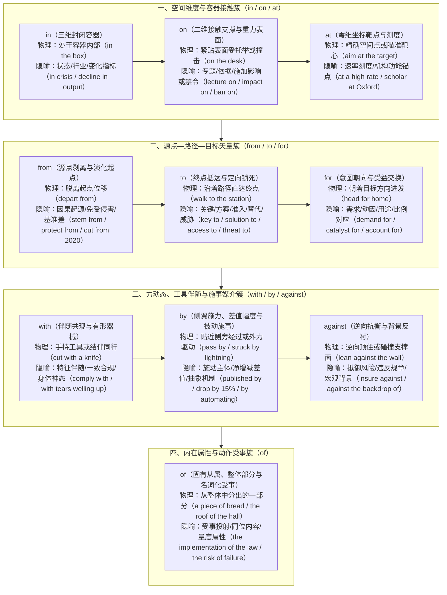

把握上述拓扑网络后，中国学习者最易犯错的**三大高频抽象介词配价定律**便一目了然：

1. **重力撞击与表面施压定律（为什么“对……产生影响 / 施加限制”锁死 `on`，而不用 `to`？）**
   * **认知图式**：在英语力动态图式中，施加影响（`impact / effect / influence`）、禁令（`ban / restriction / embargo`）或压力（`strain / pressure / burden`）并非平缓地“传递给某物（`to`）”，而是**自上而下撞击或重重压在受事物体的表面（`on / upon`）**（正如陨石撞击地表 `impact on the surface`）。
   * **双语示范**：`Stringent carbon tariffs will exert a profound impact on energy-intensive manufacturing sectors.`（严格的碳关税将对高耗能制造业部门产生深远影响。）
2. **容器陷落与领域注入定律（为什么“导致结果 / 在某领域投入或下降”锁死 `in`，而不用 `to / of`？）**
   * **认知图式**：英语将“最终状态、行业领域、变化指标”识解为三维**容器（Container）**。`result in / culminate in` 描绘事态发展最终**落入并定格在某个结果容器内**；`invest in / specialize in` 是将资源精力**注入某一领域容器**；`a sharp decline in neonatal mortality` 则指在“新生儿死亡率”这一**指标容器内部**发生了数值回落。
   * **双语示范**：`Sustained investment in basic scientific research ultimately culminated in a paradigm shift in cancer immunotherapy.`（对基础科学研究的持续投入，最终促成了癌症免疫疗法领域的范式变革。）
3. **路径通达与靶点对接定律（为什么“……的关键 / 解决方案 / 准入权 / 替代品”锁死 `to`，而绝不用 `of`？）**
   * **认知图式**：汉语习惯用静态领属词“的”（解决问题**的**办法、成功**的**关键），但英语将 `key, solution, answer, access, approach, alternative, threat, barrier, transition` 识解为**朝向目标终点推进并精准咬合的动态矢量（Vector $\to$ Goal）**——钥匙（`key`）是插向锁孔（`to the lock`）的，通道（`access / approach`）是通往目的地（`to the destination`）的。
   * **双语示范**：`Expanding equitable access to digital infrastructure provides a pragmatic solution to the urban-rural educational divide.`（扩大数字基础设施的公平准入，为城乡教育鸿沟提供了切实可行的解决方案。）

### 3.1.2 概念隐喻：把空间骨架搬到抽象域

意象图式解释了“空间关系怎么说”，而**概念隐喻**（Conceptual Metaphor，Lakoff & Johnson）则解释了**为什么抽象的心理、经济、学术与社会关系要用空间介词来表达**——因为人类大脑习惯借用可感知的物理空间经验来组织看不见、摸不着的抽象概念。

> [!cn-danger]
> **切勿与 4.4.1 节的“语法隐喻（Grammatical Metaphor）”混淆**：4.4.1 节讨论的是同一语义关系在句法形式上的转换（如把动词小句 `The pathogen mutated` 压缩为名词短语 `the mutation of the pathogen`）；而本节的“概念隐喻”讨论的是**从具体空间域向抽象概念域的认知映射**。

最核心的概念隐喻有三类：

- **方位隐喻（Orientational Metaphor）**：用空间中的“上下、高低、进退”映射抽象的数量增减、质量优劣与情绪涨落：
  - **`MORE IS UP / LESS IS DOWN`（数量多为上，数量少为下）** → `Prices rose sharply in the third quarter.`（第三季度价格急剧上涨。）/ `Manufacturing output fell by 8 percent.`（制造业产出下降了 8%。）
  - **`GOOD IS UP / BAD IS DOWN`（优质为上，劣质为下）** → `maintain a high ethical standard`（保持高道德标准）/ `Product quality dropped significantly.`（产品质量显著下滑。）
  - **`HAPPY IS UP / SAD IS DOWN`（愉悦为上，消沉为下）** → `The volunteers were in high spirits.`（志愿者们情绪高涨。）/ `Her spirits sank at the bad news.`（听到坏消息，她的情绪低落下来。）
- **本体隐喻（Ontological Metaphor）**：把抽象的状态、困境、责任或证据视作**三维容器**或**有重量的物理实体**，从而可以说“进入、走出、承担、衡量”：
  - **把状态与境遇当容器（`STATES ARE CONTAINERS`）** → `in trouble`（处于困境容器中）、`out of danger`（脱离危险容器）、`fall into heavy debt`（跌入沉重的债务容器）
  - **把责任与证据当有重量的实体（`IDEAS/DUTIES ARE PHYSICAL OBJECTS`）** → `a heavy burden of proof`（沉重的举证责任）、`the weight of empirical evidence`（实证证据的分量）、`shoulder the historical responsibility`（肩负起历史责任）
- **管道隐喻（Conduit Metaphor）**：把思想与信息当作装载在词语容器中、沿着管道从说话人传送给听话人的物体：
  - `The speaker's core message came across clearly.`（演讲者的核心信息传达得非常清楚。）
  - `I tried to warn him, but I couldn't get through to him.`（我试图警告他，但我无法让他听进去。）
  - `The professor's explanation of quantum entanglement went completely over my head.`（教授对量子纠缠的解释完全超出了我的理解范围 / 从我头顶飞过去了。）

### 3.1.3 意象图式与概念隐喻的四步实操核对法

遇到拿不准的抽象介词搭配时，可按以下四步理解并核实：

1. **第一步：判空间图式**。自问：这个抽象关系在脑海中最像哪种物理空间结构——容器里外（`in/into`）、表面依托（`on`）、源点终点（`from/to`）、管道穿透（`through`），还是逆向抗衡（`against`）？
2. **第二步：找原型熟例**。回忆英语里已知的同类高频表达怎样使用该介词（例如由 `rely on / depend on` 联想支撑面图式 `based on / contingent on`）。
3. **第三步：查隐喻家族**。确认该抽象概念在英语里习惯被识解为容器（如 `in despair`）、表面负担（如 `on one's shoulders`）还是高悬压力（如 `under pressure`）。
4. **第四步：验权威搭配**。通过牛津/朗文搭配词典或语料库（见第 8 篇 8.9 节）最终确认该名词或动词锁定的介词。前三步帮助你构建深度记忆网络，第四步确保下笔零误差。

---

### 3.1.4 八组高频易混介词的认知边界对比矩阵（Minimal Pairs）

在写作与完形填空、语法填空中，学习者最容易在含义相近的介词之间摇摆。下表从认知图式角度彻底厘清**八组最高频易混介词**的边界：

| 对比组别 | 易混介词 | 认知图式与核心语义边界 | 标准对立例句示范（附中文译文） |
| :--- | :--- | :--- | :--- |
| **1. 探讨与研究主题** | **`on`** vs. **`about`** vs. **`into`** | • **`on`**：接触支撑图式 → 严肃、系统、深入的**学术专论或政策专题**<br/>• **`about`**：外围环绕图式 → 日常、宽泛、非正式的**周边信息或故事**<br/>• **`into`**：进入容器图式 → 穿透表象、深入内里的**调查、探究或洞察** | • `Professor Lin delivered a keynote speech `**`on`**` constitutional law.`（林教授发表了一场关于宪法学的专题主旨演讲。）<br/>• `The children were chatting excitedly `**`about`**` their summer vacation.`（孩子们正兴奋地聊着他们的暑假。）<br/>• `The agency launched an independent inquiry `**`into`**` the aviation accident.`（该机构对这起航空事故展开了独立深入调查。） |
| **2. 空间与机构坐标** | **`in`** vs. **`on`** vs. **`at`** | • **`in`**：三维容器 → 国家、城市、建筑物内部或宏观行业领域<br/>• **`on`**：二维接触面/线条 → 街道表面、楼层、河畔、接壤或数字平台<br/>• **`at`**：零维坐标点 → 门牌号、具体活动点，或将大学/企业视为**功能锚点** | • `She works `**`in`**` the semiconductor industry `**`in`**` Shenzhen.`（她在深圳从事半导体行业工作。）<br/>• `The laboratory is located `**`on`**` the fifth floor of the building `**`on`**` Downing Street.`（实验室位于唐宁街那栋大楼的五层。）<br/>• `Dr. Morales is a senior neuroscientist `**`at`**` Oxford University.`（莫拉莱斯博士是牛津大学的一名资深神经科学家。） |
| **3. 路径穿透与跨越** | **`through`** vs. **`across`** vs. **`over`** | • **`through`**：三维管道内部穿过 → 经历艰难过程，或凭借某种**机制/手段**<br/>• **`across`**：二维平面横跨 → 从一边到另一边，或**全域覆盖多个部门/地区**<br/>• **`over`**：从上方越过或笼罩 → 越过障碍，或覆盖**一段时间周期** | • `The startup survived `**`through`**` continuous technological innovation.`（这家初创企业通过持续的技术创新生存了下来。）<br/>• `The heatwave caused power shortages `**`across`**` twelve southern provinces.`（热浪导致南方十二个省份全面出现电力短缺。）<br/>• `Renewable energy capacity has tripled `**`over`**` the past decade.`（在过去十年间，可再生能源装机容量增长了两倍。） |
| **4. 群际关系与分配** | **`between`** vs. **`among`** | • **`between`**：离散点对点图式 → 用于两者之间，或虽有多个实体但强调**两两之间清晰的边界、协议或差异**<br/>• **`among`**：集合内部图式 → 用于三者及以上构成的**笼统群体内部** | • `The summit aimed to resolve trade disputes `**`between`**` the four Pacific nations.`（峰会旨在解决四个太平洋国家彼此之间的贸易争端——强调国与国之间的双边边界。）<br/>• `A sense of optimism spread rapidly `**`among`**` the graduating students.`（一种乐观情绪在毕业生群体中迅速蔓延开来。） |
| **5. 原因与动因谱系** | **`due to / owing to`** vs. **`out of`** vs. **`from`** | • **`due to / owing to`**：客观逻辑归因（由于/因为）<br/>• **`out of`**：从心理容器内部涌出 → 源于某种**内在情绪、本能或动机**<br/>• **`from`**：物理或生理演化起点 → 因某种劳损、疾病或自然原因而受害 | • `The flight was canceled `**`due to`**` severe turbulence.`（航班因严重气流颠簸而取消。）<br/>• `He helped the stranded stranger purely `**`out of`**` compassion and curiosity.`（他帮助那位受困的陌生人纯粹是出于同情心与好奇心。）<br/>• `Millions of urban residents suffer `**`from`**` chronic sleep deprivation.`（数以百万计的城市居民饱受慢性睡眠剥夺之苦。） |
| **6. 工具、方式与幅度** | **`with`** vs. **`by`** vs. **`via`** | • **`with`**：伴随与具体器械 → 使用**有形工具、身体器官**或带有某种**情绪状态**<br/>• **`by`**：抽象手段、被动施事者，或表示**增减变化的净差值幅度**<br/>• **`via`**：路径中转媒介 → 通过某种**传输渠道、平台或中转站** | • `The surgeon sealed the incision `**`with`**` a precision laser scalpel.`（外科医生用精密激光手术刀封合了切口。）<br/>• `The firm reduced overhead costs `**`by`**` 18% `**`by`**` automating inventory management.`（该公司通过实现库存管理自动化，将运营成本降低了 18%。）<br/>• `All applicants must submit their portfolios `**`via`**` the online portal.`（所有申请人必须通过在线门户网站提交作品集。） |
| **7. 垂直标尺与统辖** | **`above / below`** vs. **`over / under`** | • **`above / below`**：静态标尺刻度 → 高于或低于某一**基准线、平均值或温度刻度**（无垂直正上方接触感）<br/>• **`over / under`**：垂直正上方覆盖或动态管辖 → 在……控制/监督下、处于某过程中，或超过数字上限 | • `Inflation remained stubbornly `**`above`**` the central bank's 2% target.`（通胀率居高不下，持续高于央行 2% 的目标基准线。）<br/>• `The bridge is currently `**`under`**` repair `**`under`**` the supervision of chief engineers.`（该桥梁目前正在总工程师的监督下进行维修。） |
| **8. 时间跨度与时限** | **`in`** vs. **`within`** vs. **`during`** | • **`in + 时间段`**：以现在为起点的未来倒计时（“……时间之后才发生”）<br/>• **`within + 时间段`**：限定时间上限边界（“在……时间之内完成，不超过”）<br/>• **`during + 时间名词`**：在某一特定历史阶段或事件持续期间 | • `The backup generator will kick in automatically `**`in`**` thirty seconds.`（备用发电机将在三十秒后自动启动。）<br/>• `Any defective product can be returned `**`within`**` fourteen days of purchase.`（任何瑕疵产品均可在购买后十四天内退货。）<br/>• `Several key breakthroughs occurred `**`during`**` the three-year expedition.`（在为期三年的考察期间取得了几项关键突破。） |

> [!cn-practice]
> **配套练习**：练习全书第 3 篇 **3.1节【介词填空】（第1—20题）** 与 **3.5节【介词意象图式与概念隐喻深度投射】（第41—55题）**。

---

## 3.2 为什么需要介词短语修饰链

**先理解本篇的核心术语**：
- **中心名词（Head Noun）**：整个名词短语真正谈论的核心实体对象（本书早期版本亦称“靶心”）；
- **右枝（Right-Branching Modifiers）**：位于中心名词右侧的后置修饰成分（包括介词短语、分词短语、不定式短语和定语从句）；
- **介词修饰链（Prepositional Modification Chain，简称“链”）**：在中心名词右侧接连挂接的多个介词短语（PP），链上的每一个介词短语称为一“**环（Link/Ring）**”。

> [!IMPORTANT]
> **介词环计数与依附判定原则**：  
> 1. **每读一环，必问“它修饰谁、说明什么关系”**：排在后面的介词短语不一定直接修饰最前面的中心名词，它既可能修饰前一个介词短语末尾的名词（串联递进），也可能跨越前环直接修饰中心名词（并联辐射）。  
> 2. **严格区分介词环与非限定小句**：统计介词环数时，只有真正的介词短语（`介词 + NP/V-ing`）才算一环；过去分词短语（如 `published last year`）、不定式短语（如 `to curb inflation`）和裸名词时间状语（如 `yesterday afternoon`）均须单独标明语法类型，不计入介词环数。

例如：`the cover [of the book] [on the desk]`（桌上那本书的封面）——整组短语的核心是 `cover`（封面）；第一环 `of the book` 修饰 `cover`（说明是哪里的封面）；第二环 `on the desk` 则就近修饰 `the book`（说明是哪一本书）。

汉语习惯把所有定语（时间、地点、施事、主题、属性）统统塞在中心名词左边，形成超长的前置包孕定语；而英语一旦定语超过一个简单形容词，就会遵循“**中心名词先行突围，修饰成分向右逐层延展**”的认知语序。

请看典型的中式英语“左向堆叠”病句：

> ❌ `*The yesterday afternoon in the school hall held by Professor Wang about traditional Chinese medicine lecture was very successful.`

这句话把时间（`yesterday afternoon`）、地点（`in the school hall`）、主讲人（`held by Professor Wang`）和主题（`about traditional Chinese medicine`）全部堆砌在中心名词 `lecture` 左边，导致英语母语者在读完前十五个词时依然不知道主语究竟是什么。按英语右向介词链与分词后置法则重构后：

> ✅ `The lecture `**`on traditional Chinese medicine`**`, `**`delivered by Professor Wang in the school hall yesterday afternoon`**`, was very successful.`（王教授昨天下午在学校礼堂所作的关于中医的讲座非常成功。）

**重构解析**：中心名词 `The lecture` 在句首第一时间亮相；紧接着挂接主题介词短语 `on traditional Chinese medicine`；随后用过去分词结构 `delivered...` 挂载施动介词短语 `by Professor Wang`、地点介词短语 `in the school hall` 以及时间名词短语 `yesterday afternoon`，主干 `The lecture ... was very successful` 清晰稳固。

> [!cn-practice]
> **配套练习**：练习全书第 3 篇 **3.2节【语序重组】（第21—30题）**。体验如何通过介词修饰链与分词短语分流中式长定语。

---

## 3.3 介词功能全景分类与核心名词配价库

介词在修饰链中绝非随意拼凑的虚词，而是标示两个实体之间逻辑关系的**语义连接器（Relational Connectors）**。下表汇总介词在名词修饰链中的九大核心功能维度：

| 功能维度 | 常见介词或复合表达 | 认知与句法作用 | 典型短语示范（附中文译文） |
| :--- | :--- | :--- | :--- |
| **1. 所属 / 属性 / 受事** | `of` | 标明名词的所属关系、内在属性、整体与部分，或动作名词的逻辑受事 | `the roof of the cathedral`（大教堂的屋顶）<br/>`the implementation of the new tariff`（新关税的实施）<br/>`a scholar of extraordinary erudition`（一位博学多才的学者） |
| **2. 内容 / 主题 / 领域** | `on`, `about`, `into`, `in`, `concerning`, `regarding` | 标明报告、研究、争论、改革或课程所针对的具体课题或领域 | `a white paper on artificial intelligence`（人工智能白皮书）<br/>`an investigation into corporate fraud`（对企业欺诈的调查）<br/>`a breakthrough in regenerative medicine`（再生医学领域的突破） |
| **3. 施动主体 / 创作者** | `by` | 标明动作性名词或过去分词短语的动作发出者 | `a symphony by Beethoven`（贝多芬创作的交响曲）<br/>`the inspection by federal regulators`（联邦监管机构的检查） |
| **4. 伴随 / 特征 / 工具** | `with`, `without`, `through`, `by means of`, `via` | 标明事物的伴随特征、附加条件或实现过程所使用的工具与媒介 | `a historic town with cobblestone streets`（有着鹅卵石街道的历史古镇）<br/>`communication via encrypted channels`（通过加密信道进行的通信） |
| **5. 目的 / 用途 / 受益方** | `for`, `toward(s)`, `in pursuit of`, `in celebration of` | 标明方案、资金、政策或活动的目标用途、服务对象或动因 | `a relief fund for earthquake victims`（面向地震灾民的救济基金）<br/>`a concert in celebration of the centenary`（庆祝百年校庆的音乐会） |
| **6. 空间范围 / 场域** | `in`, `at`, `on`, `across`, `throughout`, `within`, `beyond` | 标明现象发生的地理区域、机构坐标或抽象制度边界 | `water scarcity across arid regions`（干旱地区的水资源短缺）<br/>`innovation within the public sector`（公共部门内部的创新） |
| **7. 时间节点 / 跨度** | `in`, `at`, `on`, `during`, `over`, `throughout`, `since` | 标明事件发生的具体时刻、历史时期或持续时长 | `economic recovery during the post-war era`（战后时期的经济复苏）<br/>`urbanization over the past three decades`（过去三十年间的城市化进程） |
| **8. 来源 / 起点 / 基准** | `from`, `out of`, `off` | 标明人员出处、数据来源、引文摘录或增减计算的参考基准 | `excerpts from his unpublished diaries`（他未出版日记的节选）<br/>`a 30% emission cut from 2015 levels`（较 2015 年水平削减 30% 的排放） |
| **9. 对抗 / 对比 / 参照** | `against`, `versus (vs.)`, `compared with`, `in contrast to` | 标明抵御对象、竞争对手或对比参照背景 | `immunity against the mutated virus`（对变异病毒的免疫力）<br/>`gdp growth compared with the previous quarter`（与上一季度相比的 GDP 增长） |

---

### 3.3.1 核心抽象名词的介词配价锁死表（Noun + Preposition Valency）

为什么很多学习者知道“中心名词先行”，写出来的介词链却依然充满中式错误（如写出 `*the key of solving the problem`、`*a decline of employment`、`*have a great impact to the environment`）？

根本原因在于：汉语说“……的钥匙 / ……的下降 / 对……的影响”统统用“的”或“对”，导致中国学生习惯性把所有中文的“的”都翻译成英文的 `of`！而在英语中，大量核心抽象名词继承了其同源动词或形容词的**配价要求（Valency）**，在语法上**强制锁死特定的介词来引导其补语（Complement）**。请务必熟练掌握以下**四大高频抽象名词配价家族**：

| 名词语义家族 | 强制锁定的介词配价公式 | 高频核心名词清单 | 标准地道例句示范（附中式错句警示） |
| :--- | :--- | :--- | :--- |
| **1. 增减波动族**<br/>（`in` vs. `of` 双轨制） | • 接**发生变化的领域/指标**：用 **`in`**<br/>• 接**增减的具体数值/百分比**：用 **`of`** | `increase`, `rise`, `growth`, `surge`, `decline`, `drop`, `fall`, `reduction`, `decrease`, `fluctuation` | ✅ `The report documented a sharp `**`decline in`**` neonatal mortality `**`of`**` 40%.`（报告记录了新生儿死亡率出现了 40% 的急剧下降。）<br/>*(注：`decline/reduction of + 名词` 也可用于表示对象减少，但学术写作中“某指标的上升/下降”优先用 `rise/decline in + 指标` + `of + 幅度`)* |
| **2. 指向、通达与破局族**<br/>（严禁受中文“的”误导用 `*of`！） | 强制接方向终点介词 **`to`** | `key`, `solution`, `answer`, `approach`, `access`, `alternative`, `threat`, `barrier`, `obstacle`, `transition`, `contribution`, `resistance`, `exposure`, `commitment`, `guide`, `sequel` | ✅ `Universal `**`access to`**` clean drinking water remains a top priority.`（普及清洁饮用水依然是重中之重。）<br/>✅ `We must seek a viable `**`alternative to`**` fossil fuels.`（我们必须寻找化石燃料的可行替代方案。——❌ 严禁写 `*alternative of` 或 `*approach of`！） |
| **3. 作用、限制与诉求族**<br/>（`on` 与 `for` 专司其职） | • 表**施加影响/限制/压力**：接 **`on / upon`**<br/>• 表**需求/原因/渴望/资格**：接 **`for`** | • **接 `on`**：`impact`, `effect`, `influence`, `bearing`, `restriction`, `ban`, `strain`, `tax`, `emphasis`<br/>• **接 `for`**：`reason`, `catalyst`, `demand`, `need`, `appetite`, `preference`, `respect`, `reputation`, `eligibility` | ✅ `The government imposed strict `**`restrictions on`**` high-emission vehicles.`（政府对高排放车辆实施了严格限制。）<br/>✅ `Surging `**`demand for`**` lithium batteries has driven up mining investments.`（对锂电池激增的需求推高了采矿投资。） |
| **4. 认知、信任与关系族**<br/>（按心理图式精准配对） | • 知晓/把握：接 **`of`**<br/>• 信任/信念：接 **`in`**<br/>• 态度：接 **`toward(s)`**<br/>• 双边关联：接 **`between`**<br/>• 遵从/一致：接 **`with`** | • **接 `of`**：`awareness`, `knowledge`, `understanding`, `grasp`, `command`<br/>• **接 `in`**：`confidence`, `faith`, `belief`, `trust`, `interest`<br/>• **接 `between`**：`correlation`, `link`, `disparity`, `balance`<br/>• **接 `with`**：`compliance`, `accordance`, `consistency`, `contrast` | ✅ `Public `**`awareness of`**` cybersecurity risks has grown considerably.`（公众对网络安全风险的意识已显著提高。）<br/>✅ `Any erosion of public `**`trust in`**` judicial impartiality undermines social stability.`（公众对司法公正信任的任何流失都会破坏社会稳定。）<br/>✅ `The study revealed a strong `**`correlation between`**` gut microbiota and immune function.`（研究揭示了肠道菌群与免疫功能之间的强相关性。） |

---

### 3.3.2 学术与公文高阶“三词复合介词（Complex Prepositions）”升级矩阵

在议论文、学术报告与正式书信中，适度用结构凝练的“**三词复合介词**”（`介词1 + 抽象名词 + 介词2`）替代笼统的单一介词（如 `about / because of / with / for`），能使介词修饰链的逻辑精度与文体格调产生质的飞跃：

| 逻辑维度 | 基础单一介词 | 高阶三词复合介词（Complex Prepositions） | 学术与公文实战示范句（附中文译文） |
| :--- | :--- | :--- | :--- |
| **1. 界定评估维度** | `about / in` | **`in terms of`**（在……维度/方面）<br/>**`with regard to / with respect to`**（关于/就……而言） | `The new battery architecture outperforms conventional lithium-ion cells `**`in terms of`**` energy density and thermal stability.`（新型电池架构在能量密度与热稳定性方面优于传统锂离子电池。） |
| **2. 援引依据与原因** | `because of` | **`in light of / in view of`**（鉴于/考虑到）<br/>**`by virtue of`**（凭借/由于……的固有优势）<br/>**`on account of`**（由于） | **`In light of`**` the latest epidemiological data, the health ministry updated its vaccination guidelines.`（鉴于最新的流行病学数据，卫生部更新了疫苗接种指南。） |
| **3. 遵循规范与契约** | `according to` | **`in accordance with`**（依照/根据）<br/>**`in compliance with`**（严格遵照法规/标准）<br/>**`in line with`**（与……保持一致） | `All cross-border data transfers must be executed `**`in strict compliance with`**` national privacy legislation.`（所有跨境数据传输必须严格遵照国家隐私法规执行。） |
| **4. 权衡代价与利益** | `for / without` | **`at the expense of`**（以牺牲……为代价）<br/>**`for the sake of`**（为了……的利益/缘故）<br/>**`in exchange for`**（作为对……的交换） | `Short-term industrial expansion should never be pursued `**`at the expense of`**` long-term ecological resilience.`（绝不应以牺牲长期生态韧性为代价来追求短期工业扩张。） |
| **5. 时序紧接与临界** | `after / near` | **`in the wake of`**（紧随……之后/作为……的余波）<br/>**`on the verge/brink of`**（濒临……的边缘）<br/>**`prior to`**（在……之前） | `Stricter auditing rules were enacted `**`in the wake of`**` several high-profile corporate accounting scandals.`（在几起备受瞩目的企业财务丑闻发生之后，出台了更为严格的审计规则。） |

> [!cn-practice]
> **配套练习**：练习全书第 3 篇 **3.1节【介词填空】（第1—20题）** 与 **3.5.2节【核心名词介词配价、拓扑辨析与断链瘦身实战】（第46—55题）**。

---

## 3.4 四步组装法与两大拓扑挂接机制

面对一个带有多层修饰信息的复杂名词概念，可先按以下**四步法**完成基础组装，再通过**拓扑模型核验**确保挂接关系清晰无歧义：

### 3.4.1 第一步：确立中心名词（Anchor the Head Noun）

剥离一切时间、地点、施动者与主题定语，先找出整组词真正谈论的**唯一核心实体名词**（最多带一个必要的冠词或短形容词）：
- `a report`（一份报告）/ `the discovery`（这项发现）/ `an investigation`（一次调查）/ `the rapid decline`（急剧下降）

### 3.4.2 第二步：挂接属性、受事或所属环（`of / in / to` 必选补语环）

紧贴中心名词右侧，优先挂接中心名词在语义配价上最紧密的**受事对象、所属主体或变化指标**：
- <code>a report <strong>of the special committee</strong></code>（特别委员会的一份报告）
- <code>the discovery <strong>of novel antiviral compounds</strong></code>（新型抗病毒化合物的发现）
- <code>an investigation <strong>of ( / into) the laboratory accident</strong></code>（针对实验室事故的一项调查）

### 3.4.3 第三步：挂接专题内容、用途或目标环（`on / into / for` 内容环）

继续向右说明具体研究课题、政策用途或针对的目标对象：
- <code>a report of the special committee <strong>on climate adaptation policy</strong></code>（特别委员会关于气候适应政策的一份报告）
- <code>the discovery of novel antiviral compounds <strong>for drug-resistant influenza</strong></code>（针对耐药性流感的新型抗病毒化合物的发现）
- <code>an investigation of the laboratory accident <strong>into safety protocol violations</strong></code>（针对实验室事故中安全规程违规行为的调查）

### 3.4.4 第四步：挂接施动主体与外围时空环（`by + in / at / across / during`）

最后在外围交代动作发出者（常配合过去分词使层次更清楚）以及空间、时间边界：
- <code>a report of the special committee on climate adaptation policy <strong>published by the UN</strong> <strong>in Geneva last month</strong></code>（联合国上个月在日内瓦发布的特别委员会关于气候适应政策的一份报告）
- <code>the discovery of novel antiviral compounds for drug-resistant influenza <strong>made by a team of biochemists</strong> <strong>at Oxford University</strong></code>（牛津大学生物化学家团队针对耐药性流感所取得的关于新型抗病毒化合物的发现）

---

### 3.4.5 介词链的两大底层拓扑模型：串联递进链 vs. 并联辐射链

很多学习者虽然背熟了“四步法”，但在阅读或自己造句时仍会搞混各环之间的修饰关系。事实上，英语介词修饰链在内部结构上只有**两种基本拓扑连接方式**（以及二者的混合体）：

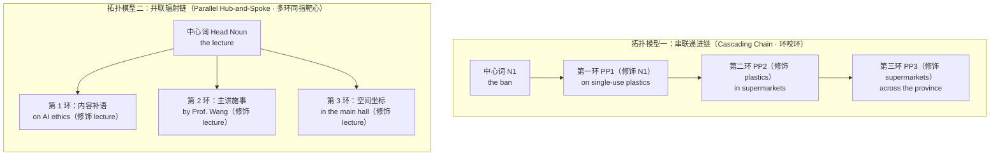

1. **模型一：串联递进链（Cascading / Tail-to-Head Chain ——“环咬环，层层缩小”）**
   - **结构特征**：后一个介词短语紧咬前一个介词短语末尾的名词（`PP1 修饰 Head` → `PP2 修饰 PP1 的宾语` → `PP3 修饰 PP2 的宾语`），像俄罗斯套娃一样层层向内聚焦：
   - **典型范例**：`the implementation [of the ban [on single-use plastics [in supermarkets [across the province]]]]`（全省各地超市一次性塑料制品禁令的实施）
     - `of the ban` 修饰 `implementation`（什么政策的实施？禁令的实施）；
     - `on single-use plastics` 修饰 `ban`（针对什么的禁令？一次性塑料制品的禁令）；
     - `in supermarkets` 修饰 `plastics` / `ban`（哪里的塑料制品禁令？超市里的）；
     - `across the province` 修饰 `supermarkets`（哪些超市？全省各地的超市）。
2. **模型二：并联辐射链（Parallel / Hub-and-Spoke Chain ——“多环同指中心词”）**
   - **结构特征**：多个介词短语在逻辑上处于并列层级，**全部回指最前面的同一个中心名词（Head Noun）**，分别从“内容、受众、施事、地点、时间”等不同侧面刻画中心名词：
   - **典型范例**：`a heated debate [on algorithmic transparency] [among legal scholars] [at the annual summit]`（在年度峰会上法学学者之间关于算法透明度的一场激烈辩论）
     - 第一环 `on algorithmic transparency` 说明 **`debate` 的议题**；
     - 第二环 `among legal scholars` 说明 **`debate` 的参与群体**；
     - 第三环 `at the annual summit` 说明 **`debate` 发生的场合**——三环全部指向中心词 `debate`！
3. **并联介词环的“向心排序黄金律（Iconicity of Proximity）”**：
   - 当多个介词短语**同时修饰同一个中心名词**时，谁排在前面、谁排在后面？认知语言学遵循“**距离象似性原则**”（关系越本质、结合越紧密，物理位置越靠近中心词）：
     - **第一优先级（紧贴中心词）**：中心名词强制要求的**必选补语环**（如受事 `of`、议题 `on/into`、对象 `to/for`）；
     - **第二优先级（中层）**：交代参与者、人群或施事者的介词环（如 `among...`、`by...`、`with...`）；
     - **第三优先级（最外层）**：提供外部空间与时间框架的附加语环（如 `in...`、`at...`、`during...`）；
     - **重量调节律（短前长后）**：若某一外围环极短（如 `in 2024`），而内容环带有长串内嵌修饰（如 `on the long-term socioeconomic impacts of aging populations`），也可将长环置于最后以防句末失衡，或用过去分词（如 `published in 2024`）清晰切分层次。

> [!cn-practice]
> **配套练习**：练习全书第 3 篇 **3.4节【自由组装】（第36—40题）** 与 **3.5.2节（第46—55题）**。

---

## 3.5 场景例句库

**读拆解的办法**：PP 表介词短语，NP 表名词短语。箭头提示阅读顺序，不保证成分在同一层。按“成分 → 说明谁 → 说明什么”复核。例如 a report on pollution 中的 on pollution 是 PP，说明主题；published last year 整体是分词结构，不能算一环 PP。

以下例句按场景分类，每组先给待纠错表达，再给保留原意的纠错；随后另列扩写示范及其拆解。纠错不增添数字、机构、人物或事件结果。

**扩写说明**：下列扩写均为自编、虚构的教学示例。新增的年份细节、百分比、机构名称与事件结果仅用于展示结构，不是原句信息，也不构成真实研究或政策事实的引用。不得把扩写当作等义改写答案。

### 3.5.1 场景 A：学术研究

<div class="subtopic-lead" id="s-3-5-1-1"><span class="subtopic-bar">▍</span> <strong>3.5.1.1 例句 1</strong></div>

* **待纠错表达**：`The a team at MIT about AI ethics in 2024 published paper is influential.`

* **保留原意的纠错**：A paper **on AI ethics**, **published by a team at MIT in 2024**, is influential.（麻省理工学院一个团队于 2024 年发表的一篇关于人工智能伦理的论文颇具影响力。）

* **扩写示范（虚构）**：A paper **on the ethical implications of artificial intelligence in military decision-making**, **published by a research team at the Massachusetts Institute of Technology**, **in the spring of 2024**, has sparked widespread debate among policymakers.（麻省理工学院一个研究团队于 2024 年春发表的一篇关于人工智能在军事决策中的伦理影响的论文，在政策制定者中引发了广泛争论。）

* **扩写结构拆解**：

  * 中心词：`a paper`

  * on 环：`on the ethical implications of artificial intelligence in military decision-making`（论文讨论的内容，依附于 paper）

  * 内嵌 of 环：`of artificial intelligence in military decision-making`（所讨论的 implications 涉及什么，依附于 implications）

  * 内嵌 in 环：`in military decision-making`（人工智能的应用场景，依附于 artificial intelligence）

  * by 环：`a research team at MIT`（施动主体）

  * 时间环：`in the spring of 2024`（时空边界）

<div class="subtopic-lead" id="s-3-5-1-2"><span class="subtopic-bar">▍</span> <strong>3.5.1.2 例句 2</strong></div>

* **待纠错表达**：`The from seawater by engineers in Australia new desalination method is efficient.`

* **保留原意的纠错**：A new method **for seawater desalination**, **developed by engineers in Australia**, is efficient.（澳大利亚工程师开发的一种海水淡化新方法效率很高。）

* **扩写示范（虚构）**：A new method **for the desalination of seawater**, **developed by a team of civil engineers** **at the University of New South Wales**, **through a five-year collaboration with local water authorities**, has reduced energy consumption by 40 percent.（新南威尔士大学土木工程师团队通过与当地水务部门历时五年的合作所开发的一种海水淡化新方法，将能耗降低了 40%。）

* **扩写结构拆解**：中心词 `method` → for 环（用途）→ of 环（对象）→ by 环（开发者）→ at 环（机构）→ through 环（合作方式）。

<div class="subtopic-lead" id="s-3-5-1-3"><span class="subtopic-bar">▍</span> <strong>3.5.1.3 例句 3</strong></div>

* **待纠错表达**：`The of bee populations across Europe due to pesticide use rapid decline concerns scientists.`

* **保留原意的纠错**：The rapid decline **of bee populations across Europe**, **due to pesticide use**, concerns scientists.（因使用农药而导致的欧洲各地蜜蜂数量的急剧下降令科学家担忧。）

* **扩写示范（虚构）**：The rapid decline **of native bee populations** **across Western Europe**, **attributed primarily to the widespread use of neonicotinoid pesticides in industrial agriculture**, has prompted a comprehensive review **of environmental regulations** **by the European Commission**.（主要归因于工业化农业中广泛使用新烟碱类杀虫剂的西欧本土蜜蜂数量的急剧下降，已促使欧盟委员会对环境法规展开全面审查。）

* **扩写结构拆解**：中心词 `decline` → of 环（什么的下降）→ across 环（空间范围）→ attributed... 分词小句（原因；其内 to PP 引出归因对象）→ by 环（谁在审查）。

### 3.5.2 场景 B：商务与经济

<div class="subtopic-lead" id="s-3-5-2-1"><span class="subtopic-bar">▍</span> <strong>3.5.2.1 例句 4</strong></div>

* **待纠错表达**：`The by the central bank in response to inflation last week interest rate decision surprised markets.`

* **保留原意的纠错**：The decision **by the central bank** **on interest rates**, **made last week in response to inflation**, surprised markets.（央行上周为应对通胀而作出的利率决定令市场感到意外。）

* **扩写示范（虚构）**：The decision **by the central bank** **to raise interest rates by 25 basis points**, **in response to persistent inflationary pressures in the housing sector**, **surprised financial markets** **around the world**.（央行为应对房地产行业持续的通胀压力而作出的加息 25 个基点的决定，令全球金融市场感到意外。）

* **扩写结构拆解**：中心词 `decision` → by PP（决策者）→ to raise... 不定式小句（决定内容，内含 by 25 basis points 幅度 PP）→ in response to 环（动因）→ around 环（影响范围）。

<div class="subtopic-lead" id="s-3-5-2-2"><span class="subtopic-bar">▍</span> <strong>3.5.2.2 例句 5</strong></div>

* **待纠错表达**：`The for small businesses during the pandemic by the government financial support program was effective.`

* **保留原意的纠错**：The financial support program **for small businesses**, **launched by the government during the pandemic**, was effective.（政府在疫情期间推出的针对小企业的财政扶持计划成效显著。）

* **扩写示范（虚构）**：The financial support program **for small and medium-sized enterprises**, **launched by the federal government** **during the initial wave of the pandemic in 2020**, **through a combination of grants and low-interest loans**, prevented an estimated 3 million job losses.（联邦政府在 2020 年首波疫情期间通过拨款与低息贷款相结合的方式推出的针对中小企业的财政扶持计划，避免了约 300 万个工作岗位的流失。）

* **扩写结构拆解**：中心词 `program` → for 环（服务对象）→ by 环（发起者）→ during 环（时间）→ through 环（实施方式）。

<div class="subtopic-lead" id="s-3-5-2-3"><span class="subtopic-bar">▍</span> <strong>3.5.2.3 例句 6</strong></div>

* **待纠错表达**：`The of semiconductor chips from Taiwan to global manufacturers supply chain disruption caused shortages.`

* **保留原意的纠错**：The disruption **of the supply chain for semiconductor chips from Taiwan to global manufacturers** caused shortages.（从台湾到全球制造商的半导体芯片供应链中断导致了短缺。）

* **扩写示范（虚构）**：The disruption **of the global supply chain for semiconductor chips**, **caused by a combination of drought-induced water shortages in Taiwan and surging demand from consumer electronics manufacturers**, **led to production delays** **across the automotive industry worldwide**.（由台湾干旱引发的缺水以及消费电子制造商需求激增共同导致的全球半导体芯片供应链中断，造成了全球汽车行业的生产延误。）

* **扩写结构拆解**：中心词 `disruption` → of 环（什么的中断）→ for PP（供应的货物类别）→ caused... 分词小句（原因，其内 by PP 引出原因）→ across 环（影响行业）。

### 3.5.3 场景 C：社会与文化

<div class="subtopic-lead" id="s-3-5-3-1"><span class="subtopic-bar">▍</span> <strong>3.5.3.1 例句 7</strong></div>

* **待纠错表达**：`The about mental health among college students by researchers last year survey revealed alarming trends.`

* **保留原意的纠错**：A survey **about mental health among college students**, **conducted by researchers last year**, revealed alarming trends.（研究人员去年开展的一项关于大学生心理健康的调查揭示了令人担忧的趋势。）

* **扩写示范（虚构）**：A nationwide survey **on mental health awareness among undergraduate students**, **conducted by researchers from the Department of Psychology** **at Peking University**, **in collaboration with the Ministry of Education**, **revealed that 37 percent of respondents reported symptoms of anxiety**.（北京大学心理学系研究人员与教育部合作开展的一项关于本科生心理健康意识的全国性调查显示，37% 的受访者报告有焦虑症状。）

* **扩写结构拆解**：中心词 `survey` → on 环（主题）→ among 环（人群）→ by 环（实施者）→ at 环（机构）→ in collaboration with 环（合作方）。

<div class="subtopic-lead" id="s-3-5-3-2"><span class="subtopic-bar">▍</span> <strong>3.5.3.2 例句 8</strong></div>

* **待纠错表达**：`The of traditional craftsmanship in rural communities by young people revival is encouraging.`

* **保留原意的纠错**：The revival **of traditional craftsmanship in rural communities**, **led by young people**, is encouraging.（由年轻人引领的乡村社区传统手工艺的复兴令人鼓舞。）

* **扩写示范（虚构）**：The revival **of traditional weaving craftsmanship** **in remote rural communities of southwestern China**, **led by a new generation of young artisans returning from urban areas**, **through online marketing and cultural tourism partnerships**, has breathed new life into villages once facing depopulation.（由从城市返乡的新一代青年工匠通过网络营销与文旅合作所引领的中国西南偏远乡村社区传统编织工艺的复兴，为曾面临人口流失的村庄注入了新的生机。）

* **扩写结构拆解**：中心词 `revival` → of 环（什么的复兴）→ in 环（地点）→ led... 分词小句（引领信息；其内 by PP 标施动者）→ through 环（方式）。

### 3.5.4 场景 D：科技与工程

<div class="subtopic-lead" id="s-3-5-4-1"><span class="subtopic-bar">▍</span> <strong>3.5.4.1 例句 9</strong></div>

* **待纠错表达**：`The for autonomous vehicles in complex urban environments by the company new algorithm improves safety.`

* **保留原意的纠错**：A new algorithm **for autonomous vehicles in complex urban environments**, **designed by the company**, improves safety.（该公司设计的一种用于复杂城市环境中自动驾驶汽车的新算法提高了安全性。）

* **扩写示范（虚构）**：A new algorithm **for real-time path planning in autonomous vehicles**, **designed by engineers at Waymo** **to handle unpredictable pedestrian behavior in dense urban environments**, **has reduced collision rates by 60 percent** **in simulated tests across fifteen major cities**.（Waymo 工程师为应对密集城市环境中难以预测的行人行为而设计的一种用于自动驾驶汽车实时路径规划的新算法，在十五个主要城市的模拟测试中将碰撞率降低了 60%。）

* **扩写结构拆解**：中心词 `algorithm` → for 环（用途）→ in 环（应用场景）→ designed... 分词小句（设计信息，内含 by PP）→ to handle... 不定式小句（目的）→ in 环（测试结果）→ across 环（测试范围）。

<div class="subtopic-lead" id="s-3-5-4-2"><span class="subtopic-bar">▍</span> <strong>3.5.4.2 例句 10</strong></div>

* **待纠错表达**：`The of carbon emissions from steel plants in northern China reduction target is ambitious.`

* **保留原意的纠错**：The target **for the reduction of carbon emissions from steel plants in northern China** is ambitious.（华北钢铁厂减少碳排放的目标雄心勃勃。）

* **扩写示范（虚构）**：The target **for the reduction of carbon dioxide emissions** **from steel manufacturing plants across the industrial belt of northern China**, **set by the State Council** **as part of the 2030 carbon peaking strategy**, **requires a 35 percent cut** **from 2020 levels** **within the next five years**.（国务院作为 2030 年碳达峰战略的一部分而制定的华北工业带钢铁制造厂二氧化碳减排目标，要求在未来五年内较 2020 年水平削减 35%。）

* **扩写结构拆解**：中心词 `target` → for 环（目标内容）→ from 环（排放源）→ across 环（地理范围）→ set... 分词小句（制定信息；其内 by PP 标施动者）→ as part of 环（政策归属）→ from 环（基准线）→ within 环（时限）。

### 3.5.5 场景 E：日常与个人表达

<div class="subtopic-lead" id="s-3-5-5-1"><span class="subtopic-bar">▍</span> <strong>3.5.5.1 例句 11</strong></div>

* **待纠错表达**：`The about my trip to Japan last summer with my friends photo album is on the shelf.`

* **保留原意的纠错**：The photo album **about my trip to Japan with my friends last summer** is on the shelf.（那本关于去年夏天我和朋友去日本旅行的相册在书架上。）

* **扩写示范（虚构）**：The photo album **from my graduation trip to Japan with my college friends last summer**, **filled with snapshots that we took of temple gardens in Kyoto and street food stalls in Osaka**, **sits on the top shelf of my bookcase**.（那本来自去年夏天我与大学好友日本毕业旅行、装满了我们在京都寺庙庭院和大阪街头小吃摊拍下的快照的相册，放在我书柜的最顶层。）

* **扩写结构拆解**：中心词 `album` → from PP（旅行来源，内含 to Japan、with my college friends；last summer 为时间 NP）→ filled... 分词小句（内容，内含 with PP）→ that we took... 限定从句（明确修饰 snapshots）→ on PP（相册位置，依附 sits）。

<div class="subtopic-lead" id="s-3-5-5-2"><span class="subtopic-bar">▍</span> <strong>3.5.5.2 例句 12</strong></div>

* **待纠错表达**：`The for my mother's birthday on Saturday by my sister and me surprise party was a success.`

* **保留原意的纠错**：The surprise party **for my mother's birthday**, **organized by my sister and me on Saturday**, was a success.（我和姐姐在周六为母亲生日筹办的惊喜派对非常成功。）

* **扩写示范（虚构）**：The surprise party **for my mother's sixtieth birthday**, **organized by my sister and me** **in the backyard of our family home** **on a warm Saturday evening in June**, **with over thirty relatives and friends in attendance**, **turned out to be the most memorable celebration of the year**.（我和姐姐于六月一个温暖的周六夜晚在自家后院为母亲六十岁生日筹办、有三十多位亲友出席的惊喜派对，成了今年最令人难忘的庆祝活动。）

* **扩写结构拆解**：中心词 `party` → for PP（为谁）→ organized... 分词结构（其中 by PP 说明组织者）→ in 环（地点）→ on 环（时间）→ with 环（参与者）。

> [!cn-practice]
> **配套练习**：练习全书第3篇 3.2节（第21—30题）与 3.4节（第36—40题）；综合互译实战参见第9篇 9.2节。

---

## 3.6 链长控制与主谓一致穿透铁律

介词链不是越长越好。一旦主语中心词后面的介词链过长，就会导致主语和谓语动词严重脱节，造成读者工作记忆超载。

### 3.6.1 短链（1—2 环）：日常表达与口语交际

> `The book `**`on the table`**` is mine.`（桌上的书是我的。）
>
> `The report `**`by the special committee`**` was released today.`（特别委员会撰写的报告于今日发布。）

### 3.6.2 中链（3—4 环）：标准学术写作与正式报告（最推荐黄金区间）

> `The discovery `**`of new treatments for diabetes by researchers at Oxford`**` has been hailed as a major breakthrough.`（牛津大学研究人员对糖尿病新疗法的发现被誉为一项重大突破。）

### 3.6.3 长链（5 环及以上）：高密度政策文书与复杂度预警

> `The decision `**`by the central bank to raise interest rates in response to inflation in the housing sector amid concerns about global economic uncertainty`**` has drawn criticism from industry leaders.`（在对全球经济不确定性的担忧之中，央行为应对房地产行业通胀而作出的加息决定招致了行业领袖的批评。）

> [!cn-theory]
> **复杂度控制红线**：当名词后的介词链达到 **4—5 环**（或主语中心词与谓语动词之间相隔超过 **18—20 个词**）时，应主动启动 3.7.1 节的“断链与分流手术”，将时间、原因或背景介词短语前移至句首，或拆分为独立分句，切勿为了炫技而硬凑超长介词链。

---

### 3.6.4 主语介词链的“主谓一致穿透铁律（Head-Verb Agreement Across PP Chains）”

在高考语法填空、改错与学术写作中，主语介词链最致命的语法陷阱是“**就近盲从**”（Proximity Blindness）——学习者常被介词链末尾紧挨着谓语动词的复数名词迷惑，从而选错谓语单复数！请牢记以下**三条穿透铁律**：

1. **铁律一（核心穿透律）：普通介词链无论挂接多少环，谓语动词永远只与最前端的“中心名词（Head Noun）”保持单复数一致！**
   - ✅ **`The rapid expansion`**` [of e-commerce platforms] [across remote rural counties] `**`has`**` (严禁写 *have!) transformed local retail ecosystems.`（电子商务平台在偏远农村县域的迅速扩张已经改变了当地的零售生态。——中心词是单数不可数名词 `expansion`，中间的 `platforms` 和 `counties` 均是介词宾语，对谓语单复数毫无决定权！）
   - ✅ **`New guidelines`**` [for the clinical application] [of artificial intelligence] [in public hospitals] `**`were`**` (严禁写 *was!) issued yesterday.`（公立医院人工智能临床应用的新指南于昨日发布。——中心词是复数 `guidelines`！）
2. **铁律二（伴随介词不改单复数）：当主语后挂接 `along with / together with / as well as / in addition to / rather than / including / besides + NP` 时，谓语依然严格与最前面的主语中心词一致！**
   - ✅ **`The chief architect`**`, together with three structural engineers, `**`is`**` (严禁写 *are!) inspecting the foundation.`（总建筑师偕同三名结构工程师正在检查地基。）
3. **铁律三（量词/比例结构透传特例）：当句首是表示“数量/比例/部分”的量词外壳（`a lot of / plenty of / the majority of / most of / half of / 60% of / a proportion of / the rest of + NP`）时，单复数穿透至 `of` 后面的实体名词！但须严格区分 `a number of` 与 `the number of`：**
   - **`A number of + 复数名词`**（许多……，中心词在语义上相当于 `Many`）→ 谓语必用**复数**：
     `A growing number of empirical studies `**`have`**` confirmed this hypothesis.`（越来越多的实证研究已证实了这一假说。）
   - **`The number of + 复数名词`**（……的数量/数字，中心词是单数名词 `number`）→ 谓语必用**单数**：
     `The number of registered electric vehicles `**`has`**` doubled in three years.`（注册电动汽车的数量在三年内翻了一番。）

> [!cn-practice]
> **配套练习**：练习全书第 3 篇 **3.3节【错误识别与改正】（第31—35题）** 与 **3.5.2节（第46—55题）**。

---

## 3.7 常见错误、依附歧义与五大“断链瘦身”重构手术

审读或修改介词修饰链时，首先要区分**语法硬伤**（如中式前置、配价用错、主谓不一致）、**依附歧义**（读者分不清某环修饰谁）与**文体臃肿**（多重 `of` 堆砌或链条过长）。

| 问题类型 | 原句表达（带问题诊断） | 优化改写方案（附中文译文） | 核心判断依据 |
| :--- | :--- | :--- | :--- |
| **1. 中式左向堆叠硬伤** | `*The yesterday held meeting was productive.`（把时间状语与分词硬塞在冠词与名词之间） | `The meeting `**`held yesterday`**` was productive.`（昨天举行的会议富有成效。） | 英语含动词或介词的修饰成分须置于中心名词右侧 |
| **2. 多重 `of` 关系粘连** | `the report of the committee of the investigation of the fraud`（三个 `of` 连续堆叠，所属与内容混作一团） | `the `**`investigation committee's`**` report `**`on`**` the fraud`（调查委员会关于该欺诈案的报告） | 用名词作定语（`investigation committee`）+ 所有格 `'s` + 专题介词 `on` 分流不同语义关系 |
| **3. 被动分词无须强补 `by`** | `The paper published last year is influential.`（部分学习者误以为分词后必须加 `by sb`） | 原句完全正确自然！（发表于去年的那篇论文颇具影响力。） | 当施动者未知、不言自明或非论述重点时，无需画蛇添足硬凑 `by` 环 |
| **4. 并联环依附歧义** | `a discussion about the plan by the team on Monday`（读者容易把 `by the team` 误读为修饰 `the plan`“团队制定的计划”） | `the team's discussion about the plan on Monday`（团队在周一关于该计划的讨论） | 将施事者 `the team` 提为前置所有格 `the team's`，彻底消除“谁属于谁”的挂靠歧义 |
| **5. 链条过长压垮主干** | `The method for the treatment of patients with diabetes by doctors at the hospital in the city during the summer of 2023 through a new protocol was effective.`（7 个介词短语全部挤压在主语后，主干窒息） | `During the summer of 2023, doctors at the city hospital used a new protocol to treat patients with diabetes. The method proved highly effective.`（2023 年夏，该市医院的医生采用新方案治疗糖尿病患者，该方法成效显著。） | 当主语介词链超过 4—5 环且包含完整动作过程时，果断提取施事者作主语，拆分为主谓宾动态句 |

---

### 3.7.1 介词修饰链的五大“断链与瘦身”重构手术（De-chaining & Optimization Strategies）

当你在写作中发现自己写出了笨重、拗口或有歧义的介词链时，可立即调用以下**五把重构手术刀**：

1. **手术一：破除“多重 `of` 机械堆叠症（Of-itis）”——用所有格 `'s`、名词前置定语（Noun Adjunct）与精准介词分流**
   - 英语非常忌讳在一个名词短语中连续使用三个以上的 `of`（即 `the A of the B of the C of the D`）。
   - **破拆法则**：将表示“机构/人物所属”的 `of` 改为 **`'s` 所有格**；将表示“类别属性”的 `of` 改为**名词直接作前置定语**；将表示“研究对象/专题”的 `of` 换为 **`on / into / for`**：
     - ❌ 臃肿原句：`the evaluation of the effectiveness of the system of the management of waste of the city`（5 个 `of` 令人窒息！）
     - ✅ 瘦身重构：`the evaluation of the effectiveness of `**`the city's waste management system`**（对该市垃圾管理系统有效性的评估——将后三个 `of` 浓缩为紧凑的 `the city's waste management system`，瞬间减少 3 个介词环！）
2. **手术二：`of + 抽象属性名词` → 前置形容词还原（Adjectival Restoration）**
   - 虽然 `of great importance / of immense value` 可作表语或后置定语，但在已有多层介词链的句子中，把不必要的 `of + 抽象名词` 还原为**前置“副词 + 形容词”**，能直接砍掉一环：
     - ❌ 臃肿原句：`a reform of great significance for the revitalization of rural education in western provinces`
     - ✅ 瘦身重构：`a `**`highly significant`**` reform for the revitalization of rural education in western provinces`（一项对西部省份乡村教育振兴具有重大意义的改革）
3. **手术三：消除“介词短语依附歧义（PP-Attachment Ambiguity）”的三把手术刀**
   - 当句中出现 `V + NP1 + PP1 + PP2` 时，读者常困惑于尾部的介词短语究竟修饰前面的**动词 V**（作状语）还是修饰紧挨着的**名词 NP**（作后置定语）。可通过三种手法彻底消歧：
     - **手法 A（状语前置抽离法）**：若该介词短语修饰全句动作（如时间、地点、方式），直接将其**前移至句首**！
       - 歧义句：`The committee discussed the proposal [in the confidential report].`（是在机密报告里讨论了提案，还是讨论了机密报告里的那份提案？）
       - 消歧（若修饰动作）：`In the confidential report, the committee discussed the proposal.`
     - **手法 B（分词显性搭桥法）**：若该介词短语修饰名词，可在介词前补入一个精准的**过去分词或现在分词**（如 `outlined in / contained in / submitted by / aimed at`）锁死依附关系：
       - 消歧（若修饰名词）：`The committee discussed the proposal `**`outlined in`**` the confidential report.`（委员会讨论了那份机密报告中所概述的提案。）
     - **手法 C（重排远近或升格为定语从句）**：让修饰名词的介词环紧贴该名词，或改写为 `which/who...` 定语从句。
4. **手术四：破解“头重脚轻主语链（Top-Heavy Subject）”——左翼背景剥离法**
   - 如果主语中心词后挂接了时间、原因、让步等外围介词环，不必全部硬塞在主谓之间，可将**时间/背景/原因介词环剥离到句首（加逗号）**，实现“左翼背景 + 核心主语链 + 谓语”的黄金平衡：
     - ❌ 头重脚轻：`The sudden cancellation of hundreds of domestic flights across the eastern seaboard during the peak holiday travel season due to a severe blizzard left thousands of passengers stranded.`
     - ✅ 双翼平衡：**`During the peak holiday travel season, due to a severe blizzard,`**` the sudden cancellation of hundreds of domestic flights across the eastern seaboard left thousands of passengers stranded.`（在假期出行高峰期，由于一场猛烈的暴风雪，东海岸数百架国内航班的突然取消导致数千名乘客滞留。）
5. **手术五：介词环与分词短语的“交替节律法（PP–Participle Alternation）”**
   - 在构建 4 环以上的中长修饰链时，不要用纯一色的介词短语一挂到底，而应在“内容介词环”与“施事/时空介词环”之间插入一个**过去分词或现在分词**（如 `published by...`、`conducted in...`、`aimed at...`、`stemming from...`）作为“结构铰链”，让长句既有层次顿挫又一目了然。

> [!cn-practice]
> **配套练习**：练习全书第 3 篇 **3.3节【错误识别与改正】（第31—35题）** 与 **3.5.2节【核心名词介词配价、拓扑辨析与断链瘦身实战】（第46—55题）**。

---

## 3.8 组装练习与跨篇章实战指引

学完本篇理论后，请立即进入《**英语认知句法练习全书**》**第 3 篇**（第 1—55 题）及**第 9 篇**（9.2 节）进行靶向训练。全套训练覆盖以下六大梯度：

1. **介词精准填空（练习 3.1，第 1—20 题）**：根据六大空间图式、概念隐喻与功能维度选择正确介词；
2. **语序重组实战（练习 3.2，第 21—30 题）**：将中式左向堆叠病句重构为“中心名词先行 + 右向介词/分词链”；
3. **错误识别与消歧瘦身（练习 3.3，第 31—35 题）**：排查多重 `of` 粘连、依附歧义与过度冗长链；
4. **四步自由组装（练习 3.4，第 36—40 题）**：给定中心名词，自主扩展 3—5 环介词修饰链并标注每环功能；
5. **意象图式深度投射（练习 3.5.1，第 41—45 题）**：剖析 `CONTAINER / SURFACE / PATH / FORCE` 图式在学术写作中的高级投射；
6. **核心名词配价、拓扑辨析与断链瘦身综合实战（练习 3.5.2，第 46—55 题）**：攻克抽象名词固定介词配价（`in` vs `of`、名词+`to`）、串联 vs 并联拓扑判定、主谓一致穿透与多重 `of` 瘦身改写（中英长定语互译综合实战详见练习全书第 9 篇 9.2 节）。

> [!cn-practice]
> **配套练习与复盘规范**：完成练习全书第 3 篇全部 55 道题目后，请对照 **3.6节【参考答案与示范文本】** 逐题核查结构拆解与认知解析，并在 **3.7节【错因登记页】** 按六类错因归档复盘。

---

<h1 id="sec-4">第4篇：写作编码：句子、语篇与修订</h1>

## 4.1 写作原则与结构入口

在完成第 2 篇的基础短语组装与第 3 篇的介词修饰链之后，英语句法学习正式进入高阶疆域 —— **复合句架构与语篇织造**。很多学习者在写作复合句时常陷入两个极端：要么通篇短句平铺直叙，如同流水账；要么生硬拼凑从句，导致句子结构臃肿、逻辑断裂。

复合句不是简单的从句堆叠，而是心智为了传达复杂事件关系而采用的“**信息打包与层次分流机制**”：

### 4.1.1 复合句认知组装总地图

| 从属机制 | 句法形态 | 认知功能（心智隐喻） | 典型写作应用场景 |
| :--- | :--- | :--- | :--- |
| **名词性从句** | `that` / `wh-` 从句 | “**概念包裹（Idea Package）** ”：把整个事件封装为实体，作为主语或宾语参与判断 | 学术论点陈述、科学事实呈现、官方观点援引 |
| **定语从句** | 关系代词 / 副词引导 | “**焦点变焦（Camera Zoom-in）** ”：锁定目标名词，向右展开限定范围或补充背景 | 读后续写人物刻画、议论文概念界定与例证补充 |
| **状语从句** | 条件/时间/让步从属连词 | “**场景视界（Horizon Signal）** ”：为全句设定观察时间、让步张力与因果逻辑空间 | 论证推导、叙事波折构筑、政策条件与限制说明 |
| **名词化与非限定** | 抽象名词 / `-ing` / `-ed` | “**密度压缩（Density Compression）** ”：剔除冗余主谓，将次要事件压缩为高密度的学术组块 | 高考读后续写动作链无缝衔接、学术书面语提炼 |

> [!cn-theory]
> **复合句四大写作铁律**：
> 1. **核心先行**：复杂句的首要原则是主旨骨架不可动摇，从属成分从属于主句逻辑，绝不能本末倒置；
> 2. **主从分明**：全句只能保留一个主时态命题中心，其余并列或伴随事件必须依法降级为从句或非限定结构；
> 3. **右向拓展**：充分利用英语右分支优势，让较重、较长的信息顺畅向右延伸，避免主语过长导致的心智卡顿；
> 4. **分寸与节制**：句式复杂度服务于思维严密性。短句用于制造节奏和强调，长句用于缜密论证，长短相间才是成熟的写作风格。

> [!cn-practice]
> **配套练习**：练习全书第4篇 4.1节【训练方法与评分流程】及 4.2节【写作核心模型训练】（14组）总入口。

## 4.2 基础四大思维模型 (The Four Foundational Modules)

英语复杂句的构建并非零散语法规则的拼凑，而是由四大基础句法引擎协同驱动的系统工程：
* **引擎一：介词短语“GPS”矩阵（4.2.1）** ——在单句内部以最低的语法成本扩充时空、方式、原因与伴随细节；
* **引擎二：定语从句“信息嫁接”模型（4.2.2）** ——锁定任意核心名词或前句事件，向右精准挂载限定特征或补充评论；
* **引擎三：名词性从句“概念包裹”模型（4.2.3）** ——将完整命题打包为抽象实体，嵌入主语、宾语、表语及同位语四大论元槽位；
* **引擎四：状语从句“关系信号灯”模型（4.2.4）** ——在分句间悬挂显性逻辑连词，构筑严密的时间、因果、条件、让步与类比网络。

---

### 4.2.1 介词短语写作：“GPS”时空定位与状态矩阵 (The "GPS" Prepositional Matrix)

汉语句子习惯把时间、地点、方式、伴随与目的全部压在谓语动词之前（如“志愿者们【早春】【沿着河岸】【在当地居民的帮助下】【为了防止水土流失】种下了树苗”）。一旦按中文语序硬译，就会造成主语与谓语动词之间出现巨大的“中场塌陷”。

英语遵循“**核心主干先行，时空状态外挂**”的组块原则：先让 `主语 + 谓语 (+ 宾语)` 迅速咬合落地，再将介词短语（Prepositional Phrases, PP）或不定式短语作为“**GPS 场景与状态模块**”分布在主干两侧。

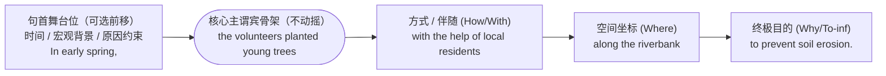

<div class="subtopic-lead" id="s-4-2-1-1"><span class="subtopic-bar">▍</span> <strong>4.2.1.1 核心三步组装法则与三级演进示范</strong></div>

1. **📍 第一步：确立主谓核心（Establish the Core）**
   剥离一切时间、地点、方式和目的修饰，先写出最精简的“主 + 谓 (+ 宾)”骨架构式，锁定全句唯一时态动词。
2. **🗺️ 第二步：启动“GPS”五维追问（Activate the "GPS" Questions）**
   根据交际任务需要，按维度提取待挂载的介词短语或不定式模块（按需选取，不强求每句凑齐五项）：
   * **Where?（空间坐标、方向与场域）**：`along the riverbank`, `in the school auditorium`, `near an abandoned wooden cabin`, `across fifteen developing economies`, `within the cerebral cortex`
   * **When?（时间节点、跨度与先后）**：`at dawn`, `during the lunch break`, `prior to the official launch`, `over the past two decades`, `in the immediate aftermath of the crisis`
   * **How / With what?（方式、工具與伴随状态）**：`with great patience`, `in silence`, `by means of thermal imaging`, `with her hands trembling slightly`, `under strict clinical supervision`
   * **Why / For what?（动因、目的与回应）**：`out of curiosity`, `for fear of waking the child`, `in response to public concerns`, `in an effort to curb inflation`, `to raise funds for rural schools`
   * **Despite what?（让步、代价与现实约束）**：`despite torrential rain`, `against all odds`, `amid escalating geopolitical tensions`, `at the expense of short-term profits`
3. **🔗 第三步：三槽位分流与节律优化（句首舞台位 vs. 句中插入位 vs. 句末延展位）**
   切忌把三四个介词短语机械排成一长串堵在句末。母语写作者通过**三槽位调度**实现句子平衡：
   * **槽位一：句末延展位（End-Slot，默认挂载 1—2 个短坐标）**
     * 裸句：`The rescue team found the hikers.`（搜救队找到了徒步者。）
     * 句末挂载：`The rescue team found the hikers [near an abandoned cabin] (地点) [before dawn] (时间).`（黎明前，搜救队在一座废弃木屋附近找到了徒步者。）
   * **槽位二：句首舞台位 + 句末延展位（Split-Frame 双翼分流——考场与学术最核心布局）**
     * 当存在 3 个及以上坐标时，将**时间、经历背景、原因或让步短语**前移至句首（加逗号设定认知舞台），将**方式、地点与目的**留在主干右侧：
     * 演进示范 A（应用文/活动报道）：
       * 裸句：`Our class held a charity sale.`（我们班举办了一场义卖。）
       * 双翼成句：`[During the lunch break] (时间舞台), our class held a charity sale [on the school playground] (空间) [with the support of the student union] (伴随) [to purchase sports equipment for rural children] (目的).`（午休期间，我们班在学生会的支持下于学校操场举办了一场义卖，为乡村儿童购置体育器材。）
     * 演进示范 B（读后续写/叙事描写）：
       * 裸句：`Mia opened the package.`（Mia 打开了包裹。）
       * 双翼成句：`[On the morning of her birthday] (时间舞台), Mia opened the mysterious package [at the kitchen table] (地点) [with her fingers trembling in anticipation] (伴随状态).`（生日当天早晨，Mia 在厨房餐桌旁打开了那个神秘包裹，手指因期待而微微颤抖。）
     * 演进示范 C（学术议论/政策发布）：
       * 裸句：`The committee announced its decision.`（委员会宣布了决定。）
       * 双翼成句：`[After three hours of heated deliberation] (前序背景), the regulatory committee announced its final decision [at an online press briefing] (地点) [in direct response to growing public anxiety over data privacy] (动因与目的).`（经过三小时的激烈商讨后，监管委员会在线上新闻发布会上宣布了最终决定，以直接回应公众对数据隐私日益加剧的焦虑。）
   * **槽位三：主谓之间双逗号插入位（Mid-Slot，凸显伴随状态、原因或让步张力）**
     * 当某个介词短语专门刻画主语当时的心理状态或紧迫背景时，可用双逗号插入主语与谓语之间，制造叙事停顿：
     * 示范 1（叙事）：`The old fisherman, [despite extreme exhaustion and freezing wind], steered the damaged boat toward the harbor.`（老渔夫尽管极度疲惫且顶着刺骨寒风，仍驾驶着受损的船只驶向港口。）
     * 示范 2（学术）：`Several central banks, [in light of persistent inflationary pressures], have postponed interest rate cuts.`（鉴于持续的通胀压力，多家央行已推迟降息。）

<div class="subtopic-lead" id="s-4-2-1-2"><span class="subtopic-bar">▍</span> <strong>4.2.1.2 多重状语的语序铁律（MPT 默认序列与短前长后调节）</strong></div>

当多个 GPS 短语同时位于动词或宾语右侧时，遵循以下三条排序准则：

1. **默认语义序列：方式（Manner）→ 地点（Place）→ 时间（Time）→ 目的（Purpose）**
   * 与动作本身结合最紧密的“**方式/工具/伴随**”通常紧靠动词或宾语，随后是“**空间地点**”，最外层是“**时间框架**”或“**终极目的**”：
   * `The pianist performed the sonata [with breathtaking passion] (方式) [at the Symphony Hall] (地点) [last night] (时间).`（昨晚，这位钢琴家在交响乐厅以令人惊叹的激情演奏了这首奏鸣曲。）
   * `The technician calibrated the sensor [by hand] (方式) [in the testing chamber] (地点) [before sunrise] (时间) [to ensure zero measurement drift] (目的).`（日出前，技术员在测试舱内手动校准了传感器，以确保零测量漂移。）
2. **空间与时间的内部顺序：先小后大（Small-to-Large Scale）**
   * 与中文“从大到小（中国北京海淀区……）”相反，英语多个同维度坐标并列时遵循“**由小到大、由点到面**”：
   * 空间先小后大：`She waited [at Gate 12] [in Terminal 3] [at Heathrow Airport] [in London].`（她在伦敦希思罗机场 3 号航站楼 12 号登机口等候。）
   * 时间先小后大：`The earthquake struck [at 4:30 a.m.] [on a chilly Tuesday] [in November 2023].`（地震发生在 2023 年 11 月一个寒冷周二的凌晨 4 点 30 分。）
3. **短前长后原则（End-Weight Override）**：
   * 若“地点”极短（如 `in Beijing`），而“方式”或“受众对象”带有长串修饰（如 `to a delegation of experts from fifteen countries`），则**短坐标在前、长坐标在后**：
   * `After two years of fieldwork, Dr. Chen presented the findings [at a conference in Beijing] (短地点在前) [to a delegation of experts from fifteen countries] (长对象在后).`（经过两年的实地调研，陈博士在北京的一场会议上向来自十五个国家的专家代表团展示了研究成果。）
4. **严防中式“动词前状语堆积”红线（Minimal Pairs）**：
   * ❌ 中式语序错误：`*The school next Monday morning in the auditorium to encourage daily reading will launch a campaign.`
   * ✅ 英语双翼布局：`Next Monday morning, the school will launch a reading campaign in the auditorium to encourage students to read for thirty minutes every day.`（下周一上午，学校将在礼堂启动一项阅读活动，鼓励学生每天阅读三十分钟。）
   * ❌ 中式语序错误：`*We with the help of local villagers along the mountain trail before dark found the lost child.`
   * ✅ 英语双翼布局：`With the help of local villagers, we found the lost child along the mountain trail before dark.`（在当地村民的帮助下，我们在天黑前沿着山间小径找到了走失的孩子。）

<div class="subtopic-lead" id="s-4-2-1-3"><span class="subtopic-bar">▍</span> <strong>4.2.1.3 五大高频写作场景的 GPS 短语装配库（带完整例句）</strong></div>

| 写作场景 | 必背核心介词组块 | 三梯度完整实战例句（应用文 / 读后续写 / 学术议论） |
| :--- | :--- | :--- |
| **1. 叙事心理与情绪外化**<br>（读后续写核心） | `in disbelief / panic / relief`<br>`with a sigh of relief`<br>`in a trembling voice`<br>`at the sight/sound of...`<br>`with tears welling up in one's eyes` | • `[At the sight of the rescue helicopter], the stranded climbers waved their jackets [in wild excitement].`（一看到救援直升机，受困的登山者便狂喜地挥舞着夹克。）<br>• `Ella stood [outside the audition room] [with her palms sweating coldly] and whispered her lines [in a barely audible voice].`（Ella 站在试镜室外，手心冒着冷汗，用几乎听不见的声音默念台词。）<br>• `[To everyone's immense relief], the missing puppy emerged [from behind the bushes] [without a single scratch].`（令大家如释重负的是，走失的小狗从灌木丛后钻了出来，毫发无伤。） |
| **2. 因果动因与触发机制**<br>（议论文/说明文） | `out of gratitude / curiosity / fear`<br>`thanks to / owing to / due to`<br>`in light of / in view of`<br>`as a direct consequence of`<br>`at the prompting of` | • `Many teenagers adopt unhealthy diets [out of peer pressure] or [due to a lack of nutritional awareness].`（许多青少年迫于同辈压力或由于缺乏营养意识而养成不健康的饮食习惯。）<br>• `[In light of the alarming decline in pollinator populations], agricultural ministries have restricted pesticide use [across major farming belts].`（鉴于传粉昆虫数量急剧下降，农业部门已限制主要农耕带的农药使用。）<br>• `The ancient frescoes deteriorated rapidly [as a direct consequence of excessive humidity and tourist footfall].`（由于湿度过高和游客踩踏的直接影响，这些古代壁画迅速损毁。） |
| **3. 方式、工具与路径媒介**<br>（科技/方案类） | `by means of / via / through`<br>`with the aid/assistance of`<br>`at the touch of a button`<br>`through trial and error`<br>`in a step-by-step manner` | • `Students can access authentic lectures [from world-renowned universities] [at the touch of a button] [via open online platforms].`（学生只需轻按按钮，即可通过开放网络平台获取世界知名大学的原版课程。）<br>• `The archaeological team reconstructed the bronze vessel [through months of painstaking trial and error] [with the aid of 3D laser scanning].`（考古队借助三维激光扫描技术，历经数月艰苦的反复试验，复原了这件青铜器。）<br>• `Neural networks optimize their internal weights [by means of iterative backpropagation].`（神经网络通过迭代反向传播来优化其内部权重。） |
| **4. 条件、规范与框架约束**<br>（正式书信/学术） | `under the guidance/supervision of`<br>`in accordance with / in compliance with`<br>`on the premise/assumption of`<br>`subject to / conditional upon`<br>`in the absence of` | • `[Under the patient guidance of our coach], we refined our debate arguments [over three weeks of intensive training].`（在教练的耐心指导下，我们通过三周的高强度训练打磨了辩论论点。）<br>• `All clinical trials must be conducted [in strict compliance with international ethical guidelines] [under independent oversight].`（所有临床试验必须在独立监督下、严格遵照国际伦理准则进行。）<br>• `[In the absence of robust empirical evidence], any sweeping policy reform remains premature.`（在缺乏有力实证证据的情况下，任何大刀阔斧的政策改革都为时过早。） |
| **5. 让步、对比与权衡代价**<br>（思辨论证核心） | `despite / in spite of`<br>`notwithstanding`<br>`in stark contrast to`<br>`at the expense of`<br>`regardless of` | • `[Despite her initial hesitation], Sarah stepped onto the stage and delivered the speech [with remarkable poise].`（尽管起初有些犹豫，Sarah 还是走上讲台，神态自若地发表了演讲。）<br>• `[In stark contrast to conventional fossil fuels], solar energy generates electricity [without emitting greenhouse gases].`（与传统化石燃料形成鲜明对比的是，太阳能在发电过程中不排放温室气体。）<br>• `No municipality should pursue rapid industrial expansion [at the expense of public health and ecological integrity].`（任何市政当局都不应以牺牲公众健康和生态完整性为代价来追求快速工业扩张。） |

<div class="subtopic-lead" id="s-4-2-1-4"><span class="subtopic-bar">▍</span> <strong>4.2.1.4 从句向介词短语的“降维提速”转换矩阵（Clause-to-PP Compression）</strong></div>

高阶写作者不会在每一句话里都堆砌 `although / because / when / if` 从句。将次要状语从句压缩为精悍的“**介词 + 名词化短语/动名词**”，是提升句法密度与文体正式度的关键手段：

| 逻辑关系 | 从句模式（较松散，含独立主谓） | 介词短语压缩模式（高密度，无冗余谓语） |
| :--- | :--- | :--- |
| **时间紧接** | `As soon as the prime minister arrived in Geneva, talks began.` | `Upon the prime minister's arrival in Geneva, talks began.`（首相一抵达日内瓦，会谈便随即开始。） |
| **时间前置** | `Before the new regulation was implemented, pollution was severe.` | `Prior to the implementation of the new regulation, pollution was severe.`（在新规实施之前，污染十分严重。） |
| **原因转换** | `Because the supply chain was disrupted, factories halted production.` | `Owing to severe supply chain disruptions, factories halted production.`（由于严重的供应链中断，工厂暂停了生产。） |
| **让步转换** | `Although the team lacked adequate funding, they completed the project.` | `Despite a severe shortage of funding, the team completed the project.`（尽管资金严重短缺，团队仍完成了该项目。） |
| **条件转换** | `If there is no parental supervision, children may overuse screens.` | `In the absence of parental supervision, children may overuse screens.`（在缺乏家长监督的情况下，儿童可能会过度使用电子屏幕。） |
| **目的转换** | `The city widened the sidewalks so that pedestrians could walk safely.` | `The city widened the sidewalks for the safety of pedestrians / with a view to improving pedestrian safety.`（为保障行人安全，该市拓宽了人行道。） |

---

### 4.2.2 定语从句写作：“信息嫁接”模型 (The "Information Grafting" Model)

在中文里，无论多长的修饰语都可以加个“的”字塞到名词前面（如“【昨天在国际会议上发表重要演讲并引发广泛讨论的那位】科学家”）；而在英语中，一旦修饰成分包含动词或介词短语，就必须放到核心名词**右侧**。**定语从句（Relative Clause）** 就是把另一个句子像“果树嫁接”一样，通过关系词精准嫁接到主句某个**锚点名词（先行词 Antecedent）** 或**整句事件**右侧的句法机制。


<div class="subtopic-lead" id="s-4-2-2-1"><span class="subtopic-bar">▍</span> <strong>4.2.2.1 核心抉择：限制性 vs. 非限制性定语从句的认知分水岭</strong></div>

写定语从句的第一步不是选 `which` 还是 `that`，而是判断：**这个从句是用来“缩小范围、辨明身份（没它就不知道指谁）”，还是“在对象已经明确的前提下补充背景/结果（加个括号顺带一提）”？**

<div class="classification-grid">
<div class="classification-card">
<div class="classification-title">🆔 岔路口 A：限制性定语从句（限定身份 · The ID Filter）</div>
<div class="classification-detail">
<ul>
<li><strong>认知功能</strong>：在同类集合中<strong>圈定子集、定义特征、辨明所指</strong>（回答“究竟是哪一个/哪一类？”）。删去后，主句所指对象变得宽泛不明或违背原意。</li>
<li><strong>标点与语音</strong>：<strong>绝对不用逗号</strong>隔开；口语中与先行词连成同一语调群，无停顿。</li>
<li><strong>关系词选择</strong>：指人作主语用 <code>who / that</code>，作宾语用 <code>who / whom / that / 省略</code>；指物用 <code>that / which</code>（作宾语可省略）；表所属用 <code>whose</code>；表时间/地点/原因用 <code>when / where / why</code>。</li>
<li><strong>三梯度典型范例</strong>：
  <ul>
  <li><strong>日常/应用文</strong>：<code>Students who wish to join the robotics club should submit their forms by Friday.</code>（希望加入机器人俱乐部的学生请在周五前提交报名表——圈定特定学生群体）。</li>
  <li><strong>读后续写</strong>：<code>He stared at the faded photograph that his grandfather had kept in his wallet for fifty years.</code>（他凝视着祖父在钱包里珍藏了五十年的那张褪色照片——锁定具体照片）。</li>
  <li><strong>学术议论</strong>：<code>Countries that invest heavily in early childhood education tend to exhibit higher long-term social mobility.</code>（大力投资早期儿童教育的国家往往展现出更高的长期社会流动性——界定国家类型）。</li>
  </ul>
</li>
</ul>
</div>
</div>

<div class="classification-card">
<div class="classification-title">📝 岔路口 B：非限制性定语从句（补充评述 · The Spotlight Note）</div>
<div class="classification-detail">
<ul>
<li><strong>认知功能</strong>：先行词本身已是<strong>唯一确定或已知的实体</strong>（专有名词、独一无二的事物、已被前文锁定的对象），从句仅用于<strong>追加背景解释、引出自然结果或发表总结评价</strong>。</li>
<li><strong>标点与语音</strong>：<strong>必须使用逗号</strong>（处于句中时用双逗号 <code>, ...,</code>）与主句隔开；口语中有明显停顿。</li>
<li><strong>关系词铁律</strong>：<strong>绝对禁用 <code>that</code>，且关系词绝对不可省略</strong>！指人用 <code>who / whom</code>，指物或指代整句用 <code>which</code>，所属用 <code>whose</code>，地点时间用 <code>where / when</code>。</li>
<li><strong>三梯度典型范例</strong>：
  <ul>
  <li><strong>日常/应用文</strong>：<code>Ms. Patel, who founded our community science club ten years ago, will deliver the opening speech.</code>（十年前创办我们社区科学俱乐部的 Patel 女士将发表开幕致辞——双逗号补充资历）。</li>
  <li><strong>读后续写</strong>：<code>The old lighthouse, which had withstood countless Atlantic storms, stood silhouetted against the crimson sky.</code>（那座经受过无数次大西洋风暴洗礼的老灯塔，在深红色的天幕下映出轮廓——补充沧桑背景）。</li>
  <li><strong>学术议论</strong>：<code>Solar photovoltaic costs have plummeted by 80% over the past decade, which has accelerated the global transition toward clean energy.</code>（过去十年间太阳能光伏成本暴跌了 80%，这加速了全球向清洁能源的转型——修饰整句事实）。</li>
  </ul>
</li>
</ul>
</div>
</div>
</div>

> [!cn-warning]
> **排他性边界警示（对应练习册第 9 题）**：
> 限制性定语从句只声明“所谈论的集合具备某性质”，**并不自动包含“只有（only）这群人才可以”的排他逻辑**！
> * 普通限定：`The students who returned their consent forms before Friday may join the field trip.`（交表的学生可以去，但没明说没交表的是否绝对不能去）。
> * 显性排他：若题意明确要求表达“**只有**按时交表的学生才可以参加”，必须在先行词前显性加上 **`Only`**：
>   `Only the students who returned their consent forms before Friday may join the field trip.`（只有周五前交回同意书的学生才可以参加实地考察。）

<div class="subtopic-lead" id="s-4-2-2-2"><span class="subtopic-bar">▍</span> <strong>4.2.2.2 认知突破：修饰前文整句事件的 <code>, which...</code> 构式</strong></div>

非限制性定语从句最强大的议论与叙事功能，是用 `, which...` 锚定**前文整个主句所描述的事件或状态**（此时 `which` 相当于 `and this fact/situation`），在句末顺势导出该事件引发的**客观结果、深远影响或作者评价**：

1. **导出客观结果（常用动词：`allow, enable, lead to, trigger, make it possible...`）**
   * 分句原稿：`The municipal library extended its weekend opening hours. This allowed more working parents to visit with their children.`
   * 嫁接升级：`The municipal library extended its weekend opening hours, which allowed more working parents to visit with their children.`（市图书馆延长了周末开放时间，这让更多职场父母能带孩子前来阅读。）
   * 学术范例：`Global surface temperatures rose by 1.2°C above pre-industrial levels, which triggered widespread coral bleaching across tropical reefs.`（全球地表温度较工业化前水平上升了 1.2°C，这引发了热带礁区大面积的珊瑚白化。）
2. **给出定性评价（常用结构：`which constituted..., which was a testament to..., which proved...`）**
   * 学术范例：`The consortium failed to disclose the critical safety data during Phase II trials, which constituted a direct breach of international regulatory standards.`（该财团在二期临床试验期间未披露关键安全数据，这直接违反了国际监管标准。）
   * 叙事范例：`He returned the lost wallet without taking a single coin, which deeply moved the elderly owner.`（他分文未取地归还了遗失的钱包，这深深打动了年迈的失主。）
3. **谓语单复数铁律**：当 `, which` 指代前文整件事时，从句谓语动词若为一般现在时，**一律按单数第三人称处理**（如 `, which makes / shows / means...`）。

<div class="subtopic-lead" id="s-4-2-2-3"><span class="subtopic-bar">▍</span> <strong>4.2.2.3 四步精准嫁接算法：从两个独立句到高阶复合句</strong></div>

把两条包含共同对象的独立信息合成为定语从句时，严格执行以下“**四步嫁接法**”，可彻底杜绝“漏主句谓语”或“从句多写代词”两大顽疾：

* **🔹 第一步：选定主干句（Determine the Matrix Clause）**
  判断哪句话是全句要传达的核心论断（保留为主句），哪句话是辅助限定或背景说明（降级为从句）。
* **🔹 第二步：锁定共同锚点（Locate the Shared Pivot）**
  找出两句话中指代同一人或物的名词。
* **🔹 第三步：角色诊断与关系词替换（Role Diagnosis & Relativization）**
  看该共同名词在**从句**内部充当什么成分（主语、宾语、定语还是状语），换为对应的关系词并移至从句句首，**同时彻底删去从句中原有的重复代词（如 `he, she, it, them, there, then`）**！
* **🔹 第四步：嵌入核验（Embed & Verify）**
  将从句紧贴在主句锚点名词之后，用“括号剥离法”检查主句和从句是否各自拥有完整的谓语动词。

| 共同对象在从句中的角色 | 原料分句（句 1 主干 + 句 2 接穗） | 嫁接推导与正误核验 |
| :--- | :--- | :--- |
| **作从句主语**<br>（不可省略关系词） | 句1：`The neuroscientist won the Nobel Prize.`<br>句2：`She discovered the memory receptor.` | • `She` 在句 2 作主语 → 换为 `who`<br>• ✅ `The neuroscientist [who discovered the memory receptor] won the Nobel Prize.`（发现记忆受体的那位神经科学家荣获了诺贝尔奖。）<br>• ❌ 严禁残留代词：`*The neuroscientist who she discovered...` |
| **作从句动词宾语**<br>（限定性可省略） | 句1：`The empirical model has been widely adopted.`<br>句2：`Dr. Lin developed the model in 2021.` | • `the model` 在句 2 作 `developed` 的宾语 → 换为 `that/which/省略` 并前移至从句首<br>• ✅ `The empirical model [(that/which) Dr. Lin developed in 2021] has been widely adopted.`（林博士于 2021 年开发的实证模型已被广泛采用。）<br>• ❌ 严禁残留宾语：`*The model that Dr. Lin developed it...` |
| **作所属限定语**<br>（`whose + 名词`） | 句1：`The artist donated twelve paintings to the town.`<br>句2：`Her childhood was spent in the town.` | • 句 2 中並非 `Her` 等于 `the town`！若以 `the artist` 为锚点，`Her childhood` = `whose childhood`：<br>• ✅ `The artist, [whose childhood was spent in the town], donated twelve paintings to it.`（那位童年在该镇度过的艺术家向小镇捐赠了十二幅画作。）<br>• 若以 `the town` 为地点锚点，则用 `where`：<br>• ✅ `The artist donated twelve paintings to the town [where her childhood was spent].`（这位艺术家向她度过童年的小镇捐赠了十二幅画作。） |

<div class="subtopic-lead" id="s-4-2-2-4"><span class="subtopic-bar">▍</span> <strong>4.2.2.4 关系代词 vs. 关系副词：看“从句动词缺不缺宾语”，不看先行词字面意思！</strong></div>

中国学习者最经典的陷阱是：“看到先行词是地点名词（如 `library, park, city`）就无脑填 `where`；看到先行词是时间名词（如 `day, afternoon, era`）就无脑填 `when`”。
**认知铁律**：选关系代词（`which/that`）还是关系副词（`where/when/why`），**唯一取决于先行词放回从句后，在从句内部充当“主语/宾语（名词性论元）”还是“地点/时间/原因状语（介词短语）”**！

| 先行词类型 | 从句内部还原检测 | 角色判定与正确关系词 | 典型正误/最小对立对（Minimal Pairs） |
| :--- | :--- | :--- | :--- |
| **具体地点名词**<br>（`park, library, museum`） | 还原 1：`We visited [the wetland park] last month.`（作及物动词 `visited` 的**宾语**）<br>还原 2：`Over 200 bird species live [in the wetland park].`（作**地点状语**） | • 缺宾语 → **`which / that`（或省略）** <br>• 作状语 → **`where`（或 `in which`）** | • ✅ `The wetland park [that/which we visited last month] covers 500 hectares.`（我们上个月参观的那个湿地公园占地 500 公顷。）<br>• ✅ `We visited a wetland park [where / in which more than 200 bird species have been recorded].`（我们参观了一个记录有 200 多种鸟类的湿地公园。） |
| **抽象空间/情境名词**<br>（`point, stage, situation, case, system, atmosphere, era`） | 还原 1：`He described [a complex situation].`（作 `described` 的**宾语**）<br>还原 2：`No single party holds a majority [in this situation].`（作**抽象空间状语**） | • 缺宾语 → **`which / that`**<br>• 作状语 → **`where`（隐喻空间点，高考/四六级极高频考点！）** | • ✅ `The situation [that the negotiators faced] was unprecedented.`（谈判代表面临的局面是前所未有的。）<br>• ✅ `The negotiations reached a critical point [where neither side was willing to compromise].`（谈判到了双方均不愿妥协的关键节点。）<br>• ✅ `Schools should foster an inclusive atmosphere [where students feel safe to express dissenting views].`（学校应营造一种包容的氛围，让学生能安心表达不同意见。） |
| **时间名词**<br>（`day, afternoon, period, decade`） | 还原 1：`I still remember [the afternoon] clearly.`（作 `remember` 的**宾语**）<br>还原 2：`Our debate team won its first title [on that afternoon].`（作**时间状语**） | • 缺宾语 → **`which / that`（或省略）** <br>• 作状语 → **`when`（或 `on/in/during which`）** | • ✅ `The afternoon [that we spent at the botanical garden] remains unforgettable.`（我们在植物园度过的那个下午至今令人难忘。）<br>• ✅ `I still remember the afternoon [when / on which our debate team won its first regional championship].`（我依然记得我们辩论队赢得首个地区冠军的那个下午。） |
| **原因名词**<br>（`reason`） | 还原 1：`The committee rejected [the reason] he gave.`（作 `gave` 的**宾语**）<br>还原 2：`The flight was delayed [for this reason].`（作**原因状语**） | • 缺宾语 → **`which / that`（或省略）** <br>• 作状语 → **`why`（或 `for which`）** | • ✅ `The reason [(that/which) he offered for his absence] was unconvincing.`（他为缺席给出的理由难以令人信服。）<br>• ✅ `The reason [why / for which the flight was delayed] was severe turbulence.`（航班延误的原因是遇到了强气流。） |

<div class="subtopic-lead" id="s-4-2-2-4-1"><span class="subtopic-bar">▍</span> <strong>4.2.2.4.1 高阶利器一：“介词 + which/whom”吹笛移位（Pied-Piping）vs. 介词搁置</strong></div>

当从句中的动词、形容词或名词与先行词之间通过特定介词连接时，存在两种语体形式：

1. **介词搁置（Preposition Stranding，介词留在从句末尾——适合口语与日常书信）**：
   * `The online platform (that/which) students book individual meetings through is very convenient.`（学生用来预约单独会面的那个网络平台非常方便。）
2. **吹笛移位（Pied-Piping，介词随关系词移至从句开头——适合考场大作文、学术与正式文书）**：
   * **结构铁律**：介词前置后，指人**必须用 `whom`**，指物**必须用 `which`**，指所属**用 `whose + 名词`**（**绝对禁止在介词后写 `that` 或 `who`，也不可省略关系词**！）。
   * **四大介词选型逻辑与例句**：
     * **看从句动词/形容词的固定搭配**：
       * `collaborate with` → `The international institutions [with which our laboratory collaborated] provided key genomic datasets.`（与我们实验室合作的国际机构提供了关键基因组数据集。）
       * `rely on` → `The primary sources [upon which the historian relied] were recently declassified.`（那位历史学家所依据的一手史料已于近期解密。）
     * **看先行词在从句中的空间/通道/工具关系**：
       * `through the platform`（练习册第 14 题）→ `The school created an online platform [through which students can book individual meetings with teachers].`（学校搭建了一个网络平台，学生可通过该平台预约与老师单独会面。）
       * `in the laboratory` → `The sterile chamber [in which the cultures were incubated] was maintained at 37°C.`（孵化培养物的无菌室保持在 37 摄氏度。）
     * **看复合介词搭配（`without which`, `by means of which`, `in the light of which`）**：
       * `The treaty established a verification mechanism, [without which mutual disarmament would have been impossible].`（该条约建立了一套核查机制，若无该机制，双方裁军根本无法实现。）
       * `He developed a novel staining technique, [by means of which individual neurons could be visualized].`（他开发了一种新型染色技术，借此可以使单个神经元清晰显影。）
     * **“介词 + `whose` + 名词”构式**：
       * `Professor Morales, [under whose supervision I completed my thesis], recommended me for the fellowship.`（指导我完成学位论文的 Morales 教授推荐我申请这项奖学金。）

<div class="subtopic-lead" id="s-4-2-2-4-2"><span class="subtopic-bar">▍</span> <strong>4.2.2.4.2 高阶利器二：部分与整体量化定语从句（<code>Quantifier / Superlative + of + whom/which</code>）</strong></div>

在学术汇报、图表作文与高阶记叙文中，当主句引入一组复数实体或数据，随后需要对其中的**一部分、大多数、全部、两者之一或最突出者**作进一步说明时，使用 **`量词/数词/最高级 + of + whom（指人）/ which（指物）`** 是最地道、最紧凑的句法桥梁：

$$
\text{Main Clause (Plural Noun / Number)} + \text{,} + \left[ \text{all / most / many / some / both / neither / percentage / the + superlative} \right] + \text{of} + \text{whom / which} + \text{Predicate}
$$

* **高分实战例句矩阵**：
  1. **统计比例型（图表与研究报告必备）**：
     * `The longitudinal study tracked 1,200 adolescents, [over 70% of whom reported improved sleep quality after reducing late-night screen exposure].`（这项纵向研究追踪了 1,200 名青少年，其中超过 70% 的人在减少深夜屏幕使用后睡眠质量有所改善。）
  2. **二元全部/全否型（`both of which` / `neither of whom`）**：
     * `The committee reviewed two competing infrastructure proposals, [neither of which adequately addressed long-term flood risks].`（委员会审议了两份相互竞争的基础设施方案，但两者均未充分应对长期洪涝风险。）
  3. **部分列举与最高级型（人物与群像刻画）**：
     * `The rescue team consisted of twelve volunteers, [three of whom were retired firefighters] and [the youngest of whom was only nineteen].`（救援队由十二名志愿者组成，其中三人是退役消防员，最年轻的仅十九岁。）
  4. **名词部分从属型（`the Noun of which` = `whose Noun`）**：
     * `They took shelter in an abandoned stone chapel, [the roof of which had partially collapsed during the storm].`（他们在一座废弃的石砌小教堂里避雨，教堂的屋顶已在暴风雨中部分坍塌。）

> [!cn-warning]
> **致命红线：有逗号无并列连词 `and` 时，绝对不能用 `them` 代替 `whom/which`！**
> * ❌ 逗号粘连错误（Comma Splice）：`*The museum displayed fifty bronze artifacts, most of them dated back to the Shang Dynasty.`
> * ✅ 方案 A（非限制性定语从句，无 `and` 用 `which`）：`The museum displayed fifty bronze artifacts, [most of which dated back to the Shang Dynasty].`（博物馆展出了五十件青铜器，其中大多数可追溯至商代。）
> * ✅ 方案 B（并列分句，加 `and` 用 `them`）：`The museum displayed fifty bronze artifacts, [and most of them dated back to the Shang Dynasty].`
> * ✅ 方案 C（独立主格结构，无 `and` 用 `them` + **非谓语分词**）：`The museum displayed fifty bronze artifacts, [most of them dating back to the Shang Dynasty].`

<div class="subtopic-lead" id="s-4-2-2-5"><span class="subtopic-bar">▍</span> <strong>4.2.2.5 关系词省略边界：何时能省？何时绝对禁省？</strong></div>

省略关系词能让句子更紧凑流畅，但必须同时满足以下**三大刚性条件**：
1. **必须是限制性定语从句**（一旦有逗号的非限制性从句，任何关系词绝对不可省！）；
2. **关系词在从句中必须充当宾语**（作主语时不可省：如 `The boy who broke the window fled` 中的 `who` 不可省，否则两个谓语动词 `broke` 与 `fled` 直接撞车！）；
3. **介词没有随关系词一起前置**（`the teacher (who/whom/that) Maya spoke to` 可省关系词；但一旦介词前置为 `the teacher to whom Maya spoke`，`whom` 绝对不可省！）。

* *时间与方式关系副词的特例省略*：在限制性从句中，当先行词为 `the time / day / moment / year` 时，`when / that` 常可省略（如 `I will never forget the day (when/that) we first met.`）；当先行词为 `the way` 时，定语从句引导词可用 `in which`、`that` 或**直接省略**（如 `I admire the way (that / in which) she handled the crisis.`，**严禁写 `*the way how`**！）。

<div class="subtopic-lead" id="s-4-2-2-6"><span class="subtopic-bar">▍</span> <strong>4.2.2.6 逗号、跨层锚点歧义与精准消歧手术</strong></div>

当先行词前面或后面带有另一个名词（如 `the assistant of the scientist` 或 `the museum's east wing`）时，定语从句极易引发**远近锚点歧义（Antecedent Ambiguity，对应练习册第 16 题）**：

* **歧义原句**：`The editor interviewed the assistant of the scientist who had discovered the error.`
  * 读者困惑：发现错误的究竟是离 `who` 最近的 `the scientist`，还是核心宾语 `the assistant`？
* **三大精准消歧方案**：
  1. **若发现错误的是“助手（the assistant）”**：
     * 方案 A（拆解介词链，让从句紧贴 `assistant`）：`Working for the scientist, the assistant who had discovered the error was interviewed by the editor.`
     * 方案 B（分句重排，最清晰稳妥）：`The editor interviewed the scientist's assistant, who had discovered the error.`（或拆为两句：`The editor interviewed the scientist's assistant. It was the assistant who had discovered the error.`）
  2. **若发现错误的是“科学家（the scientist）”**：
     * 方案 A（所有格前置 `scientist's` 虽简洁，但不可再接修饰 `scientist` 的从句！此时应以 `scientist` 为锚点重排）：`The editor interviewed the assistant working for the scientist who had discovered the error.`
     * 方案 B（分句指明）：`After the scientist discovered the error, the editor interviewed her assistant.`

<div class="subtopic-lead" id="s-4-2-2-7"><span class="subtopic-bar">▍</span> <strong>4.2.2.7 定语从句的“减重瘦身法则”（Relative Clause Reduction）</strong></div>

在一段文字中连续出现三四个 `who / which / that` 会使行文显得笨拙拖沓。当定语从句满足特定条件时，将其**减重压缩（Reduce）** 为非谓语短语、同位语或后置形容词短语，是迈向高阶文体的必经之路：

| 瘦身转化方向 | 定语从句原句（较繁琐） | 减重瘦身后的高阶构式（更精炼） | 适用条件与语义守恒边界 |
| :--- | :--- | :--- | :--- |
| **1. 缩减为现在分词短语 (`V-ing`)** | `Students who live off campus must register their addresses.` | `Students [living off campus] must register their addresses.`（在校外居住的学生必须登记住址。） | 主语关系词 + 主动动词（表常态、进行或特征）可直接化为 `V-ing`。 |
| **2. 缩减为过去分词短语 (`V-ed`)** | `The data which were collected during the survey revealed a clear trend.` | `The data [collected during the survey] revealed a clear trend.`（调查期间收集的数据揭示了清晰的趋势。） | `who/which/that + be + V-ed`（被动）可直接删去关系词与 `be`，保留 `V-ed`。 |
| **3. 缩减为后置形容词短语 (`AdjP`)** | `Anyone who is eligible for the scholarship may apply online.` | `Anyone [eligible for the scholarship] may apply online.`（任何符合奖学金申请资格的人均可在线申请。） | `who/which/that + be + 形容词短语` 可删去关系词与 `be`。 |
| **4. 缩减为名词同位语 (`NP`)** | `Ms. Patel, who is the founder of the science club, gave a speech.` | `Ms. Patel, [the founder of the science club], gave a speech.`（科学俱乐部创始人 Patel 女士发表了演讲。） | 非限制性 `who/which + be + 身份/定义名词` 可直接删去 `who/which + be`，化为同位语。 |
| **5. 缩减为不定式后置定语 (`to do`)** | `Marie Curie was the first woman who won a Nobel Prize.` | `Marie Curie was the first woman [to win a Nobel Prize].`（居里夫人是第一位荣获诺贝尔奖的女性。） | 先行词含序数词（`the first/last`）、最高级或 `the only` 时，首选 `to do`。 |

> [!cn-warning]
> **不可盲目瘦身的两条红线**：
> 1. **含有情态动词或特殊时态反差时不可删**：`the report which might be published next month` **绝不能**缩减为 `*the report published next month`（后者变成了“已经发表”，丢失了 `might` 的可能性与未来时间！此时若想简化，应改用 `likely to be published next month`）。
> 2. **瞬间一次性动作一般不缩减为限定性 `-ing`**：`The man who phoned you just now left a message.` 不宜缩减为 `*The man phoning you just now...`（因 `phoned just now` 是已结束的瞬间过去动作，而非持续状态）。

<div class="subtopic-lead" id="s-4-2-2-8"><span class="subtopic-bar">▍</span> <strong>4.2.2.8 定语从句八维写作终检清单</strong></div>

完成定语从句组装后，依次核对以下八项指标：
* ☑ **1. 共同指代唯一**：主从句共享的锚点名词是否所指完全同一？是否存在跨层锚点歧义？
* ☑ **2. 主句骨架完整**：把定语从句整块括号盖住后，主句自身是否拥有完整的主语和限定谓语动词？
* ☑ **3. 从句角色准确**：先行词放回从句后究竟作主语、宾语、所属定语还是时空/原因状语？（勿见地点就填 `where`！）
* ☑ **4. 冗余代词清零**：从句内部是否已彻底删去被关系词替代的代词（严禁 `*the book that I bought it`、`*the park where we went there`）？
* ☑ **5. 标点与关系词匹配**：非限制性从句是否加了逗号？逗号后是否误用了 `that`？是否表达排他含义时漏了 `Only`？
* ☑ **6. 介词与量化构式合规**：介词前置时是否严格使用了 `whom / which`？`most of whom/which` 是否避免了写成无连词的 `*most of them`？
* ☑ **7. 双层主谓一致**：从句谓语动词是否与**先行词本尊**保持单复数一致（特别是 `one of the + 复数名词 + who/that + 复数动词` vs. `the only one of the + 复数名词 + who/that + 单数动词`）？
* ☑ **8. 适度减重瘦身**：能否将冗长的 `who/which + be` 精简为分词短语或同位语？简化后是否丢失了情态（`may/might`）或时态信息？

> [!cn-practice]
> **配套练习**：练习全书第4篇 **4.2节（写作组2）**、**4.3.2节（第9—16题）**、**4.3.5节（第35—37题：抽象空间 `where`、量化定从与减重瘦身）** 及 **4.7节（第121—132题）**。

<div style="page-break-before: always; break-before: page;"></div>

### 4.2.3 名词性从句写作：“概念包裹”模型 (The "Idea Package" Model)

<div class="subtopic-lead" id="s-4-2-3-1"><span class="subtopic-bar">▍</span> <strong>4.2.3.1 认知本质：从小句命题到名词性论元打包</strong></div>

在日常简单句中，充当主语或宾语的通常是一个具体的人或物（如 `Maya bought a book.`）；但在高阶思维与学术议论中，我们讨论的对象往往不再是单个物品，而是**一整件事、一个完整的事实判断、一个悬而未决的问题或一项政策主张**。

认知句法将这种机制称为“**概念包裹（Proposition Packaging）** ”：
一个原本独立的完整句子（如 `Adequate sleep improves memory consolidation`），在句首套上专用的**连接词封装器（Complementizer）** 后，整句话被打包降级为一个“**抽象名词性包裹**”，从而可以自由嵌入主句的**主语、宾语、表语或同位语**四大论元槽位中：

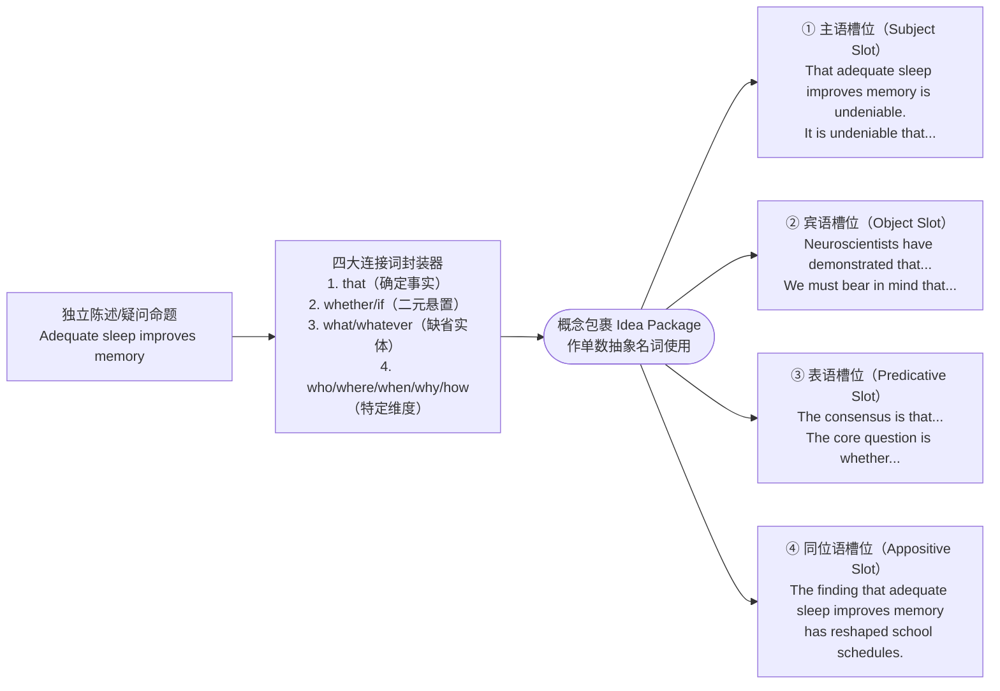

<div class="subtopic-lead" id="s-4-2-3-2"><span class="subtopic-bar">▍</span> <strong>4.2.3.2 四大封装器的结构本质与正误最小对立对（Minimal Pairs）</strong></div>

名词性从句写作中最常见的语法崩塌，源于分不清封装器在从句内部“**到底充不充当成分**”以及“**从句语序是否还原**”。下表彻底厘清四大封装家族的认知与句法边界：

| 封装器家族 | 认知功能 | 从句内部结构铁律 | 典型正误最小对立对（Minimal Pairs） |
| :--- | :--- | :--- | :--- |
| **1. `that`**<br>（纯事实封装器） | 打包一个**确定无疑的完整陈述命题**（本身无词汇意义） | • `that` **不充当任何成分**；<br>• 后面的从句必须**主谓（宾/表）完全自足**！ | • ❌ `*I know that Maya bought yesterday.`（`bought` 缺宾语）<br>• ✅ `I know that Maya bought the novel yesterday.`（我知道 Maya 昨天买了那本小说。）<br>• ✅ `The investigation revealed that the equipment had failed due to poor maintenance.`（调查表明，设备因维护不善而发生故障。） |
| **2. `what / whatever`**<br>（融合代词包装器） | 相当于 `the thing(s) that` 或 `anything that`，直接指代从句所缺的未知事物 | • `what` **必须在从句内部充当主语、宾语或表语**；<br>• 从句内部必定留有**一个论元空缺（Gap）**！ | • ❌ `*I know what Maya bought the novel yesterday.`（宾语重复）<br>• ✅ `I know what Maya bought yesterday.`（我知道 Maya 昨天买了什么——`what` 作 `bought` 宾语）<br>• ✅ `What truly matters in scientific inquiry is reproducible evidence.`（科学探究中真正重要的是可重复验证的证据——`what` 作 `matters` 主语）<br>• ✅ `Students may choose whatever research topic interests them most.`（学生可以选择自己最感兴趣的任何研究课题。） |
| **3. `whether / if`**<br>（二元悬置包装器） | 打包一个**是非未知、有待抉择的双可能性问题**（译为“是否”） | • 不充当主干论元，从句内部**结构完整**；<br>• **主语从句、表语从句、同位语从句、介词后、紧接 `or not` 或不定式前，只能用 `whether`，严禁用 `if`！** | • ❌ `*If the new policy will curb inflation remains uncertain.`（句首主从误用 `if`）<br>• ✅ `Whether the new policy will curb inflation remains uncertain.`（新政策能否抑制通胀仍不确定。）<br>• ❌ `*Success depends on if we can secure sufficient funding.`（介词后误用 `if`）<br>• ✅ `Success depends on whether we can secure sufficient funding.`（成功与否取决于我们能否获得充足的资金。） |
| **4. `who / whom / whose / which / where / when / why / how`**<br>（特定维度包装器） | 将特殊疑问句转换为陈述性的未知信息包裹 | • 封装词在从句中充当相应的主/宾/定/状语；<br>• **绝对铁律：从句必须彻底恢复“主语 + 谓语”陈述语序，严禁残留助动词倒装！** | • ❌ `*I wonder why did the organizers change the venue at the last minute.`（残留疑问倒装 `did... change`）<br>• ✅ `I wonder why the organizers changed the venue at the last minute.`（我想知道主办方为何在最后一刻更换了场地。）<br>• ❌ `*How can we balance economic growth with environmental protection is a global challenge.`<br>• ✅ `How we can balance economic growth with environmental protection is a global challenge.`（我们如何平衡经济增长与环境保护是一项全球性挑战。） |

<div class="subtopic-lead" id="s-4-2-3-3"><span class="subtopic-bar">▍</span> <strong>4.2.3.3 主语槽位双雄：<code>It</code> 形式主语平衡构式 vs. <code>What</code> 聚焦型主语从句</strong></div>

当把一个名词性从句放在主语位置时，写作者拥有两种截然不同但同样强大的修辞武器：

1. **武器一：形式主语 `It` 的尾重平衡构式（End-Weight Balancing）**
   * **认知机理**：直接把长 `that` 从句放在句首（如 `That adequate sleep improves concentration is widely recognized.`）虽然语法正确，但在头重脚轻时容易造成读者阅读卡顿。用轻巧的虚词 `It` 先占住主语槽，让核心评价（`is widely recognized`）瞬间落地，再把沉重的从句包裹移至句末，是最地道的学术句式。
   * **四大高分 `It` 形式主语母句矩阵（直接背诵调用）**：
     * **客观必然与紧迫性（`It + be + adj. + that... [should] do`）**：
       * `It is imperative / essential / vital that regulatory authorities (should) establish transparent auditing standards.`（监管机构亟需建立透明的审计标准。）
       * `It is likely / probable that the revised timetable will significantly reduce morning congestion.`（修订后的时间表很可能会显著缓解早高峰拥堵——练习册第 18 题）
     * **学术共识与被动报道（`It + be + V-ed + that...`）**：
       * `It is widely acknowledged / universally recognized / well documented that early childhood nutrition shapes lifelong health.`（人们普遍认为，儿童早期的营养状况会影响终生健康。）
       * `It has been empirically demonstrated / statistically proven that prolonged exposure to noise impairs cognitive performance.`（实证研究已表明，长期暴露于噪音环境会损害认知表现。）
     * **认知评价与情感反应（`It + be + noun / adj. + that/whether...`）**：
       * `It remains a matter of intense debate whether artificial general intelligence can possess genuine consciousness.`（通用人工智能能否拥有真正的意识，目前仍存在激烈争论。）
       * `It is a common misconception that memorization alone guarantees language proficiency.`（认为光靠死记硬背就能保证语言精通，是一种常见的误区。）
     * **动词型形式主语（`It + verb + that...`）**：
       * `It dawned on her that honesty was the only way to repair their friendship.`（她突然明白，坦诚是修复他们友谊的唯一途径——读后续写心理顿悟经典句）
       * `It turned out that the anomalous signal originated from a malfunctioning satellite.`（结果证明，该异常信号源自一颗发生故障的卫星。）

2. **武器二：`What` 引导的主语从句（聚焦型伪裂句 Pseudo-Cleft Construction）**
   * **认知机理**：当你想在段首或句首制造强烈的**悬念与对比聚焦**时，用 `What + 从句 + is/was + 表语焦点（或 that 从句）`！前半部分的 `What` 从句像聚光灯一样框定预设话题，在系动词 `is/was` 之后重重抛出全句真正的**核心论点**：
   * **三梯度实战范例**：
     * **应用文/演讲稿**：`What impressed the foreign guests most was the warmth and hospitality of the student volunteers.`（最令外国嘉宾印象深刻的是学生志愿者们的热情好客。）
     * **读后续写（心理与细节聚焦）**：`What terrified the boy in the dark forest was not the howling wind, but the sudden, absolute silence that followed.`（在黑暗森林中令男孩恐惧的不是呼啸的狂风，而是随之而来的突然而绝对的死寂。）
     * **学术议论（破题立论利器）**：
       * `What distinguishes rigorous scientific inquiry from mere speculation is the testability of its hypotheses.`（将严谨的科学探究与纯粹的臆测区分开来的，是其假说的可检验性。）
       * `What the longitudinal data reveal is that socioeconomic status alone cannot account for the variance in academic resilience.`（纵向数据所揭示的是，仅凭社会经济地位无法解释学业抗逆力方面的差异。）

<div class="subtopic-lead" id="s-4-2-3-4"><span class="subtopic-bar">▍</span> <strong>4.2.3.4 宾语与表语槽位：高阶矩阵动词、形式宾语 <code>it</code> 与表语因果链</strong></div>

1. **宾语槽位一：高阶认知与论证动词 + 名词性从句**
   告别千篇一律的 `I think that... / People say that...`，按论证功能升级主句谓语动词：
   * **揭示与证实**：`The investigation revealed / uncovered / confirmed that...`、`Empirical findings indicate / demonstrate / suggest that...`
   * **主张与反驳**：`Proponents of the policy contend / maintain / argue that...`、`Critics counter / point out that...`
   * **确保与见证**：`The new protocol ensures / guarantees that...`、`The past decade has witnessed how digital platforms have transformed retail.`
2. **宾语槽位二：`Verb + it + Adj./Noun + that从句 / to do`（形式宾语构式——高频核心考点！）**
   * **结构铁律**：当及物动词（`make, find, think, consider, deem, feel, take`）后面既带有**宾语从句（或不定式）**，又带有修饰该从句的**宾语补足语（形容词或名词）** 时，英语**严禁把长从句直接夹在动词和补语中间**，必须先放形式宾语 **`it`**，再放补语，最后放 `that` 从句或 `to do`！
   * $$ \text{Subject} + \text{make / find / consider / deem} + \mathbf{it} + \text{Adj. / Noun} + \text{that-clause / to-infinitive} $$
   * **正误对照与高分例句**：
     * ❌ 中式语序错误：`*High-speed rail has made that people travel between cities in a few hours possible.`
     * ✅ 形式宾语修正：`High-speed rail has made it possible that people can travel between cities in a few hours.`（高铁使人们在几小时内穿梭于城市之间成为可能——或 `made it possible for people to travel...`）
     * ✅ `Many urban residents find it increasingly challenging to balance demanding careers with family responsibilities.`（许多城市居民发现，兼顾繁重的事业与家庭责任正变得越来越具挑战性。）
     * ✅ `We must make it clear to the public that environmental protection is not optional.`（我们必须向公众阐明，环境保护绝非可有可无。）
     * ✅ `One should never take it for granted that natural resources are inexhaustible.`（任何人都不应想当然地认为自然资源是取之不尽的——固定短语 `take it for granted that...`）
3. **宾语槽位三：介词后的宾语从句（Preposition + Wh- / Whether Clause）**
   * 普通介词后一般**不直接接 `that` 从句**（`in that`“因为”、`except that`“除了”两个固定复合连词除外），但可以自由接 **`what / whether / how / why / whatever`** 引导的从句；若需接 `that` 事实从句，可借用 `the fact that...`：
   * ✅ `Our team's success hinges on [whether every member adheres to the safety protocol].`（我们团队的成功取决于每位成员是否都遵守安全规程。）
   * ✅ `We should judge a scholar by [what he or she contributes to human knowledge], not by titles.`（我们应当根据学者对人类知识的贡献而非头衔来评判他/她。）
   * ✅ `The committee was concerned about [the fact that several key witnesses failed to appear].`（委员会对几位关键证人未能出庭这一事实表示关切。）
4. **表语槽位：系动词后的本质揭示与因果对立（`The reason is that...` vs. `This is because / why...`）**
   * 当主语是抽象概念（`The problem, The reality, The consensus, The primary reason, My suggestion`）时，在 `be / remain / appear` 后接名词性从句作表语：
   * ✅ `The most serious problem was [that many elderly residents had not received the evacuation warning in time].`（最严重的问题是许多老年居民未能及时收到疏散预警——练习册第 20 题）
   * ✅ `The prevailing scientific consensus is [that human activities are the dominant driver of recent warming].`（目前主流的科学共识是，人类活动是近期气候变暖的主要驱动力。）
   * **三大因果表语从句精准辨析**：
     * `The reason why the project stalled is [that the core funding was abruptly withdrawn].`（该项目停滞的原因是核心资金被突然撤回——主语是 `reason` 时，表语从句用 **`that`** 引导，正式写作避免写 `*The reason is because...`）
     * `The core funding was withdrawn. That is [why the project stalled].`（核心资金被撤回了，这就是该项目停滞的原因——`why` 后接**结果**）
     * `The project stalled. That is [because the core funding was withdrawn].`（该项目停滞了，这是因为核心资金被撤回了——`because` 后接**原因**）

<div class="subtopic-lead" id="s-4-2-3-5"><span class="subtopic-bar">▍</span> <strong>4.2.3.5 同位语槽位：四大类学术“壳名词（Shell Nouns）”与定语从句终极消歧</strong></div>

在学术与考场议论文中，将一整句论点封装进 `The + 抽象壳名词（Shell Noun）+ that 从句` 中，能让句主干极度凝练。

1. **四大类高频“同位语壳名词（Shell Nouns）”分类词表与实战例句**：

| 壳名词类别 | 必背高频抽象名词 | 完整高阶同位语从句范例 |
| :--- | :--- | :--- |
| **1. 客观事实与实证发现**<br>（Fact & Finding） | `fact, reality, evidence, finding, discovery, observation, phenomenon, truth` | • `The finding [that regular aerobic exercise promotes neurogenesis in the hippocampus] has revolutionized geriatric medicine.`（规律的有氧运动能促进海马体神经元新生，这一发现彻底革新了老年医学。）<br>• `We cannot ignore the harsh reality [that rural schools still face a shortage of qualified teachers].`（我们不能忽视乡村学校仍面临合格教师短缺这一严峻现实。） |
| **2. 主观论断与普遍观念**<br>（Claim & Belief） | `claim, contention, argument, belief, notion, assumption, misconception, consensus` | • `The widespread assumption [that technological progress automatically improves human well-being] warrants critical scrutiny.`（技术进步会自动增进人类福祉这一普遍假设值得审慎检视。）<br>• `There is a growing consensus among economists [that carbon pricing is essential for decarbonization].`（经济学家之间正形成越来越广泛的共识，即碳定价对于实现脱碳至关重要。） |
| **3. 可能性、风险与希望**<br>（Possibility & Risk） | `possibility, likelihood, probability, risk, danger, fear, hope, prospect` | • `The possibility [that the school might extend library hours during exam weeks] was welcomed by students.`（学校可能在考试周延长图书馆开放时间，这一可能性受到了学生们的欢迎——练习册第 21 题）<br>• `Scientists warned of the risk [that melting permafrost could release vast amounts of methane].`（科学家警告称，永久冻土融化可能会释放巨量甲烷。） |
| **4. 建议、要求与疑问**<br>（Proposal & Question） | `proposal, suggestion, recommendation, requirement, demand`（从句用 `(should) + 动词原形`）；`question, issue, doubt`（接 `whether`） | • `The committee endorsed the proposal [that all public buildings (should) be retrofitted with solar panels].`（委员会批准了为所有公共建筑加装太阳能电池板的提案。）<br>• `The ethical question [whether gene editing should be permitted in human embryos] demands global regulation.`（是否应允许在人类胚胎中进行基因编辑这一伦理问题亟需全球监管。） |

2. **同位语从句 vs. 定语从句：一秒终极判别法**
   同一个抽象名词（如 `claim, evidence, fact, suggestion`）后面接 `that` 从句时，到底是同位语从句还是定语从句？

| 判别维度 | 同位语从句 (Appositive Clause) | 定语从句 (Relative Clause) |
| :--- | :--- | :--- |
| **核心追问** | 从句是在**直接写出该名词的具体内容**吗？（`名词 = 从句内容`） | 从句是在**限定这是谁提出的、何时发现的那一个名词**吗？ |
| **从句完整度** | 从句内部**主谓宾完全自足，不缺任何成分** | 从句内部动词或介词**必定缺少主语或宾语** |
| **`that` 的性质** | 纯封装连词，不作成分，**不可换成 `which`，正式文体不可省** | 关系代词，充当主语或宾语，**可换成 `which`**（作宾语可省） |
| **最小对立对** | `The claim [that the drug reduces blood pressure] has been verified.`<br>（`the drug reduces blood pressure` 主谓宾完整，就是 `claim` 的具体内容 → **同位语从句**） | `The claim [that/which the pharmaceutical company made last year] has been verified.`<br>（`made` 后缺宾语，`that` 代指 `claim` 作宾语 → **定语从句**） |

<div class="subtopic-lead" id="s-4-2-3-6"><span class="subtopic-bar">▍</span> <strong>4.2.3.6 完整嵌套实操轨迹：把独立命题一步步装进四大槽位</strong></div>

以同一组核心信息为例，观察如何根据交际意图将其灵活装入不同槽位并完成自检：
* **原始命题**：`Algorithmic bias may distort credit scoring.`（算法偏见可能扭曲信用评分。）
  1. **装入主语槽（配 `It` 形式主语平衡）**：
     `It has raised widespread regulatory concern [that algorithmic bias may distort credit scoring].`（算法偏见可能会扭曲信用评分，这已引发广泛的监管关切。）
  2. **装入宾语槽（配高阶揭示动词）**：
     `Recent empirical audits have demonstrated [that algorithmic bias may distort credit scoring for minority applicants].`（近期的实证审计表明，算法偏见可能会扭曲少数群体申请者的信用评分。）
  3. **装入表语槽（配核心忧虑主语）**：
     `Our primary concern is [that algorithmic bias may distort credit scoring without users' knowledge].`（我们最主要的担忧是，算法偏见可能会在用户不知情的情况下扭曲信用评分。）
  4. **装入同位语槽（配抽象壳名词 `risk`）**：
     `Financial regulators must address the risk [that algorithmic bias may distort credit scoring].`（金融监管机构必须应对算法偏见可能扭曲信用评分这一风险。）
* **三问终检**：① 每个 `that` 后面是否都是完整小句？② 每个 `what` 后面是否恰好缺一个论元？③ 每个 `wh- / whether` 从句是否都已彻底恢复“主语 + 谓语”陈述语序？

---

### 4.2.4 状语从句写作：“关系信号灯”模型 (The "Relationship Signal" Model)

<div class="subtopic-lead" id="s-4-2-4-1"><span class="subtopic-bar">▍</span> <strong>4.2.4.1 认知本质：悬挂显性逻辑信号与“中英双连词互斥铁律”</strong></div>

如果说主句是承载核心断言的“主干列车”，那么**状语从句（Adverbial Clause）** 就是通过**从属连词（Subordinating Conjunctions）** 挂接在主句前后的“逻辑信号车厢”，向读者精确指示两个事件在**时间、因果、让步、条件、目的、结果、对比或方式**上的交织关系。

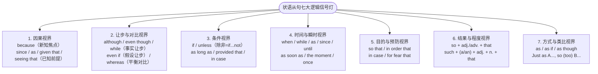

> [!cn-warning]
> **中英句法头号冲突：“双连词互斥铁律”（对应练习册第 25、32 题）**
> 汉语习惯成对使用关联词（“**因为**……**所以**……”“**虽然/尽管**……**但是**……”），但英语遵循严格的“**单核从属辖域原则**”：一旦一个分句前加上了从属连词（`because / since / as` 或 `although / though / even though / while`），该分句就已经降格为从句，**主句前绝对禁止再出现并列连词 `so` 或 `but`，也严禁紧接副词 `therefore` 造成逗号粘连**！
> * ❌ 典型中式双连词错误 1：`*Because several roads were flooded, so the football match was postponed.`
> * ❌ 典型中式双连词错误 2：`*Because the evidence was incomplete, therefore the committee delayed its decision.`
> * ✅ **三种完全合法的修正方案（任选其一）**：
>   1. **保留从属连词 `because`（删去 `so/therefore`）**：`Because the evidence was incomplete, the committee delayed its decision.`（因为证据不完整，委员会推迟了决定。）
>   2. **保留并列连词 `so`（删去 `because`）**：`The evidence was incomplete, so the committee delayed its decision.`
>   3. **升级为分号 + 逻辑副词 `therefore / consequently`（学术写作推荐）**：`The evidence was incomplete; therefore, the committee delayed its decision.`
> * ❌ 典型让步双连词错误：`*Although the initial results were encouraging, but the researchers refused to make a firm claim.`
> * ✅ **正确让步表达**：`Although the initial results were encouraging, the researchers refused to make a firm claim.`（尽管初步结果令人鼓舞，研究人员仍拒绝做出武断定论——注意：主句前绝不可加 `but`，但可以在主句内部放副词 `still / yet / nevertheless` 以强化转折语气！）

<div class="subtopic-lead" id="s-4-2-4-2"><span class="subtopic-bar">▍</span> <strong>4.2.4.2 七大逻辑信号家族的精细认知视界对比与例句矩阵</strong></div>

高水平写作绝不是随手乱抓一个连词，同一逻辑维度下的不同连词投射出截然不同的信息地位与语气：

1. **因果家族：`because`（未知焦点）vs. `since / as / now that / given that`（已知背景）**
   * **`because`（未知新信息焦点）**：回答“为什么会发生这件事？”，原因本身是读者尚不知道的重磅新信息，**最常后置**：
     * `The ferry service was suspended [because hurricane-force winds swept across the strait].`（轮渡服务因飓风级强风席卷海峡而暂停。）
     * 若想极力强调原因，可用强调句：`It is precisely [because microbial resistance is evolving so rapidly] that we must restrict antibiotic overuse.`（正是因为微生物耐药性演化得如此迅速，我们才必须限制抗生素的滥用。）
   * **`since / as / now that / given that / seeing that`（双方已知的前提背景）**：意为“既然 / 鉴于”，原因已是上下文不争的事实，用来顺水推舟导出主句结论，**最常前置**：
     * `[Given that the raw material prices have surged by 30%], the manufacturer must adjust its pricing strategy.`（鉴于原材料价格已飙升 30%，制造商必须调整其定价策略。）
     * `[Now that you have mastered the basic syntax models], you can tackle complex academic texts with confidence.`（既然你已经掌握了基础句法模型，就可以自信地攻克复杂的学术文本了。）

2. **让步与对比家族：`although / even though` vs. `even if` vs. `while / whereas`**
   * **`although / though / even though`（既定事实让步）**：从句描述的是**已经确认发生的真实事实**（`even though` 语气最强）：
     * `[Although / Even though preliminary clinical trials yielded encouraging results], the researchers refused to make a premature claim.`（尽管初步临床试验取得了令人鼓舞的结果，研究人员仍拒绝过早下定论——练习册第 26 题）
   * **`even if`（假定极值让步）**：从句描述的是**尚未发生或纯粹假设的极端退步条件**（“哪怕/就算……”）：
     * `[Even if global emissions were halted tomorrow], historical carbon accumulation would continue to warm the oceans for decades.`（即便明天全球停止碳排放，历史累积的碳仍将使海洋持续变暖数十年。）
   * **`while`（句首让步 vs. 句中对比）与 `whereas`（精准对立）**：
     * `while` 置于**句首**常表温和让步（“尽管”）：`[While I fully acknowledge the convenience of AI tools], over-reliance on them may erode students' critical thinking.`（尽管我充分认可人工智能工具的便利性，但过度依赖它们可能会削弱学生的批判性思维。）
     * `while / whereas` 置于**主句之后**表鲜明的二元对比（“然而/反观”，练习册第 31 题）：
       `The new messaging app is convenient for brief updates, [whereas / while email remains far more suitable for formal communication].`（这款新通讯软件便于发送简短动态，而电子邮件则远比它更适合正式沟通。）

3. **条件家族：`if` vs. `unless`（除非）vs. `as long as / provided that`（只要）vs. `once`（一旦）**
   * **`unless`（唯一排除性否定条件，等于 `if... not`——对应练习册第 27 题）**：
     * 原句：`You must submit the form by Friday. Otherwise, your application will not be considered.`
     * `unless` 合并：`Your application will not be considered [unless you submit the form by Friday].`（除非你在周五前提交表格，否则你的申请将不予考虑——或前置：`[Unless you submit the form by Friday], your application will not be considered.`）
     * *易错警示*：`unless` 本身已含否定，从句内部**切忌再加多余的 `not`**；且在表条件与时间的状语从句中，遵循“**主将从现**”（用一般现在时 `submit` 表将来，严禁写 `*unless you will submit`）！
   * **`as long as / so long as` 与 `provided (that) / providing (that) / on condition that`（充分必要条件：“只要 / 以……为条件”）**：
     * `Renewable energy grids can maintain stability [provided that sufficient battery storage capacity is deployed].`（只要部署了充足的电池储能容量，可再生能源电网就能保持稳定。）
     * `Any student may borrow up to ten volumes [as long as they are returned before the end of the semester].`（只要在学期结束前归还，任何学生最多可借阅十册图书。）
   * **`once`（条件兼时间起点：“一旦……就……”）**：
     * `[Once trust between trading partners is broken], restoring bilateral cooperation requires years of diplomatic effort.`（一旦贸易伙伴之间的信任破裂，恢复双边合作需要多年的外交努力。）

4. **时间家族：点线交织、先后锁定与瞬时紧接构式**
   * **点动作与持续背景交织（`when` vs. `while` vs. `as`）**：
     * `while` 从句动词必须是**可持续动作**（`While she was reading in the study, the power went out.`）；
     * `as` 擅长刻画“**一边……一边……**”或“**随着……（动态成比例变化）** ”：`[As urban populations continue to age], demand for community healthcare rises sharply.`（随着城市人口持续老龄化，社区医疗保健的需求急剧上升。）
   * **先后顺序显性锁定（`before / after / until / since`——对应练习册第 30 题）**：
     * 原料：`The final bell rang. The students rushed out of the classroom.`（铃响在先，冲出在后）
     * 方案 A：`[After / As soon as the final bell rang], the students rushed out of the classroom.`（下课铃一响，学生们便冲出了教室。）
     * 方案 B（`not... until` 直到……才）：`The students did not rush out of the classroom [until the final bell rang].`（直到下课铃响起，学生们才冲出教室。）
   * **高阶瞬时紧接构式（“一……就……”——读后续写动作提速神器）**：
     * 名词化连词：`the moment / the instant / the minute + 从句`
     * 副词连词：`immediately / directly / instantly + 从句`
     * 介词 + 动名词：`upon / on + V-ing / Noun`
     * 范例：`[The moment / Immediately she heard her name called], Ella took a deep breath and stepped onto the brightly lit stage.`（一听到叫自己的名字，Ella 便深吸一口气，迈步走上灯火通明的舞台。）

5. **目的 vs. 结果家族：前瞻意图（`so that / in case`）vs. 已然程度（`so/such... that`）**
   * **目的状语从句（面向未发生的意图，从句必含情态动词 `can/could/may/might/will/would/should`——对应练习册第 28 题）**：
     * `The speaker deliberately slowed down [so that / in order that the younger students could follow the complex explanation].`（演讲者特意放慢语速，以便低年级学生能够跟上这段复杂的讲解。）
   * **预防性目的/条件（`in case / for fear that`“以防/免得”）**：
     * `Please keep a digital backup of your manuscript [in case the hard drive fails unexpectedly].`（请保留一份手稿的电子备份，以防硬盘意外损坏。）
   * **结果状语从句（由极端程度引发的已然结果——对应练习册第 29 题）**：
     * **`so + 形容词/副词 + that 从句`**：`The gale was [so fierce that the cross-harbor ferry service had to be suspended].`（狂风如此猛烈，以至于跨海轮渡服务不得不暂停。）
     * **`such + (a/an) + 形容词 + 名词 + that 从句`**：`It was [such a fierce gale that the ferry service had to be suspended].`（那是一场如此猛烈的狂风，以至于轮渡服务不得不暂停。）
     * *特例*：当名词前有表示数量多少的 **`many / much / few / little`** 时，一律用 **`so`** 不用 `such`（如 `so many obstacles that...`、`so little time that...`；但若 `little` 表“体型小”则用 `such`，如 `such little children`）。

6. **方式与类比家族：`as if / as though` 与议论文黄金类比构式 `Just as..., so (too)...`**
   * **`as if / as though`（恰似/仿佛——读后续写神态刻画利器）**：
     * `He stood frozen at the crossroads, staring at the letter [as though he had seen a ghost].`（他僵立在十字路口，盯着那封信，仿佛见了鬼一般——与事实相反用过去完成时虚拟）。
   * **`Just as A..., so (too) B...`（“正如 A……，B 亦然”——学术议论文跨领域类比开篇金句）**：
     * `[Just as a diverse ecosystem is more resilient to environmental shocks], so a society that embraces diverse perspectives is better equipped to navigate complex crises.`（正如多样化的生态系统对环境冲击更具韧性一样，包容多元视角的社会也更有能力应对复杂的危机。）

<div class="subtopic-lead" id="s-4-2-4-3"><span class="subtopic-bar">▍</span> <strong>4.2.4.3 语篇位置调度：前置设定舞台 vs. 后置聚焦重锤（对应练习册写作组 4 与第 26 题）</strong></div>

同一个状语从句放在主句前还是主句后，直接改变全句的信息流动与交际重心：

| 布局模式 | 句法拓扑与标点规范 | 信息结构与语篇功能 | 对照范例 |
| :--- | :--- | :--- | :--- |
| **前置调度**<br>(Fronted Position) | `[Conjunction + Subordinate Clause], [Main Clause].`<br>（**主从句之间必须加逗号**） | • 从句充当全句的**已知背景舞台或让步铺垫**；<br>• 读者最后读到的是**主句结论**，主句自然占据**句末尾焦（End-Focus）**，适合在下一句继续围绕主句结论展开。 | `[Although the initial results were encouraging], the researchers refused to make a firm claim.`<br>（先退一步承认初步结果不错，最后重锤落在“拒绝草率下结论”的审慎态度上，下文接着讲需要补充哪些实验）。 |
| **后置调度**<br>(End Position) | `[Main Clause] (,) [Conjunction + Subordinate Clause].`<br>（时间/原因/条件紧接时**不加逗号**；补充性让步/对比 `whereas/while` 前**常加逗号**） | • 开门见山**先亮出主句核心行动或决定**；<br>• 句末的从句充当**核心原因揭晓、附加条件限制或对比反转**。 | `The researchers refused to make a firm claim [although the initial results were encouraging].`<br>（先亮明“拒绝草率定论”的核心立场，再补充说明这是在初步结果喜人的情况下做出的决定）。 |

<div class="subtopic-lead" id="s-4-2-4-4"><span class="subtopic-bar">▍</span> <strong>4.2.4.4 状语从句的高阶“分词化减重压缩”（Adverbial Clause Reduction）</strong></div>

在成熟的高阶英语写作中，当时间、条件、让步或方式状语从句的**主语与主句主语完全一致**（或者从句主语是虚词 `it + be`）时，母语者极少保留笨重的“主语 + be”，而是直接将其浓缩为 **`连词 + 现在分词 (V-ing) / 过去分词 (V-ed) / 形容词短语 / 介词短语`** 的无动词分句（Verbless / Non-finite Clause）：

$$
\text{When / While / Once / If / Unless / Although / As if} + \text{（省去 Subject + be）} + \left[ \text{V-ing / V-ed / AdjP / PP} \right], \text{Main Clause}
$$

| 逻辑类型 | 完整状语从句（含冗余主语 + be） | 减重压缩后的高阶分句（精悍地道） | 认知与语法自检要点 |
| :--- | :--- | :--- | :--- |
| **1. 被动条件/时间压缩**<br>(`Once / If / Unless / When + V-ed`) | `Once these habits are established in childhood, they are difficult to alter.` | `[Once established in childhood], these habits are difficult to alter.`（这些习惯一旦在童年时期养成，就很难改变。） | 逻辑主语 `these habits` 承受 `establish`（被动），故用过去分词 `established`。 |
| **2. 负面条件预警压缩**<br>(`If / Left + V-ed`) | `If the regional conflict is left unchecked, it could destabilize the entire continent.` | `[If left unchecked], the regional conflict could destabilize the entire continent.`（若放任不管，这场地区冲突可能会动摇整个大陆的稳定。） | 议论文警示句高频模板：`If left unchecked / unaddressed / unregulated...` |
| **3. 主动伴随/让步压缩**<br>(`While / When + V-ing`) | `While the authors acknowledge the sample size limitation, they stand by their core findings.` | `[While acknowledging the sample size limitation], the authors stand by their core findings.`（尽管作者承认样本量存在局限，但他们依然坚持其核心研究结论。） | 主句主语 `the authors` 主动发出 `acknowledge`，故用现在分词 `acknowledging`。 |
| **4. 状态形容词压缩**<br>(`Although / Though + AdjP`) | `Although the device is small in size, it possesses immense computing power.` | `[Although small in size], the device possesses immense computing power.`（尽管该设备体积小巧，却拥有极其强大的计算能力。） | 直接保留 `Although + 形容词短语`，省去 `it is`。 |
| **5. 读后续写神态压缩**<br>(`As if + V-ing / V-ed / to do`) | `He raised his right hand, as if he was trying to ward off an invisible blow.` | `He raised his right hand, [as if to ward off / trying to ward off an invisible blow].`（他举起右手，仿佛要挡开无形的重击。） | `as if + to do / V-ing / V-ed` 是续写动作描写的点睛之笔。 |

> [!cn-warning]
> **状语从句减重压缩的唯一生死红线：主语必须严格对齐（严防垂悬修饰语 Dangling Modifier）！**
> 只有当省略掉的从句主语与后方主句的主语是**同一个实体**时，才允许省略！
> * ❌ 垂悬修饰错误：`*When exposed to high temperatures, the researchers observed that the enzyme lost its activity.`（谁暴露在高温下？成了“研究人员被暴露在高温下”！）
> * ✅ 修正 A（让 `the enzyme` 作主句主语）：`[When exposed to high temperatures], the enzyme rapidly lost its catalytic activity.`（当暴露于高温环境时，这种酶迅速失去了催化活性。）
> * ✅ 修正 B（保留完整从句主语）：`[When the enzyme was exposed to high temperatures], the researchers observed that it lost its activity.`（当这种酶暴露于高温环境时，研究人员观察到它失去了活性。）

> [!cn-practice]
> **配套练习**：练习全书第4篇 **4.2节（写作组1—4）**、**4.3节【基础句子组装与高阶压缩进阶】（第1—44题）**。

---


## 4.3 核心进阶：介词修饰链与介词短语依附关系 (Inward Focus & Prepositional Topology)

第 4.2.1 节解决了介词短语作为**状语（挂在动词/全句两侧，交代动作的时空与方式）** 的布局；而在学术写作与高阶阅读中，介词短语更强大的功能是挂在**核心名词右侧**，作为**后置定语链（Post-nominal Prepositional Chain）** 层层收紧概念边界。

第 3 篇已介绍了单个介词的空间意象图式。本节聚焦写作中最易出错的三大进阶工程问题：**多层名词短语的右向组装与主谓一致锁定**、**介词短语依附歧义消解**，以及**并行分叉与动名词复合嵌套**。

### 4.3.1 多层名词短语（NP + PP Chain）的右向组装与主谓一致锁定

> [!TIP]
> **知识网络锚定**：关于介词短语嵌套的底层向心结构与句法树推导，详见第3篇 3.2节与 3.4节。本节聚焦于书面语产出中的**四环向右变焦组装模型与跨链主谓一致防御**。

中文习惯把所有限定成分以“……的……的……的”形式堆叠在中心名词左侧（左分支包孕），而英语要求**中心名词先行（Head-Initial）**，随后按“**核心属性/受事对象 → 运作场域/机构 → 地域范围 → 时间跨度**”由近及远向右展开。

<div class="subtopic-lead" id="s-4-3-1-1"><span class="subtopic-bar">▍</span> <strong>4.3.1.1 四阶右向变焦组装公式（由内向外层层收紧）</strong></div>

$$
\text{Head Noun（中心词）} + \underbrace{\text{of/in/on } \text{NP}_1}_{\text{第1环：核心对象/主题}} + \underbrace{\text{in/at/on } \text{NP}_2}_{\text{第2环：具体场域/机构}} + \underbrace{\text{across/in } \text{NP}_3}_{\text{第3环：宏观地域}} + \underbrace{\text{over/during } \text{NP}_4}_{\text{第4环：时间跨度}}
$$

* **实战组装示范一（趋势变化类名词）**：
  * **离散信息**：中心词 `decline`（下降）；对象 `water quality`（水质）；范围 `three industrial regions`（三个工业区）；时间 `the past decade`（过去十年）。
  * **右向组装**：`the decline [in water quality] [across three industrial regions] [over the past decade]`（过去十年间三个工业区水质的下降）
  * **介词选型逻辑**：上升/下降/变化（`decline / increase / shift / change`）标明具体指标维度时常用 `in`；跨越多个区域用 `across`；持续时间段用 `over / during`。
* **实战组装示范二（争议/供需类名词）**：
  * **离散信息**：中心词 `debate`（争论）；主题 `the use of facial recognition`；场域 `public transport`；地域 `several European cities`。
  * **右向组装**：`the debate [over/on the use of facial recognition] [in public transport] [across several European cities]`（几个欧洲城市关于在公共交通中使用人脸识别技术的争论）
  * **离散信息**：中心词 `shortage`（短缺）；对象 `trained nurses`；机构 `rural hospitals`；地域 `the western provinces`。
  * **右向组装**：`the shortage [of trained nurses] [in rural hospitals] [in/across the western provinces]`（西部省份乡镇医院受训护士的短缺）

<div class="subtopic-lead" id="s-4-3-1-2"><span class="subtopic-bar">▍</span> <strong>4.3.1.2 破除中式“左分支定语堆积”与主谓一致跨链锁定</strong></div>

1. **严禁把带介词短语的复杂修饰语强塞到中心名词左侧**：
   * 英语名词左侧只容纳“限定词 + 简单副词/形容词 + 属性名词”（如 `the student mental health support center`）；一旦修饰语内部包含**介词短语**（如 `near the railway station`）或**分词短语**（如 `recently opened...`），必须整体右移至中心词之后！
   * ❌ 中式前置堆积错误：`*The [recently opened near the railway station] student mental health support center has extended its weekend hours.`
   * ✅ 右分支解包修正：`The student mental health support center [recently opened near the railway station] has extended its weekend hours.`（最近在火车站附近新开的大学生心理健康支持中心已延长了周末开放时间。）
2. **主谓一致的“跨链中心词锁定”铁律**：
   * 当带有 3—4 环介词链的名词短语充当主语时，**主句谓语动词的单复数唯一取决于第 0 环的中心词（Head Noun）**，绝不能被紧挨在动词前的复数介词宾语带偏（邻近干扰陷阱）：
   * `The shortage (单数中心词) [of trained nurses] [in rural hospitals] [across the western provinces] has (严禁写 have) drawn national attention.`（西部各省乡镇医院受训护士短缺的问题已引起全国关注。）

---

### 4.3.2 介词短语依附关系与歧义消解 (PP Attachment & Disambiguation)

同一个介词短语在句中既可能挂靠在前面的**名词（NP-Attachment，作后置定语）** 上，也可能挂靠在**动词（VP-Attachment，作状语）** 上。如果位置不当，就会引发严重的**依附歧义（Attachment Ambiguity）**：

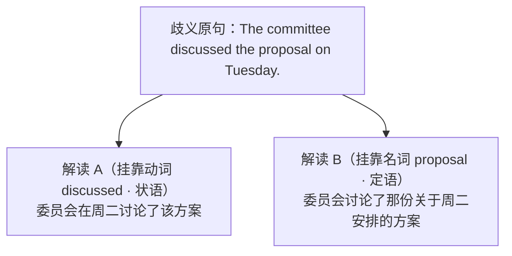

<div class="subtopic-lead" id="s-4-3-2-1"><span class="subtopic-bar">▍</span> <strong>4.3.2.1 定语依附（修饰名词）vs. 状语依附（修饰动词）的判别与消歧</strong></div>

1. **紧邻吸引定律**：
   * **定语介词短语（说明“哪一个/关于什么的名词”）必须紧贴其所修饰的中心名词**，中间不可插入其他状语。
   * **状语介词短语（说明动作发生的“时间/地点/方式”）若置于宾语名词之后，极易被误读为该宾语的后置定语**。
2. **三大实战消歧手术**：
   * **手术一：状语前移法（Fronting the Adverbial PP）** ——最彻底的消歧手段：
     * ❌ 依附歧义：`The researchers observed the cells [in the laboratory].`（是在实验室里观察细胞，还是观察“实验室里的那些细胞”？）
     * ✅ 前移消歧（明确修饰动作 `observed`）：`[In the laboratory], the researchers observed the cells.`
   * **手术二：定语从句显性展开法（Relative Clause Expansion）**：
     * ❌ 远距离跨层依附歧义：`The guard spotted the intruder [with night-vision goggles].`（是保安戴着夜视镜，还是闯入者戴着夜视镜？）
     * ✅ 显性消歧（若闯入者戴着）：`The guard spotted the intruder [who was wearing night-vision goggles].`
     * ✅ 显性消歧（若保安使用）：`[Using night-vision goggles], the guard spotted the intruder.`
   * **手术三：换用专用复合介词法**：
     * 当 `on` / `in` 既可表时空又可表主题时，将表示主题的定语介词升级为 `regarding / concerning / on the subject of`，彻底切断时空误读：
     * `On Tuesday, the committee discussed the proposal [regarding campus safety].`（周二，委员会讨论了那份关于校园安全的方案。）

---

### 4.3.3 介词深层立体嵌套、并行分叉与复合介词算子

除了线性单链修饰，高阶学术写作还常利用介词构建**对称并列分叉**、**带逻辑主语的动名词压缩块**以及**复合介词算子**。

<div class="subtopic-lead" id="s-4-3-3-1"><span class="subtopic-bar">▍</span> <strong>4.3.3.1 介词链的并行分叉（Parallel Prepositional Forking）</strong></div>

当同一个中心名词（如 `effects`, `impact`, `correlation`, `disparity`）统摄两组平行对照关系时，不必重复中心词，而是用 `of A on X and of B on Y` 构成对称分叉：

$$
\text{Head Noun} + \left[ \text{Prep}_A + \text{Noun}_A \right] + \text{and} + \left[ \text{Prep}_B + \text{Noun}_B \right]
$$

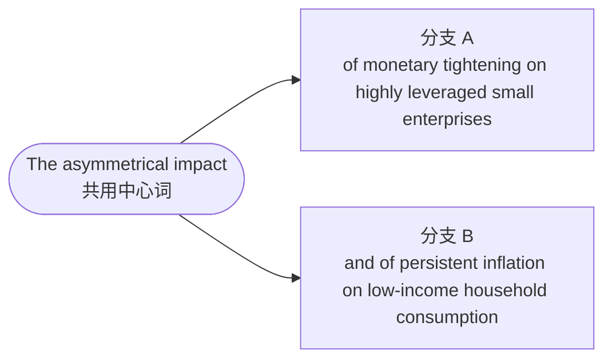

* **基础分句原料**：`Prolonged drought affected crop yields. Rising fuel prices affected transport costs.`（持续干旱影响了农作物产量；不断上涨的燃油价格影响了运输成本。）
* **对称分叉压缩**：`the effects [of prolonged drought on crop yields] and [of rising fuel prices on transport costs]`（持续干旱对农作物产量的影响，以及燃油价格上涨对运输成本的影响）
* **高阶完整范例**：
  > `The study evaluated the asymmetrical impact [of monetary tightening on highly leveraged small enterprises] and [of persistent inflation on low-income household consumption].`
  > （该研究评估了货币紧缩对高杠杆小微企业、以及持续通胀对低收入家庭消费的不对称影响。）
* **写作核查要点**：第二个分支开头的介词 `of` **不可省略**！唯有保留第二个 `of`，读者才能瞬间识别出它与第一个 `of` 并列挂靠在同一个中心词 `effects / impact` 下，而不会误挂到前一个宾语 `crop yields` 上。

<div class="subtopic-lead" id="s-4-3-3-2"><span class="subtopic-bar">▍</span> <strong>4.3.3.2 介词复合结构嵌套（Preposition + Logical Subject + V-ing）</strong></div>

当要把条件从句或原因从句压缩为介词短语，但**从句主语与主句主语不一致**时，可在介词后直接放入“**逻辑主语（名词/代词宾格或所有格）+ 动名词 V-ing**”：

$$
\text{Preposition} + \left[ \text{Logical Subject (Noun / Pronoun)} + \text{V-ing} + \text{Complements} \right]
$$

* **基础演进示范**：
  * 从句原句：`Because local residents opposed the plan, the council postponed the vote.`（由于当地居民反对该计划，市政会推迟了投票——从句主语 `residents` $\neq$ 主句主语 `the council`）
  * 介词复合压缩：`Owing to [local residents opposing the plan], the council postponed the vote.`（由于当地居民反对该计划，市政会推迟了投票。）
* **高阶学术范例**：
  * 条件从句模式：`If the central bank fails to stabilize bond yields through open-market operations, liquidity will contract.`
  * 介词立体嵌套模式：`In the event of [the central bank failing to stabilize bond yields through open-market operations], liquidity will contract.`（一旦央行未能通过公开市场操作稳定债券收益率，流动性就将出现紧缩。）
  * 医疗试验范例：`The protocol was halted [owing to several trial participants displaying unexpected neurological symptoms during Phase II].`（由于数名受试者在二期临床试验期间出现意外的神经系统症状，该试验方案被叫停。）

<div class="subtopic-lead" id="s-4-3-3-3"><span class="subtopic-bar">▍</span> <strong>4.3.3.3 复合介词作为逻辑关系算子 (Compound Prepositions as Logical Operators)</strong></div>

高阶书面语常使用“介词 + 抽象名词 + 介词”构成的**复合介词算子**，将松散的从句压缩为严密的逻辑短语：

| 复合介词算子 | 核心逻辑功能 | 对应的从句/口语表达 | 典型句法改写范例 |
| :--- | :--- | :--- | :--- |
| `in the absence of` | 标明“在缺乏……的情况下”（否定条件/原因） | `because there was no...` / `without` | `In the absence of an independent review, the figures could not be verified.`（在缺乏独立审查的情况下，这些数据无法得到核实。） |
| `in the event of` | 标明小概率或突发假设条件 | `if... happens` | `In the event of a system failure, backup servers will activate.`（一旦发生系统故障，备用服务器将立即启动。） |
| `by virtue of` | 揭示合法性来源、内在凭借或固有属性 | `because of` / `relying on` | `The treaty took effect by virtue of unanimous parliamentary ratification.`（该条约凭借议会的一致批准而正式生效。） |
| `with respect to` / `in terms of` | 精确划定考察维度与评估视角 | `about` | `The two models differ markedly with respect to computational efficiency.`（这两个模型在计算效率方面存在显著差异。） |
| `in accordance with` | 标明严格遵照规章、准则或法律条文 | `following` / `according to` | `All samples were disposed of in accordance with biosecurity protocols.`（所有样本均已严格按照生物安全规程进行了妥善处理。） |
| `at the expense of` | 标明权衡取舍（Trade-off）与付出的代价 | `while hurting / sacrificing...` | `Short-term profits were pursued at the expense of long-term ecological stability.`（以牺牲长期生态稳定为代价来追逐短期利润。） |

> [!cn-practice]
> **配套练习**：练习全书第4篇 4.2节（写作组5—7）、4.4.1节（第45—52题）及 4.3.5节（第44题：介词短语依附歧义消解）。

---

## 4.4 句法的关系动词：语法隐喻与名词化压缩 (Grammatical Metaphor & Nominalization)

### 4.4.1 语法隐喻：用名词表达动作或情况

**先看具体变化，不先记“隐喻”。**

> The plan failed, which caused delays.
>
> 计划失败了，这导致延误。

>
>
> The failure of the plan caused delays.
>
> 计划的失败导致延误。

第一句用 failed 说计划发生了什么；第二句用 the failure of the plan 指这个事件，并让它作主语。这叫**名词化**，本例保留了失败导致延误的关系。名词化便于把事件作为对象继续讨论，不保证更简洁或更清楚。

**进阶术语**：系统功能语言学把这类变化放在“语法隐喻”框架下讨论。入门任务是比较意思与结构，不把结构变化称为质量的“升维”或“降级”。

下面介绍韩礼德（M.A.K. Halliday）的系统功能语言学视角。日常与学术表达都可用动词或名词，选择取决于要说明什么，不能把两种形式当作水平高低的分界。

<div class="subtopic-lead" id="s-4-4-1-1"><span class="subtopic-bar">▍</span> <strong>4.4.1.1 一致模式 (Congruent Mode) vs. 隐喻模式 (Metaphorical Mode)</strong></div>

* **一致模式（动作通常用动词表达）**：

  * 现实世界中的“过程/动作”在语法中体现为**动词**。

  * 现实世界中的“原因/结果”在语法中体现为**连词**（because, so；if 表示条件而非因果）。

  * 现实世界中的“性质/特征”在语法中体现为**形容词**。

* **隐喻模式（本节以名词化为例）**：

  * **用名词表达原先由动词表达的动作或情况，称为名词化（Nominalization）**。

  * 事件之间的关系可改用动词、介词等表达；是否保留连词，要看句型和意思。两种表达都可用于正式或日常语境，不能只凭名词数量判断质量。

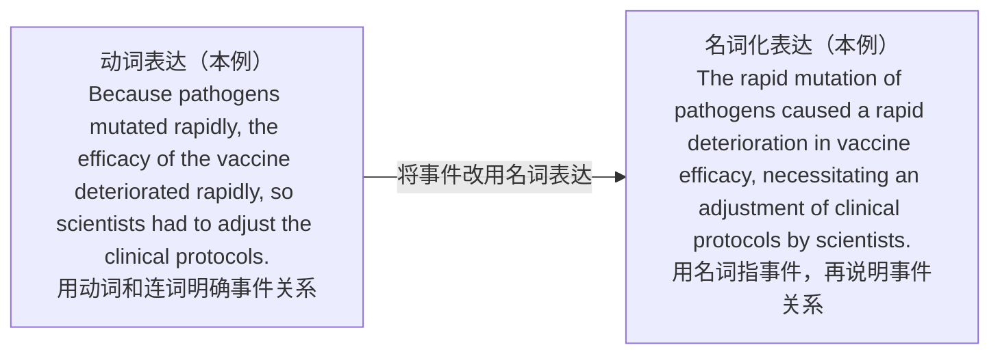

<div class="subtopic-lead" id="s-4-4-1-2"><span class="subtopic-bar">▍</span> <strong>4.4.1.2 从句、非限定结构与名词化：三种表达比较</strong></div>

以下三句比较的是同一背景下的三种表达，**不是必须逐步升级的三个等级**。其中 liquidity 指流动性，contracted 指收缩。

1. **用 because 从句明说原因**：`Because interbank liquidity contracted, banks became unwilling to lend.`（因为银行间流动性收缩，银行变得不愿放贷。）because 明确标出因果关系。

2. **用非限定结构交代背景**：`Interbank liquidity having contracted, banks became unwilling to lend.`（银行间流动性已经收缩，银行变得不愿放贷。）句首结构有自己的主体 liquidity；having contracted 说明较早发生的情况。这种结构本身没有 because，因果理解须由上下文支持，不能在所有场景中与第一句直接互换。

3. **用名词指事件，再明说因果**：`The contraction of interbank liquidity caused banks' unwillingness to lend.`（银行间流动性收缩导致银行不愿放贷。）contraction 用名词表达“收缩”，caused 表达因果。

选择哪种写法，取决于要突出动作、背景还是事件关系；不是名词化越多就越好。

<div class="subtopic-lead" id="s-4-4-1-3"><span class="subtopic-bar">▍</span> <strong>4.4.1.3 名词化高频派生词族（语法隐喻的词汇弹药）</strong></div>

名词化不是临时生造词形，而是依托成熟的派生后缀成族演化的。掌握词族有助于快速调取已有词形（具体派生形式与介词搭配需查证词典，不可随意拼接后缀）：
* **动词 → 过程/状态名词**：
  * `-tion / -sion`：`contract → contraction`（收缩）、`dissipate → dissipation`（消散）、`erode → erosion`（侵蚀）
  * `-ment`：`develop → development`、`adjust → adjustment`
  * `-al / -ing`：`dismiss → dismissal`、`survive → survival`、`restructure → restructuring`
* **形容词 → 属性/程度名词**：
  * `-ity / -ty`：`susceptible → susceptibility`（易感性）、`certain → certainty`
  * `-ance / -ence`：`reluctant → reluctance`、`persistent → persistence`
  * `-ness`：`brittle → brittleness`（脆弱性）

### 4.4.2 名词化驱动的及物动词重塑 (The Verb Engine)

当两个动作或事件被名词化压缩为名词短语（$\text{NP}_1$ 与 $\text{NP}_2$）后，原本由连词（`because`, `so`, `if`）承担的逻辑关系，便转移到了谓语位置的**关系及物动词**上。选择动词时须严格匹配事件之间的真实极性与强度，切忌为追求大词而扭曲原意。

<div class="subtopic-lead" id="s-4-4-2-1"><span class="subtopic-bar">▍</span> <strong>4.4.2.1 六大表示事件关系的动词分类总表（按极性与强度分类）</strong></div>

| 关系动词分类 | 高阶关系动词（含极性与强度区分） | 基础对照表达 | 典型句法组装范例 |
| :--- | :--- | :--- | :--- |
| **诱发 / 催化** | `precipitate`（骤然引发）, `trigger`, `engender`（滋生）, `instigate`, `spawn`, `catalyze` | `cause`, `lead to` | `The disclosure precipitated an immediate sell-off.`（该消息的披露骤然引发了即时抛售。） |
| **驱动 / 支撑** | `foster`（培育）, `facilitate`（促成）, `underpin`（构成基石）, `propel`, `bolster`, `reinforce` | `help`, `support` | `Transparent governance underpins long-term investor confidence.`（透明的治理构成了投资者长期信心的基石。） |
| **削弱 / 瓦解** | `undermine`（暗中动摇）, `compromise`（损害）, `erode`（渐进侵蚀）, `destabilize`, `attenuate`（衰减）, `sap` | `weaken`, `hurt` | `Persistent inflation severely eroded real purchasing power.`（持续的通货膨胀严重侵蚀了实际购买力。） |
| **阻断 / 排除** | `preclude`（从根本上排除可能）, `obviate`（消除……的必要）, `impede`（阻碍）, `deter`（威慑使却步）, `forestall`（预先阻止）, `rule out` | `stop`, `prevent` | `The strict non-disclosure clause precluded further public inquiry.`（严格的保密条款排除了进一步公开质询的可能。） |
| **迫使 / 要求** | `necessitate`（客观情势使必要）, `warrant`（使有充分理由）, `mandate`（法规强制要求）, `compel`（强迫）, `entail`（必然伴随） | `need`, `force` | `The anomalous readings necessitated a thorough recalibration.`（异常读数使得全面重新校准成为必要。） |
| **凸显 / 印证** | `underscore`（凸显强调）, `substantiate`（用证据证实）, `corroborate`（互证支持）, `epitomize`（成为典型缩影）, `attest to`（证实） | `show`, `prove` | `The empirical data substantiated the core theoretical premise.`（实证数据证实了核心理论前提。） |

<div class="subtopic-lead" id="s-4-4-2-2"><span class="subtopic-bar">▍</span> <strong>4.4.2.2 名词化句型组装实操</strong></div>

将多从句顺承结构压缩为“事件名词 $\text{NP}_1$ + 关系动词 + 事件名词 $\text{NP}_2$（+ 句末伴随分词）”时，必须确保因果强度一致：

* **改写前（从句连词驱动）**：
  > `Because algorithmic trading models responded too fast to market signals, volatility in asset prices increased sharply, and this forced regulators to introduce stricter circuit breakers.`（因为算法交易模型对市场信号反应过快，资产价格波动急剧上升，这迫使监管机构引入更严格的熔断机制。）
* **改写后（事件名词化 + 关系动词 + 右分支伴随）**：
  > `The excessively rapid responses of algorithmic trading models to market signals caused a sharp increase in asset price volatility, forcing regulators to introduce stricter circuit breakers.`（算法交易模型对市场信号的过快反应导致资产价格波动急剧上升，迫使监管机构引入更严格的熔断机制。）
  > *解析*：`forcing` 保留了原句 `forced` 的强迫使力度；若改用 `necessitating` 则弱化为“使有必要”，改写时需核验原意强度。

### 4.4.3 识解边界：同一事件的不同呈现与等义改写核验 (Construal Boundaries)

认知语法中的**识解（Construal）** 关注说话人如何从不同视角、显著性（Salience）与颗粒度呈现同一客观事件（[Langacker：识解与认知语法](https://academic.oup.com/book/10750)）。在进行主动/被动转换或动词/名词化改写时，必须严格区分“**纯语序重排**”与“**信息增删**”，不能把任何形式的改写盲目视为“完全等义替换”：

1. **视角切换 vs. 命题增删**：
   * `The technician repaired the pump.`（以施事人员为起点）与 `The pump was repaired by the technician.`（以受事设备为起点）共享核心命题，仅改变组织起点。
   * 而 `The repair of the pump took two hours.` 将动作打包为可度量的事件实体，并**新增了时长命题**，不再是原句的纯等义改写。
2. **改写时的四项边界核查**：

| 改写动作 | 必须核查的命题与语用边界 |
| :--- | :--- |
| **主动改被动** | 时间、情态、否定范围是否守恒？若删去 `by` 施事短语，是否有合理的隐去理由（如施事未知、泛指或无需强调）？ |
| **动词改名词化** | 施事者与受事者是否仍然清晰？原句的条件、让步或因果关系是否被不当抹除或强行夸大？ |
| **具体改概括** | 是否丢失了原文赖以成立的关键限定范围、数量比例或可验证细节？ |
| **拆长句或合短句** | 句子合并后是否凭空制造了原句没有的必然因果判断？ |

3. **四步比较法**：比较两个版本时，依次核对：① 共同核心命题 → ② 新增或省去的信息 → ③ 句首组织起点与观察视角 → ④ 哪一版本更契合当前上下文的读者预期。当行动者与具体动作过程是叙事重点时，直接用动词往往比名词化更清晰有力。

> [!cn-practice]
> **配套练习**：练习全书第4篇 4.4节【名词化与事件关系表达】（第53—60题、4.4.5节第77—83题）及 4.8节【识解边界与信息结构拓展】（第133—137题）。

---

## 4.5 高阶右分支修辞与伴随架构 (Advanced Right-Branching & Cumulative Architecture)

### 4.5.1 右分支句法生态与累积句式 (Cumulative Sentences)

<div class="subtopic-lead" id="s-4-5-1-1"><span class="subtopic-bar">▍</span> <strong>4.5.1.1 右分支（Right-Branching）的设计美学</strong></div>

Francis Christensen 提出了累积句（Cumulative Sentence）的写作理论：先写出完整主干（Base Clause），再按内容需要向右补充介词短语、分词结构、同位语或从句。

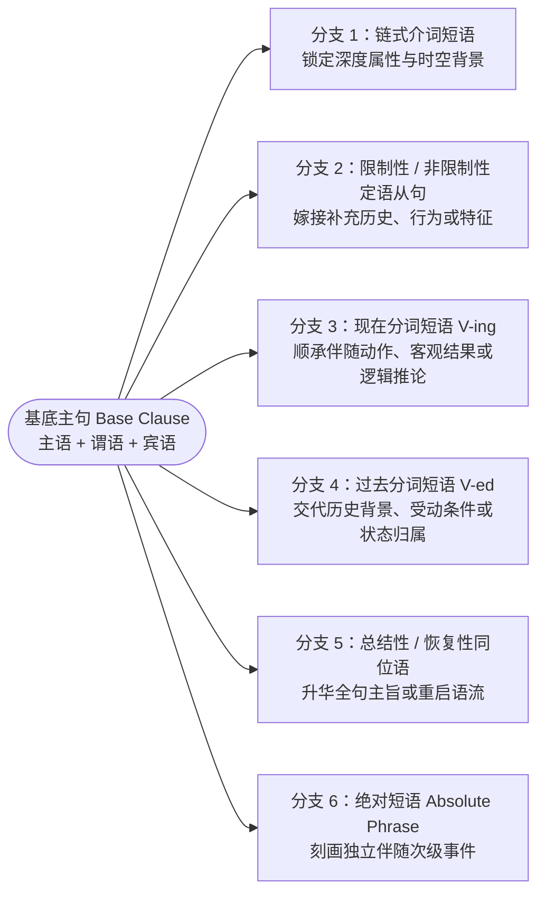

### 4.5.2 同位语修辞：总结性与恢复性同位语 (Appositives)

先区分**概括前面整件事** 与 **重复一个关键词后继续说明**：

- The team finished the project, an achievement that pleased everyone.（团队完成了项目，这一成果让大家很高兴。）an achievement 概括完成项目这件事。

- We need a plan, a plan that everyone can follow.（我们需要一个人人都能执行的计划。）第二个 a plan 重复关键词，再说明要求。

先看概括或重复了什么，再看增加了什么信息。下面分别称为总结性与恢复性修饰。

Joseph M. Williams（《Style: Lessons in Clarity and Grace》作者）的相关写作方法包括：可以使用总结性与恢复性修饰语组织信息；它们与 `, which...` 都是可选资源，不代表写作者的水平等级。

<div class="subtopic-lead" id="s-4-5-2-1"><span class="subtopic-bar">▍</span> <strong>4.5.2.1 总结性同位语（The Summative Appositive）</strong></div>

* **用法**：主句说完一件事后，可用 `a decision`、`an outcome` 等名词概括它，再说明这件事的结果或意义。先确认概括的是哪件事，再看后面的说明。

* **结构范式**：
  $$
  \text{Main Clause} + \text{, } + \left[ \text{Summative Noun} \right] + \left[ \text{that / which / V-ing...} \right]
  $$

* **对比解析**：

  * *只使用 which 的写法*：`The central bank injected massive liquidity into the banking system, which was a strategy that raised profound inflation concerns.`

  * *改用总结性同位语的写法*：

    > The central bank injected massive liquidity into the banking system, **a maneuver that raised profound inflation concerns**.（央行向银行体系注入了巨量流动性，这一举措引发了深切的通胀担忧。）

* **常用总结性同位语核心词**：

  * `a trend that...`（一种……的趋势）

  * `a predicament which...`（一种……的困境）

  * `a disparity reflecting...`（一种反映出……的悬殊差距）

  * `a move designed to...`（一项旨在……的举措）

<div class="subtopic-lead" id="s-4-5-2-2"><span class="subtopic-bar">▍</span> <strong>4.5.2.2 恢复性同位语（The Resumptive Appositive）</strong></div>

* **认知机制**：句子较长、读者可能忘记讨论对象时，可以在逗号后**重复前文的关键词**（或其同义词），再围绕它补充说明。这种重复有助于读者重新确认讨论对象；后面应提供新说明，而不是重复原话。

* **结构范式**：
  $$
  \dots + \text{Key Noun} + \dots + \text{, } + \left[ \text{Key Noun} \right] + \left[ \text{that / in which...} \right]
  $$

* **实战范例**：

  > The entire economic recovery framework relies on the assumption of uninterrupted global supply chains, **an assumption that collapses rapidly under escalating geopolitical sanctions**.（整个经济复苏框架依赖于全球供应链不中断这一假设，而这一假设在不断升级的地缘政治制裁下会迅速崩塌。）

* **多层恢复范例**：

  > The committee proposed a sweeping reform of executive compensation, **a reform that challenged decades of corporate entitlement and a reform that few shareholders were willing to endorse**.（委员会提出了一项针对高管薪酬的大刀阔斧的改革——一项挑战了数十年企业既得利益、且鲜有股东愿意背书的改革。）

<div style="page-break-before: always; break-before: page;"></div>

### 4.5.3 独立主格与绝对短语结构 (The Absolute Construction Architecture)

**先找这部分自己的主体。** The meeting ended, everyone feeling relieved.（会议结束了，大家都松了一口气。）主句主体是 the meeting；后面的 everyone feeling relieved 有自己的主体 everyone，说明大家的状态。

因此，feeling 的主体不是 meeting。这种带自身主体、补充背景或状态的结构，传统称“独立主格”，本书也称“绝对结构”。“独立”指有自己的主体，不表示能像完整限定句那样独立使用。

本书沿用**绝对短语**（Absolute Phrase）的教学名称，也称绝对结构。它有自己的主语，用来补充时间、原因、背景或伴随情况。它可以用分词，如 `Weather permitting`（如果天气允许）；也可以不用动词，如 `His hands in his pockets`（他的双手插在口袋里）。分析时，先找“说的是谁或什么”，再找“对它作了什么说明”。前一种通常称为非限定小句，后一种可称为无动词小句；不能因为没有限定动词，就认为它没有主谓关系。它通常依附主句使用，不能当作独立的完整限定句；参见2.4节。

<div class="subtopic-lead" id="s-4-5-3-1"><span class="subtopic-bar">▍</span> <strong>4.5.3.1 名词 + 分词/介词/形容词的绝对短语</strong></div>

* **句法特征**：`[Noun / Pronoun] + [Participle / Prepositional Phrase / Adjective]`
* **实战范例**：
  > The sovereign debt negotiations concluded without a resolution, **their legal representatives having exhausted every diplomatic compromise during the week-long summit**.（主权债务谈判无果而终，各方常驻法律代表在为期一周的峰会期间已穷尽了所有外交妥协手段。）
* **结构说明**：`their legal representatives having exhausted...` 拥有自己独立的主语 `representatives` 和分词完成式 `having exhausted`，无需连词 `because` 或 `as`，自然地交代了谈判破裂的宏观背景。

<div class="subtopic-lead" id="s-4-5-3-2"><span class="subtopic-bar">▍</span> <strong>4.5.3.2 分项枚举型绝对结构（Distributive Absolute Phrase）</strong></div>

当句末需要就一组复数实体（可以是主句主语中的复数实体，也可以是语境中刚出现的一类实体）逐一展开其状态或分工时，使用 `each / one / both + 分词` 构成的高级绝对短语：

* **实战范例**：
  > The five appellate judges delivered their landmark verdict, **each articulating a distinct jurisprudential rationale for overturning the constitutional precedent**.（五位上诉法院法官作出了具有里程碑意义的裁决，每位法官各自阐述了推翻该宪法先例的不同法理依据。）
* **范式解析**：主句谓语为 `delivered`，句末挂接绝对短语，以 `each` 充当分配主语，后跟 `articulating...` 向右延伸，精准刻画多主体的立体行动。

---

### 4.5.4 高阶比较构式、倍数比例与平行对称铁律 (Comparative Constructions, Proportions & Parallelism)

比较构式绝非简单的 `more than` 或 `-er than`，在学术论证、考场议论文与复杂图表分析中，比较构式是检验逻辑严密性与句法对称美感的核心试金石。

#### 1. 平行对称绝对铁律（The Symmetry Principle of Comparison）
比较构式的本质是在两个具有可比性的实体（Term A vs. Term B）之间建立逻辑度量衡。**严禁出现“实体与属性不对称”或“范畴错位（Category Mistake）”**：

* ❌ 范畴错位（中式直译）：`*The carbon emissions of China are higher than the United States.`（拿“碳排放量”与“主权国家”直接对比，范畴混乱）
* ✅ 代词对称指代（单数 `that of` / 复数 `those of`）：`The carbon emissions of China are higher than those of the United States.`
* ✅ 结构范畴绝对平行（非谓语对非谓语，从句对从句）：
  - ❌ `*Investing in renewable energy is more urgent than to subsidize fossil fuels.`
  - ✅ `Investing in renewable energy is more urgent than subsidizing fossil fuels.`（动名词对动名词）
  - ✅ `What the researchers discovered in the laboratory was far more consequential than what they had initially hypothesized.`（名词性从句对名词性从句）

#### 2. 三大多维比较构式认知拆解
在正式书面语中，母语者高频使用以下三类深层比较构式：

1. **`more A than B` / `less A than B`（准则评判：与其说是 B，不如说是 A）**：
   - 这里的比较不在两个实体之间，而在**同一种现象的两种定性描述之间**进行权衡：
   - `The recent banking crisis was more a failure of regulatory oversight than a failure of technology.`（最近的银行业危机，与其说是技术故障，不如说是监管失职。）
   - `The author is less a conventional historian than a cultural anthropologist.`（该作者与其说是一位传统历史学家，不如说是一位文化人类学家。）
2. **`no more... than...`（双重否定等同构式：和……一样不……，两者皆非）**：
   - **认知域映射**：说话人借助一个不证自明的荒谬事实（Ground），来断然否定前者（Figure）：
   - `A whale is no more a fish than a horse is.`（鲸鱼不是鱼，正如马不是鱼一样——两者皆非鱼）。
   - **关键对比**：
     - `He is not more diligent than his brother.`（差比：他不比他哥哥更勤奋——可能一样勤奋或稍逊色）。
     - `He is no more diligent than his brother.`（极度否定：他和他的懒汉哥哥一样，根本不勤奋！）。
3. **`the more..., the more...`（双重比例构式与紧凑省略）**：
   - 表达两个变量之间的正比例或反比例变动关系；前句为条件相关从句，后句为主句：
   - `The more volatile the macroeconomic environment becomes, the more conservative financial institutions are with capital allocation.`（宏观经济环境越动荡，金融机构在资本配置上就越保守。）
   - **学术紧凑省略**：当系表关系显而易见时，通常直接省略系动词：`The more sophisticated the algorithm, the harder it is to interpret.`（算法越复杂，解释起来就越困难。）

#### 3. 倍数与增减比例的标准学术句法槽位
图表描述、实证数据汇报必须精准套入以下四大标准句法槽位，杜绝介词错用：

| 句法槽位类型 | 经典学术句法结构 | 双语实战范例 |
| :--- | :--- | :--- |
| **槽位一：同级倍数** | `X is N times as [adj/adv] as Y` | `The current generation of battery cells is four times as energy-dense as its predecessor.`（当前一代电池的能量密度是上一代的四倍。） |
| **槽位二：差级倍数** | `X is N times [comparative] than Y` | `The new facility consumes three times more electricity than the old plant.`（新设施消耗的电力比旧工厂多三倍——即为旧厂的四倍。） |
| **槽位三：名词性度量倍数** | `X is N times the [size / weight / capacity / volume] of Y` | `The computing power of the newly developed quantum processor is roughly ten times the speed of traditional supercomputers.`（新量子处理器的运算能力大约是传统超级计算机速度的十倍。） |
| **槽位四：净增量 vs. 终态值** | • `increased by N% / N-fold`（净增幅度）<br>• `increased to N% / N-fold`（攀升至终态） | • `Global semiconductor revenue contracted by 8.2% year-on-year.`（全球半导体营收同比缩减了 8.2%。）<br>• `The total number of participating enterprises has surged to three times the initial projection.`（参与企业总数已飙升至最初预期的三倍。） |

> [!cn-theory]
> **配套训练指引**：本节理论直接支撑练习全书第 4 篇 **4.5节（第92—99题）** （涵盖比较项对称性修复、more A than B 改写、no more than 逻辑辨析与倍数比例句法转换）。完成训练后，请对照练习全书 **4.12节【4.12.2.12 高阶比较构式、倍数比例与平行对称参考答案】** 进行复核。

---

> [!cn-practice]
> **配套练习**：练习全书第4篇 4.4节与4.5节（第77—99题：绝对结构、高阶比较构式与倍数表达）。核对 4.12节【4.12.2.9—4.12.2.12】。

## 4.6 语篇流动、焦点调度与词序调整 (Information Packaging & Inversion)

本节讲**怎样根据前后文安排信息**。Maya sent the report to Leo.（Maya 把报告发给了 Leo。）若前面问“谁发的”，重点是 Maya；问“发了什么”，重点是 the report；问“发给谁”，重点是 Leo。

先分清三个概念：**主语**是与谓语相配的语法成分，如上句中的 Maya；**话题**回答正在谈论谁或什么；**焦点**回答这句话特别强调什么，可能是新信息，也可能是用来作对比的信息。三者可能重合，也可能不同。**主位／述位**是另一种分析：句子从哪里说起，接着说什么。它们不一定与主语／谓语或已知／未知信息对应。下面先用例句区分，再介绍原则。

### 4.6.1 信息包装：已知-未知流动与尾重/尾聚焦原则

为什么英语倾向于把长修饰语放在右侧？可从布拉格学派的**主位-述位（Theme-Rheme）研究**以及信息包装与加工视角理解这些倾向；不同理论并非同一学派，尾重也不是不可变规则。

<div class="subtopic-lead" id="s-4-6-1-1"><span class="subtopic-bar">▍</span> <strong>4.6.1.1 已知信息到未知信息流动法则 (The Given-Before-New Principle)</strong></div>

* 读者的认知心理习惯：**先接收已知的、短小的信息（锚定旧概念），随后在脑海中平稳接收全新的、复杂的论据与判断。**

* **主位（Theme）**：语篇组织的出发点，常承接已知信息，但不必都是旧信息，也不一定是短主语。

* **述位（Rheme）**：相对于主位展开的其余信息，不等于“句末”；新旧信息与焦点需要结合上下文判断。


<div class="subtopic-lead" id="s-4-6-1-2"><span class="subtopic-bar">▍</span> <strong>4.6.1.2 尾重原则 (End-Weight) 与 尾焦点原则 (End-Focus)</strong></div>

1. **尾重原则（The Principle of End-Weight）**：

   长而复杂的句法结构（如介词链、同位语、定语从句）常倾向于后置，但仍需服从上下文、依附关系与表达目的，避免句子“头重脚轻”。

2. **尾焦点原则（The Principle of End-Focus）**：

   在中性语境中，信息焦点常位于较后位置，但可因对比、上下文和重音而前移；不能仅凭句末位置判断最大语义权重或记忆效果。

<div class="subtopic-lead" id="s-4-6-1-3"><span class="subtopic-bar">▍</span> <strong>4.6.1.3 主动、被动与形式主语：怎样安排先后信息</strong></div>

被动语态可以改变先说什么、后说什么，帮助连接上下文或突出信息。选择主动还是被动，要看这句话在回答什么问题：

* *长主语被动句（是否合适取决于上下文）*：

  `A catastrophic chain reaction that completely crippled the regional energy distribution network and caused billions of dollars in losses was triggered by a minor software glitch.`（主语较长；若上文以软件故障为话题，可考虑下列主动句）。

* *主动语态改写（将长宾语后置）*：

  > A minor software glitch triggered **a catastrophic chain reaction that completely crippled the regional energy distribution network and caused billions of dollars in losses**.（一个微小的软件故障引发了一场灾难性的连锁反应，彻底瘫痪了区域能源分配网络并造成数十亿美元的损失。）

* *若需强调软件错误（通过被动语态调度至句末尾焦点）*：

  > The regional energy distribution network was completely crippled by **a catastrophic chain reaction that caused billions of dollars in losses and was triggered by a minor software glitch**.（区域能源分配网络被一场造成数十亿美元损失、且由一个微小软件故障所引发的灾难性连锁反应彻底瘫痪。）

   此版保持故障、连锁反应、网络损坏与损失金额四项信息。主动句、原被动句与此版可按上下文取舍，句末位置本身不保证强调效果。

<div class="subtopic-lead" id="s-4-6-1-4"><span class="subtopic-bar">▍</span> <strong>4.6.1.4 问答驱动测试与焦点适切性核验 (The Question-Under-Discussion Test)</strong></div>

一个语法完全正确的句子，放进具体段落中是否自然得体，取决于它是否准确回答了上下文潜在的**语篇问题（Question Under Discussion, QUD）**，并把问题索取的核心新信息稳稳放在**焦点区（通常为句末重音区）**：

1. **单句问答焦点测试**：
   * **语境 Q1**：*What did Maya buy for Leo?*（Maya 给 Leo 买了什么？）
     * ✅ 适切：`For Leo, Maya bought [a dictionary].`（已知对象 `Leo` 前置，焦点 `[a dictionary]` 落在句末）。
     * ❌ 错位：`*A dictionary was bought for Leo by Maya.`（把已知信息放到了句末，答非所问）。
   * **语境 Q2**：*Who did Maya buy a dictionary for?*（Maya 给谁买了词典？）
     * ✅ 适切：`Maya bought a dictionary for [Leo].`（焦点 `[Leo]` 落于句末）或用强调裂句 `It was [Leo] for whom Maya bought a dictionary.`
2. **语篇“问题—回答—后续承接”完整链条**：
   * **潜在问题（QUD）**：*What happened to the old library?*
   * **本句回答（旧信息作话题，新信息落句末焦点）**：`The old library was turned into [a study center].`
   * **下句承接（上一句的句末焦点转化为下一句的句首话题）**：`The study center now seats 200 students, and it is open until midnight.`
   * **写作自检法则**：这正是 4.7.2 节“线性主位推进”的微观机制——先在单句内把结构写平衡，再用问答测试核对“句末焦点是否恰好回答了上文问题，且能被下文顺畅接力”。

### 4.6.2 修辞倒装：调整词序与信息安排 (Topological Inversion)

可以根据上下文调整句子从哪里开始。例如前文正在谈地点时，可以先交代地点，再引入人物或事物。倒装是可选形式，是否有助于衔接须看具体内容；不要求每隔几句就换一次词序。

<div class="subtopic-lead" id="s-4-6-2-1"><span class="subtopic-bar">▍</span> <strong>4.6.2.1 空间/方位状语前置诱发的完全倒装 (Locative Inversion)</strong></div>

* **用法**：有时可先写地点，再写动词和主语，如 `At the door stood a boy.` 先交代门口，再引入男孩。是否使用这种词序，要看上下文和动词用法；主语不必很长。

* **范式公式**：
  $$
  \left[ \text{Prepositional Phrase (Scene/Location)} \right] + \left[ \text{Verb (lies / stands / emerges)} \right] + \left[ \text{Long Subject + Right-Branching Chain} \right]
  $$

* **实战范例**：

  > At the intersection of cognitive neuroscience and computational linguistics **lies the unresolved debate regarding the nature of semantic representation in artificial neural architectures**.（在认知神经科学与计算语言学的交叉地带，存在着关于人工神经网络架构中语义表征本质的未决争论。）

* **认知效果**：避免了 `The unresolved debate... lies at the intersection...` 造成的开篇沉重感，先以地点引导读者入境，再引入后面的主语。

> [!cn-warning]
> **完全倒装致命考场红线：人称代词主语绝对禁止倒装**  
> 当方位状语或方向副词前置时，完全倒装仅适用于**名词主语**；若主语为**已知的人称代词（he, she, it, they）**，严格遵循正常语序，绝对禁止倒装：
> * 名词主语（倒装）：`Down came the rain.` / `Out rushed the students.`（正确）
> * 代词主语（严禁倒装）：`*Out rushed they.`（**严重语法错误！**） → 必须写为：`Out they rushed.`
> * *认知机理*：代词是高度可及的已知信息（Given Information），必须紧随前置副词立即落地；如果把单音节代词强行压到句末，会严重违背“尾重原则（End-Weight）”与“尾焦原则（End-Focus）”，导致句子结构失衡。

<div class="subtopic-lead" id="s-4-6-2-2"><span class="subtopic-bar">▍</span> <strong>4.6.2.2 补语前置与让步倒装</strong></div>

* **表语提前倒装（Focus Fronting）**：

  > Equally problematic was **the board's failure to audit offshore transactions conducted by third-party intermediaries**.（同样成问题的是，董事会未能对第三方中介机构开展的离岸交易进行审计。）

* **让步压缩倒装（Concessive Inversion）**：

  > Exhaustive though the empirical trials were, **the researchers could not substantiate a direct causal relationship between the biomarker and cognitive decline**.（尽管实证试验极为详尽，研究人员仍未能证实该生物标志物与认知能力下降之间存在直接因果关系。）

<div class="subtopic-lead" id="s-4-6-2-3"><span class="subtopic-bar">▍</span> <strong>4.6.2.3 否定与限定副词前置：部分倒装 (Subject-Auxiliary Inversion)</strong></div>

* **适用触发词**：当否定副词或半否定限定副词置于句首（`Seldom`, `Rarely`, `Hardly... when`, `Scarcely... when`, `Not only... but also`, `Little`, `Only then`）时，小句必须使用**部分倒装**（助动词 / be动词 / 情态动词提前至主语前，实义动词保持在主语后）。
* **构式形式**：
  $$
  \left[ \text{Negative / Restrictive Adverbial} \right] + \left[ \text{Auxiliary / Modal / Be} \right] + \left[ \text{Subject} \right] + \left[ \text{Main Verb...} \right]
  $$
* **实战例句**：
  * `Seldom has the global scientific community achieved such swift consensus on an emerging threat.`（全球科学界很少能针对一项新兴威胁如此迅速地达成共识。）
  * `Not only did the policy curb inflationary pressures, but it also stimulated regional manufacturing.`（这项政策不仅抑制了通胀压力，还刺激了区域制造业的发展。）
* **认知效果**：通过句首极致的否定或限制标志，在听读心智中制造强烈的“戏剧悬念与反差聚焦”，将助动词提前作为认知警报，随后重重落入真实命题。

> [!cn-practice]
> **配套练习**：练习全书第4篇 4.5.1小节（第84—91题：尾重、语态与倒装）、4.8.2小节（第138—142题：信息结构与焦点调度）及 4.6.2小节（第116—120题）。

---

## 4.7 词汇层与语篇层 (Lexis & Discourse)

前文主要讨论句子内部结构与信息安排。写作还需要考虑**词语搭配** 和 **篇章组织**。本节分别说明怎样选词、怎样组织段落。

### 4.7.1 词汇篇：搭配优先于单词

中国学习者的典型误区是背孤立单词，然后在写作现场临时组装，产出 `make a big progress`、`heavy problem` 这类搭配错误。除了认识单词，还要学它常与哪些词一起使用，这叫**搭配（Collocation）**。

<div class="subtopic-lead" id="s-4-7-1-1"><span class="subtopic-bar">▍</span> <strong>4.7.1.1 四类必须整体记忆的搭配</strong></div>

* 动词 + 名词：`reach a conclusion`（不是 make a conclusion）、`pose a threat`、`wield influence`、`draw a distinction`

* 形容词 + 名词：`a compelling argument`、`profound implications`、`a marginal improvement`、`robust evidence`

* 副词 + 形容词：`sharply divergent`、`deeply entrenched`、`strictly comparable`

* 名词 + 名词（术语块）：`supply chain disruption`、`regulatory compliance costs`

> [!cn-theory]
> 记词建议：学习新词时同时记录一条常见搭配和例句。单词表帮助查找，搭配与例句帮助实际使用。

<div class="subtopic-lead" id="s-4-7-1-2"><span class="subtopic-bar">▍</span> <strong>4.7.1.2 学术词表与词族</strong></div>

* AWL（Academic Word List, Coxhead 2000）共 570 个词族，在编制所用学术语料中按词的实际出现次数统计，约覆盖其中 10% 的词（研究术语称“形符”）；不同学科与材料的覆盖会变化。适合学术学习者按自身缺口选择，不是对所有学习者收益最高的固定清单。[原发布单位的语料覆盖表](https://www.wgtn.ac.nz/lals/resources/academicwordlist/information/thesublists)

* 记忆顺序建议：先攻动词与名词（承载命题），再攻形容词与副词（修饰），最后攻连接性副词（承载逻辑）

<div class="subtopic-lead" id="s-4-7-1-3"><span class="subtopic-bar">▍</span> <strong>4.7.1.3 高频搭配纠错清单</strong></div>

* `make a research` → `conduct / carry out research`

* `make a big progress` → `make substantial progress`

* `the reason is because` → 正式写作可优先选择 `the reason is that` 以减少重复；前者的接受度依用法口径与文体而异，不一律判为语法错误。

* `more and more people think` → `an increasing number of people believe`；只有确有研究证据时，才可用 `a growing body of evidence suggests`

* `with the development of society` → 尽量删除，多数情况下是无效开场

### 4.7.2 段落与篇章：主位推进与论证咬合

单句语法准确只是写作的基石。决定文章读起来是“支离破碎的句子拼盘”还是“行云流水的高阶论证”，关键在于段落内部的**信息流动与主位推进（Thematic Progression）**。

<div class="subtopic-lead" id="s-4-7-2-1"><span class="subtopic-bar">▍</span> <strong>4.7.2.1 论证段落的认知骨架：PEEL / MEAL 架构</strong></div>

高阶议论段落遵循人类认知的论证接受心理：
* **Point (核心主旨)**：首句亮出统摄全段的论点，占据全段的认知主位（Theme）；
* **Evidence / Explanation (证据支撑与机理阐释)**：摆出事实、数据、逻辑推演或文献引用，充当主旨的论据述位；
* **Link (论证回扣与过渡)**：将证据推演出的结论重新锚定回核心论点，并为下一段自然铺设过渡接口。

<div class="subtopic-lead" id="s-4-7-2-2"><span class="subtopic-bar">▍</span> <strong>4.7.2.2 主位推进理论：句子如齿轮般咬合（František Daneš 模型）</strong></div>

在每一个英文句子中，开头部分是承前引后的**主位（Theme，已知信息起点）**，后半部分是传达新信息的**述位（Rheme，核心焦点）**。段落连贯的秘密在于句与句之间主位与述位的交织模式：

1. **模式一：线性主位推进（Linear Progression，齿轮咬合式 —— 推荐！）**
   * **公式**：第一句的述位（Rheme 1），直接转化为第二句的主位（Theme 2）！
   * `[T1] The rapid development of AI [R1] has created unprecedented ethical dilemmas.` → `[T2 (=R1)] These ethical dilemmas [R2] fundamentally challenge traditional legal frameworks.`（人工智能的快速发展引发了前所未有的伦理困境。→ 这些伦理困境从根本上挑战了传统的法律框架。）
   * *认知效果*：前一句推出的新核心，后一句立刻接过来深入展开，如环环相扣的链条，论证逻辑极度紧密。
2. **模式二：恒定主位推进（Constant Theme Progression，焦点辐射式）**
   * **公式**：连续几个句子保持同一个主位实体（T1 = T2 = T3），分别从不同侧面赋予不同的述位描述。
   * `[T] The new policy [R1] reduces corporate tax burdens.` `[T] It also [R2] simplifies administrative procedures.`
   * *适用语境*：集中描摹同一实体的多个属性特征或并行举措。
3. **模式三：派生主位推进（Derived Theme Progression，总分树状式）**
   * **公式**：首句提出一个宏观超主位（Hypertheme），后续各句的主位分别是由其衍生出的子范畴。

```mermaid
flowchart TD
  subgraph 线性主位推进模型
    S1["句子 1：[主位 T1] 主语 ---> [述位 R1] 核心新信息"]
    S2["句子 2：[主位 T2 (=R1)] 接力承接 ---> [述位 R2] 深入推导"]
    S3["句子 3：[主位 T3 (=R2)] 再次接力 ---> [述位 R3] 得出结论"]
    S1 --> S2 --> S3
  end
```

<div class="subtopic-lead" id="s-4-7-2-3"><span class="subtopic-bar">▍</span> <strong>4.7.2.3 伪连贯初稿 vs 真连贯定稿对比</strong></div>

* **初稿（连接词堆砌，但思维断裂）**：
  > `Pathogens mutate rapidly. Therefore, the vaccine lost its efficacy. Furthermore, scientists had to redesign the clinical protocols. In addition, governments were concerned about public health.`
  > *诊断*：每个句子都在生硬切换主语（Pathogens → the vaccine → scientists → governments），尽管机械贴满了 `Therefore, Furthermore, In addition`，但思维跳跃，本质仍是割裂的流水账。
* **定稿（依靠线性主位推进自然咬合）**：
  > `The rapid mutation of pathogens caused a severe deterioration in vaccine efficacy. This decline in efficacy compelled researchers to revise existing clinical protocols, a necessary adaptation that ultimately restored public confidence in health interventions.`（病原体的快速突变导致疫苗效力严重下降。这种效力的下降迫使研究人员修订现有的临床方案，而这一必要的调整最终恢复了公众对卫生干预措施的信心。）
  > *拆解*：`vaccine efficacy` 在句末引出 → 次句以 `This decline in efficacy` 咬合开篇 → 句末引出 `protocols` → 后置总结性同位语 `a necessary adaptation` 再次无缝承接。无需任何生硬连接词，内在逻辑水到渠成。
<div class="subtopic-lead" id="s-4-7-2-4"><span class="subtopic-bar">▍</span> <strong>4.7.2.4 一个完整段落的逐句标注：Point—Evidence—Explanation—Link 各归其位</strong></div>

下面是一个论证段落，逐句标出它在 PEEL 中扮演的角色，以及主位（T）与述位（R）如何咬合：

> `[P] Remote work improves employee well-being. [E] A 2023 survey of 2,000 office workers found that those working from home reported 30% lower stress levels. [E] This reduction is largely because employees avoid long commutes and gain control over their daily schedules. [L] These gains suggest that flexible arrangements are not merely a convenience, and they lead directly to the question of how managers should redesign performance evaluation.`
>
> （译文：[P] 远程办公能够提升员工福祉。[E] 2023 年一项针对 2,000 名办公人员的调查发现，居家办公者报告的压力水平降低了 30%。[E] 这一降幅很大程度上是因为员工免去了长途通勤，并获得了对日常日程的掌控权。[L] 这些益处表明，灵活的办公安排不仅是一种便利，更直接引出了管理者应如何重新设计绩效考核这一问题。）

| 句子 | PEEL 角色 | 主位—述位衔接 |
|---|---|---|
| 第 1 句 | **Point**：首句亮论点，占据全段主位 | T1 = Remote work，R1 = improves well-being |
| 第 2 句 | **Evidence**：摆数据作证据 | T2 = A 2023 survey，以具体证据支撑 R1 |
| 第 3 句 | **Explanation**：解释机理 | T3 = This reduction（承接第 2 句的 lower stress），R3 给出原因 |
| 第 4 句 | **Link**：回扣论点并向下一段过渡 | T4 = These gains（承接 well-being），R4 引向下一段“如何重新设计考核” |

**推导**：检查自己的段落时，先给每句贴上 P/E/E/L 标签——若连续两句都在陈述不同证据却没有解释，或末句没有回扣，论证就会松散。再看相邻两句的主位是否承接了上一句的述位；承接上的地方，就是读者感到“连贯”的地方。

<div class="subtopic-lead" id="s-4-7-2-5"><span class="subtopic-bar">▍</span> <strong>4.7.2.5 段落衔接的自检顺序</strong></div>

写完一段后，按以下顺序自查，比堆砌连接词更有效：

1. **先看角色是否齐全**：有没有 Point（论点）、Evidence（证据）、Explanation（解释）、Link（回扣/过渡）？缺哪一环补哪一环；
2. **再看主位是否咬合**：相邻两句的句首，是否能在前一句的句末找到来源？找不到就调整主语或加指代词（this / these / such）；
3. **最后才看连接词**：连接词只用于明确已经存在的逻辑关系，不能用它掩盖思维的断裂。若删掉连接词后句子仍读得通，说明主位推进已经成立；若删掉就跳不下去，说明要补的是内容衔接而不是再加一个 however。

---

### 4.7.3 学术写作的分寸感：Hedging 与 Boosting

学术论文与高阶考场写作的核心评判维度之一，是作者对其结论所宣称的**证据确信度分寸（Epistemic Stance）**：

<div class="subtopic-lead" id="s-4-7-3-1"><span class="subtopic-bar">▍</span> <strong>4.7.3.1 证据强度的四档渐进对比（同一事实的四种立场）</strong></div>

面对同一项实验观察数据，作者因证据完备度的不同，必须在以下四档表述中做出精准抉择：

| 证据强度分级 | 典型立场标记词 | 自编教学例句 | 认知语用评注 |
|---|---|---|---|
| **第一档：客观观察**<br/>(Neutral Observation) | `The data indicate...`<br/>`Observations show...` | `The data indicate an inverse correlation between income inequality and social mobility.`（数据显示收入不平等与社会流动性之间呈负相关。） | 纯粹客观报告观察到的数据关系，不擅自引申因果判断 |
| **第二档：审慎推断 (Hedging)** <br/>(慎重假设 · 留有退路) | `suggests`, `appears to`,<br/>`may tentatively point to` | `These findings suggest that rising housing costs may potentially hinder labor mobility.`（这些研究结果表明，不断上涨的住房成本可能会阻碍劳动力流动。） | **学术写作黄金法则**：用 `suggests` 与 `may potentially` 预留边界，防止被反例彻底击溃 |
| **第三档：确凿定论 (Boosting)** <br/>(证据充分 · 强力断言) | `clearly demonstrates`,<br/>`undoubtedly confirms` | `The randomized controlled trial clearly demonstrates the therapeutic efficacy of the drug.`（该随机对照试验清楚地证明了这种药物的治疗效果。） | 仅在方法严密、证据完全闭环的最高规格下使用，展现学术自信 |
| **第四档：过度断言 (Overclaiming)** <br/>(**学术禁忌 · 绝对化假说**) | `proves beyond doubt`,<br/>`inarguably guarantees that all...` | `*This study proves beyond doubt that the policy will completely eliminate poverty.`（本研究无可置疑地证明该政策将彻底消除贫困。） | **严重违背学术规范**：忽视外部变量与边界条件，极易被同行评审或考官直接判定为伪科学 |

<div class="subtopic-lead" id="s-4-7-3-2"><span class="subtopic-bar">▍</span> <strong>4.7.3.2 来源归属（Attribution）与断言强度的分离</strong></div>

在文献综述或转述观点时，必须严密区分“谁提出的”与“作者本人是否认同”：

* `According to Smith (2020), the model is robust.`（客观转述他人观点，作者保持中立立场）；
* `Smith (2020) claims that the model is robust, yet empirical evidence fails to substantiate this assertion.`（用带有怀疑意味的 `claims`，为后续反驳埋下伏笔）。

<div class="subtopic-lead" id="s-4-7-3-3"><span class="subtopic-bar">▍</span> <strong>4.7.3.3 把越界断言逐级降回：同一组数据的三次改写</strong></div>

面对同一项只有初步观察支撑的研究，从“越界断言”逐步降回“与证据强度匹配”的表述，体会每一档对应什么证据：

| 档位 | 表述 | 与证据是否匹配 |
|---|---|---|
| 越界（禁忌） | `This proves that the method eliminates all errors.` | 越界两处：单次研究不能用 proves，更不能用 all |
| 过强（Boosting） | `This clearly demonstrates that the method eliminates errors.` | 证据未闭环，clearly/demonstrates 仍过强 |
| 适度（Hedging） | `The findings suggest that the method may reduce certain errors.` | 与初步证据匹配：suggest + may + certain 三处留边界 |
| 中性（观察） | `The data show fewer errors in the tested group.` | 只报告观察，不引申因果 |

**推导**：降级的动作有三个位置——把证明动词从 proves/demonstrates 降为 suggests/indicates；把确定性情态从 will 降为 may/might；把全称范围从 all/every 收为 many/some/certain。对照证据逐条核对：证据支持到哪一档，就停在哪一档。

<div class="subtopic-lead" id="s-4-7-3-4"><span class="subtopic-bar">▍</span> <strong>4.7.3.4 转述与表态分工：引用他人时不替自己下结论</strong></div>

* 只转述、不表态：`According to Lee (2022), the model is effective.`（读者无法据此判断作者立场）；
* 转述并为反驳铺路：`Lee (2022) claims the model is effective, yet the sample size was too small to support that conclusion.`（claims 暗含怀疑，yet 之后才是作者立场）；
* 转述并明确支持：`Lee (2022) demonstrates that the model is effective, and the present study replicates that result.`（demonstrates 与“本研究重复成功”共同表明作者认同）。

**边界**：区分“观点是谁的”和“作者是否认同”——前者由归属词（according to / Lee argues）标明，后者由作者选择的动词色彩（claim 怀疑 vs demonstrate 赞同）及随后的证据决定。检查自己的文献综述时，把每处引用的归属与立场分别标出；若读者无法分清哪句是他人观点、哪句是你的结论，就需要补上归属或立场标记。

> [!cn-practice]
> **配套练习**：练习全书第4篇 4.6.2小节【四大主位推进模式段落拓扑实战】（第116—120题：平行、延续、派生与交叉主位推进）。

---

## 4.8 复杂句写作步骤与常见问题检查 (Writing Workflow & Diagnostics)

### 4.8.1 组织与检查复杂句的五个步骤 (The 5-Step Builder Protocol)

下列五步是组织和检查表达的教学流程。每一步都可以检查，但只有表达需要时，才使用名词化、介词链、右向扩展、同位语或倒装，不必把所有结构装进每个句子。先写清谁做了什么、事情之间是什么关系，再检查修饰语说的是谁、主语与谓语是否隔得太远、哪些信息应当先说。

```mermaid

flowchart LR

  S1["第一步：写清基本意思 Bone<br/>确立准确的核心命题<br/>按事件选择合适谓词"] --> S2["第二步：判断是否需要名词化 Nominalize<br/>按需要将事件包装为名词，保留参与者和逻辑关系"]

  S2 --> S3["第三步：补充必要说明 Chain / Fork<br/>按搭配与依附补入必要限定，不固定层数"]

  S3 --> S4["第四步：选择连接方式 Branch<br/>按内容需要选择小句或修饰结构，不强制延展"]

  S4 --> S5["第五步：调整信息重点 Focus<br/>根据上下文安排焦点与尾重，必要时调整词序"]

```

1. **第一步：写清基本意思（Bone）**：先说清谁或什么发生了怎样的事，再选合适的动词和句型。The analysis revealed vulnerabilities. 表示“分析揭示了薄弱之处”。不为缩短主干而删掉必要对象。

2. **第二步：判断是否需要名词化（Nominalize）**：需要继续谈某件事时，可用名词指这个事件；否则保留动词表达。改写时保留谁参与、是否发生、可能性和因果关系。

3. **第三步：补充必要说明（Chain/Fork）**：检查读者是否知道具体说的是哪个对象；需要时加介词短语或并列说明，每处注明它说明谁。按搭配和意思安排，不固定层数或介词顺序。

4. **第四步：选择连接方式（Branch）**：需要继续说明时，再选从句、分词等结构；检查动作执行者和事件关系。没有新信息就不延长，层层嵌套妨碍理解时可拆句。

5. **第五步：调整信息重点（Focus）**：问“这句在回答什么问题、与前文怎样相连”，再决定先说什么、突出什么。同位语与倒装按需要采用，重点不固定在句末，见 4.6.1.4 节。

### 4.8.2 高阶句法十大“红线”与避坑自检指南 (The Diagnostic Red Flags)

<div class="subtopic-lead" id="s-4-8-2-1"><span class="subtopic-bar">▍</span> <strong>4.8.2.1 前置修饰语排列错误（Top-Heavy Overload / Left-Branching Trap）</strong></div>

* **病因**：受汉语思维影响，把过多形容词、介词短语堆积在名词前。

* **反面**：`The sleep-deprivation-induced serious medical professionals' diagnosis error rates increase was shocking.`

* **右分支修正**：`The shocking increase in diagnostic error rates among medical professionals was induced by sleep deprivation.`（医疗专业人员诊断错误率令人震惊的上升是由睡眠不足引发的。）

<div class="subtopic-lead" id="s-4-8-2-2"><span class="subtopic-bar">▍</span> <strong>4.8.2.2 悬空修饰语（Dangling Modifiers）</strong></div>

* **病因**：使用句首分词或短语时，逻辑主语与主句主语不一致。

* **反面**：`Having analyzed the financial statements, the deficit became obvious.` （赤字不可能自己分析财报）

* **修正**：`After the audit committee analyzed the financial statements, the deficit became obvious.`（在审计委员会分析了财务报表之后，赤字问题变得显而易见。）

<div class="subtopic-lead" id="s-4-8-2-3"><span class="subtopic-bar">▍</span> <strong>4.8.2.3 相隔较远的主谓单复数脱节（Long-Distance Disagreement）</strong></div>

* **病因**：被链式修饰尾部紧邻的名词误导。

* **反面**：`The deterioration of the physiological systems across various laboratory specimens were observed.`

* **修正**：`The deterioration (单数) ... was observed.`（观察到了各类实验样本生理机能的退化。）

<div class="subtopic-lead" id="s-4-8-2-4"><span class="subtopic-bar">▍</span> <strong>4.8.2.4 定语从句修饰对象不清（Ambiguous Anchor Noun）</strong></div>

* **问题**：在名词链后加从句时，读者可能不能确定它说明哪个对象。

* **待明确表达**：The manager criticized the behavior of the employee that violated company policy.（经理批评了员工的行为，后面的从句可能被理解为说行为违规，也可能说员工违规。）

* **若说行为违规**：The manager criticized the employee's policy-violating behavior.（经理批评了该员工违反公司政策的行为。）

* **若说员工违规**：The manager criticized the behavior of the employee who had violated company policy.（经理批评了那名曾违反公司政策的员工的行为。）

* **检查**：先确定要表达哪种事实，再写清修饰对象；不能通过改成“发现问题”等另一种事件来消除歧义。练习全书第4篇第144题（及第5篇第134题）与此对应。

<div class="subtopic-lead" id="s-4-8-2-5"><span class="subtopic-bar">▍</span> <strong>4.8.2.5 关系信号灯多余叠加（Double-Signaling Fallacy）</strong></div>

* **病因**：汉语“因为……所以……”、“虽然……但是……”思维残留。

* **反面**：`Although the empirical data corroborated the hypothesis, but the board remained skeptical.`

* **修正**：`Although the empirical data corroborated the hypothesis, the board remained skeptical.`（尽管实证数据证实了这一假设，董事会仍持怀疑态度。）

<div class="subtopic-lead" id="s-4-8-2-6"><span class="subtopic-bar">▍</span> <strong>4.8.2.6 非限制性定语从句错用 "that"（The "That" in Comma Trap）</strong></div>

* **反面**：`The landmark treaty, that was ratified in 1994, stabilized border disputes.`

* **修正**：`The landmark treaty, which was ratified in 1994, stabilized border disputes.`（那份于 1994 年批准的具有里程碑意义的条约平息了边境争端。）

<div class="subtopic-lead" id="s-4-8-2-7"><span class="subtopic-bar">▍</span> <strong>4.8.2.7 疑问句打包语序未倒回（Wh- Inversion Error）</strong></div>

* **反面**：`The investigation clarified why did the critical telemetry system fail during reentry.`

* **修正**：`The investigation clarified why the critical telemetry system failed during reentry.`（调查查明了关键遥测系统在再入大气层期间失效的原因。）

<div class="subtopic-lead" id="s-4-8-2-8"><span class="subtopic-bar">▍</span> <strong>4.8.2.8 同位语从句与定语从句功能混淆（That-Deletion Risk）</strong></div>

* **使用建议**：名词后的内容从句在某些词项、结构与语体中允许省略 `that`，如 `There is a chance he will come.`；正式写作中为减少歧义，尤其在复杂结构中，建议保留。

* **易产生解析负担的写法**：`The hypothesis the interest rates will drop rapidly is unsubstantiated.`

* **修正**：`The hypothesis that interest rates will drop rapidly is unsubstantiated.`（利率将迅速下降这一假设缺乏证据支持。）

<div class="subtopic-lead" id="s-4-8-2-9"><span class="subtopic-bar">▍</span> <strong>4.8.2.9 滥用浅层系表结构（Nominal Depletion）</strong></div>

* **病因**：使用冗余的名词化或空泛结构；be、make、have 本身并非错误，应按意义与搭配选用。

* **可减少冗余的表达**：`The occurrence of the crisis was a cause of serious problems for the economy.`

* **可选改写**：`The crisis caused serious problems for the economy.`（这场危机给经济造成了严重问题。）原句并非语法错误；是否改写取决于表达是否清楚、简洁。

<div class="subtopic-lead" id="s-4-8-2-10"><span class="subtopic-bar">▍</span> <strong>4.8.2.10 句末说明是否有用（Anti-Climactic Ending）</strong></div>

* **检查**：句首的长成分是否让读者难以跟上，句末是否提供当前语境所需的信息。以短代词结尾本身并不构成错误。

* **可按语境调整的信息安排（并非语法错误）**：`That the entire infrastructure would collapse within weeks under stress was obvious to them.`

* **可选改写**：`It was obvious to them that the entire infrastructure would collapse within weeks under stress.`（他们很清楚，整个基础设施在压力之下不出几周就会崩溃。）是否更合适，还要结合上下文判断。

> [!cn-practice]
> **配套练习**：练习全书第4篇 4.9节【五步工程化造句与红线修正】（第143—182题）；练习全书第4篇 4.11节【写作终检清单与21天训练安排】。

---

## 4.9 跨学科高阶实战例句深度拆解 (Interdisciplinary Deep Dives)

**本节是进阶材料。** 先按“谁或什么 → 发生什么 → 涉及谁或什么”理解，再分析细节。先读术语提示，不把学科词汇困难误当成句法困难。本节与 5.4 节使用同一批例句，分别从写作与阅读的角度分析。

| 领域 | 读句子所需的中文提示 | 先找的事件 |

|---|---|---|

| 金融 | liquidity：流动性；collateral：抵押品；contraction：收缩／紧缩 | 某种变化引发怎样的调整 |

| 司法 | compliance：合规；evasion：规避；criminal intent：犯罪意图 | 调查或审查发现什么 |

| 神经网络 | attention mechanisms：注意力机制；input noise：输入噪声 | 分析表明某机制可能受怎样的影响 |

| 生物学 | phosphorylation：磷酸化；proliferation：增殖；mutation：突变 | 材料声称什么过程导致什么变化 |

提示只帮助读句子，不代替学科定义或事实证据。先用已有中文译文理解事件，再分层核对英文。

### 4.9.1 跨学科教学范例（综合运用）

以下材料用于句法分析，来源尚未确认；不作为真实研究结果、政策事实或已核验的期刊引文。需要事实引用时，应另查原始文献。

<div class="subtopic-lead" id="s-4-9-1-1"><span class="subtopic-bar">▍</span> <strong>4.9.1.1 例句一：学术与宏观金融经济学（多维介词修饰链 + 派生及物动词）</strong></div>

**英文教学用例（非经核验的原文引述）**

> [!cn-example]
> The unprecedented acceleration of the contraction of liquidity in the interbank lending markets across major advanced economies precipitated an immediate restructuring of short-term collateral requirements by central monetary authorities.

**结构蓝图与视觉图解**

```mermaid

flowchart LR

  S(["主语核心<br/>The unprecedented acceleration<br/>中心名词 · 单数"]) --> S1["链式 1<br/>of the contraction 紧缩"]

  S1 --> S2["链式 2<br/>of liquidity 流动性"]

  S2 --> S3["链式 3<br/>in interbank lending markets 市场领域"]

  S3 --> S4["链式 4<br/>across advanced economies 地缘范围"]

  S4 --> V(["谓语核心<br/>precipitated<br/>表示事件关系的及物动词"])

  V --> O(["宾语核心<br/>an immediate restructuring<br/>动作名词化"])

  O --> O1["链式 1<br/>of collateral requirements 抵押要求"]

  O --> O2["链式 2<br/>by central authorities 施动主体"]

```

**认知语法拆解**

1. **主干提取**：`Acceleration precipitated restructuring.`（紧缩的加剧导致了要求的重组；骨架只用于定位，细节随后补回。）

2. **主语介词修饰链（4 级收紧）**：

   * `acceleration` → `of the contraction`（紧缩的加剧）

   * → `of liquidity`（流动性的紧缩）

   * → `in the interbank lending markets`（银行间拆借市场的流动性）

   * → `across major advanced economies`（主要发达经济体的市场）。

3. **主谓结构验证**：主语中心词是单数 `acceleration`，不是修饰语中的复数名词 `economies`；但过去式 `precipitated` 对单复数主语形式相同，不能用它验证数的一致。可用 `The acceleration is...` 与 `The results are...` 对照。

4. **宾语介词修饰链（2 级收紧）**：

   * `restructuring` → `of short-term collateral requirements`（短期抵押品要求的重组）

   * → `by central monetary authorities`（中央货币当局实施的重组）。

**学术中文全译**

“主要发达经济体的银行间拆借市场出现流动性紧缩，而且紧缩以前所未有的速度加剧。这促使中央货币当局立即调整短期抵押品要求。”

<div class="subtopic-lead" id="s-4-9-1-2"><span class="subtopic-bar">▍</span> <strong>4.9.1.2 例句二：分子病理学与系统生物学（名词化关系动词 + 介词修饰链 + 总结性同位语 + 绝对短语）</strong></div>

**英文教学用例（非经核验的原文引述）**

> [!cn-example]
> The aberrant phosphorylation of signaling kinases within target oncogenic pathways precipitated an uncontrolled proliferation of mutated epithelial cells, a pathological transformation that systematically undermined host immune surveillance, each subsequent mutation progressively eroding the therapeutic efficacy of targeted monoclonal antibodies.

**结构蓝图与视觉图解**

```mermaid

flowchart LR

  S(["名词化主语（中心词）<br/>The aberrant phosphorylation"]) --> C1["介词链 1：发生主体<br/>of signaling kinases"]

  C1 --> C2["介词链 2：空间靶点<br/>within target oncogenic pathways"]

  C2 --> V(["表示事件关系的及物动词<br/>precipitated"])

  V --> O(["名词化宾语<br/>an uncontrolled proliferation"])

  O --> OC["介词链：增殖实体<br/>of mutated epithelial cells"]

  OC --> A1["总结性同位语 Summative Appositive<br/>, a pathological transformation that systematically undermined...<br/>概括前述全部生物学反应"]

  OC --> A2["分配式绝对短语 Distributive Absolute Phrase<br/>, each subsequent mutation progressively eroding the efficacy...<br/>独立主格微观演变"]

```

**认知语法拆解**

1. **名词化驱动主干**：`Phosphorylation precipitated proliferation.`（磷酸化诱发了增殖）。两个事件用名词表达，precipitated 连接它们，说明前者诱发后者。

2. **介词修饰链聚焦**：主语由分子机制 (`phosphorylation`) 锁定到具体酶类 (`kinases`)，再锁定至生物通道 (`pathways`)。

3. **用名词概括前述变化**：主句结束后，逗号隔开接入 `, a pathological transformation that...`。这一短语把前面“突变细胞失控增殖”概括为 a pathological transformation（一种病理转变）；后面的 that 从句说明它削弱了宿主的免疫监视功能。

4. **分配式绝对短语收束**：句末挂载 `, each subsequent mutation progressively eroding...`，具备独立主语 `mutation` 与分词谓语 `eroding`，补充说明每次后续突变的影响。

**学术中文全译**

“目标致癌通路中的信号激酶发生异常磷酸化，诱发了突变上皮细胞的失控增殖。这一病理转变系统性削弱了宿主的免疫监视功能；随后发生的每一次突变，都逐渐降低靶向单克隆抗体的治疗效果。”

> [!cn-theory]
> **跨篇章联动说明**：本节聚焦高阶学术句式的**正向组装合成**（介词链收紧、名词化关系动词、总结性同位语与绝对短语）。其余三类典型跨学科长难句（企业合规治理、深度学习注意力机制、司法调查多从句嵌套）的**逆向阅读拆解与 D0—D3 分层图解**，详见本书 **第5篇 5.4节（5.4.2—5.4.8）**。

> [!cn-practice]
> **配套练习**：练习全书第4篇 4.7节【定语从句写作与高级修订】（第121—132题）与第8篇 8.1节【跨学科长难句构建实战】（第1—15题）。

---

## 4.10 语步安排：体裁与篇章展开逻辑

### 4.10.1 什么是语步（Move Analysis）

应用语言学家 John Swales 提出了**语步分析理论（Genre & Move Analysis）**：每一种成熟的实用文体（体裁 Genre），都是为了达成特定的交际目的而演化出来的。为了实现这一目的，作者必须按部就班地走完若干个具有特定功能的交际步骤，每个步骤称为一个**语步（Move）**。

### 4.10.2 学术引言黄金标准：Swales CARS 三语步模型与信号词矩阵

在学术论文写作与国际高阶期刊发表中，引言（Introduction）部分绝不是随心所欲的背景杂谈，而是有着极其严格的认知修辞规范。国际应用语言学泰斗 John Swales 提出的 **CARS 模型（Create A Research Space，创建学术研究空间）**，已成为全球学术共同体公认的引言撰写“黄金标准”。

```mermaid
flowchart TD
  M1["Move 1: 确立研究领域 (Establishing a Territory)<br/>说明领域重要性，回顾已有广泛共识与基础文献"] --> M2["Move 2: 确立学术生态位 (Establishing a Niche)<br/>指出前人未决难题、知识缺口 (Gap) 或研究局限"]
  M2 --> M3["Move 3: 占据并呈现本项研究 (Presenting the Present Work)<br/>阐述本研究的核心假说、创新方法与论证布局"]
```

#### 1. CARS 模型三语步细分步骤（Steps）与修辞功能

1. **Move 1：确立研究领域（Establishing a Territory）**
   - **Step 1：强调议题重要性与中心地位（Claiming Centrality）**：向读者证明该研究方向关乎重大利益、前沿科技或核心社会现实。
   - **Step 2：综述已有经典成果与共识（Reviewing Items of Previous Research）**：梳理学界已取得的突破，奠定知识基石。
2. **Move 2：确立学术生态位/发现知识空缺（Establishing a Niche——全文修辞核心转折点！）**
   - **Step 1A：指出研究空白或局限（Indicating a Gap）**：指出既有理论或实验模型的盲区。
   - **Step 1B：提出疑问（Question-Raising）**：针对现有结论的矛盾之处提炼关键科学问题。
   - **Step 1C：学术延伸（Continuing a Tradition）**：指出已有成果需要在新样本、新参数或新场景下进一步检验。
3. **Move 3：占据生态位/呈现本研究（Presenting the Present Work）**
   - **Step 1：宣布本研究的目的或核心假说（Announcing Present Research / Purposes）**：直截了当阐明本研究要做什么。
   - **Step 2：概述关键方法与主要发现（Announcing Principal Findings）**：简要预告本文的方法学突破或核心实证结论。
   - **Step 3：交代论文篇章结构安排（Outlining the Structure of the Paper）**：引导读者了解后续章节的组织布局。

#### 2. CARS 三语步必备学术信号词与句法矩阵

| 语步 (Move) | 核心修辞意图 | 高频学术引导动词与介词短语 | 典型学术句法范式 (Sentence Templates) |
| :--- | :--- | :--- | :--- |
| **Move 1**<br>(Territory) | 奠定议题重要性，综述经典文献 | `increasingly recognized`, `attracted significant attention`, `central to`, `well-established`, `extensively documented` | • `In recent years, the question of [Topic] has attracted considerable interest among [Scholars].`<br>• `A substantial body of literature has documented the correlation between [Variable A] and [Variable B].`<br>• `Understanding [Mechanism] is widely acknowledged as essential for [Goal].` |
| **Move 2**<br>(Niche) | **制造张力，指出文献空白 (Gap)** | `however`, `despite`, `nevertheless`, `remains poorly understood`, `few empirical studies`, `scant attention`, `largely overlooked` | • `However, existing paradigms fail to account for [Phenomenon] under extreme conditions.`<br>• `Despite extensive investigations into [X], the precise role of [Y] remains elusive / insufficiently explored.`<br>• `Most prior research has focused almost exclusively on [A], while relatively little attention has been paid to [B].` |
| **Move 3**<br>(Occupation) | 宣布本研究工作，填补空缺 | `this study aims to`, `here we present`, `to bridge this gap`, `we hypothesize that`, `the remainder of this paper is structured as...` | • `To address this critical knowledge gap, this paper develops a novel theoretical framework that...`<br>• `Here we report the design and experimental validation of [Method].`<br>• `The primary objective of the present study is to investigate whether [Hypothesis].`<br>• `The remainder of this article is organized as follows: Section 2 details the methodology, while Section 3 reports...` |

#### 3. 经典引言范文逐句语步映射与拆解
> **语篇范例**：
> ① *In the era of rapid artificial intelligence deployment, ensuring algorithmic transparency has emerged as a cornerstone of ethical governance.* [**Move 1: Step 1 声明重要性**]
> ② *Extensive studies have demonstrated that explainable AI significantly boosts user trust in automated clinical diagnostics.* [**Move 1: Step 2 综述共识**]
> ③ *However, the overwhelming majority of these frameworks rely heavily on post-hoc perturbation methods, which frequently generate inconsistent rationales across slightly modified inputs.* [**Move 2: Step 1A 揭示致命缺陷与空白**]
> ④ *Consequently, whether black-box neural networks can genuinely achieve faithful interpretability in high-stakes environments remains fiercely debated.* [**Move 2: Step 1B 提炼核心疑问**]
> ⑤ *To address this gap, this paper introduces a mathematically guaranteed self-interpreting architecture that embeds symbolic constraints directly into the loss function.* [**Move 3: Step 1 宣布本研究核心方案**]
> ⑥ *Through comprehensive benchmarks on three clinical datasets, we demonstrate that our model achieves state-of-the-art predictive accuracy while reducing explanation variability by 42%.* [**Move 3: Step 2 汇报关键突破**]
> ⑦ *The remainder of this paper is organized as follows: Section 2 reviews related work; Section 3 formalizes the mathematical model; and Section 4 discusses policy implications.* [**Move 3: Step 3 篇章导航**]

> [!cn-practice]
> **配套练习**：练习全书第4篇 4.10节【Swales CARS 学术引言语步实战剖析与仿写】（第183—190题）。核对 4.12节【4.12.8】。

### 4.10.3 必选核心语步 vs 弹性可选语步（口径校准）

学习语步切忌陷入教条主义：
* **必选核心语步（Obligatory Moves）**：凡是文体交际目的所必需的核心要件，不可遗漏（如邀请信必须包含“发出邀请、活动时间地点、出席期望”；申请信必须包含“表明申请意图、核心资历证明、后续联络恳请”）。
* **弹性可选语步（Optional Moves）**：根据具体篇幅、交际亲疏度与考场字数要求可灵活选用（如背景铺垫、寒暄问候、补充注意事项等）。
* **段落划分依据**：段落的切分取决于**交际功能的相对独立性与读者的认知负荷**，而不是机械式的“换一个任务才换一段”。重要语步若内容丰富，可独立成段；几个短小连贯的语步亦可有机融合在同一自然段中。

### 4.10.4 典型体裁的逐句语步映射范例（建议信 / 倡议信）

| 语步序号与功能名称 | 必选/可选 | 写作任务核心要求 | 典型句法实现范式 |
|---|---|---|---|
| **Move 1：确立交际原由**<br/>(Establishing the Purpose) | **必选** | 点明写信身份与建议/倡议的核心议题 | `I am writing this letter to share a few constructive proposals regarding the improvement of our campus library facilities.`（我写信旨在就改善我校图书馆设施分享几点建设性建议。） |
| **Move 2：识别痛点与背景**<br/>(Highlighting the Current Issue) | 可选/兼并 | 简要陈述当前存在的不便或现实挑战 | `While the current collection is extensive, the limited study spaces during peak hours have created significant inconvenience for students.`（尽管目前馆藏丰富，但高峰时段有限的自习座位给学生带来了诸多不便。） |
| **Move 3：提出具象化建议**<br/>(Presenting Concrete Recommendations) | **必选** | 运用主位推进提出 2—3 条切实可行的优化方案 | `To address this challenge, it would be highly beneficial to introduce an online seat reservation system. Furthermore, extending weekend opening hours would provide much-needed flexibility.`（为应对这一问题，引入线上座位预约系统将大有裨益。此外，延长周末开放时间也将提供亟需的灵活性。） |
| **Move 4：阐明预期效益**<br/>(Projecting Positive Outcomes) | 可选 | 说明建议落地后带来的积极转变 | `These adjustments would not only optimize resource allocation but also foster a more collaborative academic atmosphere.`（这些调整不仅能优化资源配置，还能营造更具协作精神的学术氛围。） |
| **Move 5：礼貌收束与期盼**<br/>(Concluding & Courteous Request) | **必选** | 表达对采纳建议的真诚期盼与致谢 | `I hope these suggestions will be taken into favorable consideration, and I look forward to your positive response.`（希望这些建议能得到您的酌情采纳，期待您的积极回复。） |
### 4.10.5 申请信与建议信对照：交际目的不同，必选语步不同

建议信的目的是“说服对方采纳建议”，申请信的目的是“证明自己是合适的人选并获得机会”。目的不同，必选语步与可选语步就不同，不能套用同一个模板：

| 维度 | 建议信 / 倡议信 | 申请信 |
|---|---|---|
| 交际目的 | 说服对方采纳建议或采取行动 | 证明自己胜任，争取职位/名额/机会 |
| 必选语步 | ① 点明建议事由 ② 提出 2—3 条具体建议 ③ 礼貌收束期盼 | ① 表明申请意图与申请对象 ② 核心资历证明（与要求逐条对应） ③ 恳请进一步联络/面试 |
| 可选语步 | 背景痛点、预期效益 | 信息来源、个人品质的具体事例、附加材料 |
| 语气重心 | 有理有据、便于操作 | 自信而不夸大，证据与岗位要求直接对应 |
| 典型开头 | `I am writing to offer a few suggestions regarding...` | `I am writing to apply for the position of... / I would like to apply for admission to...` |

**推导**：拿到题目先判断文体“要达成什么目的”，再列出服务于该目的的必选语步，最后才考虑可选语步。申请信里“资历证明”是必选且必须与对方要求逐条对应；只写“我很努力、我很优秀”而没有具体事例，等于没完成必选语步。

### 4.10.6 完整申请信逐句标注：每个语步在做什么

下面是一封志愿者申请信，逐句标注语步与必选/可选：

> `Dear Sir or Madam,`
>
> `[Move 1 · 必选] I am writing to apply for the volunteer position at the international cultural exchange camp advertised on your website.`（我写信申请贵方网站上招募的国际文化交流营志愿者一职。）
>
> `[Move 2 · 可选] I have been learning English for eight years and I am able to communicate fluently with foreign visitors.`（我已学习英语八年，能够与外国访客流利交流。）
>
> `[Move 3 · 必选] As a member of my school's student union, I have organized two cultural events, which helped me develop teamwork and problem-solving skills.`（作为校学生会成员，我曾组织过两场文化活动，这帮助我培养了团队协作与解决问题的能力。）
>
> `[Move 3 · 必选] These experiences, I believe, match the requirements for guiding visitors and supporting daily activities.`（我相信这些经历契合引导访客及支持日常活动的岗位要求。）
>
> `[Move 4 · 必选] I would welcome the opportunity for an interview and can provide references at your request.`（我非常期待能有机会参加面试，并可应要求提供推荐信。）
>
> `Thank you for considering my application.`
>
> `Yours faithfully,`
> `Li Hua`

| 句子 | 语步 | 为什么这样排 |
|---|---|---|
| Move 1 | 表明意图与申请对象 | 读者第一时间知道写信目的 |
| Move 2 | 背景能力（可选） | 提供基础语言能力，为核心资历铺垫 |
| Move 3 第 1、2 句 | 核心资历证明（必选） | 用具体事例（组织过两次活动）而非空泛评价，并明确对应岗位要求 |
| Move 4 | 恳请联络（必选） | 给出下一步（面试、推荐人），推动回应 |
| 礼貌收束 | 致谢 | 得体收束 |

**边界**：注意段落如何切分——Move 1 与 Move 2 可合在第一段（建立身份与资格），Move 3 可独立成段（核心证明），Move 4 收束。切分依据是“交际功能相对独立、同时不增加读者负担”，而不是机械地“一个语步一段”。检查时把每句的语步标出来，再核对必选语步是否都有具体内容支撑；若某个必选语步只有形容词没有事例，就要补证据。

> [!cn-practice]
> **配套练习**：练习全书第4篇 4.10节【Swales CARS 学术引言语步实战】（第183—190题）。系统演练 Move 1-2-3 识别、语步信号词与完整引言段落构建。

---

<h1 id="sec-5">第5篇：阅读解码：长句、篇章与题型</h1>


> [!cn-theory]
> **体系定位**：本篇讲阅读解码；理论出处与文体分层见第1篇1.3—1.4节。核心模型训练见练习全书第5篇 5.2节，综合阅读与改写题见练习全书第5篇 5.3—5.7节。


>
>
> **学习前提**：可先查看第2、3篇基础及第4篇4.2-4.3节。了解组装方式有助于拆解，但先学写作并不是发展阅读能力的必要条件。


---


## 5.1 导论：读写对称性与句子理解步骤


### 5.1.1 写作与阅读：组织意思和理解意思


写作先确定表达什么，再选词语和句型。阅读根据已有词语和句型，理解人物、事件及其关系。两者能互相帮助，但不是把完全相同的步骤倒过来做。


例如想写“雨太大，所以比赛推迟了”，可以写 The match was postponed because of heavy rain. 读时先看比赛发生了什么，再看推迟的原因。写作要选择表达，阅读要核对原句究竟说了什么。


“编码”指把意思组织成语言，“解码”指从语言理解意思。这是教学比喻，不是需要先学数学或计算机算法才能使用的方法。


### 5.1.2 复杂句的三个常见理解难点


遇到长句时，先判断自己卡在哪里，再选择对应办法：


1. **前面的信息记不住**：读到后面时，可能忘了前面在谈谁。先找主句的主语和谓语，再把必要说明逐项补回；必要时回读，不要求一遍就记住所有内容。关于工作记忆和句子加工，见2.1.1、5.8节。


2. **把修饰语里的名词认成主语**：例如 The list of books is on the desk.（书单在桌上。）中，主语中心是 list，books 只说明是什么清单。不能因为 books 离动词更近，就让它决定 is 的形式。长介词链也要逐层找说明对象。


3. **认识名词，却看不清事件关系**：例如 The failure of the plan caused delays.（计划失败导致了延误。）中，failure 指“计划失败”这件事；caused 说明它导致延误。遇到名词化表达，可先还原为简单动作或情况，再核对关系，保留参与者、否定、条件和可能性，见4.4节。


> [!cn-practice]
> **配套练习**：练习全书第5篇 5.1节【阅读逆向解码方法与训练记录】及 5.2节【阅读核心模型训练】（9组）总入口。


---


## 5.2 逆向解码核心通法：分层找主句与必要信息


**先用白话理解四类信息，再记 D0—D3 标签**：


| 标签 | 先问什么 | 保留什么 |


|---|---|---|


| D0 | 在什么背景或条件下？ | 句首先交代的背景、条件、让步等 |


| D1 | 主句在谈谁或什么？ | 完整主语及其内部说明 |


| D2 | 发生了什么？涉及什么？ | 谓语及所需宾语、补足内容 |


| D3 | 还补充了什么说明？ | 追加的事实、结果、状态或评价 |


示范：**After the meeting / the students from Class Two / cleaned the room / leaving it ready for the next class.**（会议结束后，二班学生打扫了教室，让它可供下一节课使用。）四部分分别对应本例的 D0、D1、D2、D3。


先看清 the students cleaned the room，再恢复时间、学生范围和结果。不是每句都有四部分；句末的必要成分仍属于 D2，不能因为在后面就当作可删的 D3。


D0—D3 是本书帮助阅读的四种标签，并不是所有句子都能套用的规则，也不是实验测得的四个记忆单位。D2 要保留谓语以及与它配套的宾语、补语，例如 force someone to act 中的 someone to act；prevent someone from acting、enable someone to act 也要保留与动词配套的部分。D3 用来标记额外补充的说明：一个成分即使放在句末，只要动词需要它，就仍应留在 D2。句末是不是重点，要另外结合上下文判断，不能用来决定它属于 D2 还是 D3。


```mermaid


flowchart LR


  A["第一阶：识别 D0 舞台<br/>概括并保留前置条件，识别倒装与信号灯"] --> B["第二阶：解析 D1 链条<br/>锁定主语中心结构，核对修饰与分叉关系"]


  B --> C["第三阶：解析 D2 谓语与 D3 补充<br/>保留否定与情态，核对全句命题"]


```


### 5.2.1 第一阶：识别 $D_0$ 句首背景并检查倒装


* **目标标记**：句首介词短语（GPS 坐标）、分词引导短语，以及由 `although`、`while`、`given that` 引导的让步/背景从句，或由 `in light of` 等复合介词引出的背景短语。


* **解码机制**：


  * 若开篇遇到 `At the intersection of... lies...` 或 `Equally problematic was...`，先检查是否倒装：在这两个例子中，主语位于动词之后。


  * 若为让步从句，可先概括从句内容，再结合主句判断两者关系；`while` 也可能表示时间或对比，不能只保留正负极性或自动舍弃从句信息。


### 5.2.2 第二阶：分析 $D_1$，找完整主语及其中心


* **目标结构**：`Head Noun + [of/on/in/across...] + [and of/on...]`


* **解码机制**：


  * 先识别分句边界和主要谓语，再根据句型确定完整主语及其中心结构；不能把第一个未被介词引导的名词自动认作主语；


  * 用括号标出主语内部的介词说明，暂时放在一边，以便找主句谓语。看清主句后，逐项恢复对象、范围和逻辑关系；


  * 向右读，找与完整主语对应的主句谓语。先确定从句边界，不把从句动词误当成主句谓语。


### 5.2.3 第三阶：理解 $D_2$ 的动词关系与 $D_3$ 的补充信息


* **解码机制**：


  * 当捕捉到 `precipitated`, `undermined`, `necessitated`, `precluded` 等核心关系动词时，在大脑中将其直接概括为关系标签（如引发、削弱、使必要、排除可能），保留各词的强度差别，不把它们等同于统一的逻辑算子；


  * 按动词的具体意义还原两侧名词化表达；只有动词确实表达因果时，才标为原因与结果；


  * 若句末逗号后挂载总结性同位语（`, a move that...`）或绝对短语（`each doing...`），检查其中是否有评价、补充事实或结果；句末位置不保证它就是全句或全文最重要的信息。


> [!cn-practice]
> **配套练习**：练习全书第5篇 5.2节【阅读组1—3】（D0—D3分层解构）；练习全书第5篇 5.3节【基础解码专项】（第1—20题）。


---


## 5.3 写作全书理论与阅读逆向解构全景映射表


| 写作思维模型 (正向编码)       | 阅读解构机制 (逆向破译)         | 阅读题型映射与考场锁定策略                                                |


| :------------------ | :-------------------- | :----------------------------------------------------------- |


| **1. 介词短语 GPS 定位** | **识别时空与条件** | 提取地点、时间和条件，核对事实细节选项是否改变范围。 |


| **2. 定语从句信息嫁接** | **限定信息与补充信息判别** | 限制性定语从句常用于界定所指；非限制性定语从句也可能承载关键事实、原因或评价，不能一律跳过。 |


| **3. 名词性从句概念包裹** | **命题与立场共同识别** | 解析 that 从句内容，同时保留主句中的来源、否定与确定程度；It is...that 还需区分形式主语与强调结构。 |


| **4. 状语从句关系信号灯** | **逻辑关系与立场判断** | 让步并不等于反方观点或主句否定从句；结合具体词义和上下文判断作者立场。 |


| **5. 单线介词修饰链**    | **找主语及其中心词**           | 排除 3-5 级长介词链的视线干扰，精准锁定主语；杜绝以链尾名词为干扰项的“偷换施动者”陷阱。              |


| **6. 介词深层分叉与复合嵌套**  | **双变量对照与从属事件复原**      | 识别 `of A and of B` 对称结构，先做 A—X、B—Y 配对，再核对选项是否跨组拼接；将动名词复合结构还原为条件分句。      |


| **7. 语法隐喻与名词化压缩** | **把名词化表达还原成事件** | 说明谁做了什么、两个事件有什么关系；动词明确表达因果时，再据此回答因果题。 |


| **8. 选择表示关系的动词** | **关系与强度判断** | 区分促进、削弱、阻碍、排除可能与消除需要，不能仅凭正负极性锁定答案。 |


| **9. 总结性与恢复性同位语** | **评价与衔接线索识别** | 句末概括性名词及其修饰语可提示评价与议题，但需核对上下文、引述来源和题目范围。 |


| **10. 绝对短语与独立主格** | **找各主体及其动作或状态** | 先找绝对结构自己的主体，再看它补充什么。例如 each doing... 可说明各成员的分工。 |


| **11. 语篇流动与尾重/尾焦点** | **信息权重判断** | 注意句末可能承载的新信息，也结合上下文判断其他位置的焦点；不能把述位固定为最后1/3。 |


| **12. 修辞倒装与词序调整**   | **场景与焦点复位术**          | 逆向还原方位状语倒装，把后置的真主语放回动词前面读，再看作者把什么放在句末。是否表示强调须结合上下文判断，不能只凭倒装。                      |


> [!cn-practice]
> **配套练习**：练习全书第5篇 5.2节【阅读组4—6】（写作模型逆向破译）；练习全书第5篇 5.3节（第21—36题：4篇学术段落逆向解码）。


---


## 5.4 跨学科阅读教学用例精析（九类场景）


本节是专业场景的进阶练习。先读中文术语，再找主句与关键关系，理解完整句子后才判断选项。金融、司法、神经网络、生物学词语提示见4.9节。


补充提示：天体物理中 jet 为喷流、medium 为介质、dissipation 为耗散，先判断条件和被阻止的形成过程；政策分析中 reparations 为赔偿、ratify 为批准、premise 为前提，先判断谁提出要求、最终采用什么安排。这里只训练理解材料，不把示例中的专业论断记成事实。


本节用例用于练习结构与信息关系，未核验为期刊原文；涉及学科或政策的陈述不作为事实依据。


### 5.4.1 案例一：宏观金融与经济学（多维介词修饰链 + 表示关系的及物动词）


<div class="subtopic-lead" id="s-5-4-1-1"><span class="subtopic-bar">▍</span> <strong>5.4.1.1 教学用例文本（非经核验的原文引述）</strong></div>


> [!cn-example]
> The unprecedented acceleration of the contraction of liquidity in the interbank lending markets across major advanced economies precipitated an immediate restructuring of short-term collateral requirements by central monetary authorities.
>
> **参考译文**：主要发达经济体银行间拆借市场流动性紧缩的空前加剧，促使中央货币当局立即对短期抵押品要求进行了调整重组。


<div class="subtopic-lead" id="s-5-4-1-2"><span class="subtopic-bar">▍</span> <strong>5.4.1.2 分层结构分析</strong></div>


<div class="structure-map">


| 解码位置 | 成分 | 关系与核对 |


|---|---|---|


| D1 主语中心 | The unprecedented acceleration | acceleration 为单数中心名词 |


| 主语内部第1层 | of the contraction | acceleration 的对象：紧缩的加速 |


| 主语内部第2层 | of liquidity | contraction 的对象：流动性 |


| 市场与经济体范围 | in the interbank lending markets across major advanced economies | 补足紧缩发生的市场及其地域范围，不把链尾 markets 当主语 |


| D2 核心谓语 | precipitated | 表示引发，按原词核对因果强度 |


| D2 核心客体 | an immediate restructuring | restructuring 为对象中心；保留 immediate |


| 重组对象与施动方 | of short-term collateral requirements by central monetary authorities | 抵押品要求为重组对象；中央货币当局为重组施动方 |


骨架：Acceleration precipitated restructuring。骨架只用于初步定位，回答问题时须恢复流动性、市场范围、要求类型及施动方等相关信息。


</div>


<div class="subtopic-lead" id="s-5-4-1-3"><span class="subtopic-bar">▍</span> <strong>5.4.1.3 逆向解构心智三步法</strong></div>


1. **先找主语中心词，再读内部说明**：


   先确认主语以 acceleration 为中心，再标出四组介词说明。暂时放下说明寻找主句谓语，随后回读，核对加速的是什么、发生在哪些市场和经济体。


2. **捕获表示事件关系的及物动词**：


   越过修饰链，捕获核心谓语动词 **`precipitated`**。根据本句词义把关系概括为：**【加速紧缩】** $\xrightarrow{\text{直接导致}}$ 【立即重组】。


3. **极简骨架生成**：


   `Acceleration precipitated restructuring.`（紧缩的加剧导致了要求的重组）。


<div class="subtopic-lead" id="s-5-4-1-4"><span class="subtopic-bar">▍</span> <strong>5.4.1.4 考题对决与命题陷阱透视</strong></div>


* **【典型题目】** *According to the passage, what directly triggered the restructuring of collateral requirements?*（根据文意，是什么直接触发了抵押品要求的重组？）


* **干扰项 A**：The financial instability across major advanced economies. *(邻近干扰：利用链尾空间名词制造错觉)*


* **干扰项 B**：The gradual contraction of liquidity in interbank markets. *(偷换概念：原文强调的是 contraction 的 `acceleration`，而非普通紧缩)*


* **正确项 C**：The sharp speeding up of liquidity shrinkage. *(精准替换：`acceleration` 替换为 `speeding up`，`contraction of liquidity` 替换为 `liquidity shrinkage`)*。


### 5.4.2 案例二：司法审判与企业合规治理（名词限定 + 非限制性定语从句嫁接 + 句末伴随分词右分支）


<div class="subtopic-lead" id="s-5-4-2-1"><span class="subtopic-bar">▍</span> <strong>5.4.2.1 教学用例文本（非经核验的原文引述）</strong></div>


> [!cn-example]
> The judicial review exposed a systematic evasion of mandatory safety protocols by senior executives of the manufacturing consortium, who had deliberately falsified emissions data for over a decade, effectively exposing millions of urban residents to hazardous particulate matter.
>
> **参考译文**：司法审查揭露了该制造财团高管系统性规避强制安全规程的行为；这些高管在十余年间蓄意伪造排放数据，实际上使数百万城市居民暴露于有害颗粒物之中。


<div class="subtopic-lead" id="s-5-4-2-2"><span class="subtopic-bar">▍</span> <strong>5.4.2.2 分层结构分析</strong></div>


```mermaid


flowchart LR


  M(["主干层 D1 + D2<br/>The judicial review exposed a systematic evasion"]) --> C["D1 宾语介词修饰链：事实客体<br/>of mandatory safety protocols<br/>by senior executives<br/>of the manufacturing consortium"]


  M --> R["D3 信息嫁接：非限定补充信息<br/>, who had deliberately falsified emissions data for over a decade"]


  R -->|"保留插入语中的关键事实，再解析句末"| T["D3 累积右分支：伴随灾难后果<br/>, effectively exposing millions..."]


```


<div class="subtopic-lead" id="s-5-4-2-3"><span class="subtopic-bar">▍</span> <strong>5.4.2.3 逆向解构心智三步法</strong></div>


1. **骨架提炼**：


   抓住核心主谓宾：`The review exposed evasion.`（司法审查揭露了规避行为）。


2. **先看宾语，再读后置说明**：


   宾语后的介词修饰链交代了规避的对象（安全规程）与主体（制造财团高管）。


3. **识别嫁接与右分支分工**：


   * 看到 `, who had deliberately falsified...`，识别为**非限制性定语从句（补充造假事实）**，检查它是否影响原因、责任或作者评价，不能只因非限定结构而跳过；


   * 句末的分词短语 `, effectively exposing...` 补充说明上述违规行为造成的**危害（Cumulative Tail）**，即“使数百万市民暴露于危险颗粒物中”。


<div class="subtopic-lead" id="s-5-4-2-4"><span class="subtopic-bar">▍</span> <strong>5.4.2.4 考题对决与命题陷阱透视</strong></div>


* **【典型题目】** *The primary public hazard resulting from the executives' actions was that \_\_\_\_\_\_.*（这些高管的行为所导致的主要公共危害是……）


* **干扰项 A**：mandatory safety protocols were completely dismantled by the judicial review. *(因果倒置：审查是揭露者而非破坏者)*


* **干扰项 B**：corporate data integrity had been undermined for more than ten years. *(答非所问：这是造假事实，非公众危害)*


* **正确项 C**：urban populations were subjected to dangerous environmental pollutants. *(检查句末补充信息：`particulate matter` 替换为 `pollutants`)*。


### 5.4.3 案例三：前沿人工智能与认知神经科学（长介词链 + 概念包裹 + 限制性定从嵌套）


<div class="subtopic-lead" id="s-5-4-3-1"><span class="subtopic-bar">▍</span> <strong>5.4.3.1 教学用例文本（非经核验的原文引述）</strong></div>


> [!cn-example]
> A rigorous quantitative analysis of the operational vulnerabilities of decentralized neural networks under adversarial perturbation demonstrated that the internal attention mechanisms which allocate representational weights across multi-modal token streams could be systematically destabilized by minor input noise.
>
> **参考译文**：一项针对去中心化神经网络在对抗性扰动下运行脆弱性的严谨定量分析表明，负责在多模态词元流之间分配表征权重的内部注意力机制，可能会受到微小输入噪声的系统性干扰而失稳。


<div class="subtopic-lead" id="s-5-4-3-2"><span class="subtopic-bar">▍</span> <strong>5.4.3.2 分层结构分析</strong></div>


```mermaid


flowchart LR


  L1["Layer 1：复杂主语介词修饰链（来源与条件层 · 保留关键信息）<br/>A rigorous quantitative analysis of the operational vulnerabilities ... demonstrated"] -->|"结合主句立场解析从句命题"| L2(["Layer 2：概念包裹开箱（高价值命题层 · 精读核心）"])


  L2 --> CS["从句主语<br/>the internal attention mechanisms"]


  CS --> G["限制定从嫁接（限定信息：机制功能）<br/>which allocate representational weights..."]


  L2 --> CP["从句谓语受损态（核心结论：被系统性破坏）<br/>could be systematically destabilized"]


  CP --> GPS["GPS 方式介词（触发条件：微小输入噪声）<br/>by minor input noise"]


```


<div class="subtopic-lead" id="s-5-4-3-3"><span class="subtopic-bar">▍</span> <strong>5.4.3.3 逆向解构心智三步法</strong></div>


1. **先看主句，弄清结论出自哪里**：


   主句主语 `analysis of... under...` 交代研究对象与条件，谓语 `demonstrated` 交代证据强度；`that` 从句承载具体发现，但需与主句的来源、否定和情态信息一起理解。


2. **拆封概念包裹**：


   把视线集中在 `that` 从句内部：


   * 从句主语：`internal attention mechanisms`；


   * 限制性定语从句：`which allocate representational weights...`（界定该机制是用来分配权重的）；


   * 从句核心谓语：`could be systematically destabilized by minor input noise`。


3. **浓缩成一句中文结论**：


   > “**分析表明：负责分配权重的注意力机制可能会受到微小输入噪声的系统性干扰。**”


<div class="subtopic-lead" id="s-5-4-3-4"><span class="subtopic-bar">▍</span> <strong>5.4.3.4 考题对决与命题陷阱透视</strong></div>


* **【典型题目】** *What did the quantitative analysis conclude about decentralized neural networks?*（该定量分析得出了关于去中心化神经网络的什么结论？）


* **干扰项 A**：Adversarial perturbation can strengthen the representational capacity of token streams. *(极性颠倒：扭曲 destabilized 的破坏性)*


* **干扰项 B**：All attention mechanisms in neural networks allocate equal weights to inputs. *(无中生有：利用定语从句中的 allocate weights 编造细节)*


* **正确项 C**：Their core weight-allocating mechanisms are susceptible to slight data disturbances. *(同义替换：`minor input noise` 换为 `slight data disturbances`，`systematically destabilized` 换为 `susceptible`)*。


### 5.4.4 案例四：分子病理学与系统生物学（语法隐喻 + 介词分叉 + 总结性同位语 + 绝对短语）


<div class="subtopic-lead" id="s-5-4-4-1"><span class="subtopic-bar">▍</span> <strong>5.4.4.1 教学用例文本（非经核验的原文引述）</strong></div>


> [!cn-example]
> The aberrant phosphorylation of signaling kinases within target oncogenic pathways precipitated an uncontrolled proliferation of mutated epithelial cells, a pathological transformation that systematically undermined host immune surveillance, each subsequent mutation progressively eroding the therapeutic efficacy of targeted monoclonal antibodies.
>
> **参考译文**：目标致癌通路中信号激酶的异常磷酸化诱发了突变上皮细胞的失控增殖；这一病理转变系统性地削弱了宿主的免疫监视功能，而随后的每一次突变都逐步侵蚀着靶向单克隆抗体的治疗效果。


<div class="subtopic-lead" id="s-5-4-4-2"><span class="subtopic-bar">▍</span> <strong>5.4.4.2 分层结构分析</strong></div>


```mermaid


flowchart LR


  S(["D1 语法隐喻主语<br/>The aberrant phosphorylation of... within..."]) --> V(["D2 表示关系的及物动词<br/>precipitated 导致"])


  V --> O(["D2 语法隐喻宾语<br/>an uncontrolled proliferation of mutated epithelial cells"])


  O --> A1["D3 总结性同位语：概括与评价<br/>, a pathological transformation that systematically undermined immunity..."]


  O --> A2["D3 分配式绝对短语：微观动态推进<br/>, each subsequent mutation progressively eroding therapeutic efficacy..."]


```


<div class="subtopic-lead" id="s-5-4-4-3"><span class="subtopic-bar">▍</span> <strong>5.4.4.3 逆向解构心智三步法</strong></div>


1. **解压缩语法隐喻因果链**：


   * 原文：`phosphorylation`（名词） → `precipitated`（动词） → `proliferation`（名词）；


   * 还原为白话因果：“**因为激酶异常磷酸化（因 1），导致突变细胞失控增殖（果 1）** ”。


2. **截获总结性同位语（Summative Appositive）**：


   * 看到逗号后的 `, a pathological transformation that...`。作者用 `pathological transformation`（病理转变）对前半句的所有生化过程进行了**高度概括与本质定性**；


   * 后续定语从句交代核心危害：**破坏了免疫监视机制**。


3. **解析分配式绝对短语（Distributive Absolute Phrase）**：


   * 句末 `, each subsequent mutation progressively eroding...` 具备独立主语 `mutation` 与分词 `eroding`；


   * 提炼最终推论：细胞增殖失控，而且**原句声称后续每次突变都在削弱所述靶向抗体的疗效**；这一专业断言本身尚需来源核验。


<div class="subtopic-lead" id="s-5-4-4-4"><span class="subtopic-bar">▍</span> <strong>5.4.4.4 考题对决与命题陷阱透视</strong></div>


* **【典型题目】** *Which of the following best captures the downstream therapeutic consequence of the cellular transformation described?*（下列哪项最准确地概括了文中所述细胞转变对后续治疗产生的影响？）


* **干扰项 A**：The immediate destruction of signaling kinases in oncogenic pathways. *(主客颠倒：激酶是始动诱因，非后果)*


* **干扰项 B**：The complete restoration of host immune surveillance. *(极性相反：原文是 undermined 破坏)*


* **正确项 C**：A continuous diminution in the effectiveness of targeted drug treatments. *(精准对应绝对短语：`progressively eroding` 对应 `continuous diminution`，`therapeutic efficacy` 对应 `effectiveness of targeted treatments`)*。


### 5.4.5 案例五：理论天体物理与宇宙学（介词复合结构嵌套 + 介词并行分叉 + 因果动词阻断）


<div class="subtopic-lead" id="s-5-4-5-1"><span class="subtopic-bar">▍</span> <strong>5.4.5.1 教学用例文本（非经核验的原文引述）</strong></div>


> [!cn-example]
> In the event of relativistic plasma jets failing to penetrate the dense interstellar medium surrounding active galactic nuclei, the catastrophic dissipation of kinetic energy into diffuse thermal radiation precludes the spontaneous formation of stellar nurseries and of proto-planetary discs across the host galaxy.
>
> **参考译文**：一旦相对论性等离子体喷流未能穿透活动星系核周围稠密的星际介质，动能向弥散热辐射的灾难性耗散便会阻止整个宿主星系中恒星摇篮与原行星盘的自发形成。


<div class="subtopic-lead" id="s-5-4-5-2"><span class="subtopic-bar">▍</span> <strong>5.4.5.2 分层结构分析</strong></div>


```mermaid


flowchart LR


  D0(["D0 前置复合介词嵌套（事件假说层）<br/>In the event of relativistic plasma jets failing to penetrate..."]) -->|"概括并保留前置条件，再解析主句"| S(["D1 主语中心<br/>The catastrophic dissipation 耗散 · 抽象核心词"])


  S --> C1["介词链 1（耗散对象：动能）<br/>of kinetic energy"]


  S --> C2["介词链 2（转化形态：热辐射）<br/>into diffuse thermal radiation"]


  S --> V(["D2 谓语及其关系<br/>precludes：使产生成为不可能"])


  V --> O(["D2 宾语立体分叉链<br/>the spontaneous formation 宾语中心"])


  O --> FA["分叉分支 A（支链 1：恒星摇篮）<br/>of stellar nurseries"]


  O --> FB["分叉分支 B（支链 2：原行星盘）<br/>of proto-planetary discs"]


  FB --> GPS["GPS 空间范围（空间场域）<br/>across the host galaxy"]


```


<div class="subtopic-lead" id="s-5-4-5-3"><span class="subtopic-bar">▍</span> <strong>5.4.5.3 逆向解构心智三步法</strong></div>


1. <strong>剥离介词复合嵌套条件（$D_0$）</strong>：


   句首出现 `In the event of + 名词 + V-ing`。读者需意识到：这是用介词后的 -ing 结构表达“如果相对论性等离子体射流未能穿透介质”这一条件，**逗号前给出触发条件**；概括并保留条件，再分析主句，不能把条件性结论读成无条件事实。


2. **锁定主干与阻断性谓语动词（$D_1 + D_2$）**：


   主句主语是 `dissipation`（动能耗散），谓语是具有强烈阻断极性的动词 **`precludes`（使……不可能 / 阻断）**。在大脑中建立否定箭头：**【动能耗散】** $\xrightarrow{\text{阻止形成}}$ 【形成】。


3. **解析立体分叉客体（Forking Objects）**：


   核心宾语 `the spontaneous formation` 挂载了两个并列分叉：`of stellar nurseries` 与 `of proto-planetary discs`。被阻断的对象有两个：恒星摇篮与原行星盘。


<div class="subtopic-lead" id="s-5-4-5-4"><span class="subtopic-bar">▍</span> <strong>5.4.5.4 考题对决与命题陷阱透视</strong></div>


* **【典型题目】** *What is the direct consequence when plasma jets fail to pierce the interstellar medium?*（当等离子体喷流未能穿透星际介质时，直接后果是什么？）


* **干扰项 A**：Active galactic nuclei begin to collapse due to intense thermal radiation. *(无中生有：原文未提及星系核坍缩)*


* **干扰项 B**：Stellar nurseries and proto-planetary discs undergo rapid spontaneous expansion. *(逻辑极性颠倒：将 precludes 误判为促进)*


* **正确项 C**：The formation of stellar nurseries and proto-planetary discs is prevented under the stated condition. *(精准命中：`precludes formation` 对应 `formation... is prevented under the stated condition`)*。


### 5.4.6 案例六：地缘战略与历史政治哲学（让步信号灯 + 恢复性同位语语流接力 + 总结同位语）


<div class="subtopic-lead" id="s-5-4-6-1"><span class="subtopic-bar">▍</span> <strong>5.4.6.1 教学用例文本（非经核验的原文引述）</strong></div>


> [!cn-example]
> While orthodox diplomatic historians assert that the multipolar equilibrium preserved continental stability throughout the nineteenth century, the catastrophic breakdown of the alliance architecture in 1914 revealed an inherent structural brittleness, a brittleness that had been systematically exacerbated by imperial competition, an unsustainable geopolitical posture that made general mobilization virtually irreversible.
>
> **参考译文**：尽管传统外交史学家坚称多极均势在整个十九世纪维持了欧洲大陆的稳定，但 1914 年同盟体系的灾难性崩溃暴露出一种内在的结构性脆弱——一种被帝国竞争系统性加剧的脆弱性，以及一种使全面战争动员几乎不可逆转的不可持续的地缘政治态势。


<div class="subtopic-lead" id="s-5-4-6-2"><span class="subtopic-bar">▍</span> <strong>5.4.6.2 分层结构分析</strong></div>


```mermaid


flowchart LR


  D0(["D0 让步信号灯（被引述的观点 · 保留内容）<br/>While orthodox diplomatic historians assert that the equilibrium preserved stability..."]) -->|"继续核对主句是否限制、补充或反驳前述观点"| M["主干层 D1 + D2<br/>the catastrophic breakdown of the alliance architecture revealed an inherent structural brittleness"]


  M --> R["D3 恢复性同位语 Resumptive Appositive<br/>重复支点，重启语流<br/>, a brittleness that had been systematically exacerbated by imperial competition"]


  R --> S["D3 总结性同位语 Summative Appositive<br/>概括与推论<br/>, an unsustainable geopolitical posture that made general mobilization virtually irreversible"]


```


<div class="subtopic-lead" id="s-5-4-6-3"><span class="subtopic-bar">▍</span> <strong>5.4.6.3 逆向解构心智三步法</strong></div>


1. **识别让步倒装（Concession Inversion）**：


   句首 `While` 引出的是史学家的判断：多极均势在十九世纪维持了欧洲大陆的稳定。主句讲的是另一件事：1914 年联盟体系的灾难性崩溃暴露出内在的结构脆弱性。两者讲的时段不同，不是一句推翻另一句；作者立场要看主句说了什么，不能只凭 `While` 预先断定。


2. **截获核心揭示命题**：


   主句主干为 `breakdown revealed brittleness`（崩溃揭示了脆弱性）。


3. **解析两层同位语（恢复性 → 总结性）**：


   * **恢复性同位语**：逗号后重复核心词 `, a brittleness that...`，作为新的支点说明脆弱性被“帝国竞争加剧”；


   * **总结性同位语**：紧接着又以 `, an unsustainable geopolitical posture that...` 对前述整套局势定性为“不可持续的地缘姿态”，并补充结论：**使得全面动员几乎不可逆转**。


<div class="subtopic-lead" id="s-5-4-6-4"><span class="subtopic-bar">▍</span> <strong>5.4.6.4 考题对决与命题陷阱透视</strong></div>


* **【典型题目】** *The author's view regarding the 19th-century multipolar alliance system is that it \_\_\_\_\_\_.*（作者对十九世纪多极同盟体系的看法是，该体系……）


* **干扰项 A**：successfully maintained perpetual peace despite imperial rivalries. *(让步陷阱：将从句反方观点误认为作者观点)*


* **干扰项 B**：demonstrated unprecedented resilience during the 1914 crisis. *(颠倒黑白：原文强调的是 brittleness 脆弱而非 resilience)*


* **正确项 C**：had structural weaknesses worsened by imperial competition, leaving general mobilization almost impossible to reverse. *(保留原文的事件与强度：动员“几乎不可逆”，不改写为战争“不可避免”。)*


### 5.4.7 案例七：环境法学与全球气候博弈（双重让步 + 被动尾重焦点 + 句末分词结果链）


<div class="subtopic-lead" id="s-5-4-7-1"><span class="subtopic-bar">▍</span> <strong>5.4.7.1 教学用例文本（非经核验的原文引述）</strong></div>


> [!cn-example]
> Although developing nations have persistently demanded equitable compensation for historical emissions generated during early industrialization, the binding regulatory framework was ultimately ratified without enforceable financial reparations, effectively shifting the economic burden of ecological adaptation onto the most vulnerable regions, an outcome that severely compromised international trust.
>
> **参考译文**：尽管发展中国家一直要求就早期工业化期间产生的历史排放获得公平赔偿，但最终获批的具有约束力的监管框架却并未包含可强制执行的财政赔偿条款，这实际上将生态适应的经济负担转嫁给了最脆弱的地区——这一结果严重损害了国际信任。


<div class="subtopic-lead" id="s-5-4-7-2"><span class="subtopic-bar">▍</span> <strong>5.4.7.2 分层结构分析</strong></div>


```mermaid


flowchart LR


  D0(["D0 让步信号灯：诉求被边缘化<br/>Although developing nations have persistently demanded compensation..."]) -->|"扫过诉求，寻找真实决议"| M["主句主干：被动语态落实尾重原则<br/>the binding regulatory framework was ultimately ratified without enforceable reparations"]


  M --> R1["D3 累积右分支 1：分词伴随结果<br/>, effectively shifting the economic burden onto vulnerable regions"]


  R1 --> R2["D3 累积右分支 2：总结性同位语概括评价<br/>, an outcome that severely compromised international trust"]


```


<div class="subtopic-lead" id="s-5-4-7-3"><span class="subtopic-bar">▍</span> <strong>5.4.7.3 逆向解构心智三步法</strong></div>


1. **隔离诉求背景**：


   看到 `Although developing nations demanded...`，知晓这是发展中国家的历史索赔诉求，随后须读取主句核验诉求是否实现；本例由 `without enforceable financial reparations` 表明未纳入可执行赔偿，不能只凭 Although 推定。


2. **找出主句陈述的事实**：


   主干是 `framework was ratified without enforceable financial reparations`（没有具有执行力的赔偿条款就通过了框架协议）。


3. **顺承句末双层右分支（V-ing + Summative Appositive）**：


   * 结果分词：`, effectively shifting...`（实质上将适应负担转嫁给脆弱地区）；


   * 句末同位语评价：`, an outcome that severely compromised international trust`（作者定性为**严重破坏了国际信任**）。


<div class="subtopic-lead" id="s-5-4-7-4"><span class="subtopic-bar">▍</span> <strong>5.4.7.4 考题对决与命题陷阱透视</strong></div>


* **【典型题目】** *The ratification of the regulatory framework can best be described as \_\_\_\_\_\_.*（该监管框架的获批最适合被描述为……）


* **干扰项 A**：a historic breakthrough that satisfied the financial claims of developing countries. *(张冠李戴：直接无视 without reparations)*


* **干扰项 B**：an equitable agreement designed to alleviate the financial burden of vulnerable regions. *(颠倒黑白：原文是 shifting onto 转嫁负担)*


* **正确项 C**：a contentious resolution that damaged global diplomatic cohesion. *(检查句末同位语：`compromised international trust` 同义替换为 `damaged diplomatic cohesion`)*。


### 5.4.8 案例八：词序与信息安排调整——修辞完全倒装与长主语后置


<div class="subtopic-lead" id="s-5-4-8-1"><span class="subtopic-bar">▍</span> <strong>5.4.8.1 教学用例文本（非经核验的原文引述）</strong></div>


> [!cn-example]
> At the intersection of cognitive neuroscience and computational linguistics lies the unresolved debate regarding the nature of semantic representation in artificial neural architectures.
>
> **参考译文**：在认知神经科学与计算语言学的交叉地带，存在着关于人工神经网络架构中语义表征本质的未决争论。


<div class="subtopic-lead" id="s-5-4-8-2"><span class="subtopic-bar">▍</span> <strong>5.4.8.2 逆向还原心智方程式</strong></div>


学术写作者为了实现<strong>“尾重原则（End-Weight）”</strong>与<strong>“场景搭建（Scene-Setting）”</strong>，常使用方位状语完全倒装。阅读时可先在纸上把词序恢复为常见顺序：


$$


\left[ \text{At the intersection... (介词短语)} \right] + \left[ \text{lies (谓语动词)} \right] + \left[ \mathbf{\text{the unresolved debate... (真主语)}} \right]


$$


$$


\Downarrow \quad \text{恢复常见词序}


$$


$$


\mathbf{\text{The unresolved debate [regarding...]}} + \text{lies} + \left[ \text{at the intersection of cognitive neuroscience...} \right]


$$


<div class="subtopic-lead" id="s-5-4-8-3"><span class="subtopic-bar">▍</span> <strong>5.4.8.3 逆向解构心智三步法</strong></div>


1. **先别把句首介词短语当主语**：


   句首为介词短语 `At the intersection of...`，紧接着不及物动词 `lies`。**判定办法：看 lies 后面是否还有一个名词短语（本句是 the unresolved debate）；如果有，那个名词短语才是主语，句首介词短语是前置的地点成分，据此判为完全倒装；这不意味着介词短语绝不能承担主语功能。**


2. **后移视线捕获真主语**：


   动词 `lies` 后面紧跟着的 **`the unresolved debate`（未决的争论）** 才是全句真正的核心实体。


3. **解析后置定语边界**：


   争论的核心主题由分词介词短语划定：`regarding the nature of semantic representation...`（关于人工神经网络中语义表征本质的争论）。


<div class="subtopic-lead" id="s-5-4-8-4"><span class="subtopic-bar">▍</span> <strong>5.4.8.4 考题对决与命题陷阱透视</strong></div>


* **【典型题目】** *What is the main topic introduced in the opening sentence?*（开篇句引入的核心议题是什么？）


* **干扰项 A**：The technical breakthroughs in computational linguistics. *(抓取枝节名词，遗漏核心主语 debate)*


* **干扰项 B**：The practical application of artificial neural architectures in neuroscience. *(错把介词宾语组合当成主旨)*


* **正确项 C**：An ongoing scientific controversy over semantic representation in AI models. *(精准捕捉倒装真主语：`unresolved debate` 换为 `ongoing controversy`)*。


### 5.4.9 案例九：现代社会学与算法伦理（主语从句包裹 + 抽象名词同位语从句 + 复合介词表达）


<div class="subtopic-lead" id="s-5-4-9-1"><span class="subtopic-bar">▍</span> <strong>5.4.9.1 教学用例文本（非经核验的原文引述）</strong></div>


> [!cn-example]
> What sociologists find particularly alarming is the institutional reliance on predictive recidivism algorithms across municipal jurisdictions, a practice based on the dubious premise that historical arrest records constitute an objective metric of future criminal conduct.
>
> **参考译文**：令社会学家尤为警惕的是，各市政司法管辖区在制度层面对再犯预测算法的依赖——这种做法建立在一个可疑的前提之上，即认为历史逮捕记录构成了衡量未来犯罪行为的客观指标。


<div class="subtopic-lead" id="s-5-4-9-2"><span class="subtopic-bar">▍</span> <strong>5.4.9.2 分层结构分析</strong></div>


```mermaid


flowchart LR


  S(["D1 主语从句包裹：情绪与警示焦点<br/>What sociologists find particularly alarming<br/>包裹内部标明核心情感：令人警惕"]) --> V["D2 系动词引擎<br/>is"]


  V --> P(["D2 核心表语<br/>the institutional reliance 制度性依赖"])


  P --> C1["介词链 1（依赖客体：再犯预测算法）<br/>on predictive recidivism algorithms"]


  P --> C2["介词链 2（空间范围：各地市政司法管辖区）<br/>across municipal jurisdictions"]


  C2 --> A["D3 总结性同位语：本质批判<br/>, a practice based on the dubious premise"]


  A --> AP(["从属概念包裹：同位语从句拆封<br/>that historical arrest records constitute an objective metric of future criminal conduct"])


```


<div class="subtopic-lead" id="s-5-4-9-3"><span class="subtopic-bar">▍</span> <strong>5.4.9.3 逆向解构心智三步法</strong></div>


1. **解构主语从句包裹（$D_1$）**：


   句首出现 `What sociologists find particularly alarming is...`。这是用 What 从句作主语的写法：先说"社会学家特别警惕的是什么"，再用 is 引出答案。alarming 属于社会学家的判断，作者是否还要进一步表态，要看后半句的措辞。


2. <strong>锁定被批判定性的核心现象（$D_2$）</strong>：


   表语是 `the institutional reliance on algorithms`（制度层面对预测算法的依赖）。


3. <strong>读出同位语从句的具体内容（$D_3$）</strong>：


   逗号后以 `, a practice based on the dubious premise...` 进行总结定性，接着用 `that` 展开同位语从句，交代了这个前提的荒谬实质：**把历史逮捕记录等同于对未来犯罪的客观衡量**。


<div class="subtopic-lead" id="s-5-4-9-4"><span class="subtopic-bar">▍</span> <strong>5.4.9.4 考题对决与命题陷阱透视</strong></div>


* **【典型题目】** *According to the passage, the predictive recidivism algorithm is criticized primarily because \_\_\_\_\_\_.*（根据文意，再犯预测算法受到批评主要是因为……）


* **干扰项 A**：it has failed to be adopted across municipal jurisdictions. *(反向干扰：原文明确说明存在 institutional reliance)*


* **干扰项 B**：sociologists have not developed alternative predictive technologies. *(责任推脱：非问题根源)*


* **正确项 C**：it operates on the flawed assumption that past arrests reliably forecast future crimes. *(同义替换：`dubious premise` 换为 `flawed assumption`，`objective metric` 换为 `reliably forecast`)*。


> [!cn-practice]
> **配套练习**：练习全书第5篇 5.4节【进阶解码专项：长句分层、消歧与高阶段落】（第37—82题）。


---


## 5.5 阅读六类常见题型：句法结构与推断判定

长难句阅读解码的最终战场是真题阅读理解。命题人设置的每一个干扰选项，本质上都是在针对考生的**句法盲区、论元错位或逻辑范围误读**设计陷阱。

### 5.5.1 主旨大意题（Main Idea & Purpose）
* **句法解构路径**：运用 4.7.2 节的主位推进模型，迅速抓取全篇各段的“主位链条（Theme Chain）”。全篇最高频出现、并在各段首尾形成稳定语义咬合的那个宏观超主位，即为核心主旨。
* **经典干扰项陷阱**：
  * **以偏概全（Sub-theme Trap）**：把某一支撑段的局部论据或细节（某个具体实验、某位学者的名言）拔高为全文主旨；
  * **范围扩大（Over-generalization）**：超出原文限制性从句界定的特定范围（如原文限定 `in urban healthcare systems`，选项擅自扩大为 `in society`）。
* **真题级微型拆解范例**：
  - **原文关键命题句**：`While early behavioral economists assumed that consumer choices were driven predominantly by rational utility maximization, two decades of empirical cognitive experiments have conclusively established that subconscious heuristics systematically dictate purchasing decisions.`（虽然早期行为经济学家假定消费者选择主要受理性效用最大化驱动，但二十年的实证认知实验已确凿证实，下意识的启发式偏见系统性地主导着购买决策。）
  - **题干**：What is the primary focus of the passage?
  - **同义替换映射**：`subconscious heuristics systematically dictate purchasing decisions` $\to$ **The decisive impact of subconscious cognitive heuristics on purchasing behavior**（用 `decisive impact` 替换 `systematically dictate`，精准概括转折主句核心命题）。
  - **干扰陷阱诊断**：选项 `Why rational utility remains the cornerstone of modern economic models` 属于典型的“让步从句以偏概全陷阱”，把作者用来批驳的前置让步当作全篇主旨。

### 5.5.2 事实细节题（Fact & Detailed Information）
* **句法解构路径**：根据题干核心名词定位至原文目标长句，执行“**剥离修饰、还原主谓宾核心命题**”：
  1. 锁定核心及物动作与受影响对象；
  2. 严查时间状语、条件从句与非限定分词的范围限定。
* **经典干扰项陷阱**：
  * **论元反转（Argument Reversal）**：在被动语态或名词化表达中，故意颠倒施事（Agent）与受事（Patient）的因果角色；
  * **偷换因果（False Causality）**：将原文中仅具有时间伴随关系（如用 `while` 引导）的两个事件，强行篡改为直接因果关系（如用 `caused`）。
* **真题级微型拆解范例**：
  - **原文长难句定位**：`The unexpected maritime embargo, which halted container traffic across three key straits, severely impeded the delivery of essential pharmaceutical precursors to landlocked central European research facilities.`（突如其来的海上禁运导致三大关键海峡的集装箱运输停运，严重阻碍了必需的医药前驱体向内陆中欧研究机构的运送。）
  - **题干**：What problem did central European laboratories encounter?
  - **同义替换映射**：`severely impeded the delivery of essential pharmaceutical precursors` $\to$ **Disruption in the inbound supply of critical chemical raw materials**（`impeded delivery` $\to$ `disruption in supply`；`essential precursors` $\to$ `critical raw materials`）。
  - **干扰陷阱诊断**：选项 `They were forced to suspend research because the coastal harbors refused to unload finished medicines.` 设下“论元与范围偷换陷阱”：原文受阻的是“前驱原料（precursors）”，选项偷换为“成品药（finished medicines）”，且错把运输延误篡改为港口拒卸。

### 5.5.3 词义猜测与代词指代题（Vocabulary & Reference）
* **句法解构路径**：
  * **生词猜测**：绝不盲目瞎猜。依据 2.2 节向心组块模型，检查生词所在的并列短语（`and / or`）、同位语解释（破折号或逗号同位语）、或反义转折从句（`while / whereas`），利用对立或对称的已知词反向推导；
  * **代词指代**：依据 2.12.5 节认知可及性原则，从代词向前回溯最近且在语法数（单复数）、语义格上完全契合的核心名词，严防跨越句子层级的“跳跃性拉郎配”。
* **真题级微型拆解范例**：
  - **原文语境句**：`Far from being a transient novelty that will vanish with changing technological fads, generative algorithms represent an indelible watershed in human-machine collaborative design.`（生成式算法绝非一种会随着技术时尚变迁而消逝的短暂新鲜玩意，而代表了人机协作设计中一个不可磨灭的分水岭。）
  - **题干**：The word "indelible" in paragraph 3 is closest in meaning to:
  - **反向推导链**：依据 `Far from being A, B represents indelible C` 的强反义对立构式，`transient novelty`（转瞬即逝的新鲜事物）的对立面必然是“持久存在的、无法消除的” $\to$ **permanent and enduring**。
  - **干扰陷阱诊断**：选项 `technologically controversial`（技术上有争议的）利用了后文提及的辩论背景，但脱离了原句当前对立句法结构的强约束。

### 5.5.4 推理判断题（Inference & Boundary Conditions）
* **句法解构路径**：推断必须建立在原文句法的 **严密逻辑蕴含（Implication）** 之上，不能掺杂考生的主观臆想。重点审视 2.14 节的情态算子与量词范围：
* **经典干扰项陷阱**：
  * **确信度越界（Epistemic Leap）**：原文作者使用了审慎的弱情态标记（`The preliminary study suggests that X may contribute to Y`），而干扰项擅自将其升级为绝对断言（`X definitely causes Y`）；
  * **全称偷换（Quantifier Shift）**：原文仅为部分量词（`many / some researchers`），干扰项偷换为全称判断（`all researchers`）。
* **真题级微型拆解范例**：
  - **原文逻辑限制句**：`Although the enzyme variant demonstrated measurable catalytic activity at elevated temperatures in laboratory cultures, the researchers cautioned that its instability in non-sterile aqueous solutions precludes immediate commercial deployment.`（尽管该酶变体在实验室培养的高温环境下表现出可测量的催化活性，但研究人员告诫称，它在非无菌水溶液中的不稳定性排除了立即进行商业化应用的可能性。）
  - **题干**：What can be inferred about the newly synthesized enzyme variant?
  - **严密推断映射**：`instability precludes immediate commercial deployment` $\to$ **Stabilization techniques must be developed before the enzyme can be utilized in practical industries.**（必须先攻克稳定性难题才能工业化）。
  - **干扰陷阱诊断**：选项 `The enzyme has officially solved the dilemma of industrial catalytic decay.` 犯了“确信度跃迁（Epistemic Leap）”，把初步实验室弱活性吹捧为解决工业难题。

### 5.5.5 作者态度与观点题（Author's Tone & Attitude）
* **句法解构路径**：作者的真实态度往往不写在正文字面口号中，而是隐匿在 **评价性修饰词与介入标记（Engagement Markers）** 中：
  * 识别作者是否使用转折从句推翻前文假说（`Admittedly..., but the reality is...`）；
  * 识别引导动词的情感色彩：用 `claims / alleges` 通常暗含怀疑，用 `demonstrates / reveals` 通常表明赞同。
* **真题级微型拆解范例**：
  - **原文态度标记句**：`The speculative claims heralded by the developers regarding zero-emission manufacturing appear considerably inflated, given that the underlying lifecycle assessment conspicuously overlooks the coal-fired power powering their extraction facilities.`（鉴于其底层生命周期评估显眼地忽略了为其提炼设施供电的燃煤电力，开发者大肆宣扬的零排放制造的投机性断言显得相当夸大。）
  - **题干**：What is the author's tone toward the developers' zero-emission claims?
  - **介入标记解析**：`speculative claims`（投机性断言）+ `appear considerably inflated`（显得严重夸大）+ `conspicuously overlooks`（显眼地视而不见）三者形成态度评价合力 $\to$ **Skeptical and critical**（怀疑与审视批判）。
  - **干扰陷阱诊断**：选项 `Cautiously optimistic` 忽视了 `conspicuously overlooks` 的强烈负向评注；选项 `Scornfully abusive`（轻蔑辱骂）则情感过载，学术文体通常保持客观克制的批判。

### 5.5.6 篇章结构题（Discourse Organization）
* **句法解构路径**：依托 4.10 节的语步分析（Move Analysis），判断特定段落或例证在全篇论证链中扮演的角色（是引入问题、反驳前人、提供实验证据，还是总结政策启示）。
* **真题级微型拆解范例**：
  - **篇章承接句**：第4段首句：`To corroborate this counter-intuitive observation under real-world conditions, Dr. Vance's team launched a three-year longitudinal trial across forty urban districts...`（为了在真实世界条件下佐证这一反常直觉的观察结果，Vance 博士的团队在四十个城市学区启动了一项为期三年的纵向实验……）
  - **题干**：How does Paragraph 4 relate to the preceding paragraph?
  - **语步功能判定**：前段提出了 `counter-intuitive observation`，第4段以 `To corroborate this... launched a longitudinal trial` 开头，显性承担“提供实证检验以支持前文发现”的修辞语步 $\to$ **It provides empirical field evidence to substantiate the hypothesis introduced previously.**
  - **干扰陷阱诊断**：选项 `It refutes the theoretical framework proposed in Paragraph 3.` 错误将“佐证（corroborate）”看成“反驳（refute）”。

> [!cn-theory]
> **配套训练指引**：本节理论直接支撑练习全书第 5 篇 5.2 节阅读组第 1—7 组（六类题型的长难句解码实战）。
### 5.5.7 完整范例：一篇短文如何对应六类题型

下面用一篇约 120 词的短文，演示每类题型都要走完的四步——**题干范围 → 原文证据 → 可推结论 → 干扰项错在哪里**。

> **短文**：`(1) In recent years, many schools have replaced printed textbooks with digital devices. (2) Supporters argue that digital materials are cheaper and can be updated instantly. (3) However, a recent study of 500 students found that those who read on screens scored 15% lower on recall tests. (4) The researchers suggest that screens may encourage scrolling rather than careful reading, though they admit that the effect varies with the type of text. (5) Parents, meanwhile, are most concerned about eye strain. (6) The debate is far from settled, and most experts recommend a mix rather than a complete switch.`
>
> **参考译文**：(1) 近年来，许多学校已用电子设备取代了纸质教材。(2) 支持者认为，电子材料成本更低且可以即时更新。(3) 然而，近期一项针对 500 名学生的研究发现，在屏幕上阅读的学生在回忆测试中的得分要低 15%。(4) 研究人员认为，屏幕可能会促使学生快速滑动浏览而非仔细阅读，尽管他们承认这种影响会因文本类型而异。(5) 与此同时，家长最担心的是视力疲劳。(6) 这场争论远未有定论，大多数专家建议采用混合模式，而非完全替代。

**① 主旨大意题**
* 题干范围：问全文主要讲什么（覆盖各段）；
* 原文证据：第 1 句引出“纸质换数字”，第 3 句给出相反研究，第 6 句“尚无定论、建议混合”；
* 可推结论：数字与纸质教材之争尚无定论，混合方案更受推荐；
* 干扰项错因：把“屏幕阅读回忆率低 15%”（第 3 句，局部论据）当主旨 = 以偏概全；把“schools”扩大成“society” = 范围扩大。

**② 事实细节题**
* 题干范围：问研究的具体发现；
* 原文证据：第 3 句“读屏幕的学生回忆测试低 15%”；
* 可推结论：屏幕组在回忆测试上低 15 个百分点；
* 干扰项错因：写成“屏幕导致视力下降”（原文未测视力，视力是第 5 句家长担心的事）= 偷换事实；把“15% lower”说成“15% 的学生不及格” = 数字对象错置。

**③ 词义猜测 / 指代题**
* 题干范围：问第 4 句 they 指代谁；
* 原文证据：第 4 句“the researchers suggest..., though they admit...”——they 与 admit 同主语；
* 可推结论：they = the researchers；
* 干扰项错因：把 they 解成 students（学生在第 3 句，跨句且 admit 动作发出者是研究者）= 跳跃性指代。

**④ 推理判断题**
* 题干范围：问能从研究中推出什么；
* 原文证据：第 4 句 suggest + may（“可能促使快速滑动而非细读”），且“因文体而异”；
* 可推结论：屏幕阅读可能不利于某些文本的记忆，结论仍有限定；
* 干扰项错因：把 may 升级为“screens definitely reduce learning” = 确信度越界；把“many schools”（第 1 句）换成“all schools” = 全称偷换。

**⑤ 作者态度题**
* 题干范围：问作者对“完全替换”的态度；
* 原文证据：第 6 句“far from settled”“recommend a mix rather than a complete switch”，第 3 句用 however 引出反证；
* 可推结论：作者对完全替换持保留、谨慎态度；
* 干扰项错因：写成“作者强烈支持数字化”（忽视 however 与末句）= 态度颠倒；写成“作者完全反对数字化”（末句只反对 complete switch，并非反对本身）= 态度过度。

**⑥ 篇章结构题**
* 题干范围：问第 3 句在全文中的作用；
* 原文证据：第 2 句讲支持者理由，第 3 句以 However 引出研究反证；
* 可推结论：第 3 句提供反驳前文的证据，使论证转向；
* 干扰项错因：说它“重复第 2 句观点”（方向相反）= 结构误判；说它“是全文结论”（结论在第 6 句）= 语步错位。

**推导**：六类题型的共性是“证据先行、结论受证据范围约束”。做每道题都先回到原文定位、再按证据范围推出结论，最后把干扰项与原文逐一比对——所有干扰项都能在原文中找到它“越界或错位”的位置。


> [!cn-practice]
> **配套练习**：练习全书第5篇 5.2节【阅读组7—9】（六大常见考题逆向解构）、5.5节【读写转化与长难句综合改写】（第83—106题）及 5.6节【高阶右分支与综合改写】（第107—135题）。


---

## 5.6 篇章级阅读：从句子进阶到篇章图谱

### 5.6.1 篇章结构类型与阅读策略（口径校准）

传统阅读技巧常宣扬“首段首句与尾段尾句必是主旨”的速成法则。这种机械策略在应对复杂真实语篇时极易失灵。读者必须根据**体裁类型**精准调控认知阅读视界：

1. **学术议论文与论述文（漏斗形论证架构）**：
   * *结构规律*：引言段通常从广泛背景逐步收敛聚焦，在引言末尾亮出核心论点（Thesis Statement）；正文各段首句作为分论点，末段进行宏观升华。
   * *策略*：重点精读引言末尾与各主体段的支撑逻辑链条。
2. **新闻特写与科技报道（倒金字塔架构）**：
   * *结构规律*：核心事实（Who, What, When, Where）全部浓缩在导语第一句话中；后续段落按重要性递减原则逐步交代背景、引用各方言论。
   * *策略*：重点精读首段导语，后续段落按需快速扫描事实细节。
3. **记叙文与叙事散文（伏笔悬念架构）**：
   * *结构规律*：开篇往往只是时间、地点与平静的人物日常描写，冲突与高潮隐藏在篇章中部，而真正的哲理感悟或情感爆发直至终篇才显现。
   * *策略*：绝不能仅凭首段判断作者意图，必须紧随人物心理轨迹与情节转折点进行全程沉浸式解码。

### 5.6.2 篇章图谱绘制：宏观论证树与主位骨架映射

在面对 300—400 词的高阶篇章时，优秀的阅读者大脑中会即时生成一张**层次分明的篇章论证树**：

```mermaid
flowchart TD
  H["篇章宏观超主位 Hypertheme<br/>The Double-Edged Sword of Automation"]
  H --> P1["段落 1：背景语步<br/>工业自动化的大幅推进与经济效益"]
  H --> P2["段落 2：转折痛点语步<br/>中等技能岗位的结构性流失与不平等"]
  H --> P3["段落 3：机制深挖语步<br/>技术偏向性变迁的技术机理分析"]
  H --> P4["段落 4：政策应对语步<br/>教育培训重构与社会保障网升级"]
```

### 5.6.3 识别篇章的转折枢纽（Pivot Points）

在阅读长篇论著时，必须对改变论证流向的**句法枢纽词**保持最高警惕：
* 当出现 `Yet`, `However`, `In reality`, `Contrary to expectations` 时，前文的一切篇幅往往只是“欲抑先扬”的让步铺垫，真正的作者立场正是从这里破土而出。此时应放慢阅读速度，进入深度解码状态。

> [!cn-theory]
> **配套训练指引**：本节理论直接支撑练习全书第 5 篇 5.2 节阅读组第 8—9 组（篇章宏观架构图绘制与深层主旨提炼）。
### 5.6.4 完整范例：一段 4 段短文的关系图谱与主旨形成

下面是一篇 4 段短文（约 180 词），演示如何从段落关系走向主旨，而不是只看首末句。

> **第 1 段**：`Urban farming—growing food on rooftops and empty city land—has expanded rapidly, promising fresh produce and green spaces in crowded neighborhoods.`（城市农业——即在屋顶和城市闲置土地上种植食物——已迅速扩展，有望为拥挤的街区带来新鲜农产品和绿色空间。）
> **第 2 段**：`Yet city farms face serious obstacles. Land is expensive, soil is often polluted, and uncertain leases mean a garden may be cleared for construction overnight.`（然而，城市农场面临着严峻障碍。土地价格高昂，土壤往往受到污染，而不稳定的租约意味着菜园可能在一夜之间因施工建设而被清理。）
> **第 3 段**：`Supporters respond that these problems are manageable. Testing soil, using raised beds, and signing longer leases can reduce most risks at low cost.`（支持者回应称，这些问题是可控的。检测土壤、使用抬高式种植床以及签订更长期的租约，能够以较低成本降低大多数风险。）
> **第 4 段**：`The real value of urban farming, however, may lie less in the amount of food produced than in bringing communities together. Whether it survives depends less on technology than on whether cities choose to protect it.`（不过，城市农业的真正价值或许不在于生产了多少食物，而在于将社区凝聚在一起。它能否存续，与其说取决于技术，不如说取决于城市是否选择保护它。）

**段落关系图谱**：

```mermaid
flowchart TD
  H["主旨：城市农业的价值与去留"] --> P1["第1段：背景与承诺（引入）"]
  P1 --> P2["第2段：Yet 转折，提出障碍（问题）"]
  P2 --> P3["第3段：回应障碍，提出可行办法（对策）"]
  P3 --> P4["第4段：however 再聚焦，重估价值与决定因素（结论）"]
```

**主旨是如何逐步形成的**：

1. 第 1 段只给出话题与乐观承诺，尚不能当主旨；
2. 第 2 段以 Yet 把论证转向“障碍”，说明文章要讨论的是可行性；
3. 第 3 段回应障碍，形成“问题—对策”的平衡；
4. 第 4 段以 however 再次聚焦，把价值从“产粮量”重新定位到“凝聚社区”，并给出去留的决定因素——主旨在这里才完整落地。

**候选主旨的范围比较**：

| 候选主旨 | 判断 | 错在哪里 |
|---|---|---|
| A. 城市农业能提供新鲜农产品和绿地 | 过窄 | 只覆盖第 1 段的承诺，未含障碍与结论 |
| B. 城市农业因土壤污染和用地不稳定注定失败 | 过窄且方向偏 | 只取第 2 段，忽视第 3 段对策与第 4 段的平衡结论 |
| C. 城市农业虽有可应对的障碍，其真正价值在社区，去留取决于城市是否保护它 | 正确 | 覆盖第 2—4 段的转折、对策与结论，范围与全文一致 |

**推导**：主旨不是某一句（首句或末句）的直接复制，而是把各段关系（背景—转折—对策—再聚焦）压缩后的结果。判断候选主旨时先看它覆盖了几段、漏掉了哪个转折；凡是只承载一个段落信息的选项，无论它在原文多么显眼，都属于“以偏概全”。

### 5.6.5 篇章阅读的操作顺序

1. 先标段落关系：用箭头标出各段是“背景、转折、对策、例证还是结论”；
2. 圈出转折枢纽：Yet / However / In reality 之后放慢，标注论证方向的改变；
3. 再形成候选主旨：列出 2—3 个候选，逐一比较覆盖范围；
4. 最后核对：正确主旨应能覆盖所有主要段落，且不引入原文没有的范围或态度。


> [!cn-practice]
> **配套练习**：练习全书第5篇 5.6.3小节【篇章级阅读图谱与宏观论证树图破译】（第131—135题）。实操论证树图抽取、让步反驳图谱与 Toulmin 模型逆向解码。


---

## 5.7 阅读自检流程


在限时阅读中，面对长度超过 3 行（35-65 词）的学术复杂句，可按下面两组步骤分析，先看主句，再核对必要信息：


```mermaid


flowchart LR


  A["步骤 1：扫描句首，识别 D0 状语 / 从句 / 倒装<br/>保留背景、条件与逻辑关系"] --> B["步骤 2：结合分句边界与谓语确定主语（D1）<br/>暂时折叠修饰，再恢复必要限定"]


  B --> C["步骤 3：捕捉 D2 谓语，拆解 That 包裹<br/>保留否定、情态与具体关系"]


  C --> D["步骤 4：解析 D3 同位语 / 绝对短语<br/>结合上下文核验信息作用"]


```


### 5.7.1 考场“四不纠缠”原则（减少无效认知开销）


1. **双逗号之间的非限定插入语（`, who / which... ,`）**：可暂时折叠以看清主干，但它可能承载关键事实、原因或评价，须恢复并核对。


2. **多层介词修饰链的中间名词**：先找中心结构，再判断各短语依附关系；不能只保留链首与链尾而丢失对象、范围和条件。


3. **让步从句（`Although / Even though / While...`）**：概括从句与主句的关系；信息重心和作者立场不能只凭主从位置确定。


4. **并列枚举中的实体（`A, B, as well as C`）**：可先提炼上位概念，但若差异影响范围、对比或题目判断，须保留具体实体。


### 5.7.2 考场阅读的四项关键检查


1. **找准完整主语及其中心词**：不要把介词链尾部的名词误当作主语中心词；


2. **核对谓语表示的关系与强度**：区分引发、促进、削弱、阻碍、排除可能与消除需要，并保留否定和情态。


3. **读清 that 从句表达的命题**：同时保留主句的来源、否定和证据强度；关键发现不一定以 that 从句表达。


4. **判断句末同位语与绝对短语的作用**：检查其补充、评价或结果信息，再结合上下文确定重心，不能仅凭句末位置判定主旨。


### 5.7.3 练习总索引（题目见本篇各节，题目作答与参考答案见练习全书第5篇5.2—5.9节）


* 第 1-7 组（句子级）：D0 切割、找主语与对应谓语、就近陷阱、动词关系与强度、概念包裹开箱、识别句末补充或评价、指代还原


* 第 8-9 组（篇章级）：段落功能贴标签与结构预判、语篇衔接点追踪


* 限时综合练习（见训练册）：连续5句主干及必要限定理解计时；15秒为可调整参考，允许必要回读


> [!cn-theory]
> 每完成一组登记耗时与错因。按训练册统一归类：主语中心误判 / 动词关系读反 / 修饰或指代对象找错/ 范围泛化 / 过度推断 / 主谓脱节与悬空修饰；不适用者另记。


---

> [!cn-practice]
> **配套练习**：练习全书第5篇 5.7节【句法红线实战诊断】（第136—151题），并对照 5.8节安排与 5.9节逆向解码图解核对。

## 5.8 句子加工：依存距离、花园幽径与实时消歧 (Sentence Processing & Garden-Path Disambiguation)

长难句之所以让人“读着读着卡壳”或“反复读三遍才恍然大悟”，往往不是因为词汇超纲，而是人类大脑在进行**实时增量加工（Incremental Parsing）** 时，遭遇了认知心理学上的**花园幽径陷阱（Garden-Path Traps）** 与**工作记忆过载（Working Memory Overload）**。

#### 1. 认知动因：增量解析与 Gibson 依存局部性理论 (DLT)
大脑阅读英文时不是等读完句号才建构语法树，而是**逐词输入、逐词预测并实时挂接句法分支**。
根据 Edward Gibson 提出的**依存局部性理论（Dependency Locality Theory, DLT）**，句法加工负荷由两大核心成本构成：
1. **存储成本（Storage Cost）**：当前未闭合的语法预测（如读到主语后，在心智记忆槽中保持“主语正在苦等谓语动词”的张力状态）；
2. **整合成本（Integration Cost）**：当谓语最终出现时，大脑必须跨越中间所有干扰介入词，将谓语与远距离主语成功配对。中间跨越的未闭合论元越多，记忆衰退和认知崩溃的概率就呈指数级上升。

```mermaid
flowchart TD
  W1["逐词输入 (Word Input)"] --> W2["增量假设：优先选择最省力的局部闭合<br/>(Minimal Attachment / Late Closure)"]
  W2 --> W3{"后续输入是否违背假设？"}
  W3 -- 否 --> W4["流畅解析 (Smooth Comprehension)"]
  W3 -- 是：遭遇瓶颈 --> W5["【花园幽径崩溃 Garden-Path Breakdown】<br/>认知冲突爆发：当前词无法接入已有语法树"]
  W5 --> W6["【认知重构 Re-analysis】<br/>强制眼动回跳，推翻前置假设，重新切分句子边界"]
```

#### 2. 考场与学术长难句三大经典花园幽径陷阱 (The Three Classic Garden-Path Traps)

1. **陷阱一：早期闭合与宾语/主语角色混淆（Early Closure Trap）**
   - **认知陷阱机制**：及物动词天然倾向于吸纳紧随其后的名词短语充当直接宾语；如果该名词其实是后方主句的主语，读者在读到真正的谓语时就会瞬间卡壳：
   - ⚠️ **幽径原句**：`While the committee was investigating the allegations of fraud emerged in the national press.`
   - 🧠 **大脑受骗轨迹**：读到 `allegations of fraud` 时，大脑将其顺理成章解析为 `investigating` 的宾语（以为是“当委员会调查欺诈指控时”）；但读到后面的 `emerged`（浮现）时，突然发现 `emerged` 无主可用，全句句法崩溃！
   - 💡 **消歧重构**：还原边界！加逗号标定状语从句终点：`While the committee was investigating, [the allegations of fraud] emerged in the national press.`（当委员会展开调查之际，关于欺诈的指控在国家级媒体上浮出了水面。）

2. **陷阱二：缩略关系从句与被动分词误接（Reduced Relative Clause Trap）**
   - **认知陷阱机制**：动词的过去分词（-ed）与一般过去时同形。遇到“名词 + -ed”结构时，大脑根据“省力原则”默认将其解析为“主语 + 谓语及物动作（主动式）”；当后方真正的谓语破空而出时，大脑才惊觉先前的动词其实是被动后置定语：
   - ⚠️ **幽径原句**：`The horse raced past the barn fell.`（语言学经典例句）
   - ⚠️ **学术高阶真题句**：`The synthetic molecules synthesized by the automated biochemical laboratory failed to bind to target receptors under ambient temperature.`
   - 🧠 **大脑受骗轨迹**：读到 `The synthetic molecules synthesized...` 时，大脑容易把 `synthesized` 当成谓语（“合成分子合成了……”——荒谬！）；直至读到真正的谓语 `failed to bind`，才被迫回跳修正：`synthesized` 是过去分词定语，修饰 `molecules`！
   - 💡 **消歧标记**：心智添加隐性关系词：`The synthetic molecules [which were synthesized by...] failed to bind...`

3. **陷阱三：引导词省略引发的论元归属断裂（Complementizer Drop Trap）**
   - **认知陷阱机制**：在认知动词（`believe, expect, confirm, hear, know`）后省略连接词 `that` 时，大脑极易把宾语从句的主语误读为前面主句动词的物理直接宾语：
   - ⚠️ **幽径原句**：`The structural engineer recognized the critical foundation flaw could lead to catastrophic collapse within days.`
   - 🧠 **大脑受骗轨迹**：读到 `recognized the critical foundation flaw` 时，大脑建立的命题是“结构工程师认出了关键的地基缺陷”；但随后读到情态动词 `could lead to` 时，认知连接断裂，必须紧急将 `flaw` 从宾语提升为从句主语。
   - 💡 **规范写作防御**：在正式学术写作或长主语从句中，**坚决保留 `that`**：`The structural engineer recognized [that the critical foundation flaw could lead to...]`

#### 3. 实时阅读解码的“四步脱困”算法
在考场高压或高难度文献阅读中，一旦遭遇“读到半截突然卡死”的体验，立即启动四步认知脱困程序：
1. **第一步：立刻刹车，拒绝强行顺读**。不要反复从头重读全句，而是盯住引发卡壳的那个“多余谓语动词”。
2. **第二步：逆向寻找潜在边界**。在该谓语动词之前，寻找是否存在被省略了 `that` 的从句主语，或者可被理解为后置修饰语的分词短语。
3. **第三步：检验核心动词的及物性（Transitivity Check）**。检查前面的动词是不及物动词（如 `reading, investigating` 此时作不及物使用），还是后面跟了双宾语/宾语从句。
4. **第四步：划定逻辑组块，在草稿纸上虚拟插入逗号或括号**，还原被压缩的深层句法树。

> [!cn-theory]
> **配套训练指引**：本节理论直接支撑练习全书第 5 篇 **5.4.9节（第73—82题）** （涵盖花园幽径句断句、缩略被动分词识别、宾语从句 `that` 省略消歧与加工友好型学术改写）。完成训练后，请对照练习全书 **5.9.2节【进阶解码与句子加工消歧参考答案】** 进行复核。

---

> [!cn-practice]
> **配套练习**：练习全书第5篇 5.4.9小节（第73—82题：花园幽径句与结构消歧专项），核对 5.9.2节【进阶解码与句子加工消歧参考答案】。


---

<h1 id="sec-6">第6篇：高考写作应用：应用文与读后续写</h1>


> [!cn-theory]
> **体系定位：高考写作实战专篇（应用文与读后续写）**。本篇只服务**第一层文体**（高考应用文 15 分 + 读后续写 25 分）。基础模型见第2—4篇，应用时以任务和文体为准，本篇的价值在于高考文体的产出素材：场景例句库、动作链范例、完整范文、考场红线自检表。


>
>
> **文体层警告**：本篇展示的形容词、情感描写与修辞倒装是可选表达资源，不是高考加分的固定条件；是否适用于考研或学术写作，应根据任务、文体和语境判断。三层差异见1.4节。


>
>
> **配套练习**：见练习全书第6篇（6.1—6.4节，含空间动作链微技能 5 组及实战第 1—20 题）。


---


## 6.1 高考应用原则


本篇保留高考应用文、读后续写的场景例句、动作链、范文对比和自检表。基础规则见第2—4篇；这里重点观察同一结构怎样服务于具体任务。评分与篇幅要求以适用试卷为准，复杂句式不保证分数。


**示例使用说明**：本篇场景与人物为自编教学材料，不指称某一年真实试题。标为“创作扩写”的升级可增加合理细节，不作为原句的等义转换；实际考场必须服从题目要点、原文情节、给定段首及适用字数。短句、普通词和连词本身不等于低分，评分须看内容、准确性、得体性和连贯性。

> [!cn-practice]
> **配套练习**：练习全书第6篇 6.1节【高考应用文核心模型与微技能】（5组）。


## 6.2 高中四大核心句法模型（入门讲解）


### 6.2.1 介词短语：“GPS”场景导演法则（搞定细节与环境渲染）


先写清动作，再按需要说明时间、地点、状态、原因或目的。He waited at the door in silence.（他在门口默默等候。）中，at the door 说明地点，in silence 说明状态。“GPS”只是检查这些信息的提示，不要求每句都补齐。


<div class="subtopic-lead" id="s-6-2-1-1"><span class="subtopic-bar">▍</span> <strong>6.2.1.1 核心三步法</strong></div>


1. **立骨架（Action）**：先写出 3-4 个词的核心动作（如 `The boy ran.` / `The exhibition was launched.`）。


2. **调 GPS 坐标（Detail）**：


   * **Where?（空间方位）**：`across the crowded campus`, `into the dense woods`, `along the moonlit corridor`


   * **When?（时间节点）**：`at the crack of dawn`, `in the twilight`, `on a chilly winter afternoon`, `in the immediate aftermath of the storm`


   * **How?（伴随心理/状态）**：`with a pounding heart`, `in breathless suspense`, `with a beam of relief`, `under overwhelming academic pressure`


   * **Why/For what?（动因/目的）**：`out of sheer curiosity`, `in search of his lost backpack`, `for the upcoming cultural festival`, `in celebration of our school's centenary`


3. **镜头调度（Positioning）**：


   * **句首前置（设舞台，加逗号）**：用于读后续写开篇或段首，烘托气氛。


   * **句末后置（顺畅补充）**：用于应用文交代活动时间、地点与目的。


<div class="subtopic-lead" id="s-6-2-1-2"><span class="subtopic-bar">▍</span> <strong>6.2.1.2 高考常见场景教学例句库</strong></div>


**类别 A：读后续写——紧张/惊险动作**


* **基础表达**：`The girl hid in the room. She was very afraid.`


* **GPS 创作扩写**：**Behind the trembling wooden door**, the little girl crouched **in breathless silence, with her heart hammering against her ribs**.（在颤抖的木门后，小女孩屏息静气地蹲伏着，心脏砰砰直撞肋骨。）


* **结构拆解**：空间坐标（门后） + 状态定位（屏息静气） + 身体特写（心跳撞击肋骨）。


**类别 B：读后续写——疲惫与脱险瞬间**


* **基础表达**：`He walked out of the forest in the morning. He was tired.`


* **GPS 创作扩写**：**At the crack of dawn**, the exhausted hiker finally limped out of the dense forest **with dragging steps, in desperate search of medical assistance**.（破晓时分，筋疲力尽的徒步者终于拖着沉重的步伐一瘸一拐地走出密林，急切地寻找医疗救助。）


* **结构拆解**：时间坐标（破晓） + 方式状态（拖着沉重脚步） + 目的诉求（寻求医疗援助）。


**类别 C：应用文——活动通知与邀请信（交代活动时间地点）**


* **基础表达**：`Our school will have a concert. It is in the hall next Friday.`


* **GPS 创作扩写**：Our school will stage a grand classical concert **in the multi-functional auditorium from 3:00 pm to 5:30 pm next Friday, in celebration of our school's 70th anniversary**.（为庆祝建校七十周年，我校将于下周五下午 3:00 至 5:30 在多功能礼堂举办一场盛大的古典音乐会。）


* **结构拆解**：空间地点 + 具体时段 + 宏观活动目的。


**类别 D：应用文——建议信与求助信（阐明动因与现状）**


* **基础表达**：`I write to you because I have trouble in learning English.`


* **GPS 创作扩写**：I am writing **with genuine sincerity** to solicit your invaluable advice **on overcoming psychological barriers in English public speaking**.（我怀着万分诚意写信向您征求关于克服英语公众演讲心理障碍的宝贵建议。）


### 6.2.2 定语从句：“信息嫁接”手术（告别单调短句）


先确定说明谁或什么，再在相应名词后补从句。The student who helped me was Leo.（帮助我的学生是 Leo。）中，who helped me 说明 student，回答“哪位学生”。


<div class="subtopic-lead" id="s-6-2-2-1"><span class="subtopic-bar">▍</span> <strong>6.2.2.1 核心抉择：限定信息 vs. 补充信息</strong></div>


* **限制性定语从句（限定所指或范围，标准书面语中不用逗号分隔）**：


  * 用途：精准限定是“哪一个/哪一类人或物”。


  * 规则：指物可用 `that` 或 `which`；指人可用 `who` 或 `that`。


* **非限制性定语从句（补充信息/递进补充，须用标点分隔）**：


  * 用途：读者已知该实体，补充它的背景、情绪或相关评价。


  * 规则：从句主语或宾语指物用 `which`，指人用 `who` / `whom`；所属关系可用 `whose`，时间、地点关系可用 `when` / `where`；非限制性定语从句不用 `that`。


<div class="subtopic-lead" id="s-6-2-2-2"><span class="subtopic-bar">▍</span> <strong>6.2.2.2 整句补充说明：“修饰前文整句话”的 <code>, which...</code></strong></div>


在高考作文中，避免机械使用 `and this made me happy` 或 `so we were excited`，直接使用非限制性定语从句 `which` 对全句事实进行情感与思想升华：


$$


\text{主句完整事实} + \text{, } + \text{which} + \text{谓语动词 (greatly inspired / profoundly transformed / instantly relieved...)}


$$


<div class="subtopic-lead" id="s-6-2-2-3"><span class="subtopic-bar">▍</span> <strong>6.2.2.3 高考实战分类例句拓展库</strong></div>


**类别 A：读后续写——情感反应与心理升华**


* **基础流水账**：`Father patted his shoulder and said nothing. This gave him great courage.`


* **从句创作扩写**：Father patted his shoulder gently in silence, **which instantly breathed fresh courage and determination into his anxious heart**.（父亲默默地轻拍他的肩膀，这瞬间为他焦虑的内心注入了新的勇气与决心。）


* **基础流水账**：`The lost puppy wagged its tail at her. It made her forget all her sadness.`


* **从句创作扩写**：The shivering puppy wagged its tail enthusiastically, **which melted away all the bitterness and frustration that had plagued her all afternoon**.（瑟瑟发抖的小狗热情地摇着尾巴，这融化了困扰她一整个下午的所有苦涩与沮丧。）


**类别 B：应用文——人物介绍（推荐信/感谢信）**


* **基础流水账**：`I recommend Li Hua. He is our monitor. He is good at English and always helps us.`


* **从句创作扩写**：I unhesitatingly recommend Li Hua, **who has been serving as our monitor for two consecutive years and whose exceptional leadership and fluency in spoken English have won unanimous praise across our grade**.（我毫不犹豫地推荐李华，他已连续两年担任我们班长，其出色的领导力和流利的英语口语赢得了全年级的一致好评。）


**类别 C：应用文——文化活动/传统节日宣传**


* **基础流水账**：`We will hold the Dragon Boat Festival. It is very important in China. It commemorates Qu Yuan.`


* **从句创作扩写**：We are scheduled to celebrate the Dragon Boat Festival, **which serves as an indispensable cultural bond uniting Chinese people across generations and which commemorates the patriotic poet Qu Yuan**.（我们定于近期庆祝端午节；这一节日是凝聚代代中国人的重要文化纽带，旨在纪念爱国诗人屈原。）


**类别 D：介词 + 关系代词（“介词提前”的高阶学术美感）**


* **普通写法**：`This is a meaningful platform. You can practice oral English on it.`


* **从句创作扩写**：The English Salon provides a dynamic interactive platform **on which you can articulate your thoughts and engage in thought-provoking discussions with peers**.（英语沙龙提供了一个充满活力的互动平台，在这个平台上你可以畅所欲言，并与同龄人展开引人深思的讨论。）


* **读后续写**：He stared at the old family photograph, **from which he seemed to draw an inexhaustible reservoir of inner strength**.（他凝视着那张老旧的全家福，从中仿佛汲取到了无穷无尽的内心力量。）


### 6.2.3 名词性从句：“概念包裹”投递法则（应用文议论拔高）


名词性从句可作主语、宾语、表语，或在名词后说明内容。I know that Maya is at home.（我知道 Maya 在家。）中，从句说明知道的内容。四种作用对照见4.2.3.2节；“概念包裹”只是记忆提示。


<div class="subtopic-lead" id="s-6-2-3-1"><span class="subtopic-bar">▍</span> <strong>6.2.3.1 从句的四种常见作用图解</strong></div>


```mermaid


flowchart LR


  P(["概念包裹 Package"]) --> S1["1. 主语位置<br/>[What impressed us most] was his perseverance"]


  P --> S2["2. 宾语位置<br/>I firmly believe [that practice makes perfect]"]


  P --> S3["3. 表语位置<br/>The reason is [that we failed to cooperate]"]


  P --> S4["4. 名词后的内容说明位置<br/>There is no doubt [that we will succeed]"]


```


<div class="subtopic-lead" id="s-6-2-3-2"><span class="subtopic-bar">▍</span> <strong>6.2.3.2 名词性从句常用模板与例句</strong></div>


本节示范主语、同位语和表语三种作用；宾语从句及四类作用的完整对照见4.2.3.2节。


**用作主语：引出重点或看法**


1. **`What...` 强调结构**（表达“……的是”）：


   * **What matters most in language acquisition** is not passive memorization, but persistent communication in authentic contexts.（在语言习得中，最重要的不是被动死记硬背，而是在真实语境中坚持交流——建议信首段）


   * **What struck me most during the volunteer teaching program** was the children's insatiable thirst for knowledge.（在支教活动中最触动我的，是孩子们对知识永不满足的渴望——反思日记/演讲稿）


2. **`It is + adj./p.p. + that...` 形式主语结构**（客观严谨）：


   * **It is widely acknowledged that** reading classic literature nourishes our spiritual world and sharpens our critical thinking skills.（人们普遍认为，阅读经典文学作品能够滋养精神世界并锤炼批判性思维能力。）


   * **It is strongly recommended that** participants bring their own reusable water bottles to minimize plastic waste.（强烈建议参与者自带可重复使用的水杯，以尽量减少塑料垃圾。）


**说明名词内容：交代信念、担忧或前提**


需要说明信念、担忧或前提的内容时，可用“**抽象名词 + that 从句**”。先保证内容准确，不能凭形式判断写作水平：


* 常见抽象锚点词：`conviction`（信念）, `realization`（领悟）, `concern`（担忧）, `premise`（前提）, `guarantee`（保证）


* **建议信范例**：I am writing on the assumption **that our school library should remain an inspiring sanctuary accessible to all curious minds**.（我基于这样一个前提写信：我校图书馆应当始终是向所有求知心智敞开的启迪殿堂。）


* **申请信范例**：I harbor a steadfast conviction **that my intercultural communication skills will enable me to serve as a bridge between Chinese and overseas students**.（我坚信自己的跨文化沟通能力将使我能够成为连接中外学生的桥梁。）


* **读后续写领悟范例**：Staring at the blooming sunflower, he was suddenly struck by the profound realization **that every hardship endured in youth is a stepping stone toward resilience**.（凝视着盛开的向日葵，他突然深切地领悟到：年少时所经历的每一次磨难，都是通向坚韧的垫脚石。）


**用作表语：说明原因、方案或困境**


* **应用文反思**：The primary reason why traditional arts are losing appeal among youngsters is **that modern presentation techniques have not been effectively integrated**.（传统艺术在年轻人中失去吸引力的主要原因，是尚未有效融入现代展示技术。）


* **读后续写困境**：The real dilemma confronting the lost hikers was not the bitter cold, but **whether they could find a safe shelter before total darkness fell**.（迷路徒步者面临的真正困境不是刺骨的严寒，而是他们能否在夜幕完全降临前找到安全的避难所。）


### 6.2.4 状语从句：“关系信号灯”调度（杜绝逻辑混乱）


<div class="subtopic-lead" id="s-6-2-4-1"><span class="subtopic-bar">▍</span> <strong>6.2.4.1 高考必背高阶“信号灯”升级全景表</strong></div>


| 逻辑维度 | 考场初阶连词 | 可选连词／短语 | 针对考场题型 | 提分实战范式 |


| :--- | :--- | :--- | :--- | :--- |


| **让步** | `although`, `though` | `while`, `even if`, `admittedly...yet` | 应用文辩证分析、读后续写 | **While** individual efforts seem minuscule, our collective action can generate profound change.（尽管个人努力看似微不足道，但我们的集体行动能产生深远改变。） | 


| **条件** | `if` | `as long as`, `provided that`, `on condition that` | 倡议书、建议信、承诺保证 | You are certain to excel in the upcoming contest **provided that** you maintain regular rehearsal.（只要保持规律排练，你定能在即将到来的比赛中脱颖而出。） | 


| **原因** | `because`, `since` | `given that`, `in light of the fact that` | 应用文阐释因果、请假信 | **Given that** the deadline is approaching rapidly, an early confirmation will be deeply appreciated.（鉴于截止日期临近，若能尽早确认我们将不胜感激。） | 


| **时间紧迫** | `when`, `as soon as` | `the moment`, `scarcely...when`, `instantly` | 读后续写动作突发瞬发 | **The moment** the starter's gun fired, he bolted forward like an arrow loosed from its bow.（发令枪一响，他便如离弦之箭般飞奔而出。） | 


| **对比** | `but` | `whereas`, `while` | 演讲稿观点对比 | Traditional education emphasizes rote learning, **whereas** modern education prioritizes creative inquiry.（传统教育强调死记硬背，而现代教育则优先注重创造性探究。） | 


<div class="subtopic-lead" id="s-6-2-4-2"><span class="subtopic-bar">▍</span> <strong>6.2.4.2 空间调度原则（前置设景 vs. 后置突重点）</strong></div>


* **前置（通常加逗号）**：**Even if** the weather turns harsh tomorrow, our field trip will proceed as scheduled.（先交代“即使天气变坏”这一条件，再说出行决定。）


* **后置（通常不加逗号）**：Our field trip will proceed as scheduled **even if** the weather turns harsh tomorrow.（先说出行决定，再补让步条件。实际强调点还要结合上下文和重音判断。）


> [!cn-practice]
> **配套练习**：练习全书第6篇 6.1节【高考应用文核心模型】（模型1—4）；实战造句练习第6篇 6.2节（第1—6题）。


---


## 6.3 提分进阶：介词修饰链与高中非谓语右分支体系


### 6.3.1 介词修饰链（写出地道英文的长定语）


汉语定语通常前置，英语长定语常可后置。这里练习“中心名词先行、修饰向右扩展”，但这只是常见倾向：并不是所有英汉结构都遵循这一语序，也不等于两种语言的思维方式有差异。


<div class="subtopic-lead" id="s-6-3-1-1"><span class="subtopic-bar">▍</span> <strong>6.3.1.1 高考核心变焦公式</strong></div>


$$


\text{中心名词} \to \text{of (主题/属性)} \to \text{on/into (具体内容)} \to \text{by (施动主体)} \to \text{in/at (时空边界)}


$$


<div class="subtopic-lead" id="s-6-3-1-2"><span class="subtopic-bar">▍</span> <strong>6.3.1.2 考场实战对比与练习库</strong></div>


**演练一：应用文——学术讲座与校园活动介绍**


* **中文语序思维（错误前置堆叠）**：`We had a yesterday afternoon in the school hall held by Professor Wang about traditional Chinese medicine lecture.`


* **介词修饰链组装**：


  * 中心名词：`a lecture`


  * 第 1 环（内容）：`on traditional Chinese medicine`


  * 第 2 环（主讲人）：`delivered by Professor Wang`


  * 第 3 环（时空边界）：`in the school hall yesterday afternoon`


* **保留原意的重组示范**：


  > We attended **a lecture on traditional Chinese medicine delivered by Professor Wang in the school hall yesterday afternoon**.（我们参加了王教授昨天下午在学校礼堂举办的中医讲座。）


**演练二：读后续写——环境与物态描写**


* **中文语序思维**：`He looked at the on the living room wooden table left by his mother with tears note.`


* **介词修饰链组装**：


  * 中心名词：`a note`


  * 属性修饰（前置）：`tear-stained（前置属性修饰，不计入介词链）`（本例按纸条上有泪痕理解）


  * 第 1 环（主体）：`left by his mother`


  * 第 2 环（空间）：`on the wooden table in the living room`


* **保留原意的重组示范**：


  > He looked at **a tear-stained note left by his mother on the wooden table in the living room**.（他看着母亲留在客厅木桌上的一张染有泪痕的字条。）


**演练三：应用文——摄影展/书画展活动通知**


* **中文语序思维**：`There is an about our city forty years great changes photo exhibition held by the youth league committee.`


* **介词修饰链组装**：


  * 中心名词：`a photo exhibition`


  * 第 1 环（主题）：`on the great changes in our city`


  * 第 2 环（时段）：`over the past forty years`


  * 分词说明（本册不计入介词链）：`organized by the Youth League Committee`


* **保留原意的重组示范**：


  > There is **a photo exhibition on the great changes in our city over the past forty years, organized by the Youth League Committee**.（团委举办了一场关于我市过去四十年巨变的摄影展。）


### 6.3.2 非谓语动词：右分支写作的“可选表达工具”（读后续写常用结构）


现在分词、过去分词等结构可说明同时发生的动作、状态或结果。关系合适时采用；关系不清时，保留短句或并列句更容易表达准确。


<div class="subtopic-lead" id="s-6-3-2-1"><span class="subtopic-bar">▍</span> <strong>6.3.2.1 现在分词（<code>V-ing</code>）的两种高阶用法</strong></div>


* **用法一：伴随动作/情绪外露**（主语主动发出，与核心动词同时发生）


  * The little boy ran into his mother's warm embrace, **sobbing uncontrollably and clutching her apron tightly**.（小男孩扑进母亲温暖的怀抱，无法自抑地抽泣着，紧紧抓着她的围裙。）


* **用法二：句末自然结果延展**（表达结果，需结合动词与语境判断；也可另用 so 或 and this 连接完整分句）


  * The old bridge collapsed suddenly under the torrential flood, **cutting off all physical connection between the remote village and the outside world**.（老桥在汹涌的洪水中突然坍塌，切断了这个偏远村庄与外界的一切交通联系。）


<div class="subtopic-lead" id="s-6-3-2-2"><span class="subtopic-bar">▍</span> <strong>6.3.2.2 过去分词（<code>V-ed</code>）的两种高阶用法</strong></div>


* **用法一：心理重创与被动状态前置**（句首设舞台）


  * **Overwhelmed by deep remorse and guilt**, the young man lowered his head, utterly unable to meet his teacher's questioning gaze.（内心被深深的懊悔与愧疚所淹没，年轻人低下了头，完全不敢迎视老师质询的目光。）


* **用法二：后置紧扣名词作为精简修饰**（替代冗长定语从句）


  * We should strictly follow the statutory guidelines **formulated by the organizing committee**.（我们应当严格遵守组委会制定的各项规章准则——代替 `which were formulated by...`）


<div class="subtopic-lead" id="s-6-3-2-3"><span class="subtopic-bar">▍</span> <strong>6.3.2.3 读后续写“动作链三步跃迁法”（把相关动作组织清楚）</strong></div>


流水账的本质是：`He V1. Then he V2, and he V3.`。 动作链的一种组织模板是： 


$$


\left[ \text{前置伴随分词 (V-ing / V-ed)} \right] \text{, } \left[ \text{主语 + 核心精炼动词} \right] \text{, } \left[ \text{句末结果/伴随分词短语 (V-ing)} \right]


$$


**动作链实战范例 1：抢救落水儿童**


* **基础分句表达**：`He heard the cry. He took off his coat. He jumped into the river. He saved the child.`


* **动作链重组（保留原意）**：**Hearing the cry**, he took off his coat, jumped into the river, and saved the child.（保留听见、脱衣、跳河与救出孩子四个事件，不添加水温、衣物厚度或水流信息。）


**动作链实战范例 2：舞台演讲克服恐惧**


* **初阶流水账**：`She stood on the stage. She saw hundreds of students. She was afraid, but she took a deep breath and began her speech.`


* **动作链重组（保留原意）**：**Standing on the stage and seeing hundreds of students**, she felt afraid but took a deep breath and began her speech.（保留害怕这一状态，不补造观众期待、出汗或表现镇定等细节。）


**动作链实战范例 3：暴风雨中修补屋顶**


* **初阶流水账**：`Father climbed up the ladder. He held the hammer. He fixed the broken roof in the heavy rain.`


* **动作链重组（保留原意）**：Father climbed up the ladder and, **holding a hammer**, fixed the broken roof in the heavy rain.（保留先爬梯、再修屋顶的顺序，不指定破损部位或添加大风。）


> [!cn-practice]
> **配套练习**：练习全书第6篇 6.3节【读后续写微技能与综合实战】（第7—12题：动作链与环境描写）。


---


## 6.4 考场表达工具：同位语、独立主格与倒装


### 6.4.1 总结性同位语：摆脱只会写 `which is...` 的高阶招数


写完一个完整陈述句后，可以用 `, which...` 补充说明，但要写清具体内容，避免空泛评价。若需要概括前句事件并展开判断，可选用**总结性同位语（Summative Appositive）**；是否合适取决于具体内容与上下文。


<div class="subtopic-lead" id="s-6-4-1-1"><span class="subtopic-bar">▍</span> <strong>6.4.1.1 结构公式</strong></div>


$$


\text{完整主句} + \text{, } + \text{a(n) + 概括性抽象名词} + \left[ \text{that / which 从句 或 分词短语} \right]


$$


<div class="subtopic-lead" id="s-6-4-1-2"><span class="subtopic-bar">▍</span> <strong>6.4.1.2 高考必备概括性核心名词库</strong></div>


* `a gesture that...`（一种……的姿态/善意举动）


* `a move designed to...`（一项旨在……的举措）


* `a trait / quality that...`（一种……的品质）


* `an ordeal that...`（一场……的严峻考验）


* `a heartwarming scene that...`（一幕……的暖心场景）


* `a milestone marking...`（一个标志着……的里程碑）


<div class="subtopic-lead" id="s-6-4-1-3"><span class="subtopic-bar">▍</span> <strong>6.4.1.3 考场实战对比范例库</strong></div>


**范例一：应用文——环保活动倡议**


* **初阶写法**：`Our school decided to ban single-use plastic cutlery, which is a very good decision.`


* **创作扩写示范（新增细节为自拟）**：Our school has resolved to eliminate single-use plastic cutlery across all canteens, **a progressive move that underscores our collective commitment to ecological sustainability**.（我校已决定在所有食堂取消一次性塑料餐具，这一进步举措彰显了我们对生态可持续发展的共同承诺。）


**范例二：应用文——志愿服务心得总结**


* **初阶写法**：`We spent the whole weekend cleaning the nursing home, and this was an unforgettable experience for all of us.`


* **创作扩写示范（新增细节为自拟）**：We dedicated the entire weekend to tidying up the local nursing home and conversing with lonely senior citizens, **an eye-opening experience that instilled in our minds the true meaning of empathy and social responsibility**.（我们花了一整个周末打扫当地敬老院并与孤寡老人交谈，这次令人大开眼界的经历将共情与社会责任的真正意义深植于我们心中。）


**范例三：读后续写——冰释前嫌/拥抱和解**


* **初阶写法**：`Tom stepped forward and held Jack's hand tightly, which surprised all the classmates.`


* **创作扩写示范（新增细节为自拟）**：Tom took the initiative to step forward and grasp Jack's trembling hand tightly, **a magnanimous gesture that instantly dissolved months of misunderstanding and cold silence between the two former best friends**.（Tom 主动上前紧紧握住 Jack 颤抖的手，这一大度的举动瞬间消融了两位昔日好友之间数月来的误解与冷漠。）


**范例四：读后续写——绝境逢生**


* **初阶写法**：`Suddenly, a rescue helicopter appeared in the distant sky, and it made everyone cry with excitement.`


* **创作扩写示范（新增细节为自拟）**：A rescue helicopter broke through the dense overcast sky, its searchlight piercing the darkness—**a lifesaving sight that rekindled the flame of hope in every stranded passenger's heart**.（一架救援直升机冲破浓密的阴云，探照灯刺穿黑暗——这一救命的景象重新点燃了每位受困乘客心中的希望之火。）


### 6.4.2 独立主格与 `With` 复合结构：读后续写的“特写镜头”


独立主格和 with 复合结构可补充人物、身体部位或环境状态。He stood at the door, his hands trembling.（他站在门口，双手颤抖。）中，主句说明站在哪里，his hands trembling 有自己的主体 his hands，补充手的状态。先看清主体与状态，再选结构。


<div class="subtopic-lead" id="s-6-4-2-1"><span class="subtopic-bar">▍</span> <strong>6.4.2.1 <code>With</code> 复合结构四大公式</strong></div>


$$


\text{With} + \text{特写对象 (名/代)} + \begin{cases} \text{doing} & \text{(主动发出动作/进行中)} \\ \text{done} & \text{(被动/完成状态)} \\ \text{adj. / prep. phrase} & \text{(心理/空间状态)} \end{cases}


$$


**实战演练库**


* **手部特写（紧张/颤抖）**：**With his trembling fingers fumbling with the keys**, he struggled to unlock the front door as footsteps approached.（随着脚步声逼近，他颤抖的手指慌乱地摸索着钥匙，费力地想要打开前门。）


* **眼部特写（感动/悲伤）**：The old woman smiled tenderly, **with crystal tears welling up in her wrinkled eyes**.（老妇人温柔地微笑着，晶莹的泪珠在她布满皱纹的眼眶里打转。）


* **环境烘托（狂风/暴雨）**：He pressed forward along the mountain trail, **with icy rain slashing mercilessly against his bare face**.（他沿着山间小径奋力前行，冰冷的雨水无情地抽打在他裸露的脸上。）


* **姿态描写（自信/从容）**：She strode onto the podium, **with her chin held high and confidence radiating from her eyes**.（她大步走上讲台，昂首挺胸，双眸中焕发出自信的光芒。）


<div class="subtopic-lead" id="s-6-4-2-2"><span class="subtopic-bar">▍</span> <strong>6.4.2.2 不带 with 的独立主格：先找主体和状态</strong></div>


结构：`[特写名词] + [现在分词 / 过去分词 / 形容词 / 介词短语]`，与主句用逗号隔开。


**实战演练库**


* **声音特写（哽咽）**：**His voice choked with overwhelming gratitude**, the rescued boy bowed deeply to the brave firefighters.（获救的男孩声音因无尽的感激而哽咽，向勇敢的消防员深深鞠躬。）


* **动作细节（双手握拳）**：He stared down his formidable opponent, **his fists clenched so tightly that his knuckles turned pale**.（他怒视着强大的对手，双拳紧握，连指关节都发白了。）


* **自然景物融合（夕阳落日）**：The long trek finally reached its end, **the setting sun casting long, golden shadows across the tranquil valley**.（漫长的跋涉终于抵达终点，夕阳在宁静的山谷间投下修长的金色阴影。）


* **微观生理反应（冷汗直流）**：The suspect sat rigidly in the interrogation room, **cold sweat soaking through the collar of his shirt**.（嫌疑人僵硬地坐在审讯室里，冷汗浸透了他的衬衫领口。）


### 6.4.3 高考经典修辞倒装：气氛烘托与节奏调控


倒装可用于段首设景、高潮转折或文末强调；是否有助于表达取决于准确性与语境，不能按使用次数保证提分。


<div class="subtopic-lead" id="s-6-4-3-1"><span class="subtopic-bar">▍</span> <strong>6.4.3.1 方位/地点介词短语前置诱发的“完全倒装”（场景登场感）</strong></div>


* 公式：`介词短语 (地点/方位) + 动词 (stood / lay / sat / rushed / came) + 核心主语`


* **读后续写登场**：**At the foot of the snow-capped mountain stood** a solitary wooden cabin, offering shelter against the raging blizzard.（积雪覆盖的山脚下伫立着一座孤零零的小木屋，为抵御肆虐的暴风雪提供庇护。）


* **读后续写脱险**：**Out of the dense smoke rushed** a courageous firefighter, holding the unconscious child securely in his arms.（浓烟中冲出一位勇敢的消防员，怀里稳稳抱着那个失去知觉的孩子。）


* **应用文校园介绍**：**In the center of our scenic campus lies** a modern science and technology pavilion, housing state-of-the-art laboratory facilities.（在我们风景秀丽的校园中央坐落着一座现代化科技馆，内设最先进的实验室设施。）


<div class="subtopic-lead" id="s-6-4-3-2"><span class="subtopic-bar">▍</span> <strong>6.4.3.2 “Only + 状语”前置的“部分倒装”（高潮领悟与哲理反思）</strong></div>


* 公式：`Only + 介词短语/从句 + did / can + 主语 + 动词原形`


* **读后续写结尾领悟（结尾观点示范）**：


  * **Only when he conquered the steep peak did he truly comprehend** that the greatest obstacle in life is never external adversity, but self-doubt.（直到征服了那座陡峭的山峰，他才真正领悟到：人生最大的阻碍从来不是外部逆境，而是自我怀疑。）


  * **Only after experiencing this agonizing ordeal did the two brothers realize** how precious and unbreakable their emotional bond was.（只有在经历了这场痛苦的磨难之后，兄弟俩才意识到他们之间的情感纽带是多么珍贵而坚不可摧。）


* **应用文演讲倡议**：


  * **Only through persistent practice and unwavering self-belief can we** dismantle the barriers of language and communicate with global confidence.（唯有通过持之以恒的练习和坚定的自信，我们才能打破语言壁垒，充满自信地与世界交流。）


<div class="subtopic-lead" id="s-6-4-3-3"><span class="subtopic-bar">▍</span> <strong>6.4.3.3 形容词/副词提前的“让步倒装”（<code>as / though</code> 引导）</strong></div>


* 公式：`形容词/副词 + as/though + 主语 + be/动词`


* **应用文建议/反思**：


  * **Challenging though the preliminary preparation was**, every member of our volunteer team gained profound fulfillment from the project.（尽管前期筹备工作极具挑战性，我们志愿者团队的每位成员都从该项目中收获了深深的成就感。）


  * **Costly as the experimental equipment might be**, it constitutes a vital investment in our students' scientific literacy.（尽管这些实验设备可能价格不菲，但它们构成了对学生科学素养的一项关键投资。）


### 6.4.4 裂句：精准锁定要突出的成分（It-cleft vs Wh-cleft）

裂句（Cleft Sentences）是将一个原本单重的句子“劈裂”为两部分，人为制造 **强烈的对比焦点（Contrastive Focus）** 的顶级修辞工具。

<div class="subtopic-lead" id="s-6-4-4-1"><span class="subtopic-bar">▍</span> <strong>6.4.4.1 It-cleft（IT 分裂句）：排他性纠偏与聚焦</strong></div>

* **基本构式**：`It + is / was + 被强调成分 + that / who + 其余部分`
* **连接词的真实规范（口径校准）**：
  * 当被强调成分是**人**且在从句中作主语时，使用 `who` 完全合法、地道且常用于较正式文体；使用 `that` 同样广泛通用。不能武断规定“分裂句一律只能用 that”：
    * `It was Maya who discovered the anomaly in the dataset.`（强调人作主语，用 who 优雅自然）。
    * `It is I who am responsible for this project.`（主格代词后接 who，动词 am 与 I 严格一致）。
  * 当强调时间、地点、状语或物时，必须使用 `that`（即使在汉语中译为“在某处”，也绝不可误用 `where` 或 `when`）：
    * 错误：`*It was in the laboratory where the breakthrough occurred.`
    * 纠正：`It was in the laboratory that the breakthrough occurred.`
* **认知语用功能**：**排他性反驳（Exhaustive / Corrective Focus）**。它通常用于纠正前文的错误假定，向读者宣称：“正是 X（而不是其他人或事）做成了这件事！”

<div class="subtopic-lead" id="s-6-4-4-2"><span class="subtopic-bar">▍</span> <strong>6.4.4.2 Wh-cleft（拟分裂句 / 伪裂句）：信息重组与高潮引出</strong></div>

* **基本构式**：`What... is / was + 核心焦点`
* **认知语用功能**：**全景铺垫与终极揭示（End-Weight & Climax）**。
  * 将已知的话题需求整体打包为 `What...` 从句放在句首，作为认知主位（Theme）；而将最震撼的解决方案或核心实体稳稳当当压在句末表语位置，作为核心述位（Rheme）：
  * `What the patient desperately needed was not another surgery, but emotional reassurance.`（这位患者迫切需要的不是又一场手术，而是情感上的宽慰。）
* **两者没有高低优劣之分**：It-cleft 适合开篇先声夺人击碎误解；Wh-cleft 适合段落收束引出破局关键。两者信息流向相反，按语境各尽其用。


> [!cn-practice]
> **配套练习**：练习全书第6篇 6.3节（第7—12题：独立主格、同位语与高潮段特写）。


---

## 6.5 高考实战应用示范：从机械套句到认知生成

### 6.5.1 应用文写作实战：要点整合与句式升华

<div class="subtopic-lead" id="s-6-5-1-1"><span class="subtopic-bar">▍</span> <strong>6.5.1.1 示范一：文化节邀请信（邀请外教体验中国茶文化）</strong></div>

* **初稿（中式碎片流水句，低分典型）**：
  > `Dear Mr. Smith, Our school will hold a Chinese Tea Culture Festival next Friday. It will be in the school library. We have prepared many activities. You can taste different kinds of tea. Also, you can watch tea art performances. Because you like Chinese culture very much, so I think you will enjoy it. Please come. Yours sincerely, Li Hua`
  >
  > **初稿直译**：亲爱的 Smith 先生：我们学校下周五将举办中国茶文化节。它将在学校图书馆举行。我们准备了许多活动。你可以品尝不同种类的茶。而且，你可以观看茶艺表演。因为你非常喜欢中国文化，所以我认为你会喜欢它。请来参加。谨上，李华。
* **高分升华（运用向心组块、右分支伴随与得体语步）**：
  > `Dear Mr. Smith,`
  >
  > `On behalf of the Student Union, I am writing to cordially invite you to our upcoming Chinese Tea Culture Festival, which is scheduled to take place in the school library next Friday afternoon.`
  >
  > `Designed to foster a deeper appreciation of traditional Chinese customs, the festival features a diverse array of interactive events. Not only will you have the opportunity to savor authentic teas from various provinces, but you can also witness delicate tea art performances demonstrated by seasoned practitioners. Given your enduring passion for Chinese culture, we are convinced that this immersive experience will prove both delightful and enlightening.`
  >
  > `We would be deeply honored by your presence. Please let us know at your earliest convenience if you can join us.`
  >
  > `Yours sincerely,`
  > `Li Hua`
  >
  > **参考译文**：尊敬的 Smith 先生：我谨代表学生会诚挚邀请您参加即将于下周五下午在学校图书馆举办的中国茶文化节。本次文化节旨在加深大家对中国传统习俗的了解，设有丰富多彩的互动活动。您不仅有机会品尝来自各省的地道茗茶，还能欣赏由资深茶艺师展示的精湛茶艺表演。鉴于您对中国文化一直怀有浓厚热情，我们相信这次沉浸式体验定会既令人愉悦又富有启发。如蒙莅临，我们将深感荣幸。若您能参加，请尽早告知我们。此致，李华。

<div class="subtopic-lead" id="s-6-5-1-2"><span class="subtopic-bar">▍</span> <strong>6.5.1.2 示范二：校园设施改善建议信（运用主位推进与名词化）</strong></div>

* **核心段落示范**：
  > `While the newly renovated campus library has provided an extensive academic collection, the limited study spaces during peak hours have created persistent inconvenience for students. To optimize resource utilization, it would be highly beneficial to implement an online seat reservation system, a pragmatic adaptation that could significantly reduce unnecessary queuing while cultivating an orderly learning environment.`
  >
  > **参考译文**：尽管新翻修的校图书馆提供了丰富的学术馆藏，但高峰时段有限的自习座位仍给学生带来了持续不便。为优化资源利用，推行线上座位预约系统将大有裨益——这一务实的改进举措不仅能显著减少不必要的排队等候，还能营造井然有序的学习环境。

### 6.5.2 读后续写实战：动作链、心理外化与环境交织

续写的高分分水岭，在于能否**将抽离的心理状态外化为具体的空间动作链条**，并与恶劣环境形成强烈的张力共振：

<div class="subtopic-lead" id="s-6-5-2-1"><span class="subtopic-bar">▍</span> <strong>6.5.2.1 示范一：暴风雪中搜救父亲（动态紧张叙事）</strong></div>

* **初稿（干瘪抽象的形容词罗列）**：
  > `He was very cold and very scared. He walked into the blizzard. He saw a shadow. He shouted loudly. He found his father and cried.`
* **高分升华（运用分词伴随、绝对结构与微表情外化）**：
  > `Snow biting his face with icy fury, Tom plunged into the swirling whiteout, his lantern trembling against the howling gale. Every agonizing step demanded immense willpower as the biting wind tore at his frozen limbs. Suddenly, through the blinding curtain of snow, a motionless silhouette emerged beside the fallen pine. "Dad!" his voice cracked against the storm as he dropped to his knees, his trembling fingers checking the faint pulse at his father's neck. Relief, sudden and overwhelming, surged through his veins, warm tears instantly freezing upon his cheeks.`
  >
  > **参考译文**：风雪带着刺骨的狂暴抽打着脸庞，Tom 一头扎进漫天旋转的白茫雪雾之中，手中的提灯在呼啸的狂风中摇曳颤抖。刺骨寒风撕扯着他冻僵的四肢，每迈出痛苦的一步都需要巨大的意志力。突然，透过令人目眩的雪幕，倒下的松树旁浮现出一个一动不动的身影。“爸！”他的声音在暴风雪中嘶哑破裂，双膝跪倒在地，颤抖的手指探向父亲颈部微弱的脉搏。一股突如其来、排山倒海般的宽慰涌遍全身，温热的泪水瞬间在脸颊上凝结成冰。

<div class="subtopic-lead" id="s-6-5-2-2"><span class="subtopic-bar">▍</span> <strong>6.5.2.2 示范二：舞台克服怯场（情绪实体化与环境反差）</strong></div>

* **核心段落示范**：
  > `Standing in the dim wings of the auditorium, Maya clutched her violin, her heart hammering against her ribs like a trapped bird. The hushed murmur of the packed audience drifted across the stage, magnifying her sudden wave of panic. However, remembering her grandfather's reassuring smile, she drew a deep, steadying breath. Squaring her shoulders, she stepped firmly into the brilliant warmth of the spotlight, all lingering doubts evaporating the moment her bow caressed the strings.`
  >
  > **参考译文**：站在礼堂昏暗的侧幕旁，Maya 紧握着小提琴，心脏像受困的小鸟般猛烈撞击着肋骨。座无虚席的观众席上传来低沉的私语声，飘过舞台，放大了她突如其来的恐慌。然而，想起祖父令人安心的微笑，她深吸了一口气以平复心绪。她挺直双肩，坚定地迈入聚光灯灿烂的暖光之中；当琴弓轻抚琴弦的那一刻，所有残存的疑虑都烟消云散。
<div class="subtopic-lead" id="s-6-5-2-3"><span class="subtopic-bar">▍</span> <strong>6.5.2.3 读后续写完整推演：从原文约束到两段衔接</strong></div>

高分续写不是“另起炉灶写美文”，而是先把原文约束读清楚，再让两段在因果与人物动机上自然延续。下面演示一遍完整的审题与推演（以常见“迷路获救”类设定为例）：

1. **读原文约束**：标出已知的人物（a boy, an old guide）、环境（a sudden mountain storm, fading light）、冲突（they had lost the path）与基调（紧张但有希望）；
2. **读给定段首**：
   第 1 段段首 `Para 1: The boy stared at the darkening trees.`——本段应写他如何应对眼前困境；
   第 2 段段首 `Para 2: A faint light flickered through the rain.`——本段应写转机出现、获救；
3. **排情节因果**：困境（迷路、失温）→ 动机（不能停下，想起 guide 的话）→ 动作（沿坡呼喊、举灯）→ 转机（看到灯光/听到回应）→ 结局（获救、情绪释放）；
4. **对齐人物动机**：每个动作都要能由人物的处境与性格推出——男孩“害怕但不放弃”，所以他会咬牙前行而不是坐着等待，这一动机贯穿两段；
5. **安排两段衔接**：第 1 段结尾应停在“转机将现未现”的高点（如他似乎听到什么），正好被第 2 段段首“a faint light”接住；两段之间是因果，不是并列。

**两段衔接的具体落点**：

| 位置 | 内容 | 衔接作用 |
|---|---|---|
| 第 1 段中段 | 写动作链与心理外化（咬牙、呼喊、灯笼） | 承接段首困境，体现动机 |
| 第 1 段末句 | `Then, above the roar of the storm, he thought he heard something.` | 留出悬念，等待下一段 |
| 第 2 段段首 | `A faint light flickered through the rain.` | 直接回应“听到的东西”，转机出现 |
| 第 2 段末 | 获救、释然、回扣主题（如 guide 的话） | 收束情绪，与原文基调呼应 |

为将上述推演落实为考场可复用的工程化模板，下图整合了“**两段八步叙事动作链**”与 6.7 节 **Martin & White 评价理论的情绪级差动力学**（Emotional Resonance Engine）：

```mermaid
flowchart TD
  subgraph P1["第一段（Para 1）：困境升级 · 动机唤醒 · 悬念蓄势"]
    S1["Step 1：段首定调（承接首句）<br/>句法：方位倒装 / 分词环境描写<br/>评价：环境鉴赏（Appreciation · 压迫感）"]
    S2["Step 2：生理与心理微特写<br/>句法：With复合结构 / 独立主格<br/>评价：初始情感外化（Affect · 颤抖/焦虑）"]
    S3["Step 3：动机唤醒与初次突围<br/>句法：非谓语三连动作链（V-ing, S + V）<br/>评价：多声介入回忆（Heterogloss · 信念支撑）"]
    S4["Step 4：段尾悬念钩子（Cliffhanger）<br/>句法：感官突发短句 / 时间状从<br/>评价：级差微兆（faint / barely audible）锁定第二段首句"]
    S1 --> S2 --> S3 --> S4
  end

  subgraph P2["第二段（Para 2）：转机破局 · 情绪波峰 · 哲理回扣"]
    S5["Step 5：段首转机交汇（紧咬第二段首句）<br/>句法：主干突围 + 定从/分词补充<br/>评价：希望重燃（a spark of hope）"]
    S6["Step 6：高潮破局动作链<br/>句法：强动作动词 + 伴随特写<br/>评价：级差极值（overwhelming / piercing · 情绪波峰）"]
    S7["Step 7：危机化解与人物品格显现<br/>句法：总结性同位语（a gesture that...）<br/>评价：伦理评判（Judgement · 勇气与温情共振）"]
    S8["Step 8：意象闭环与主旨升华<br/>句法：Only部分倒装 / What伪裂句 / 意象定格<br/>评价：余韵收束（回扣前文核心伏笔）"]
    S5 --> S6 --> S7 --> S8
  end

  S4 ==>|"因果咬合 · 零缝隙过渡"| S5
```

**两段式情绪与句法协同调谐三法则**：

1. **句长随呼吸张弛交替**：在危急时刻或转机初现时（Step 4、Step 5），果断使用 **8—12 词的精悍短句**制造急促心跳感；在细腻刻画环境交织或危机解除后的释然时（Step 2、Step 7），舒展为带有**独立主格或总结性同位语的 20—25 词累积句**。
2. **评价级差呈阶梯爬升（Graduation Ladder）**：第一段蓄势期用低至中强度词（`a faint flicker`, `trembling slightly`, `biting wind`），将最高强度的级差词（`overwhelming relief`, `shattering the silence`, `unbreakable bond`）严格保留给第二段高潮与结尾（Step 6—8）。
3. **伏笔与结尾镜像闭环**：第一段或原文中出现的标志性道具/环境意象（如摇曳的提灯 `the flickering lantern`、祖父的怀表、漫天风雪），必须在第二段结尾处以变化后的状态再次出现（如提灯照亮归途、风雪初霁后的金色晨光），实现文学意象的完美合拢。

**边界**：续写中所有新加入的情节都必须在原文给定的人物、环境和段首约束内——不能凭空出现新角色、新工具或与原文天气矛盾的情节。检查时逐条核对：人物动机是否前后一致、动作是否构成因果、两段段首是否都被用上、第 1 段末是否自然引向第 2 段段首；任一处对不上，就应回到原文约束重排，而不是靠堆形容词制造“高级感”。


> [!cn-practice]
> **配套练习**：练习全书第6篇 6.2节【高考应用文实战】（第1—6题）与 6.3节【读后续写微技能与综合实战】（第7—12题）。核对 6.4节满分示范文本。


---

## 6.6 高考应用文与读后续写句法赋分核查清单 (Gaokao Writing Scoring & Continuation Writing Checklist)

高级句法发挥效力的绝对前提是**零语法硬伤**，并在高考阅卷的“语言档次（Language Quality）”标准下实现句式多样性与交际得体性。考前与考场交卷前，请对照以下应用文与续写专属赋分指标进行全方位自检：

#### 1. 高考应用文（15 分）高分档（13—15 分）句法赋分关键指标自查表

| 赋分维度 | 考场核心要求与自检项 | 典型低分薄弱表达 | 高分升华示范（认知句法加持） |
| :--- | :--- | :--- | :--- |
| **交际得体度<br>(Register)** | 语域与身份契合；正式文体严禁口语化简写与粗糙祈使句 | `You must come to our school to give a talk.` | `We would be deeply honored if you could spare your valuable time to deliver a keynote speech on campus.`（情态动词委婉礼貌） |
| **概念包裹<br>(Nominalization)** | 运用名词性从句与介词短语包裹核心议题，提升议论文理论成熟度 | `I am writing because I want to tell you some advice.` | `I am writing this letter with the genuine expectation of presenting a series of constructive proposals regarding...`（中心名词右向变焦） |
| **信息衔接<br>(Flow)** | 主位推进顺畅，拒绝干瘪的 `First, Second, Third`，运用副词与从句无痕过渡 | `First, books are good. Second, we can read together.` | `Not only does this initiative enrich students' intellectual horizon, but it also fosters a collaborative reading atmosphere across campus.`（半倒装强化主位） |
| **终检避错<br>(Accuracy)** | 杜绝逗号连接独立句（Comma Splice）与 `There be` 谓语重叠 | ❌ `There are many students like reading.` | ✅ `A multitude of students harbor a profound passion for literature.` / `There are many students who cherish literature.` |

#### 2. 高考读后续写（25 分）最高档（21—25 分）句法赋分关键指标自查表

| 赋分维度 | 考场核心要求与自检项 | 典型低分薄弱表达 | 高分升华示范（认知句法加持） |
| :--- | :--- | :--- | :--- |
| **动作链右分支<br>(Action Chains)** | 严禁机械主谓宾短句堆砌（如 `He did A. He did B.`），巧用现在分词伴随、过去分词状语 | `He stood up. He grabbed his coat. He ran into the storm.` | `Springing to his feet, he grabbed his rain-soaked coat, plunging headlong into the roaring storm.`（分词短语向右立体铺展） |
| **特写镜头抓取<br>(Close-ups)** | 善用 `with` 复合结构与独立主格，生动刻画肢体细节与面部微表情 | `His hands were shaking because he was very scared.` | `With trembling fingers and his breath catching in his throat, he stared at the flickering embers.`（`with` 结构具象微观动作） |
| **心理与情绪外化<br>(Externalization)** | 杜绝空洞的抽象形容词（如 `He felt nervous / happy`），转化为生理反应与具象物象交织 | `She was extremely anxious about the contest results.` | `A knot of anxiety tightened in her stomach, each ticking of the wall clock pounding against her temples.`（独立主格具象心理） |
| **环境与时空烘托<br>(Setting Shift)** | 介词短语前置调度场景方位，烘托人物心境或叙事重大转折 | `A sudden scream came from the dark forest.` | `Out of the pitch-black shadows of the forest came a piercing, bloodcurdling cry.`（地点介词短语前置引出完全倒装） |

#### 3. 考场交卷前 3 分钟四步极速排雷算法 (Four-Step Rapid Proofreading)
1. **第一步：通扫动词与主谓一致（Verb & Agreement Check）**：
   - 快速划出每一个句子的主谓核心；检查长介词链主语（如 `The discovery of new techniques...`）是否错接了复数谓语；
   - 检查读后续写时态是否自始至终统一在过去时态体系（特别警惕直接引语转间接叙述时的时态滑脱）。
2. **第二步：严查逗号与连词（Comma Splice & Conjunction Check）**：
   - 视线扫描所有逗号，凡是逗号两侧均包含完整主谓结构的，必须立即补上并列连词（`and / but`）或将前句削减为分词短语。
   - 检查是否存在 `Although... but...` 或 `Because... so...` 的汉语双连词残留，果断删去其一。
3. **第三步：核查非谓语动词的逻辑主语（Dangling Modifier Check）**：
   - 检查句首带 `-ing` 或 `-ed` 的状语短语，其动作发出者是否与**主句语法主语**严格重合（大山不会向窗外看，书本自己不会阅读）。
4. **第四步：检查续写伏笔与标引句呼应（Plot & Prompt Alignment Check）**：
   - 确认第二段续写首句是否与第一段结尾形成紧密的情节与因果咬合；试卷给出的两段首句是否自然嵌入，无生硬拼贴感。

> [!cn-practice]
> **配套练习**：练习全书第6篇 6.4节【满分示范文本、评分标准与得分要点】自查清单；结合练习全书第4篇 4.11节【写作终检清单】考前逐项核查。

 


## 6.7 评价理论：态度、介入与级差（Appraisal Theory）

在高考读后续写与高阶英语写作中，如何细腻地调控文本的情感温度、叙事立场与戏剧张力？系统功能语言学的 **评价理论（Martin & White, 2005）** 提供了强有力的认知工具箱：

```mermaid
flowchart TD
  A["评价系统 Appraisal"] --> B["态度 Attitude<br/>情感 Affect · 评判 Judgement · 鉴赏 Appreciation"]
  A --> C["介入 Engagement<br/>单声裸陈述 vs 多声对话协商"]
  A --> D["级差 Graduation<br/>语势 Force（强化/弱化） · 焦点 Focus（原型度）"]
```

### 6.7.1 态度系统（Attitude）：情绪的精准具象化
态度系统分为三大范畴：
1. **情感（Affect）**：主体内在的喜怒哀乐（`a flicker of relief`, `trembled with gratitude`）；
2. **评判（Judgement）**：对人物道德品质与意志行为的伦理评价（`an act of quiet courage`, `tenacious dedication`）；
3. **鉴赏（Appreciation）**：对客观事物、艺术或环境的美学与价值评估（`a breathtaking vista`, `a meticulously crafted violin`）。

<div class="subtopic-lead" id="s-6-7-1-1"><span class="subtopic-bar">▍</span> <strong>6.7.1.1 表达形式的文体适切性（口径校准）</strong></div>

在英语教学中，切忌把表达方式打上绝对的优劣标签：

* **形容词与副词（`very panicked`, `trembled nervously`）**：表达直接、节奏迅捷，非常适宜快节奏的客观叙事或动作推进；
* **实体化名词短语（`a sudden wave of panic`, `a flicker of hope`）**：将抽离的情绪具象化为具有质量与动态的实体，适合慢速镜头下的细腻心理特写与文学共鸣。两者各具文体功能，写作应交替结合，不可厚此薄彼。

### 6.7.2 介入系统（Engagement）：叙事立场的声调调控
* **单声（Monogloss）**：不给外部对话留余地，直接宣称事实：`The weather was merciless.`
* **多声（Heterogloss）**：引入外部声音或内心推敲，展开心理协商：
  * 对话收缩（Contract）：`Indeed, there was no turning back.`
  * 对话扩展（Expand）：`Perhaps, in the depths of his exhaustion, a spark of resolve remained.`

### 6.7.3 级差系统（Graduation）：张力的波澜起伏
* **语势（Force）的阶梯式推进**：`barely audible` → `audible` → `distinctly clear` → `deafeningly loud`。在续写的高潮段落，通过级差词的阶梯式增强，能够引导读者心跳与情节共振。
### 6.7.4 同一情节的综合对照：情感、评判、鉴赏与立场来源

评价理论的三类态度不是分散使用的，同一个情节里往往同时出现。下面用“男孩在暴风雪中坚持搜救父亲”这一情节，把三类态度、立场来源和强度放到一起对照：

| 评价维度 | 指向对象 | 表达举例 | 强度（级差） |
|---|---|---|---|
| **情感 Affect** | 主体内在情绪 | `a flicker of hope rose in him` / `relief surged through him` | 从 faint 到 overwhelming，随情节增强 |
| **评判 Judgement** | 对人物意志/行为 | `it was an act of quiet courage` / `he refused to give up` | 用 quiet 抑制强度，显克制 |
| **鉴赏 Appreciation** | 对环境/事物 | `the merciless storm` / `the fragile lantern` | 用 merciless、fragile 强化反衬 |
| **立场来源（介入）** | 谁的声音 | 单声：`The storm was merciless`；多声：`He remembered his father's words, as if they were spoken beside him.` | 多声把外部声音引入内心 |

**对照读法**：同一情节里，Affect 写“他心里发生了什么”，Judgement 写“他是个怎样的人”，Appreciation 写“他周围的世界如何”，而这一切都可以被级差词（barely / quiet / overwhelming）调节强度，并通过单声/多声决定立场由谁发出。

**立场来源与强度的边界**：

* 写内心独白与回忆（多声）时，立场来自被引用的声音，叙述者不必直接断言；
* 直接描写环境（单声）时，立场由叙述者承担，`merciful / merciless` 等词就是叙述者的态度；
* 强度要与情节位置匹配——紧张积累时用 faint、quiet、barely 等低强度词，高潮与结局才用 overwhelming、deafening 等高强度词，形成级差的阶梯。

**迁移**：写续写或叙事时，先确定“这一段要让读者感到情绪、评价人物，还是感受环境”，再分别从 Affect / Judgement / Appreciation 中选词，并按情节位置安排强度；检查时把三类表达与它们的立场来源分别标出，避免全篇只用同一种评价（如只会写 he was happy / scared），也避免强度从头满到尾、没有波澜。


> [!cn-practice]
> **配套练习**：练习全书第6篇 6.3.2小节【Martin & White 评价理论高分实战】（第13—20题）。全面突破态度系统（情感/评判/鉴赏）、介入系统（异声协商）与级差强化。


---

<h1 id="sec-7">第7篇：听说应用：实时表达与理解</h1>


> [!cn-theory]
> **体系定位**：本篇结合前文的写作与阅读方法，介绍实时口语表达和听力理解，并说明两者怎样配合训练。


>
>
> **适用范围**：日常交流、高中及大学英语、雅思与托福口语听力、课堂讨论、演讲、访谈、会议和学术讲座。


>
>
> **理论边界**：本篇中的 P0—P4、L0—L4 等名称是为了训练方便建立的教学标签，不是语言学界统一使用的标准术语。具体理解速度和表达效果还会受到词汇、背景知识、口音、注意力、听觉条件及焦虑程度等因素影响。


---


## 7.1 导论：把读写模型放进真实时间


在写作中，表达者有时间修改句子；在阅读中，读者可以回看文字。口语和听力则发生在不断向前流动的时间中：说话者必须一边计划一边输出，听者必须在声音消失之前完成切分、识别、解释和回应。


因此，口语不是“把作文念出来”，听力也不是“把每个单词听写出来”。二者共同面对三个实时限制：


1. **声音短暂**：语音不像文字一样持续停留，遗漏后通常只能依靠上下文恢复。


2. **计划时间有限**：说话者往往无法先构造完整长句，再一次性输出。


3. **互动持续变化**：对方会插话、追问、误解、补充或改变话题，原计划必须随时调整。


本体系把四项能力放在同一张图上：


| 能力 | 核心任务 | 时间特点 | 主要策略 |


|---|---|---|---|


| 写作 | 正向编码 | 可停顿、可回改 | 主干先行，右向扩展 |


| 阅读 | 逆向解码 | 可回看、可复核 | 剪枝定位，恢复限定 |


| 口语 | 实时编码 | 边计划边输出 | 小块启动，增量扩展，及时修复 |


| 听力 | 预测解码 | 声音转瞬即逝 | 韵律切分，锚点定位，边听边更新理解 |


写作和说话都要把想表达的意思变成句子。说话时来不及反复修改，所以更需要随时能说出口的常用表达，也要分段说清楚、在合适的地方停顿。阅读和听力都要弄懂别人表达的意思。听力还多一步：先从连续的声音中听出词和意思相连的一组词，再判断它们在句子里是什么关系。


> [!cn-practice]
> **配套训练**：练习全书第7篇 7.1节【实时表达意群切分与即时组块实训】（第1—5题）。


---


## 7.2 总体模型：实时交流的双环系统


### 7.2.1 内环与外环


“内环”讲一句话怎样说出、听懂并纠正；“外环”讲两个人怎样轮流发言、回应并核对理解；本节标题说的“双环”就是指这一内一外两个循环。“话轮”就是由某个人连续发言的一个回合。箭头表示训练时关注的环节，不要求真实交流机械经过同样顺序。


<div class="subtopic-lead" id="s-7-2-1-1"><span class="subtopic-bar">▍</span> <strong>7.2.1.1 内环：一句话内部的加工</strong></div>


说话时，内环按下列方向运行：


> [!cn-theory]
> 交际意图 → 核心命题 → 语块化输出 → 右向扩展 → 韵律突出 → 自我监控


听话时，方向大致相反：


> [!cn-theory]
> 声学信号 → 音流切分 → 关键词与谓语锚点 → 句法挂接 → 命题整合 → 说话意图判断


<div class="subtopic-lead" id="s-7-2-1-2"><span class="subtopic-bar">▍</span> <strong>7.2.1.2 外环：两个人之间的互动</strong></div>


真实交流还存在一个更大的循环：


> [!cn-theory]
> 听取对方 → 推断意图 → 选择回应 → 观察反馈 → 澄清或修复 → 推进话题


只训练发音而不训练回应，容易出现“能朗读却不会对话”；只训练做题而不训练意义协商，容易出现“能选答案却跟不上真人交流”。


### 7.2.2 口语实时编码 P0—P4


P0—P4 是训练标签：P0 想清楚要说什么，P1 先说完整的基本意思，P2 按需增加说明，P3 用重音和停顿突出关系，P4 发现问题后纠正。先练动作，再记名称。


<div class="subtopic-lead" id="s-7-2-2-1"><span class="subtopic-bar">▍</span> <strong>7.2.2.1 P0：交际意图（Communicative Intention）</strong></div>


开口前先决定自己正在做什么：陈述事实、表达观点、解释原因、讲述经历、提出请求、表示不同意，还是确认信息。意图不清时，即使语法正确，回答也容易散乱。


<div class="subtopic-lead" id="s-7-2-2-2"><span class="subtopic-bar">▍</span> <strong>7.2.2.2 P1：核心启动（Core Launch）</strong></div>


优先启动一个能够独立成立的核心命题，常见形式是：


- `I think...`


- `The main reason is...`


- `What happened was...`


- `We decided to...`


- `One problem is that...`


- `It depends on...`


P1 的任务是尽快建立主语—谓语或话题—判断关系，而不是立刻追求复杂句。


<div class="subtopic-lead" id="s-7-2-2-3"><span class="subtopic-bar">▍</span> <strong>7.2.2.3 P2：增量扩展（Incremental Expansion）</strong></div>


在核心之后逐块增加时间、地点、原因、例子、限定和结果：


> [!cn-example]
> `We changed the plan`（我们调整了计划）  
>
> → `We changed the plan yesterday`（我们昨天调整了计划）  
>
> → `We changed the plan yesterday after talking to the volunteers`（我们昨天和志愿者沟通后调整了计划）  
>
> → `We changed the plan yesterday after talking to the volunteers, because the original schedule was too demanding.`（我们昨天和志愿者沟通后调整了计划，因为原定的日程安排要求太苛刻了。）


每补充一部分，都应让前面已说出的内容保持完整。这样即使中途停顿，听者仍能理解前面的意思。


<div class="subtopic-lead" id="s-7-2-2-4"><span class="subtopic-bar">▍</span> <strong>7.2.2.4 P3：韵律包装（Prosodic Packaging）</strong></div>


说话者用重音、停顿、音高和语速告诉听者：哪些词是新信息，哪些成分属于同一意群，句子是否结束，态度是确定、犹豫、惊讶还是保留。


<div class="subtopic-lead" id="s-7-2-2-5"><span class="subtopic-bar">▍</span> <strong>7.2.2.5 P4：监控与修复（Monitoring and Repair）</strong></div>


自然交流中经常需要调整说法。出现表达问题时，可以这样修复：


- `I met her on Thursday—sorry, on Tuesday.`（我是周四——抱歉，是周二遇到她的。）
- `The policy was ineffective, or at least less effective than we expected.`（这项政策没有效果，或者至少不如我们预期的那么有效。）
- `What I mean is that the timing was wrong.`（我的意思是时机不对。）
- `Let me put that another way.`（让我换一种方式来表达。）


成熟的说话者会以较小代价修复局部信息，而不是因为一个错误把整句话推倒重来。


### 7.2.3 听力预测解码 L0—L4


L0—L4 是训练标签：L0 判断场景，L1 从连续声音中认出词组，L2 抓人物和关键动作，L3 把后续说明接到正确对象，L4 理解意思并准备回应。预测只是候选理解，听到新信息后还要核对。


<div class="subtopic-lead" id="s-7-2-3-1"><span class="subtopic-bar">▍</span> <strong>7.2.3.1 L0：场景建模（Situation Framing）</strong></div>


在细听之前先判断：谁在说、在什么场景、为了什么、接下来可能出现哪类信息。餐厅点餐、课堂讲解和新闻访谈会激活不同的词汇、句式与互动预期。


<div class="subtopic-lead" id="s-7-2-3-2"><span class="subtopic-bar">▍</span> <strong>7.2.3.2 L1：音流切分（Stream Segmentation）</strong></div>


自然口语不是单词之间留有整齐空格的声音。听者需要依靠重音、节奏、音节、语法概率和上下文，把连续声音切成可能的词组。


<div class="subtopic-lead" id="s-7-2-3-3"><span class="subtopic-bar">▍</span> <strong>7.2.3.3 L2：锚点定位（Anchor Detection）</strong></div>


优先抓住能够建立命题骨架的成分：


- 主体或话题


- 限定动词或核心谓语


- 否定词与情态词


- 数字、时间、地点和专有名词


- 因果、转折、让步、举例、总结等信号


<div class="subtopic-lead" id="s-7-2-3-4"><span class="subtopic-bar">▍</span> <strong>7.2.3.4 L3：挂接与恢复（Attachment and Recovery）</strong></div>


把后续信息挂到正确对象上，同时利用语义和语境恢复弱读、连读中没有完全听清的部分。恢复必须受证据约束，不能凭常识随意补写。


<div class="subtopic-lead" id="s-7-2-3-5"><span class="subtopic-bar">▍</span> <strong>7.2.3.5 L4：命题与意图整合（Proposition and Intention Integration）</strong></div>


听懂字面内容后，还要判断说话者是在赞成、保留、讽刺、纠正、委婉拒绝，还是仅仅转述他人观点。听懂还包括理解对方的意思，并据此作出回应。


> [!cn-practice]
> **配套训练**：练习全书第7篇 7.2节【语流同化、弱读与连读感知实战】（第6—10题）。


---


## 7.3 口语实时编码：从想法到可持续输出


### 7.3.1 先确定“言语动作”


同一个主题可以执行不同的言语动作：


| 任务 | 常用启动结构 | 后续信息 |


|---|---|---|


| 表达观点 | `I think...` / `My view is that...` | 理由、例子、限制 |


| 解释原因 | `The main reason is...` | 原因链、证据、结果 |


| 讲述经历 | `What happened was...` | 时间线、转折、结果 |


| 比较选择 | `The main difference is...` | 维度一、维度二、结论 |


| 提出建议 | `One practical option would be...` | 条件、收益、风险 |


| 委婉反对 | `I see the point, but...` | 承认、异议、替代方案 |


| 请求澄清 | `Do you mean that...?` | 复述、确认、追问 |


训练时先明确自己要表达什么、希望对方作出什么回应，再选择句型。这样即使问题发生变化，也能组织回答。


### 7.3.2 核心命题启动法


<div class="subtopic-lead" id="s-7-3-2-1"><span class="subtopic-bar">▍</span> <strong>7.3.2.1 口语不宜以超长主语开场</strong></div>


书面语可以写：


> [!cn-example]
> The rapid expansion of online services across rural regions during the past decade has transformed access to public information.
>
> （译文：过去十年间农村地区线上服务的迅速普及，彻底改变了人们获取公共信息的方式。）


口语中若尚未完全规划好，可拆成：


> [!cn-example]
> Online services have expanded rapidly in rural areas over the past decade. And that has really changed how people access public information.


信息没有变少，但规划压力更低，听者也更容易跟随。


<div class="subtopic-lead" id="s-7-3-2-2"><span class="subtopic-bar">▍</span> <strong>7.3.2.2 三种安全启动器</strong></div>


1. **实体启动**：`The school / My friend / This policy...`


2. **事件启动**：`What happened was...`


3. **评价启动**：`The main problem is...` / `What surprised me was...`


<div class="subtopic-lead" id="s-7-3-2-3"><span class="subtopic-bar">▍</span> <strong>7.3.2.3 最小可用句</strong></div>


最小可用句不是永远只说简单句，而是先完成一个可独立理解的单元：


> [!cn-example]
> `I disagree.`（我不同意。）  
>
> `I disagree with the proposal.`（我不同意这项提案。）  
>
> `I disagree with the proposal because it shifts too much cost onto students.`（我不同意这项提案，因为它把太多成本转嫁到了学生身上。）  
>
> `I disagree with the proposal because it shifts too much cost onto students, especially those who already work part-time.`（我不同意这项提案，因为它把太多成本转嫁到了学生身上，尤其是那些已经在兼职打工的学生。）


这种“先完成、再扩展”的顺序是口语流利度的重要基础。


### 7.3.3 口语右分支扩展矩阵


核心句完成后，可以按需要挂载以下模块：


| 模块 | 回答的问题 | 示例 |


|---|---|---|


| 时间地点 | 何时、何地 | `during my first year`, `at a local shelter` |


| 原因目的 | 为什么、为了什么 | `because...`, `to reduce costs` |


| 例子 | 具体表现是什么 | `for example`, `such as...` |


| 限定 | 在什么条件下成立 | `in most cases`, `as long as...` |


| 对比让步 | 哪一面需要修正 | `although...`, `on the other hand...` |


| 结果影响 | 后来怎样 | `so...`, `which meant that...` |


| 评价 | 说话者怎么看 | `which was frustrating`, `a useful change` |


<div class="subtopic-lead" id="s-7-3-3-1"><span class="subtopic-bar">▍</span> <strong>7.3.3.1 口语扩展示范</strong></div>


题目：*Should schools limit students' use of smartphones?*


> [!cn-example]
> `I think schools should limit smartphone use during lessons`（核心判断）  
>
> `because constant notifications make it difficult for students to concentrate`（原因）  
>
> `especially in classes that require sustained reading or discussion`（限定与例子）  
>
> `but a complete ban may be unnecessary`（边界修正）  
>
> `since phones can still be useful in emergencies or guided learning activities`（反向理由）。


答案的力量来自信息关系清楚，而不是来自句子越长越好。


### 7.3.4 语块：实时输出的基本库存


<div class="subtopic-lead" id="s-7-3-4-1"><span class="subtopic-bar">▍</span> <strong>7.3.4.1 为什么要积累语块</strong></div>


逐词造句会占用大量注意力。语块把经常共同出现的词作为一个较大的调用单位，例如：


- `from my point of view`（在我看来）
- `one of the main reasons`（主要原因之一）
- `it depends on whether`（这取决于是否……）
- `what I found difficult was`（我觉得困难的是……）
- `to a certain extent`（在一定程度上）
- `the point I'm trying to make is`（我想表达的重点是……）


语块可以加快启动，但不能替代真实内容。连续堆放空泛模板会让表达听起来流利却信息贫乏。


<div class="subtopic-lead" id="s-7-3-4-2"><span class="subtopic-bar">▍</span> <strong>7.3.4.2 按功能建立语块库</strong></div>


不要只按话题背词，应按交际功能整理：


- **启动**：`I'd say...`（要我说……）, `The first thing that comes to mind is...`（我首先想到的是……）
- **展开**：`Another point is...`（另一点是……）, `A good example would be...`（一个很好的例子是……）
- **限定**：`That is usually true when...`（当……时通常确实如此）, `It may not apply to...`（这可能不适用于……）
- **转折**：`Having said that...`（话虽如此……）, `The difficulty is that...`（难点在于……）
- **澄清**：`By that, I mean...`（我的意思是……）, `More specifically...`（更具体地说……）
- **修复**：`Let me rephrase that.`（让我重新表述一下。）, `What I meant to say was...`（我本想说的是……）
- **收束**：`So overall...`（所以总的来说……）, `That is why I would...`（这就是为什么我会……）


<div class="subtopic-lead" id="s-7-3-4-3"><span class="subtopic-bar">▍</span> <strong>7.3.4.3 主动语块的判定标准</strong></div>


满足以下条件，才说明学习者能主动使用这个语块：


1. 能听出来；


2. 知道功能和语气；


3. 能在新话题中快速调用；


4. 能根据人称、时态和语境变形；


5. 不依赖背诵整段答案。


### 7.3.5 口语语法：准确、清楚与可持续


<div class="subtopic-lead" id="s-7-3-5-1"><span class="subtopic-bar">▍</span> <strong>7.3.5.1 优先级</strong></div>


实时表达中，语法优先级可按以下顺序处理：


1. 谁做什么：主语与谓语清楚；


2. 时间关系：时态与时间标记基本一致；


3. 否定和情态：`not`、`may`、`must`、`used to` 等不能丢；


4. 逻辑关系：原因、转折、条件和结果连接准确；


5. 修饰关系：从句或短语挂到正确对象上；


6. 风格升级：复杂结构服务于意义，而非装饰。


<div class="subtopic-lead" id="s-7-3-5-2"><span class="subtopic-bar">▍</span> <strong>7.3.5.2 口语允许重启和追加</strong></div>


自然口语常包含：


- 重启：`The main reason—well, one reason—is cost.`（主要原因——唔，原因之一——是成本。）
- 追加：`It was useful, especially for new students.`（它很有用，尤其对新生而言。）
- 自我限定：`It always happens—or at least it happens quite often.`（这种事总是发生——或者至少相当频繁地发生。）
- 话语填充：`well`（唔/这个）, `you know`（你知道的）, `I mean`（我是说）。


填充语有组织话轮的功能，但高频无意义重复会妨碍理解。目标不是完全消灭停顿，而是让停顿出现在意群边界，并减少反复使用无意义填充词的情况。


<div class="subtopic-lead" id="s-7-3-5-3"><span class="subtopic-bar">▍</span> <strong>7.3.5.3 复杂句的口语化</strong></div>


书面长句：


> [!cn-example]
> Although the program, which was introduced after months of consultation, initially attracted criticism from parents concerned about cost, it eventually improved attendance.
>
> （译文：尽管该项目在历经数月磋商推出之初招致了担忧费用的家长们的批评，但它最终提高了出勤率。）


口语化版本：


> [!cn-example]
> The program was introduced after months of consultation. At first, some parents criticized it because they were worried about the cost. But in the end, it actually improved attendance.
>
> （译文：该项目是在历经数月磋商后推出的。起初，一些家长因为担心费用问题而批评它。但最终，它确实提高了出勤率。）


口语化不等于低级化，而是把信息切成听者能够实时处理的单位。


### 7.3.6 从中文意图到英文表达


<div class="subtopic-lead" id="s-7-3-6-1"><span class="subtopic-bar">▍</span> <strong>7.3.6.1 不要先生成完整中文长句</strong></div>


若先在脑中形成一整句复杂中文，再逐词翻译，容易出现长时间停顿和前置修饰堆叠。更有效的顺序是：


1. 提取要表达的核心判断；


2. 用英文最小句启动；


3. 按“原因—例子—限定”逐块增加；


4. 根据对方反应决定是否继续。


<div class="subtopic-lead" id="s-7-3-6-2"><span class="subtopic-bar">▍</span> <strong>7.3.6.2 概念不等于单一英文词</strong></div>


想不起某个词时，可用上位词、功能解释或例子维持交流：


- `thermometer`（温度计）→ `a tool you use to measure temperature`（用来测量温度的工具）
- `reimburse`（报销/偿还）→ `pay the money back`（把钱退还回去）
- `pedestrian zone`（步行街区）→ `an area where cars are not allowed`（不允许汽车进入的区域）


绕述是成熟的交际策略，不应被视为词汇失败。


### 7.3.7 口语核心引擎：谓语动词的强锚定与轻动词组块优先律

很多学习者在书面语中能够写出结构严密的复杂长句，但一旦进入面对面口语交流，瞬间舌头打结、大脑空白。其根本认知症结在于：**用书面语的“深层静态语法树”去硬套口语的“实时动态时间流”**。

在口语认知句法中，必须确立三大颠覆性的谓语动词操作原则：

<div class="subtopic-lead" id="s-7-3-7-1"><span class="subtopic-bar">▍</span> <strong>7.3.7.1 谓语强锚定原则（Predicate Anchoring Principle）</strong></div>

汉语是典型的“话题优先语言（Topic-prominent）”，日常口语常常没有显性谓语，或者谓语极其模糊飘忽（例如：“*这个事儿吧，咱们大家伙儿一起……*”、“*明天下午两点，不见不散*”、“*这道菜味道真好*”）。然而，英语是严密的“主谓枢纽语言（Subject-Predicate Pivot）”。在英语口语中：
* **谓语是整句话的“跳动心脏”**：没有谓语动词，句子在听者大脑中就无法完成时空定位与事件闭环；
* “**动作先行，锚定施受**”：口语启动时，千万不要在主语前纠结修饰语（不要在脑中去想“*那个昨天在会议上提出反对意见的资深经理……*”），而要**强迫自己在 1.5 秒内先把核心谓语动词吐出嘴唇**（`The manager disagreed yesterday...`）。谓语一旦落地，整句话的骨架就立住了！

<div class="subtopic-lead" id="s-7-3-7-2"><span class="subtopic-bar">▍</span> <strong>7.3.7.2 破除“大词诅咒”：轻动词组块优先律（Light Verb Dominance）</strong></div>

为什么中国学生想开口时往往卡壳 3—5 秒？因为大脑陷入了“**大词诅咒（The Big-Word Curse）** ”：
脑中浮现出汉语的书面大词（如“提高”、“深化”、“消除”、“建立”、“维持”），英文大脑立刻去词汇库深处搜寻生僻的静态及物动词（`promote, deepen, eliminate, establish, maintain`），由于神经元检索路径漫长，瞬间造成口语卡死。

然而，语料库统计表明：**母语者日常口语中 80% 以上的谓语事件，均由 12 个极其高频的“轻动词（Light Verbs）”驱动！**
> **核心轻动词库**：`get, make, take, have, do, give, keep, put, set, bring, come, go`

轻动词本身语义极为轻灵，它们不靠单个词的复杂拼写，而是通过与简单的名词、介词和副词快速咬合，形成即插即用的口语动词组块。口语启动的黄金口诀是：“**能用轻动词组块，绝不用孤立大词！**”

| 汉语交际意图 | 中国学生容易卡壳的书面大词（易死机） | **母语者口语秒出的轻动词组块（秒说出口）** | 口语实战示范 |
| :--- | :--- | :--- | :--- |
| **提高生活品质** | `*elevate / enhance living standards` | **`make life better`** | *All we want is to make life a bit better for our kids.* |
| **消除双方误会** | `*eliminate misunderstandings` | **`clear things up`** | *Let's sit down and clear things up.* |
| **建立密切合作** | `*establish cooperative relationships` | **`work closely together` / `get together`** | *We should get together and work this out.* |
| **解决棘手难题** | `*resolve this complex predicament` | **`figure it out` / `sort it out`** | *Don't worry, we'll figure it out.* |
| **承受巨大压力** | `*sustain immense psychological pressure` | **`be under a lot of stress`** | *He's been under a lot of stress lately.* |
| **产生积极改变** | `*exert constructive influences` | **`make a big difference`** | *Your advice really made a big difference.* |
| **取得实质进展** | `*achieve significant headway` | **`get somewhere` / `make progress`** | *I feel like we're finally getting somewhere.* |
| **放弃现有计划** | `*relinquish the ongoing scheme` | **`give up on the plan` / `drop it`** | *We decided to drop the idea for now.* |

<div class="subtopic-lead" id="s-7-3-7-3"><span class="subtopic-bar">▍</span> <strong>7.3.7.3 时态极简降维律（Tense Flattening）</strong></div>

口语是实时发生的即兴交流。在口语中，绝不要在脑海中预设推演复杂的“过去完成进行时”或“将来完成时”。口语交流的 90% 只依赖三种基准时态：
1. **一般现在时**：表达当下看法、客观规律与习惯（`I feel... / It works like this...`）；
2. **一般过去时**：叙述过去发生的事情和经历（`Then she said... / We went there...`）；
3. **`be going to` / `will`**：表达即时意图与下一步打算（`I'm gonna talk to him / We'll see.`）。

把时态降维到最简形态，把宝贵的认知资源全部留给“信息意群的连贯流动”。

---

### 7.3.8 口语特许语法：尾部追补、片段孤岛与假启动

认知语言学指出：口语绝不是书面语的劣质变体，口语拥有自己独特的“**特许语法规则（Spoken Grammar Licensures）** ”。了解这些特许规则，能让学习者彻底卸下语法心理包袱，大胆开口：

<div class="subtopic-lead" id="s-7-3-8-1"><span class="subtopic-bar">▍</span> <strong>7.3.8.1 尾部追补（Tails / Right-Dislocation）</strong></div>

在书面语中，你必须写出结构严谨的句子：
> *That young lady wearing a blue coat over there is our new department head.*（那边穿蓝色外套的那位年轻女士是我们新来的部门主管。）

在口语中，说话人的工作记忆无法瞬间装配好冗长的前置定语。口语语法特许你**先吐出核心谓语，把难以在第一时间装配的名词修饰甩到句末追补（Tails）**：
> *She's our new department head, that young lady in the blue coat.*（她是我们新来的部门主管，就是穿蓝色外套的那位年轻女士。）  
> *It's really delicious, this homemade noodle soup.*（真好喝啊，这碗自制汤面。）

先主谓定音，再尾部追加说明，听者感到极其亲切自然，而说话人的认知负荷减轻了 80%！

<div class="subtopic-lead" id="s-7-3-8-2"><span class="subtopic-bar">▍</span> <strong>7.3.8.2 片段孤岛与谓语省略（Elliptical Islands）</strong></div>

许多初学者受到传统应试教育的误导，认为回答别人提问必须给出主谓完备的完整长句（例如被问 `Are you coming to the seminar?`，机械回答 `Yes, I am coming to the seminar this afternoon.`）。
在真实英语口语中，重复已知信息被视作极度生硬机械。口语特许**片段孤岛（Fragments）与完全省略**：
- `Definitely, around two.`（完全省略主谓，直接给出态度与时间孤岛，干脆地道）；
- `Not really.` / `With pleasure.` / `Hard to say, honestly.`。

<div class="subtopic-lead" id="s-7-3-8-3"><span class="subtopic-bar">▍</span> <strong>7.3.8.3 假启动与安全重启（False Starts & Restarts）</strong></div>

母语者在日常谈话中平均每分钟出现 3—5 次**假启动（False Starts）**。例如话一出口发现句型选错了，立刻平滑重启：
> *We need to—well, what I mean is, the best way forward is to test it first.*（我们需要——唔，我的意思是，往前推进的最佳方式是先做测试。）

口语语法完全许可这种“边走边修”。听众的大脑拥有自动平滑滤波机制，完全不会认为这是语法错误，反而视其为真诚思考与流利调整的自然表现。

---

### 7.3.9 认知脱壳破局：怎么能“说出口”的心理与技术急救包

许多人英语考了高分，面对老外或面试官时依然“难以启齿、张不开嘴”。要彻底解决“怎么能说出口”，必须从心理机制和实战技术两个维度完成蜕变：

<div class="subtopic-lead" id="s-7-3-9-1"><span class="subtopic-bar">▍</span> <strong>7.3.9.1 认知心法：戒除“中译英同传模式”，推行“概念脱壳还原”</strong></div>

张不开嘴的根本心理死结在于：**脑内双系统在疯狂互搏**。
中文大脑先构思出一句文采飞扬的汉语长句（例如：“*我们应当充分发挥彼此的互补优势，在激烈的市场竞争中谋求互利共赢。*”）；英文大脑随即陷入绝望，试图逐字翻译“充分发挥”、“互补优势”、“互利共赢”。只要一个词想不出，整个人当场石化！

**终极破局法：概念脱壳（Concept De-shelling）**！
问自己一句话：“**撕掉所有华丽的中文形容词包装，底层的物理真实到底是什么？**”
- “充分发挥互补优势”脱壳还原为真实动作：`use what we're good at`（做我们擅长的事）；
- “谋求互利共赢”脱壳还原为真实结果：`help each other make money`（互相帮助把事办成）。
瞬间脱口而出：
> *If we just use what we're each good at, we can both win in this market.*（只要我们各自发挥擅长之处，就能在这个市场实现双赢。）

没有生僻词，没有语法障碍，信息传递快、准、狠！这就是口语表达的最高境界。

<div class="subtopic-lead" id="s-7-3-9-2"><span class="subtopic-bar">▍</span> <strong>7.3.9.2 克服完美主义语法焦虑：监控降级（Lowering the Monitor）</strong></div>

二语习得先驱 Krashen 的监护假说（Monitor Hypothesis）指出：中国学生最大的口语障碍是“**过度监控（Monitor Overuse）** ”。在张嘴之前，大脑中的监护器在反复盘查：“*动词过去式变了没？单三加 s 了没？名词加 the 了没？*”。

请牢记口语交际的第一铁律：
> **口语中，缺失单数 s 或冠词 the 的交际损害度是 0%；而因纠结语法而导致的 3 秒沉默死寂，交际损害度是 100%！**

交际的目的是传递意义。允许小瑕疵，坚决保持语流向前推进。

<div class="subtopic-lead" id="s-7-3-9-3"><span class="subtopic-bar">▍</span> <strong>7.3.9.3 0.5 秒救命气垫包（Emergency Floor-Holders）</strong></div>

当大脑偶尔真的陷入检索卡顿、一时不知道下一句说什么时，千万不要闭嘴发呆，也不要发出难听的呃、啊（Uh... Er...）。必须在 0.5 秒内抛出**语音气垫包（Voice Cushions）**，合法稳稳霸占话轮：

1. **拖延时间型气垫（争取 2 秒检索时间）**：
   - `Well, let me think about that for a second...`（唔，让我思考一秒钟……）
   - `How should I put this...`（这该怎么说呢……）
   - `That's actually a really interesting question...`（这其实是个很有意思的问题……）
2. **重整思路型气垫（掩盖词汇短路）**：
   - `The point I'm trying to make is...`（我想表达的核心观点是……）
   - `What it really comes down to is this...`（归根结底其实是这样……）
   - `To put it another way...`（换句话说……）
3. **安全交出话轮型（避免突然冷场）**：
   - `...if that makes any sense?`（……不知道我这样说清楚吗？）
   - `...what's your take on this?`（……你对这件事怎么看？）
   - `...do you know what I mean?`（……你明白我的意思吧？）

```mermaid
flowchart LR
    A["交际意图触发<br/>(0.0s 概念脱壳)"] --> B{"词汇/句型是否秒出?"}
    B -- "是 (80% 常规场景)" --> C["1.5s 谓语强锚定<br/>(主语 + 12大轻动词组块)"]
    B -- "否 (20% 检索受阻)" --> D["0.5s 抛出语音气垫包<br/>(Well, let me think / The thing is...)"]
    D --> E["上位词绕述 / 动作还原<br/>(use what we're good at)"]
    E --> C
    C --> F["右分支线性追加<br/>(because / for example / 尾部追补)"]
    F --> G["监控修复或交出话轮<br/>(I mean... / what's your take?)"]
```

> [!cn-practice]
> **配套训练**：练习全书第7篇 7.3节【实时句法降维与口语流水浅层树装配】（第11—15题）。


---


## 7.4 韵律与发音：用句法重音听懂意群

在真实的听说交流中，声音不是孤立单词的平铺直叙，而是由**句法结构驱动的韵律流（Prosodic Flow）**。

### 7.4.1 意群切分（Thought Groups）与呼吸停顿

自然口语中，说话人按照认知向心组块将句子切分为**意群（Tone Units / Thought Groups）**，每个意群在书面上通常以斜杠 `/` 标识一次微小的呼吸停顿：

> [!cn-example]
> `After the meeting / we changed the schedule / because several volunteers were unavailable / on Friday.`
> * **切分原则**：绝对不在“限定动词与必要宾语之间”、或者“介词与宾语之间”生硬切断；意群的边界天然落在短语向右挂接的缝隙处。

### 7.4.2 调核重音（Nuclear Stress）与信息焦点的认知对立

每一个意群内部，必定有且仅有一个单词承载全组最核心的**调核重音（Nuclear Stress / Tonic Accent）**。这个重音的位置，直接揭示了说话人心智中的核心信息焦点！

<div class="subtopic-lead" id="s-7-4-2-1"><span class="subtopic-bar">▍</span> <strong>7.4.2.1 经典五词重音变幻对比（The Power of Stress Placement）</strong></div>

同一个包含 5 个单词的句子：`I didn't steal your money`，随着重音位置的位移，在听者心智中激活出 5 种截然相反的语用假定：

| 重音落脚点 | 发音突显模式 | 隐藏的认知反差与言外之意 |
|---|---|---|
| **I** | **I** didn't steal your money. | 别人偷的，绝不是我偷的！（撇清责任，暗示另有其人） |
| **didn't** | I **didn't** steal your money. | 坚决否认！你为什么偏偏怀疑我？（强烈情绪对抗） |
| **steal** | I didn't **steal** your money. | 我没偷！我只是借用 / 临时借调而已。（否定动作性质） |
| **your** | I didn't steal **your** money. | 我偷的不是你的钱，我偷的是别人的钱！（受害者另有其人） |
| **money** | I didn't steal your **money**. | 我没偷你的钱，我拿的是你的项链 / 手机！（被盗物品另有其物） |

### 7.4.3 语调升降（Intonation Contours）与语法功能
1. **降调（Falling Tone $\searrow$）**：表达陈述终结、断言确凿与信息关闭；
2. **升调（Rising Tone $\nearrow$）**：表达问题开放、疑问悬置、信息未完待续（如前置状语从句末尾）；
3. **降升调（Fall-Rise $\searrow\nearrow$）**：表达字面之外的让步保留、委婉异议或隐晦提醒（如 `Well, I suppose so...`）。

### 7.4.4 停顿与重音如何改变意思：同一串词的两种标注

韵律标注里，停顿（/）和调核重音（大写）都能改变同一句话的意思。下面用同一串词做三种标注，对照各自的解读：

**句子一：停顿位置决定修饰关系**

* `They didn't answer / because they were afraid.`（停顿在 answer 后：他们没有回答，原因是害怕）；
* `They didn't answer because they were afraid.`（无停顿，且重音在 because 前：可解读为“他们回答了，但不是因为害怕才回答”——否定管辖原因）。

| 标注 | 停顿 | 否定管辖 | 意思 |
|---|---|---|---|
| 版本 A | answer 后有停顿 | 否定管辖“回答” | 没回答，原因是害怕 |
| 版本 B | 无停顿 | 否定可管辖“原因” | 回答了，但并非出于害怕 |

**句子二：重音位置决定焦点**

* `She didn't call the manager because she was late.`（重音在 late：迟到是她没打电话的原因）；
* `She didn't call the manager because she was late.`（重音在 call：她没打电话这件事不是因为迟到，另有原因）。

**句子三：意群切分决定归属**

* `When she arrived / the meeting that was scheduled / had already begun.`（切分清楚，意思是“她到的时候，原定的会议已经开始”）；
* 若切成 `When she arrived the meeting / that was scheduled had already begun`，句法关系就被切断，听感上出现歧义，听者要重新切分。

**推导**：停顿告诉听者“哪些词属于同一个意群”，重音告诉听者“哪个是焦点”，两者共同决定了同一句话在真实语境中的解读。听力练习时可对同一句做两种停顿或重音标注，再比较解读；口语表达时，若想避免歧义，就在正确的意群边界停顿，并把重音放在你要强调的焦点词上。

**边界**：韵律标注（/、大写）是帮助理解的教学记号，不是唯一标准——真实语流中停顿长短、重音强弱是连续的。若以后为本节例句制作音频，停顿与重音应与上面的标注一一对应，保证听感和标注一致。


> [!cn-practice]
> **配套训练**：练习全书第7篇 7.4节【核重音与焦点定位、话轮语用自我修复】（第16—20题）。


---

## 7.5 听力预测解码：从声音到意义模型


### 7.5.1 听力不是单向“自下而上”


“自下而上”指从实际声音认出词语、理解句子；“自上而下”指根据场景和上下文预测内容。在餐厅听到 Would you like...，可预计对方在提供选择，但仍要继续听，确认究竟提供什么。两种方式需要互相核对。


听力同时使用三类信息：


1. **声学线索**：实际听到的音、重音、停顿与音高；


2. **语言线索**：词汇搭配、句法结构和篇章信号；


3. **情境线索**：场景、人物关系、常识与当前话题。


自上而下预测能够缩小可能范围，但预测必须随新证据更新。若只按预期听，会把真实内容改造成自己想听的内容。


### 7.5.2 第一遍：先建地图


第一遍听较长材料时，优先回答：


- 谁在说？


- 在讨论什么任务或问题？


- 说话者的主要目的是什么？


- 整体结构是叙事、问题—解决、观点—论据、比较，还是流程说明？


- 结论或下一步行动是什么？


第一遍不应因一个陌生词停止。陌生词若不影响上述问题，可以暂时保留为空位。


### 7.5.3 第二遍：锁定命题骨架


对每个意群优先记录：


> [!cn-theory]
> 谁 / 什么 + 做了什么 / 怎么样 + 对谁 / 什么 + 否定、情态与条件


例如：


> [!cn-example]
> Although the initial survey looked promising / the research team has not yet confirmed whether the treatment works / for patients over sixty-five.


必须保留：


- `although` 引出的让步背景；


- `has not yet confirmed` 的否定与完成状态；


- `whether` 表明尚未确定；


- `for patients over sixty-five` 限定适用人群。


若只记成“治疗对老人有效”，就同时丢失了否定、不确定性和范围。


### 7.5.4 信号词的预测功能


<div class="subtopic-lead" id="s-7-5-4-1"><span class="subtopic-bar">▍</span> <strong>7.5.4.1 逻辑信号</strong></div>


| 信号 | 预测 |


|---|---|


| `because`, `since` | 原因或解释 |


| `so`, `therefore`, `as a result` | 结果或结论 |


| `but`, `however`, `yet` | 预期修正或对比 |


| `although`, `even though` | 先承认，再转入主判断 |


| `if`, `unless`, `as long as` | 条件与适用边界 |


| `for example`, `for instance` | 例证，不一定是主旨 |


| `in other words` | 重述或澄清 |


| `the point is`, `overall` | 核心判断或总结 |


<div class="subtopic-lead" id="s-7-5-4-2"><span class="subtopic-bar">▍</span> <strong>7.5.4.2 互动信号</strong></div>


- `Well...`：可能延迟回答、修正预期或委婉不同意；


- `Actually...`：可能纠正事实或改变对方假设；


- `I mean...`：解释或修复前述表达；


- `You know...`：建立共同注意，有时也用于争取规划时间；


- `Right...`：可能表示理解、过渡或结束当前话题，不能一律理解为赞成。


### 7.5.5 介词修饰链与口语听辨


书面语中的长介词链在讲座、新闻和正式访谈中仍会出现：


> [!cn-example]
> the decline / in public confidence / in the safety of the transport system


听力中应先抓中心词 `decline`，再把后续介词短语逐层挂回：


> [!cn-theory]
> 什么下降？公众信心。  
>
> 对什么的信心？交通系统安全性。


不要因为最后听到 `transport system`，就把它误当成句子主语。


<div class="subtopic-lead" id="s-7-5-5-1"><span class="subtopic-bar">▍</span> <strong>7.5.5.1 听力中的中心词识别</strong></div>


1. 听到冠词或限定词后，等待中心名词；


2. 遇到 `of / in / on / among / across` 时，先记下"后面这段是说明前面那个名词的"，继续往下听，等到出现下一个中心名词或谓语时再判断它修饰谁；


3. 继续等待限定动词，确认真正主谓连接；


4. 用数的一致、语义角色和韵律边界复核。


### 7.5.6 否定、情态与范围


听力中最危险的遗漏往往不是生词，而是小型逻辑词：


- `not`, `hardly`, `rarely`


- `may`, `might`, `could`


- `only`, `mainly`, `at least`


- `some`, `most`, `all`


- `before`, `until`, `unless`


比较：


- `The method works.`（该方法有效。——无保留绝对断言）
- `The method may work.`（该方法可能有效。——认识情态弱化确定性）
- `The method may work only under controlled conditions.`（该方法可能仅在受控条件下有效。——限定适用边界）
- `The method has not yet been shown to work outside controlled conditions.`（目前尚未证实该方法在受控条件之外依然有效。——证据空白限定）


四句话的话题相同，但证据强度和适用范围完全不同。


### 7.5.7 陌生词处理与失步恢复


<div class="subtopic-lead" id="s-7-5-7-1"><span class="subtopic-bar">▍</span> <strong>7.5.7.1 三类陌生词</strong></div>


1. **不影响主干**：暂时放过；


2. **可由同位语或例子解释**：继续听，等待后文恢复；


3. **位于核心谓语、否定或关键术语位置**：做标记，利用后文重述或第二遍确认。


<div class="subtopic-lead" id="s-7-5-7-2"><span class="subtopic-bar">▍</span> <strong>7.5.7.2 失步后的恢复点</strong></div>


漏掉一段时，不要继续在脑中追赶已经消失的声音。主动寻找新的入口：


- 新句开头；


- 明显话语标记；


- 重读名词或数字；


- `but / so / the main point is`；


- 说话者的重复、举例或总结。


<div class="subtopic-lead" id="s-7-5-7-3"><span class="subtopic-bar">▍</span> <strong>7.5.7.3 容错式理解</strong></div>


听力中漏听几个词，并不一定妨碍理解。只要还能弄清谁做了什么、事情之间是什么关系、有哪些条件或限制，就可以继续往下听。练习时先减少关键信息的遗漏，不必要求自己每次都听清全部词语。


### 7.5.8 听力笔记：记录关系，不抄句子


笔记应压缩为“实体—关系—变化”：


> [!cn-example]
> `rain ↑ → soil unstable → road closed till Fri`  
>
> `proposal: cheaper ✓ / privacy risk ?`  
>
> `survey promising BUT sample small → no firm conclusion`


建议符号：


- `→` 因果或结果


- `↔` 对比或双向关系


- `↑ / ↓` 增加或减少


- `?` 不确定、待确认


- `×` 否定、排除


- `cond.` 条件


- `ex.` 例子


记笔记时应优先听懂内容，不要为了写完整句子而漏听后面的信息。


> [!cn-practice]
> **配套训练**：练习全书第7篇 7.1节（即时组块预测）；分级精听网站见理论第8篇 8.2节。


---


## 7.6 互动能力：听懂之后如何接住话轮


### 7.6.1 回应的五种基本动作


<div class="subtopic-lead" id="s-7-6-1-1"><span class="subtopic-bar">▍</span> <strong>7.6.1.1 确认收到</strong></div>


- `I see.`（我明白了。）
- `Right, so the deadline has been moved to Friday.`（好的，也就是说截止日期已经推迟到周五了。）


第二种回应比简单说 `OK` 更能验证理解是否正确。


<div class="subtopic-lead" id="s-7-6-1-2"><span class="subtopic-bar">▍</span> <strong>7.6.1.2 请求重复</strong></div>


- `Sorry, could you say that again?`（抱歉，您能再说一遍吗？）
- `Could you repeat the last part?`（您能重复一下最后那部分吗？）


<div class="subtopic-lead" id="s-7-6-1-3"><span class="subtopic-bar">▍</span> <strong>7.6.1.3 请求具体化</strong></div>


- `What do you mean by “flexible”?`（您说的“灵活”具体是指什么？）
- `Could you give me an example?`（您能给我举个例子吗？）


<div class="subtopic-lead" id="s-7-6-1-4"><span class="subtopic-bar">▍</span> <strong>7.6.1.4 核对推断</strong></div>


- `So, if I understand correctly, we need approval before we make any changes?`（那么，如果我理解正确的话，我们在做任何改动之前都需要先获得批准，对吗？）


<div class="subtopic-lead" id="s-7-6-1-5"><span class="subtopic-bar">▍</span> <strong>7.6.1.5 推进话题</strong></div>


- `That makes sense. How would the new system affect part-time staff?`（很有道理。那这套新系统会对兼职人员产生什么影响呢？）


### 7.6.2 轮次管理


说话者可用以下信号维持或交出话轮：


- 维持话轮：`There are two reasons. First...`、`Let me finish this point.`


- 暂缓：`Give me a second to think.`


- 邀请对方：`What do you think?`


- 交出话轮：完整语调收束、目光或明确提问；


- 礼貌插入：`Can I add something here?`


不同文化、场景与关系对重叠和停顿的容忍度不同，不应把某一种轮次风格视为唯一正确模式。


### 7.6.3 不同意与立场分寸


口语中的立场由词汇、语法和韵律共同表达：


| 强度 | 示例 |


|---|---|


| 强断言 | `This approach will fail.` |


| 一般判断 | `I don't think this approach will work.` |


| 保留判断 | `I'm not sure this approach would work in every case.` |


| 部分认同 | `I agree with the goal, but I have concerns about the timing.` |


| 探索式异议 | `Could there be another explanation?` |


使用缓和表达不是逃避观点，而是在证据有限、关系敏感或需要继续协商时，准确标记立场强度。


### 7.6.4 修复系统


<div class="subtopic-lead" id="s-7-6-4-1"><span class="subtopic-bar">▍</span> <strong>7.6.4.1 自我修复</strong></div>


- 事实修复：`on Monday—sorry, on Tuesday`


- 词语修复：`It was cheap—well, affordable rather than cheap.`


- 范围修复：`Everyone agreed—or almost everyone.`


- 结构修复：`What I wanted to say was that...`


<div class="subtopic-lead" id="s-7-6-4-2"><span class="subtopic-bar">▍</span> <strong>7.6.4.2 对方发起修复</strong></div>


- 开放式：`Sorry?`


- 定位式：`Did you say fifteen or fifty?`


- 理解核对：`Do you mean the old policy or the revised one?`


<div class="subtopic-lead" id="s-7-6-4-3"><span class="subtopic-bar">▍</span> <strong>7.6.4.3 修复优先级</strong></div>


优先修复会改变以下内容的错误：人物、时间、数字、否定、条件、因果、立场和行动安排。轻微发音或冠词错误若不影响理解，可在话轮结束后再处理。


> [!cn-practice]
> **配套训练**：练习全书第7篇 7.4节（第18—20题：话轮接住、自我修复与即兴交际应答）。


---


### 7.6.5 实时互动中的精准提问：追问、澄清与礼貌降级

在真实听说互动中，“接住话轮”不仅意味着回答对方的问题，更意味着通过**精准提问**（Strategic Questioning）主动推进对话、核实信息边界并展现积极倾听（句法底层规则详见第 2 篇 **2.15节**）。在实时语流中，母语者最常调用以下四类功能性问句：

| 交际功能 | 高频口语提问模组（可直接套用） | 实战例句与语调控制（附中文译文） | 认知与语用机制 |
|---|---|---|---|
| **1. 顺势追问细节（Follow-up Probing）** | `What made you decide to...?`<br/>`How did that turn out?`<br/>`What was the biggest challenge when...?` | `What made you decide to switch from finance to cognitive science?` $\searrow$（是什么让你决定从金融转向认知科学的？） | 用开放式 `What / How` 特殊疑问句承接对方上一句的述位焦点，展现深度兴趣 |
| **2. 边界澄清与核实（Clarification）** | `When you say X, do you mean...?`<br/>`Are you suggesting that...?`<br/>`Did you say X or Y?` | `When you say the timeline is tight, do you mean we should cut the testing phase `**`or`**` hire more engineers?`（当你说工期紧张时，你的意思是我们应该削减测试阶段，还是多招工程师？） | 用选择疑问句或 `do you mean` 将模糊表述锁定为具体选项，消除沟通歧义 |
| **3. 礼貌请求与委婉咨询（Polite Hedging）** | `I was wondering if you could...`<br/>`Do you happen to know whether...?`<br/>`Would you mind sharing...?` | `I was wondering if you could send me the slides after the session.` $\searrow$（不知您是否方便在会后把演示文稿发给我。） | 通过过去进行时 `I was wondering` + 嵌入式陈述语序拉大心理距离，降低对听话人的强加感 |
| **4. 快速确认与回声惊叹（Quick Check & Echo）** | `陈述语序 + 句尾升调` $\nearrow$<br/>`反意疑问尾缀 , right? / , isn't it?` | `So the entire server migration was completed in just two hours?` $\nearrow$（所以整个服务器迁移只用了两个小时就完成了？） | 免去句首助动词倒装的编码开销，直接用句末升调或轻量附加问词 `, right?` 实现零延迟确认 |

> [!cn-practice]
> **配套训练**：练习全书第7篇 **7.4节（第21—25题：实时互动追问、二选一边界澄清、礼貌降级提问与回声核重音实训）**。

---

## 7.7 场景化听说模型


### 7.7.1 日常对话


<div class="subtopic-lead" id="s-7-7-1-1"><span class="subtopic-bar">▍</span> <strong>7.7.1.1 听力重点</strong></div>


- 对方真正需要你做什么；


- 时间、地点、数量和选择；


- 委婉表达背后的实际倾向；


- 话题是否已经转换。


<div class="subtopic-lead" id="s-7-7-1-2"><span class="subtopic-bar">▍</span> <strong>7.7.1.2 口语结构</strong></div>


> [!cn-theory]
> 回应对方 → 给出核心信息 → 必要解释 → 确认下一步


示例：


> [!cn-example]
> A: `Can we move the meeting to Thursday afternoon?`（我们能把会议改到周四下午吗？）  
>
> B: `Thursday afternoon works for me, but I won't be available before three. Would three thirty be all right?`（周四下午我没问题，但我三点前没空。三点半可以吗？）


### 7.7.2 考试口语


<div class="subtopic-lead" id="s-7-7-2-1"><span class="subtopic-bar">▍</span> <strong>7.7.2.1 独立回答四步</strong></div>


1. 直接回答；


2. 给出一个主要理由；


3. 提供具体例子或经历；


4. 用一句话回扣问题。


示例骨架：


> [!cn-example]
> `I prefer studying with one or two classmates.`（我更喜欢和一两个同学一起学习。）  
>
> `The main reason is that discussion exposes gaps in my understanding.`（主要原因是讨论能暴露出我理解上的盲区。）  
>
> `For example, when I prepared for a biology exam last term, a classmate noticed that I had confused two similar processes.`（例如，上学期我准备生物考试时，一位同学发现我把两个相似的生理过程搞混了。）  
>
> `So for difficult subjects, a small study group is usually more effective for me.`（因此对于高难度科目，小型学习小组通常对我更有效。）


<div class="subtopic-lead" id="s-7-7-2-2"><span class="subtopic-bar">▍</span> <strong>7.7.2.2 综合口语</strong></div>


先区分信息来源：


- 阅读提出什么；


- 听力赞成、反对还是修改；


- 证据与例子属于谁；


- 自己是否被要求评价。


不要把材料观点误说成自己的观点，也不要遗漏说话者的否定与保留。


### 7.7.3 课堂、讲座与播客


<div class="subtopic-lead" id="s-7-7-3-1"><span class="subtopic-bar">▍</span> <strong>7.7.3.1 常见篇章结构</strong></div>


- 定义 → 特征 → 例子


- 问题 → 原因 → 解决方案


- 旧理论 → 新证据 → 修正


- 现象 → 机制 → 影响


- 两种观点 → 比较 → 暂定结论


<div class="subtopic-lead" id="s-7-7-3-2"><span class="subtopic-bar">▍</span> <strong>7.7.3.2 路标表达</strong></div>


- `Today I'd like to focus on...`（今天我想重点探讨……）
- `There are three main factors...`（主要有三个因素……）
- `Let's look at an example.`（让我们来看一个例子。）
- `This brings us to...`（这就引出了我们要讲的……）
- `The important distinction is...`（重要的区别在于……）
- `To sum up...`（总而言之……）


听到路标后，应更新笔记结构，而不是只把路标当作普通词汇记录。


### 7.7.4 会议与讨论


会议听说要求同时处理内容与行动：


- 问题是什么；


- 谁提出什么方案；


- 哪些点已同意；


- 哪些点仍有争议；


- 谁在何时完成什么任务。


总结时使用：


> [!cn-example]
> So we've agreed to revise the budget by Wednesday, and Maya will contact the supplier. The location is still undecided.


这种表达把“已决定”和“未决定”分开，能减少行动误解。


> [!cn-practice]
> **配套训练**：练习全书第7篇 7.3节（场景化精听复述）；高阶真实语料见理论第8篇 8.5节。


---


## 7.8 训练工程：把知识转化为实时能力


### 7.8.1 听力四遍法


同一段 30 秒至 2 分钟的材料可按四遍训练：


<div class="subtopic-lead" id="s-7-8-1-1"><span class="subtopic-bar">▍</span> <strong>7.8.1.1 第一遍：只抓场景和主旨</strong></div>


不暂停，不看文本，写下人物、话题、目的和结论。


<div class="subtopic-lead" id="s-7-8-1-2"><span class="subtopic-bar">▍</span> <strong>7.8.1.2 第二遍：标记骨架和信号</strong></div>


记录谓语、否定、情态、数字、转折、因果与条件。


<div class="subtopic-lead" id="s-7-8-1-3"><span class="subtopic-bar">▍</span> <strong>7.8.1.3 第三遍：对照文本诊断</strong></div>


区分错误来源：


- 声音没有识别；


- 单词认识但未能从语流切出；


- 句法挂接错误；


- 词义或搭配不熟；


- 背景知识不足；


- 注意力失步；


- 过度预测。


<div class="subtopic-lead" id="s-7-8-1-4"><span class="subtopic-bar">▍</span> <strong>7.8.1.4 第四遍：复述与迁移</strong></div>


关掉文本，用自己的话复述，再替换人物、数字或场景，生成一段新表达。


### 7.8.2 精听不等于全文听写


全文听写能暴露语音识别问题，但成本较高，不必对所有材料使用。可根据目标选择：


- **关键词听写**：训练命题骨架；


- **意群听写**：训练短时保持与句法切分；


- **功能词听写**：训练否定、情态、介词和弱读；


- **局部全文听写**：针对反复听错的 10—20 秒片段。


听写结束后，要找出听错的原因，再有针对性地练习；只记录错误还不够。


### 7.8.3 跟读与影子训练


<div class="subtopic-lead" id="s-7-8-3-1"><span class="subtopic-bar">▍</span> <strong>7.8.3.1 三种层级</strong></div>


1. **暂停模仿**：听一个意群，暂停，复现发音与意义；


2. **文本跟读**：看文本跟随音频，标出重音和弱读；


3. **延迟影子**：落后原声少量时间连续复述。


<div class="subtopic-lead" id="s-7-8-3-2"><span class="subtopic-bar">▍</span> <strong>7.8.3.2 适用顺序</strong></div>


先理解内容，再做声音模仿。若材料中大量词汇和句法尚未理解，直接做影子跟读容易只顾跟着声音念，忽略内容。


<div class="subtopic-lead" id="s-7-8-3-3"><span class="subtopic-bar">▍</span> <strong>7.8.3.3 评价维度</strong></div>


- 意群是否一致；


- 核心重音是否突出；


- 弱读是否自然；


- 音高是否传达相同功能；


- 是否为了追速度牺牲清晰度。


### 7.8.4 口语五步生成训练


面对一个题目，按以下顺序练习：


1. **十秒列意图**：立场、一个理由、一个例子、一个限制；


2. **一句核心回答**：不超过一个主要命题；


3. **右向扩展**：每次只加一块；


4. **录音复盘**：标出停顿、重启、逻辑和关键语法；


5. **第二次表达**：保留内容，减少无效停顿，修复一至两个高频问题。


不要连续重录十遍追求“完美成品”。两至三遍后应更换题目，检验结构能否迁移。


### 7.8.5 4—3—2 流利度训练


对同一内容依次说 4 分钟、3 分钟、2 分钟。时间缩短会迫使表达者提高提取速度并删除次要信息。


使用条件：


- 第一轮内容已经基本准确；


- 每轮面对真实或想象中的听者；


- 缩短时间时不以吞音或省略关键逻辑为代价；


- 结束后检查信息是否仍完整。


### 7.8.6 复述梯度


1. **贴近复述**：保留原结构和关键词；


2. **压缩复述**：只保留主旨与关键因果；


3. **视角转换**：改用另一人物或立场叙述；


4. **评价复述**：复述后加入自己的判断；


5. **迁移表达**：把结构用于新话题。


复述连接听力输入与口语输出，是检验“真正理解”而非“短暂认出”的有效方式。


### 7.8.7 语块循环


每个新语块完成五步：


1. 在真实语境中听见；


2. 记录前后搭配与语气；


3. 做三次替换；


4. 在一分钟回答中主动使用；


5. 一周后不看笔记再次调用。


例：`What I found most difficult was...`


- `What I found most difficult was managing my time.`（我觉得最困难的是管理自己的时间。）
- `What I found most difficult was explaining the idea clearly.`（我觉得最困难的是把想法清晰地解释出来。）
- `What I found most difficult was staying calm during the interview.`（我觉得最困难的是在面试过程中保持冷静。）


### 7.8.8 “三阶口语启动法”与四大高能肌肉记忆操

要把上述认知句法原则真正固化为肌肉记忆，每天需完成以下四大刻意训练操（全部脱稿口述）：

<div class="subtopic-lead" id="s-7-8-8-1"><span class="subtopic-bar">▍</span> <strong>7.8.8.1 操法一：1.5 秒主谓盲脱启动操（The 1.5-Second Blind Launch Drill）</strong></div>

* **痛点根治**：彻底消灭“想好整句才开口”的死机习惯。
* **训练方法**：拿起手机秒表，随机给出一个中文提问或观点（例如：“你觉得人工智能会取代教师吗？”）。按下秒表，**必须在 1.5 秒内吐出主语和谓语动词**（如 `I don't think AI can replace teachers...` 或 `The way I see it is...`）。
* **铁律**：先发声把主谓推出去！后面的原因和例子利用发音的物理空档向右追加。

<div class="subtopic-lead" id="s-7-8-8-2"><span class="subtopic-bar">▍</span> <strong>7.8.8.2 操法二：轻动词万能替换操（Light Verb Substitution Drill）</strong></div>

* **痛点根治**：戒除生僻书面大词，打造轻动词秒出反射。
* **训练方法**：拿出一组书面动词列表，进行 3 秒口语极速转换：
  - 看到 `investigate` → 大声秒出：`look into`
  - 看到 `compensate` → 大声秒出：`make up for`
  - 看到 `tolerate` → 大声秒出：`put up with`
  - 看到 `discover` → 大声秒出：`find out`
  - 看到 `participate in` → 大声秒出：`take part in` / `join in`
  - 看到 `continue` → 大声秒出：`keep on` / `go on`
* **达标标准**：20 个词在 60 秒内全部完成口头轻动词转换。

<div class="subtopic-lead" id="s-7-8-8-3"><span class="subtopic-bar">▍</span> <strong>7.8.8.3 操法三：30 秒无稿电梯流（30-Second Elevator Stream）</strong></div>

* **痛点根治**：训练右分支持续挂接，消灭长达 2 秒以上的死寂。
* **训练方法**：随机抽取一个话题（如“为什么现代人喜欢熬夜？”），开启 30 秒录音倒计时。不准写字，只准用“最小主谓句 + 4 种右分支挂接（because / which / to do / with）”一口气说满 30 秒。
* **铁律**：中途卡顿必须用语音气垫（`you know / the thing is`）填补，绝不允许沉默。录音复盘，统计有效意群数。

<div class="subtopic-lead" id="s-7-8-8-4"><span class="subtopic-bar">▍</span> <strong>7.8.8.4 操法四：绕述脱壳操（Circumlocution De-shelling Drill）</strong></div>

* **痛点根治**：彻底消除“卡在一个生词就无法继续”的交际绝望。
* **训练方法**：挑出 5 个具体词汇（如 `thermometer` 温度计, `drought` 干旱, `insomnia` 失眠, `vegetarian` 素食者, `deadline` 截止日期）。**强迫故意禁用这 5 个词本身**，只用简单的定语从句和谓语动词解释清楚其实体：
  - `insomnia` → *a medical problem where you simply can't fall asleep at night, no matter how tired you feel.*
  - `vegetarian` → *someone who chooses not to eat any meat or fish, usually for ethical or health reasons.*
* **认知效果**：一旦掌握绕述脱壳，你在世界上将再无任何“说不出的话”！

> [!cn-practice]
> **配套训练**：练习全书第7篇全部实训模块，每日闭环记录于练习全书第1篇 1.2节。


---


### 7.8.9 四阶段分级进阶学习路线（从主干搭建到专业高密度表达）


#### 7.8.9.1 阶段一：建立可听见的主干


<div class="subtopic-lead" id="s-7-8-9-1-1"><span class="subtopic-bar">▍</span> <strong>7.8.9.1.1 目标</strong></div>


- 能听出常见句型中的主语、谓语、否定和时间；


- 能用 5—8 个词的核心句快速回答；


- 能按意群朗读短句；


- 能使用基本澄清表达。


<div class="subtopic-lead" id="s-7-8-9-1-2"><span class="subtopic-bar">▍</span> <strong>7.8.9.1.2 训练</strong></div>


- 30—60 秒生活对话；


- 最小句扩展；


- 数字、日期、地点听辨；


- 每日 5 个功能语块。


#### 7.8.9.2 阶段二：建立右分支和逻辑关系


<div class="subtopic-lead" id="s-7-8-9-2-1"><span class="subtopic-bar">▍</span> <strong>7.8.9.2.1 目标</strong></div>


- 能用原因、例子、条件和转折扩展回答；


- 能识别 `although / however / unless / therefore` 对结论的影响；


- 能跟随两至三个意群的长句；


- 能完成 60—90 秒有结构的回答。


<div class="subtopic-lead" id="s-7-8-9-2-2"><span class="subtopic-bar">▍</span> <strong>7.8.9.2.2 训练</strong></div>


- 句子合并与拆分；


- 用 D0—D3 给听到的长句分段（背景—主语—谓语—补充，见 5.2 节）；


- 一分钟复述；


- 对同一观点写口语版与书面版。


#### 7.8.9.3 阶段三：建立篇章与互动能力


<div class="subtopic-lead" id="s-7-8-9-3-1"><span class="subtopic-bar">▍</span> <strong>7.8.9.3.1 目标</strong></div>


- 能跟踪 3—5 分钟材料的段落功能；


- 能区分事实、转述、态度和推断；


- 能自然请求澄清、部分同意和修复；


- 能围绕一个主题进行数轮交流。


<div class="subtopic-lead" id="s-7-8-9-3-2"><span class="subtopic-bar">▍</span> <strong>7.8.9.3.2 训练</strong></div>


- 讲座结构笔记；


- 观点—理由—证据复述；


- 角色讨论；


- 会议决策总结。


#### 7.8.9.4 阶段四：处理专业与高密度表达


<div class="subtopic-lead" id="s-7-8-9-4-1"><span class="subtopic-bar">▍</span> <strong>7.8.9.4.1 目标</strong></div>


- 能处理长名词短语、名词化和多层限定；


- 能在保留证据强度的前提下压缩复述；


- 能在专业讨论中表达保留、反驳和综合判断；


- 能根据听者反馈实时调整解释深度。


<div class="subtopic-lead" id="s-7-8-9-4-2"><span class="subtopic-bar">▍</span> <strong>7.8.9.4.2 训练</strong></div>


- 新闻访谈、公开课和专业播客；


- 介词修饰链听辨；


- 学术内容口语化；


- 三分钟无稿解释与问答。


> [!cn-practice]
> **配套训练**：练习全书第1篇 1.5节【阶段达标自测】与 1.8节【自评与复测记录】。


---


### 7.8.10 每日训练闭环与时间分配（30分钟精进版与60分钟高强版）


#### 7.8.10.1 30 分钟基础版


1. 5 分钟：复习旧语块；


2. 8 分钟：听一段 30—60 秒材料，完成主旨与骨架记录；


3. 7 分钟：对照文本，诊断两处听错；


4. 5 分钟：按意群模仿；


5. 5 分钟：关掉文本复述或回答相关问题。


#### 7.8.10.2 60 分钟进阶版


1. 10 分钟：泛听并画篇章结构；


2. 15 分钟：精听关键片段；


3. 10 分钟：跟读与韵律模仿；


4. 15 分钟：主题口语输出两遍；


5. 10 分钟：错因归档和语块迁移。


#### 7.8.10.3 一周循环


| 日期 | 重点 |


|---|---|


| 周一 | 音流切分与弱读 |


| 周二 | 主干、否定和情态 |


| 周三 | 逻辑信号与篇章结构 |


| 周四 | 核心句启动与右分支扩展 |


| 周五 | 互动、澄清与修复 |


| 周六 | 综合听说任务与录音复盘 |


| 周日 | 错题重做、轻量泛听或休息 |


训练内容应循环出现。同一问题若连续发生，应降低材料难度或缩短片段，先修复加工环节，再提高速度。


> [!cn-practice]
> **配套训练**：练习全书第1篇 1.2节【每日训练记录模板】（复用口语听说记录栏）。


---


## 7.9 诊断与评价 (Diagnostics & Performance Evaluation)


### 7.9.1 听力错因表


| 表现 | 可能原因 | 对应训练 |


|---|---|---|


| 看文本全懂，听音频不懂 | 语音形式未建立 | 意群听写、弱读与连读辨认 |


| 单词都听到，句意不清 | 句法挂接失败 | 谓语锚点；用 D0—D3 给长句分段（见 5.2 节） |


| 前半句懂，后半句失步 | 工作记忆或追词 | 缩短材料、抓关系、失步恢复 |


| 总把内容听成预期答案 | 过度自上而下预测 | 证据核对、逐句验证 |


| 主旨懂，细节错 | 数字、否定、范围遗漏 | 定向听辨与结构化笔记 |


| 熟悉口音能懂，陌生口音困难 | 语音变体经验不足 | 多说话者、逐步增加口音范围 |


### 7.9.2 口语错因表


| 表现 | 可能原因 | 对应训练 |


|---|---|---|


| 开口慢 | 意图与启动句未自动化 | 十秒规划、最小句启动 |


| 说到一半接不下去 | 一次规划过长 | 核心句先完成、分句输出 |


| 只会简单句罗列 | 缺少关系模块 | 原因、例子、限定右向扩展 |


| 模板很多但内容空 | 语块脱离命题 | 每个语块绑定真实观点与例子 |


| 发音清楚仍难理解 | 重音和意群不清 | 焦点重音、意群朗读 |


| 一错就从头重说 | 缺少局部修复 | 修复语块与短距离回退 |


| 语法准确但像作文 | 书面结构过密 | 拆句、互动标记、短意群 |


### 7.9.3 可记录的指标


<div class="subtopic-lead" id="s-7-9-3-1"><span class="subtopic-bar">▍</span> <strong>7.9.3.1 听力</strong></div>


- 第一遍能否说出场景、主旨和结论；


- 核心命题正确率；


- 否定、情态、数字和条件遗漏次数；


- 失步后恢复所需时间；


- 能否用自己的话复述，而非背原句。


<div class="subtopic-lead" id="s-7-9-3-2"><span class="subtopic-bar">▍</span> <strong>7.9.3.2 口语</strong></div>


- 启动前停顿时间；


- 每分钟出现的无控制重启次数；


- 回答是否包含核心判断、理由和例子；


- 意群边界是否自然；


- 关键语法错误是否造成误解；


- 能否澄清、修复并继续话题。


语速只能作为辅助指标。速度提高但清晰度、准确性或互动能力下降，不算真正进步。


### 7.9.4 四级自测


<div class="subtopic-lead" id="s-7-9-4-1"><span class="subtopic-bar">▍</span> <strong>7.9.4.1 一级：句子层</strong></div>


- 听完 10—15 秒材料，能复述谁做了什么；


- 能用核心句回答并补充一个原因；


- 能听出明显否定与时间变化。


<div class="subtopic-lead" id="s-7-9-4-2"><span class="subtopic-bar">▍</span> <strong>7.9.4.2 二级：段落层</strong></div>


- 听完 45—60 秒材料，能写出主旨和两个支持点；


- 能连续表达一分钟，结构基本清楚；


- 能使用澄清与自我修复。


<div class="subtopic-lead" id="s-7-9-4-3"><span class="subtopic-bar">▍</span> <strong>7.9.4.3 三级：篇章层</strong></div>


- 听完 3—5 分钟材料，能画出结构并准确保留限定；


- 能进行三分钟说明或观点表达；


- 能接住追问并调整答案。


<div class="subtopic-lead" id="s-7-9-4-4"><span class="subtopic-bar">▍</span> <strong>7.9.4.4 四级：专业互动层</strong></div>


- 能区分事实、推断、引用和立场；


- 能把高密度书面信息转化为清楚口语；


- 能在讨论中总结分歧、提出条件化结论并确认行动。


> [!cn-practice]
> **配套训练**：练习全书第7篇 7.1—7.5节【语音解码、口语产出与参考答案及口语复述评估清单】。


---


## 7.10 综合案例 (Comprehensive Case Studies)


### 7.10.1 案例一：从书面句到自然口语


<div class="subtopic-lead" id="s-7-10-1-1"><span class="subtopic-bar">▍</span> <strong>7.10.1.1 原始书面句</strong></div>


> [!cn-example]
> The rapid adoption of remote-working arrangements across technology firms during the pandemic produced a substantial reconfiguration of managerial practices, a shift that continues to influence recruitment and office design.
>
> （译文：疫情期间科技企业对远程办公安排的迅速采用，促使管理方式发生了重大重构，这一转变至今仍在影响着招聘与办公空间设计。）


<div class="subtopic-lead" id="s-7-10-1-2"><span class="subtopic-bar">▍</span> <strong>7.10.1.2 阅读解码</strong></div>


- 中心词：`adoption`


- 谓语：`produced`


- 客体：`reconfiguration`


- 尾焦点：`a shift that...`


<div class="subtopic-lead" id="s-7-10-1-3"><span class="subtopic-bar">▍</span> <strong>7.10.1.3 口语重构</strong></div>


> [!cn-example]
> During the pandemic, many technology firms adopted remote work very quickly. That led to major changes in management practices. And the effects are still visible today, especially in recruitment and office design.
>
> （译文：疫情期间，许多科技公司非常迅速地采用了远程办公。这带来了管理方式上的重大改变。而且其影响至今依然清晰可见，尤其是在招聘和办公空间设计方面。）


<div class="subtopic-lead" id="s-7-10-1-4"><span class="subtopic-bar">▍</span> <strong>7.10.1.4 说明</strong></div>


口语版保留了时间、主体、因果和持续影响，但把一个高密度长句分成三个可实时处理的命题。


### 7.10.2 案例二：从听力信号到回应


<div class="subtopic-lead" id="s-7-10-2-1"><span class="subtopic-bar">▍</span> <strong>7.10.2.1 听到的话</strong></div>


> [!cn-example]
> I like the general idea, but I'm not convinced that we have enough staff to launch it next month.
>
> （译文：我赞同这个总体构想，但我并不确信我们有足够的人手在下个月启动该项目。）


<div class="subtopic-lead" id="s-7-10-2-2"><span class="subtopic-bar">▍</span> <strong>7.10.2.2 解码</strong></div>


- `I like the general idea`：有限度认同；


- `but`：核心立场即将修正；


- `I'm not convinced`：保留或反对，不是完全否定项目；


- `enough staff`：问题来源；


- `next month`：反对的是当前时间安排。


<div class="subtopic-lead" id="s-7-10-2-3"><span class="subtopic-bar">▍</span> <strong>7.10.2.3 合适回应</strong></div>


> [!cn-example]
> So your main concern is the timing rather than the idea itself. Would a later launch solve the staffing problem?
>
> （译文：也就是说，您主要担心的是时间节点而非构想本身。推迟启动能否解决人手不足的问题？）


回应先核对推断，再推进解决方案。


### 7.10.3 案例三：保留证据强度


<div class="subtopic-lead" id="s-7-10-3-1"><span class="subtopic-bar">▍</span> <strong>7.10.3.1 听力原句</strong></div>


> [!cn-example]
> The early results suggest that the training may improve attention in some older adults, although the sample was too small to support a firm conclusion.
>
> （译文：早期结果表明该项训练可能会改善部分老年人的注意力，尽管样本量过小，尚不足以支撑确凿结论。）


<div class="subtopic-lead" id="s-7-10-3-2"><span class="subtopic-bar">▍</span> <strong>7.10.3.2 错误复述</strong></div>


> [!cn-example]
> `The training improves attention in older adults.`（该训练能提高老年人的注意力。——错误：完全丢失了限定与或然性边界）


<div class="subtopic-lead" id="s-7-10-3-3"><span class="subtopic-bar">▍</span> <strong>7.10.3.3 准确复述</strong></div>


> [!cn-example]
> Early results suggest the training may improve attention in some older adults, although the sample was too small to support a firm conclusion.
>
> （译文：初步结果表明该训练或许能改善部分老年人的注意力，但样本量过小，尚不足以支撑确凿结论。）


必须保留 `early`、`suggest`、`may`、`some`、`although` 和样本限制共同构成的证据边界；上面的准确复述逐项保留了这些词，7.10.3.2 的错误复述则把它们全部删掉了。


### 7.10.4 案例四：失步后的恢复


<div class="subtopic-lead" id="s-7-10-4-1"><span class="subtopic-bar">▍</span> <strong>7.10.4.1 场景</strong></div>


讲座中有一句没有听清，只听到后面的：


> [!cn-theory]
> ...however, the main point is that price alone does not explain the change in demand.


<div class="subtopic-lead" id="s-7-10-4-2"><span class="subtopic-bar">▍</span> <strong>7.10.4.2 处理</strong></div>


1. 放弃追赶缺失部分；


2. 用 `however` 判断前后发生转折；


3. 用 `the main point is` 重新进入；


4. 记录核心命题：`price alone × explain demand change`；


5. 等待后文出现其他解释因素。


恢复能力比执着补齐每个漏词更重要。


> [!cn-practice]
> **配套训练**：练习全书第7篇 7.1至7.3节综合实训；语料结合理论第8篇 8.5节。


---


## 7.11 常见误区与使用原则 (Common Pitfalls & Best Practices)


### 7.11.1 十个常见误区


1. **把口语当作文朗读**：句子过密，互动感弱。


2. **把听力当单词听写**：听到词却没有建立命题关系。


3. **追求零停顿**：容易说得过快，或说到一半接不下去。


4. **迷信单一标准口音**：真实交流中的语音变体适应不足。


5. **只背整段答案**：题目稍变就无法迁移。


6. **只做泛听**：舒适但长期听错的地方没有得到诊断。


7. **只做精听**：材料覆盖过窄，难以适应新话题和新说话者。


8. **直接跟读尚未理解的材料**：只顾跟着声音念，忽略内容。


9. **遗漏小型逻辑词**：主旨大致正确，边界和立场却错误。


10. **把复杂等同于高级**：忽视清楚、准确、适合听者才是核心。


### 7.11.2 材料选择原则


有效材料应满足：


- 大部分内容可以理解，同时存在少量可诊断难点；


- 有可核对的文本或可靠答案；


- 声音清楚，但不必永远是录音棚语音；


- 说话目的和场景明确；


- 能用于复述、回应或迁移表达；


- 难度随训练目标逐步提高。


若材料难到只能零散猜词，应降低难度。若连续多次几乎没有新问题，应增加说话者、速度、语篇长度或任务复杂度。


### 7.11.3 听说与读写的闭环


四项能力可以形成一个训练循环：


1. **读**：拆解一段结构清楚的材料；


2. **听**：识别同一材料在真实语流中的意群、弱读和焦点；


3. **说**：关掉文本，用较自然的口语复述；


4. **写**：把口语复述压缩成逻辑严密的书面段落；


5. **再说**：把书面段落重新拆成适合听者实时处理的表达。


这个循环把读、听、说、写联系起来，让学习者练习用适合不同任务的方式表达同一内容。


### 7.11.4 结语：真正的流利是持续建立共同理解


流利交流包括听懂和说清楚，也包括发现误解后及时澄清。练习时检查三点：


> [!cn-theory]
> **听**：用上下文帮助理解，但以实际听到的证据为准，保留否定、可能性和范围。  
>
> **说**：先说清主要意思，再补必要信息；表达可以简化，但不能丢掉关键限定。  
>
> **互动**：留意对方的反应。出现误解时，换一种说法、补充说明或确认所指，再继续交流。

> [!cn-practice]
> **配套训练**：理论第8篇 8.8节【避免无效练习清单】与练习全书第1篇 1.4节错题归因。


---

<h1 id="sec-8">第8篇：资源附录：听说材料与工具</h1>


> [!cn-theory]
> 配套理论：见[第7篇：听说应用](#sec-7)。


>
>
> 本清单按“分级听力输入—精听与跟读—发音与口语反馈—高阶真实材料—真人互动”的顺序整理；8.7、8.8 两节说明如何选用材料和避免无效练习，可按需要随时查阅。网站功能和收费方案可能调整，使用时以网站当前页面为准。


---


## 8.1 快速选择


| 当前水平或目标 | 优先选择 |


|---|---|


| A1—A2 入门听力 | British Council、VOA Learning English |


| B1—B2 日常与考试听力 | ELLLO、Randall's ESL Cyber Listening Lab、每日英语听力 |


| B2—C1 讲座与高阶复述 | TED Talks、BBC Learning English |


| 单词、语块与真实发音 | YouGlish |


| 跟读、录音与发音反馈 | Speechling、英语趣配音 |


| 真人对话与互动修复 | Cambly 或其他真人教师平台 |


| 完全免费组合 | British Council＋ELLLO＋Randall's ESL Cyber Listening Lab＋YouGlish＋TED |


如果暂时不知道自己的级别，可以先尝试 British Council 的分级材料。第一遍能理解约七成主旨，同时仍有少量需要对照原文解决的难点，通常比较适合作为训练材料。


> [!cn-practice]
> **配套实践与综合实训**：根据听说工具入口开启日常精听；高阶语篇与跨学科工程流实训进入练习全书第8篇 8.1节【跨学科长难句构建实战】（第1—15题）。


---


## 8.2 系统分级听力网站


### 8.2.1 British Council LearnEnglish


**网址**：[British Council Listening](https://learnenglish.britishcouncil.org/en/listen-and-watch)


**特点**：


- 按 CEFR 的 A1—C1 分级；


- 包含生活对话、电话、会议、访谈、演讲和讲座；


- 通常带听前准备、录音和互动练习；


- 说话者来自不同国家，适合逐步接触英语口音差异。


**最适合训练**：


- L0 场景建模；


- L2 谓语、数字和关键信息定位；


- L4 主旨与说话目的整合。


**推荐方法**：


1. 按自己的水平选择一课；


2. 不看题目听第一遍，写下人物、场景和目的；


3. 第二遍完成题目；


4. 对照文本标记转折、否定和条件；


5. 用三句话复述。


**费用**：核心自学材料免费，在线课程和辅导服务收费。


### 8.2.2 VOA Learning English


**网址**：[VOA Learning English](https://learningenglish.voanews.com/)


**入门课程**：[Let's Learn English Level 1](https://learningenglish.voanews.com/p/5644.html)


**特点**：


- 以美式英语为主；


- 包含新闻、生活会话、语法、词汇和发音内容；


- 初级课程带视频、口语练习、发音练习、测验和活动资料；


- 部分初中级节目比自然新闻语速慢，适合建立声音与文本的对应关系。


**最适合训练**：


- A1—B1 基础听力；


- 新闻核心命题提取；


- 美式英语语音和基础语块；


- P1 核心句启动。


**推荐方法**：


先听后读，再选取 3—5 个能够直接用于交流的语块，例如 `The main reason is...`、`It depends on...`，替换内容后录音。


**费用**：免费。


### 8.2.3 ELLLO


**网址**：[ELLLO](https://www.elllo.org/)


**特点**：


- 拥有大量 A1—C1 听力课程；


- 多数课程带音频或视频、原文、词汇和互动测验；


- 包含来自不同地区的说话者；


- 既有一分钟短视频，也有自然对话。


**最适合训练**：


- 多口音适应；


- 日常对话中的意群切分；


- 听后复述；


- 同一话题的不同表达方式。


**推荐方法**：


同一主题连续选择三位不同说话者。第一轮只抓共同主旨，第二轮比较他们使用的语块、语速和重音，最后用自己的观点回答同一个问题。


**费用**：免费。


### 8.2.4 Randall's ESL Cyber Listening Lab


**网址**：[Randall's ESL Cyber Listening Lab](https://www.esl-lab.com/)


**特点**：


- 按 Easy、Intermediate、Difficult 等难度组织；


- 题材覆盖生活、学习、工作、旅行和社会话题；


- 课程通常包含听前预测、理解测验、原文、词汇和听后讨论；


- 既训练信息理解，也引导学习者围绕相同主题开口表达。


**最适合训练**：


- 从 L0 场景预测走到 L4 整体理解；


- 数字、时间、人物关系和行动安排；


- 听说一体化；


- 考试式理解题。


**推荐方法**：


不要一开始打开原文。依次完成“听前预测—第一遍主旨—第二遍细节—核对原文—回答听后问题”。


**费用**：在线个人使用免费。


### 8.2.5 BBC Learning English


**网址**：[BBC Learning English](https://www.bbc.co.uk/learningenglish/)


**特点**：


- 以英式英语为主，同时会出现不同口音；


- 包含新闻英语、短节目、词汇、语法和发音课程；


- 发音内容常涉及重音、弱读、连读和真实语流；


- `6 Minute English` 等栏目适合中级以上学习者。


**最适合训练**：


- 英式英语听辨；


- P3 韵律包装；


- 连读、弱读和句子重音；


- 六分钟左右材料的结构化复述。


**费用**：免费。


> [!cn-practice]
> **配套实践**：登录 British Council / ELLLO / BBC 开展分级精听；高阶学术语料构建进入练习全书第8篇 8.2节【语篇衔接与跨学科段落构建】（第16—20题）。


---


## 8.3 国内使用较方便的精听与跟读工具


### 8.3.1 每日英语听力


**网址**：[每日英语听力](https://www.eudic.cn/ting/)


**特点**：


- 包含考试、新闻、演讲、有声读物和影视英语等材料；


- 支持变速、循环、逐句精听、听写和测验；


- 可与词典及生词本配合；


- 移动端还提供跟读和发音评分等功能。


**最适合训练**：


- 局部精听；


- 弱读和连读定位；


- 听写与错因归档；


- 四六级、考研、雅思和托福等考试材料。


**推荐方法**：


每次只精听 30—60 秒：


1. 第一遍听主旨；


2. 第二遍标记听不出的意群；


3. 对照原文判断是语音、词汇还是句法问题；


4. 单句循环；


5. 关闭文本复述。


**费用**：免费功能＋会员内容。


### 8.3.2 英语趣配音


**网址**：[英语趣配音](https://www.qupeiyin.com/product.html)


**特点**：


- 通过电影、剧集、动画、演讲和教材片段进行跟读配音；


- 适合模仿人物语气、节奏和情绪；


- 提供语音评测和多类口语素材；


- 主要学习功能集中在移动端。


**最适合训练**：


- P3 重音、节奏和语调；


- 提高开口频率；


- 短意群模仿；


- 日常表达的情绪和互动感。


> [!cn-warning]
> **注意**：不要只追求机器评分。配音结束后应脱离原句，用相同语气和结构表达自己的内容。


**费用**：免费功能＋会员内容。


> [!cn-practice]
> **配套实践**：选用 Speechling/YouGlish 工具；语料库实战验证进入练习全书第8篇 8.4.2小节【权威语料库（BNC/COCA）实战查证任务】（第45—50题）。


---


## 8.4 真实发音与口语反馈


### 8.4.1 YouGlish


**网址**：[YouGlish](https://youglish.com/)


**特点**：


- 输入一个单词或短语，即可观看它在真实视频中的使用片段；


- 可比较不同说话者和不同语境；


- 英语搜索可按词性、疑问或感叹形式、主题等缩小范围；


- 适合观察单词在句子里的重音、弱读、连读及搭配。


**最适合训练**：


- 查询真实发音，而非只听词典孤立读音；


- 建立“语块—语境—语音”连接；


- 比较美式、英式及其他口音；


- 解决“这个表达真人到底怎么说”的问题。


**推荐方法**：


搜索整个语块，例如 `what I mean is`，连续听五个片段，记录共同的弱读和重音，再用该语块完成三个自己的句子。


**费用**：基础功能免费。视频加载情况取决于所处网络环境。


### 8.4.2 Speechling


**网址**：[Speechling](https://speechling.com/)


**使用说明**：[Speechling Quickstart](https://speechling.com/help/quickstart?overwriteDefault=true)


**特点**：


- 提供示范音；


- 可以录制自己的声音并与示范并排比较；


- 提供课程、句子练习和语音反馈功能；


- 移动端和网页端可以同步使用。


**最适合训练**：


- 发音和句子节奏自检；


- 录音对比；


- 把被动听辨转化为主动模仿；


- 建立稳定的短句输出。


> [!cn-warning]
> **注意**：不同语言和方案可获得的免费真人反馈额度可能不同，以当前账户页面为准。


**费用**：免费功能＋付费方案。


> [!cn-practice]
> **配套实践**：练习全书第8篇 8.4.2小节【权威语料库（BNC/COCA）实战查证任务】（第45—50题：通配符语法、搭配频次、语义韵与 Chinglish 纠错）。


---


## 8.5 高阶真实材料


### 8.5.1 TED Talks


**网址**：[TED Talks](https://www.ted.com/talks)


**特点**：


- 题材覆盖科技、教育、心理、社会和文化；


- 多数视频提供可点击定位的互动原文；


- 大量演讲提供多语言字幕；


- 适合观察演讲者如何组织观点、例子和结论。


**最适合训练**：


- B2—C1 讲座听力；


- 篇章结构和路标识别；


- 三分钟压缩复述；


- 演讲重音、停顿和论证方式。


**推荐方法**：


不要一开始选择十八分钟以上的完整演讲。先截取 2—4 分钟：


1. 不开字幕写主旨；


2. 第二遍画“观点—理由—例子”结构；


3. 查看互动原文；


4. 用一分钟复述；


5. 加入自己的评价。


**费用**：免费。


> [!cn-practice]
> **配套实践**：选取 1 段 NPR 或 TED 音频开展 4 遍法深度精听；对应高阶长难句分析参见练习全书第8篇 8.1至8.3节。


---


## 8.6 真人互动


### 8.6.1 Cambly


**网址**：[Cambly](https://www.cambly.com/english)


**特点**：


- 提供真人英语教师的一对一或小组对话；


- 可按照目标选择教师和课程；


- 部分方案提供课后录音、文本及自动反馈；


- 适合日常、职场和考试口语。


**最适合训练**：


- P0 交际意图；


- P4 自我修复；


- 请求澄清、核对理解和接续话轮；


- 面对追问时即兴组织答案。


**提高使用效率的方法**：


课前准备一个主题、三个必须使用的语块和一个希望教师纠正的问题。课后从录音中截取两段：一段最流畅，一段最混乱，分别分析成功结构和失步原因。


**费用**：付费，具体价格和方案可能因地区及活动变化。


> [!cn-practice]
> **配套实践**：准备 1 轮 15 分钟真人外教对话，重点实操澄清与修复技能；配合练习全书第7篇 7.3节进行自评。


---


## 8.7 材料与训练方法的衔接


L0—L4、P0—P4 训练流程见第7篇 7.2 节，30 分钟与 60 分钟方案见 7.10 节。先从本附录选一份有音频与文本的材料，再按第7篇完成听辨、跟读、复述和互动迁移。

> [!cn-practice]
> **配套实践**：对照 7.8 节工程流检查每日训练是否闭环；跨学科长难句研析核对练习全书第8篇 8.5节【参考答案与跨学科精解】。


## 8.8 避免无效练习


1. 不要同时收藏大量网站却不固定训练流程。


2. 不要第一遍就打开双语字幕。


3. 不要把逐词听写当成所有听力训练的唯一方法。


4. 不要直接影子跟读自己尚未理解的材料。


5. 不要只模仿单词发音，忽略意群、重音和语境。


6. 不要只追求机器评分，最终必须脱离原句表达自己的内容。


7. 不要为了“高级”而说无法实时控制的长句。


8. 真人课程不要变成教师单方面讲话，应主动请求追问、纠错和总结。


9. 每次只重点修复一至两个问题，避免录音后罗列大量错误却不复练。


10. 连续三次出现同类问题时，降低材料长度或难度，先修复加工环节。


### 8.8.1 最简组合建议


如果只选择三个工具：


1. **British Council 或 ELLLO**：负责分级输入；


2. **YouGlish**：负责真实语音和语块；


3. **Speechling、自主录音或真人教师平台**：负责输出和反馈。


每份材料都完成“先听主旨—再找主干—对照诊断—意群模仿—脱稿复述—迁移表达”，才能把网站资源真正转化为听说能力。

> [!cn-practice]
> **配套实践**：核对 8.8节 最简组合建议，杜绝无效工具堆积；在练习全书第8篇 8.6节登记错因。

---

## 8.9 权威语料库（BNC / COCA）与搭配词典实战查证指南

在跨学科写作与中英互译（见第 3 篇 3.1.3 节与第 4 篇 4.4 节）中，当拿不准某个抽象名词锁死哪个介词（如 `key to` 还是 `*key of`）、或不确定某个关系动词能否搭配特定宾语时，切忌凭中文语感生造，而应通过**权威搭配词典**与**大型平衡语料库**（COCA / BNC）进行实证核验。

```mermaid
flowchart LR
    S1["第一步：提出搭配存疑<br/>(如 demand 后接 for 还是 of?)"] --> S2["第二步：检索搭配词典/语料库<br/>(Oxford Collocations / COCA)"]
    S2 --> S3["第三步：双指标量化筛选<br/>(MI >= 3.0 测紧密度, t >= 2.0 测显著性)"]
    S3 --> S4["第四步：核验语体与语义韵<br/>(Academic 分布 + 积极/消极 KWIC 语境)"]
    S4 --> S5["第五步：锁定地道构式产出<br/>(如 demand for + NP)"]
```

### 8.9.1 核心检索语法：词元（Lemma）、词性赋码（POS）与通配符

在当代美式英语语料库（**COCA**）与英国国家语料库（**BNC**）中，掌握三条基础检索语法即可解决 95% 的搭配疑问：

1. **词元检索（Lemma Search，`[word]`）**：输入 `[mitigate]` 可一次性检索出 `mitigate, mitigates, mitigated, mitigating` 所有屈折形态；
2. **词性赋码检索（POS Tagging）**：如 `[mitigate] _nn*`（检索 `mitigate` 后接任意名词宾语，高频结果：`risk, impact, effect, climate change`）或 `_vv* a role in`（检索“在……中扮演角色”的地道动词：`play, assume, serve, take`）；
3. **介词槽位探测**：输入 `demand _i*`（检索名词 `demand` 后最常锁定的介词，语料库频次第一为 `demand for`）或 `impact _i*`（锁定 `impact on`）。

### 8.9.2 搭配强度的双维黄金判据：互信息值（MI）与 t-score

语料库统计不仅看绝对频次（Frequency），更依赖两个互补的统计学指标：

| 统计指标 | 数学与认知含义 | 显著性阈值 | 实战优势与盲区 |
|---|---|---|---|
| **互信息值（Mutual Information, MI）** | 衡量两个词共同出现的概率高于随机共现概率的倍数（对数比值） | **$MI \ge 3.0$** | 擅长捕捉**高度专属的强绑定习语与专业术语**（如 `torrential rain`, ` wreak havoc`），但容易偏爱低频生僻词组 |
| **t 检验值（t-score）** | 衡量搭配共现的统计置信度，受绝对共现频次正相关加权 | **$t \ge 2.0$** | 擅长验证**高频核心语法搭配与介词配价**（如 `rely on`, `lead to`, `make a difference`），确保表达自然稳妥 |

### 8.9.3 语义韵（Semantic Prosody）与语体分布雷达（Register Radar）

通过点击语料库的 **KWIC（Key Word in Context，关键词语境共现行）** 与 **Chart（语体分布图）**，可避免两大隐蔽陷阱：

1. **语义韵冲突（Semantic Prosody Clash）**：例如表面同义的“导致”，`cause` 和 `bring about` 的 KWIC 右侧语义场截然不同——`cause` 90% 以上搭配消极灾难性名词（`damage, death, distress, accident`，具有**强烈消极语义韵**），而 `bring about` 则常搭配积极变革（`reform, improvement, peace, transformation`，具有**积极/建设性语义韵**）。若写出 `*cause a great improvement` 即触发语义韵违和。
2. **语体错位（Register Mismatch）**：在 Chart 视图中对比 **Spoken（口语）/ Fiction（小说）/ Magazine（杂志）/ Newspaper（报刊）/ Academic（学术）** 五大子库。例如 `get across` 集中于 Spoken，而 `convey` 与 `elucidate` 集中于 Academic。

> [!cn-practice]
> **配套实践**：进入练习全书第8篇 **8.4节【模块四：权威语料库（BNC/COCA）查证与高阶实战工具指南】（第45—50题）**，实操通配符检索、MI/t值判读、语义韵诊断与中式搭配纠错。


---

<h1 id="sec-9">第9篇：中英互译：双向认知转换与句法重构</h1>

---

> **本篇定位与前篇承接**：  
> 本书前8篇完成了认知句法的底层工具链搭建——第2篇短语向心组块模型（PCCM）与构式论元、第3篇介词修饰链、第4篇写作正向编码（语法隐喻、名词化、右分支累积架构、信息包装）、第5篇阅读逆向解码（D0–D3层次剥离与限定锚提取）、第6/7篇考场与听说实时应用。  
> **第9篇是全书理论的终极综合与高阶反演**：中英互译绝非表层双语词典的字面替换，而是“**源语逆向解码（脱壳还原概念命题） → 跨语言认知重识解 → 目标语正向编码（句法拓扑装配）** ”的双向闭环。本篇将全面揭示英汉思维在形合/意合、树状/竹节、名词/动词、客体/主体等维度的认知本质，提供高度可操作的工程化重构方法论。

---

## 9.1 导论：中英互译的认知本质与双环转码模型

### 9.1.1 认知转向：从“字词等值”到“概念重识解”

传统翻译教学常将翻译视为词汇与语法规则的机械替换（Word-for-Word Substitution），这种表层对映极易导致两类恶性偏误：
1. **汉译英时写出“中式流水游离句”**：将中文的连动结构生硬译为一连串谓语动词，导致句法破裂（Run-on sentences）、主语脱节与逻辑混乱；
2. **英译汉时写出“恶性翻译腔死句”**：将英文的介词链、定语从句和名词化结构直接按原语语序硬套中文，产生大量带有“……的……的……的”、“进行了……的实现”、“被……”等冗长窒息的长句。

认知语言学表明，语言是对现实世界的**识解（Construal，承接 4.4.3 节）**。不同语言凝结了各自独特的识解图式与句法拓扑习惯。因此，中英互译的本质是**双层转码模型（The Two-Loop Cognitive Recoding Model）**：

```mermaid
flowchart LR
    SL["源语表层代码 (Source Text)"] -->|"逆向解码 (Ch 5: 剥离修饰/定锚)"| Concept["概念命题网 (Conceptual Scene)<br/>• 核心事件与论元关系<br/>• 时空背景与条件范围<br/>• 话语立场与信息焦点 (QUD)"]
    
    Concept -->|"重新识解与拓扑转换"| TargetPlan["目标语句法规划 (Ch 2 & Ch 4)<br/>• 拓扑选择 (树状 vs 线性)<br/>• 词性选择 (名词化 vs 动词流)<br/>• 焦点调度 (尾焦 vs 话题)"]
    
    TargetPlan -->|"正向编码装配"| TL["目标语表层代码 (Target Text)"]
```

翻译者的大脑在处理双语转换时，必须执行“**先脱壳、后入胎**”的认知跃迁：
- **脱壳（De-verbalization）**：借助第5篇的 D0–D3 逆向解码法，穿透源语的表层形态，析出不依附于具体语种的“纯净概念命题网（Conceptual Propositional Web）”；
- **重构（Re-typologization）**：依据目标语的心智习惯与句法强制性约束，重新选择构式与组块拓扑，将命题无损装配进目标语的标准形态框架中。

---

### 9.1.2 读写对称性的终极闭环

本书第1.1节提出“写作是编码，阅读是解码，两者共享句法知识”。在翻译中，这种对称性达到了完整的闭环统合：

| 转换方向 | 解码阶段（第一环：Input Processing） | 编码阶段（第二环：Output Generation） |
| :--- | :--- | :--- |
| **汉译英 (C → E)** | **意合解码**：从中文话题链与流水句中，提取核心事件、界定显性/隐性论元、识别逻辑因果关系。 | **形合编码（第4篇体系）**：锁定单一限定动词锚、中心词先行（NP Head）、向右挂接介词链与伴随分词、施行名词化压缩。 |
| **英译汉 (E → C)** | **形合解码（第5篇体系）**：运行 D0–D3 剪枝法，切断右枝介词链/定从，透视主干 SVO，识别语法隐喻。 | **意合编码**：解包名词化为动态小句，变树状挂接为流水竹节，按时间/因果自然顺承线性铺展。 |

---

### 9.1.3 全景对位：英汉认知句法六维极性矩阵

英汉两种语言在句法生成与认知加工机制上存在系统性的极性对立。理解这六大极性是掌握互译重构的根本前提：

| 维度 | 汉语认知图式 (Chinese Parataxis) | 英语认知句法图式 (English Hypotaxis) | 互译重构转换法则 |
| :--- | :--- | :--- | :--- |
| **1. 拓扑走向 (Topology)** | **左向包孕 (Left-branch Nesting)** <br>修饰成分压在中心词左侧（`[……的……的] 中心词`）；先背景后焦点。 | **右向级联 (Right-branch Cascade)** <br>中心词先行（Head-Initial NP），修饰语向右发散（`NP + PP + Non-finite + RelClause`）。 | **C → E**：中心词突围法则（提取核心名词，修饰向右剥离）。<br>**E → C**：修饰解包与前置分流法则（长定语化为前置短语或独立分句）。 |
| **2. 动词动力学 (Verb Dynamics)** | **多核连动 (Serial Verbs)** <br>动词顺承连用，无形态限定标记，靠时间次序推动语流（走过去开门拿书）。 | **单核限定 (Single Finite Anchor)** <br>单句严格保持单一时态锚；多余动词必须降格为非谓语、介词或名词化。 | **C → E**：单一限定锚定法则（选定一主谓动词，次要动作降格）。<br>**E → C**：动词释放法则（将非谓语/介词短语还原为并列顺承动词）。 |
| **3. 骨架组织 (Skeletal Architecture)** | **话题-说明 (Topic-Comment)** <br>话题统领，流水铺展；主语常隐去，允许无主句与零形式回指。 | **主谓严格配价 (Subject-Predicate)** <br>主谓轴心严格闭合，配价语法要求补齐必选论元（Agent/Patient 强制卡位）。 | **C → E**：主干论元补齐与物称转置法则（补齐施事/受事，或激活无生命主语）。<br>**E → C**：话题化与泛化主语消解法则（将英语形式主语化为汉语话题或无主句）。 |
| **4. 词性隐喻 (Grammatical Metaphor)** | **动态过程优先 (Process/Verbal)** <br>偏好动词驱动，句中充满动作与心理活动。 | **静态实体优先 (Entity/Nominalized)** <br>书面语与学术语篇高度名词化，以“实体 + 关系动词”建构概念模型（4.4节）。 | **C → E**：过程实体化压缩法则（动词转名词，连词转及物动词）。<br>**E → C**：实体解压过程化法则（抽象名词还原为动态小句与行动过程）。 |
| **5. 信息时序 (Information Sequence)** | **自然时序与因果顺承 (Iconic/Chronological)** <br>“先因后果”、“先条件后结论”、“先时空后动作”（叙事竹节式）。 | **尾焦原则与末端重量 (End-Weight & End-Focus)** <br>主句核心命题先行，条件/背景作为后置修饰，最重信息置于句末（4.6.1节）。 | **C → E**：结论先行与焦点重锁法则（按 QUD 将全新重要信息置于句末）。<br>**E → C**：时序还原与背景前移法则（状语从句提前，先交代因由背景）。 |
| **6. 语境锚定 (Grounding & Reference)** | **词序隐性锚定 (Word-Order Definiteness)** <br>动词前常表已知/特指，动词后常表未知/泛指；无冠词，代词常省略。 | **形态显性锚定 (Morphological Grounding)** <br>通过 `a/the/零冠词`、可数复数、代词照应等强制性标记建立心智指称（2.12节）。 | **C → E**：指称显性化法则（根据已知/未知补足冠词与数范畴）。<br>**E → C**：冗余形态剥离法则（滤除多余的“一个/这个/他们”，还原意合指称）。 |

---

### 9.1.4 跨语言转码的守恒定律

在进行双向转码时，译者必须坚守三项跨语言“认知守恒定律”：
1. **命题真实度守恒（Truth Value Conservation）**：不得因句法重排而增删逻辑论元（谁、对谁、在什么约束下做了什么）；
2. **话语立场守恒（Epistemic Stance Conservation）**：原语中的情态、否定范围与避险强度（Hedging 4.7.3 / 2.14）必须分毫不差地投射到目标语中（如将 `may suggest` 误译为“充分证明了”即破坏了立场守恒）；
3. **焦点权重守恒（Focus Salience Conservation）**：原语在语境中重点回答的语篇问题（QUD，见 4.6.1.4 节），在译文中必须依然落在最突出的焦点区（英语落在句末尾焦区，汉语落在说明部核心）。


> [!cn-practice]
> **配套练习**：练习全书第9篇 9.1节【汉译英短语组块化】（第1—6题）与 9.2节【多层介词链树状重构】（第7—16题）。


---

## 9.2 汉译英（C → E）：从流水意合到树状形合装配

汉语是典型的“竹节流水式”语言，语义靠词序与意合自然连接；英语是典型的“树状级联式”语言，全句必须依托一个坚固的主干（Trunk）向外挂接枝蔓。将中文重构为地道英文，必须严格执行**形合装配四步法**：

```mermaid
flowchart TD
    Step1["第一步 · 论元透视与骨架确立<br>识别隐性主体，选定主谓结构（人称主语 vs 无生命主语）"]
    Step2["第二步 · 单限定时态锚定<br>从中文动词链中选出唯一核心谓语，其余降格为非限定枝蔓"]
    Step3["第三步 · 中心词突围与右枝级联<br>解绑中文左叠长定语，NP Head 先行，挂接介词链与定从"]
    Step4["第四步 · 语法隐喻与名词化压缩<br>将中文'连词+动词'重构为'名词化实体+关系及物动词'（进阶学术）"]
    
    Step1 --> Step2 --> Step3 --> Step4
```

---

### 9.2.1 第一步：透视话题链与主干论元锁定

#### 1. 汉语无主句与游离施事的恢复
中文表达极喜省略主语（如：“必须抓紧时间解决这一矛盾，否则会引发严重后果”）。英语语法是严格配价的，不允许出现谓语悬空（`*Must seize time solve...` 为严重句法残疾）。此时译者有三大论元恢复策略：
- **恢复泛指人称主体**：补齐 `we`, `governments`, `researchers` 作施事；
- **将中文宾语前置为英语被动主语**：`This conflict must be resolved with urgency...`；
- **激活无生命主语（Inanimate Subject，高阶文体）**：将原因、举措或情境转化为句首主语：  
  *原句*：“看到这个实验结果，大家都很振奋。”  
  *中式直译*：`*Saw this result, everyone was excited.`  
  *主干跃升*：`The experimental findings sparked widespread enthusiasm among the researchers.`（实验结果在研究人员中引发了广泛的热情。）

#### 2. 话题-说明向主谓一致的投影
汉语“主语”往往只是“话题（Topic）”（如：“这个问题，他的看法很特别”）。转译为英文时，必须将其转化为严密的主谓构式：
- 错误直译：`*This problem, his view is special.`
- 规范形合：`He holds a peculiar perspective on this issue.` （将话题下沉为介词补语）。

---

### 9.2.2 第二步：确立单一限定时态锚与非限定分流

中文常常出现一连串动词顺承（连动式，Serial Verb Construction）。英语小句宪法规定：**一个句子只能拥有一个带有时态标记的限定谓语动词（Finite Verb Anchor）**。

#### 1. 核心动词（Head Verb）的遴选法则
审视中文动词序列 $V_1, V_2, V_3 \dots$：
- 哪个动词代表全句的最终目标、核心事实或终极判断？将其封为**唯一限定谓语（Finite Anchor）**；
- 其余动词根据逻辑从属关系，果断降格为非限定结构（Non-finite）或介词短语（PP）。

#### 2. 次级动作的三向降格分流表

| 中文动词角色 | 英文降格路径 | 语法形式 | 转换示范 |
| :--- | :--- | :--- | :--- |
| **表示目的 / 意图** | 降格为不定式 | `to do` | 政府出台政策**鼓励**创新 → `...introduced policies to encourage innovation.` |
| **表示伴随 / 手段 / 伴随结果** | 降格为现在分词 | `-ing` 短语 | 科学家提出新假说，**推翻了**以往结论 → `...proposed a new hypothesis, overturning previous assumptions.` |
| **表示被动条件 / 来源背景** | 降格为过去分词 | `-ed` 短语 | 新方案**由专家组设计**，具有极高可靠性 → `The new protocol, devised by experts, exhibits high reliability.` |
| **表示方式 / 工具 / 凭借** | 降格为介词短语 | `through / by / via + NP` | 工人**通过采用新工艺**提高了效率 → `Workers improved efficiency through new techniques.` |

---

### 9.2.3 第三步：中心词突围与右枝级联组装

这是汉译英中最核心的拓扑重构工程。

#### 1. 中文左叠定语的“解套”：中心词先行
中文喜欢将所有修饰一股脑堆在名词前面：  
`[由跨国委员会在今年早些时候发布的关于气候变化适应性的] 综合评估报告`  
如果机械套用中文语序，英文将彻底瘫痪。

**操作程序**：
1. **抓中心词（Head Identification）**：穿透漫长的修饰链，直接抓出核心被描述对象——`the comprehensive assessment report`；
2. **放置在首位（Head-First）**：让大脑第 1-3 个词即确立实体指称；
3. **向右级联挂接（Right-Branching Cascade，承接第3篇四步组装法）**：
   - 第一层（核心主题属性）：`on climate change adaptation`（介词短语）
   - 第二层（动作来源）：`released by the multinational committee`（过去分词非限定短语）
   - 第三层（外围时空锚定）：`earlier this year`（副词性短语）
- **最终合成**：  
  <code>The comprehensive assessment report <strong>on climate change adaptation</strong>, <strong>released by the multinational committee</strong> earlier this year...</code>

> [!cn-theory]
> **拓扑转换对比**：  
> 中文认知是“**漏斗型**”（先用修饰画出极大范围，最后在漏斗底露出核心事物）；  
> 英文认知是“**衣架型**”（先立起一个结实的衣架挂钩 Head，再把各件大衣、围巾向后挂上去）。

---

### 9.2.4 第四步：语法隐喻与名词化压缩

在学术、政经及高端书面语体中，汉译英必须跨越从“口语化叙事动词”到“学术性名词化（Nominalization，承接4.4节）”的跃升：

#### 1. 过程（Process）转实体（Thing）
- 中文流水动词：“因为全球气候持续变暖，海平面不断上升，沿海城市面临着严重的洪涝威胁。”
- 汉语思维为事件因果连接：`变暖 (V) → 上升 (V) → 面临威胁 (V)`。
- 初级直译（动词堆砌）：`Because global climate continues to warm, sea levels keep rising, so coastal cities face severe flooding threats.` （结构松散，缺乏学术张力）。

#### 2. 关系及物动词（Relational Process）驱动重组
将前两个动态小句压缩为具有概念密度的名词短语（NP），并用强有力的关系动词驱动结论：
- `climate continues to warm` → `persistent global climate warming`
- `sea levels keep rising` → `rising sea levels`
- 合并原因实体：`The compound impact of global climate warming and rising sea levels`
- 关系动词直击受事：`poses an unprecedented flooding hazard to coastal cities.`
- **重构定稿**：  
  <code>The compound impact of persistent global climate warming and rising sea levels <strong>poses an unprecedented flooding hazard</strong> to coastal municipalities.</code>

---

### 9.2.5 汉译英全流程实战案例精剖

#### 【实战案例：跨学科政策论述】
> **中文原句**：  
> 近年来，许多发展中国家由于过度依赖单一初级产品出口，国际市场价格一旦出现剧烈波动，其国内财政收入就会大幅缩水，这严重阻碍了这些国家在公共医疗和基础教育领域的长期投资能力。

#### 逐步重构推导演示：

- **Step 1：提取概念命题网络（脱壳解码）**
  - 核心因果链：过度依赖单一出口 + 国际价格波动 ⇒ 财政收入缩水 ⇒ 削弱医疗教育投资。
  - 潜在逻辑：因果推动（$X$ 导致 $Y$ 并产生后续阻碍 $Z$）。

- **Step 2：论元透视与单一谓语锚定**
  - 方案A（动词主干）：以国家为施事，多重从句拼接（易导致头重脚轻）。
  - 方案B（名词化关系主干，推荐）：以“过度依赖（Over-reliance）”或其复合后果为主语，选定动词 `curtail` 或 `diminish` 作为全句单一限定主干。

- **Step 3：中心词突围与介词修饰链重组（Ch 3 体系）**
  - “过度依赖单一初级产品出口” → `an excessive reliance on primary commodity exports`；
  - “国际市场价格出现剧烈波动” → 降格为介词短语环境：`amid volatile international market prices`。

- **Step 4：伴随架构与右分支挂载（Ch 4 累积句）**
  - 主干句：`In recent years, an excessive reliance on primary commodity exports has left many developing nations vulnerable to international price volatility,`
  - 伴随悬挂结果（现在分词引导右分支，4.5节）：`sharply diminishing their fiscal revenues and severely crippling their capacity for sustained public investment in healthcare and primary education.`

- **综合对比研判**：
  - *普通学生死译*：`*In recent years, many developing countries rely too much on exporting single product, once world price changes greatly, their government money will reduce a lot, which seriously stops them from investing in health and schools for a long time.` (松散、碎片、通篇口语)。
  - *认知句法重构*：  
    <code>In recent years, <strong>an excessive reliance on primary commodity exports</strong> has left many developing nations vulnerable to international price volatility, <strong>sharply diminishing their fiscal revenues</strong> and <strong>severely crippling their capacity</strong> for sustained public investment in healthcare and primary education.</code>


> [!cn-practice]
> **配套练习**：练习全书第9篇 9.1节【汉译英短语组块化】（第1—6题）与 9.2节【多层介词链树状重构】（第7—16题）。完整实操 16 道汉译英树状形合重构。


---

## 9.3 英译汉（E → C）：从树状形合到线性意合解包

英文是高度形合、高度右分支、高度名词化的“参天大树”；中文是讲求节奏、平衡、时序平铺的“流水语流”。英译汉决不能按英文语序生搬硬套，而必须执行**意合解包四步法**：

```mermaid
flowchart TD
    D1["第一步 · 剪枝定骨架（D0–D3 逆向解码）<br>穿透介词链、分词短语与从句，锁定主干核心命题"]
    D2["第二步 · 解压名词化（Process Release）<br>把僵硬的抽象名词还原为动态动词与'谁做什么'的活句"]
    D3["第三步 · 右枝修饰线性化解包（De-branching）<br>长后置修饰化为中文左置定语或后置独立竹节小句"]
    D4["第四步 · 被动与物称的意合消解（Voice Alignment）<br>剔除恶性'被/受'字，将物称主语转换为汉语主题或无主句"]
    
    D1 --> D2 --> D3 --> D4
```

---

### 9.3.1 第一步：剪枝定骨架（D0–D3 逆向解码）

英译汉的第一步，就是完整运行本书第5.2节的阅读解码通法：
1. **D3 扫描识别**：圈出所有的连词（`which`, `although`）、介词短语引导词（`in`, `with`, `of`）、非限定分词（`-ing`, `-ed`）；
2. **D2 剥离外围枝蔓**：将修饰性介词链与伴随分词暂时放入认知括号内；
3. **D0/D1 锁定主干核心**：快速锁定携带主时态的单一谓语动词及其主宾论元。

> 只有先在脑海中透视出“谁做了什么”，才能避免在翻译开头就被一长串前置状语或主语后置修饰带偏方向。

---

### 9.3.2 第二步：解压名词化隐喻，释放动态动词流

英语书面语中大量存在形如 `the implementation of`, `the transformation of`, `the deterioration in` 等名词化表达。这在英文中是体现客观严谨的学术手段（4.4节），但若直接机械翻成中文“……的实施”、“……的转变”、“……的恶化”，就会制造出面目可憎的“公文翻译腔”。

#### 1. 解压重构原则
- **名词化解压（De-nominalization）**：将其打碎还原为**动词**；
- **寻觅逻辑施受事**：追问“这个动作究竟是谁发出的？作用于谁？”；
- **重构为动态小句**：将静态概念激活为生动的行为事件。

| 英语名词化死句 | 恶性直译腔（差） | 认知句法解压为动态小句（优） |
| :--- | :--- | :--- |
| `His prompt intervention prevented the escalation of the dispute.` | 他的及时干预阻止了争议的升级。 | 他**及时介入**，这才没有让争端**进一步激化**。 |
| `The rapid depletion of water resources demands immediate action.` | 水资源的迅速枯竭要求立即的行动。 | 水资源正在**急剧减少**，我们必须**立刻采取措施**。 |
| `Strict enforcement of the law is essential for environmental protection.` | 对法律的严格执行对于环境保护是必不可少的。 | 只有**严格执法**，才能真正**保护好生态环境**。 |

---

### 9.3.3 第三步：右枝修饰语的顺承化与分句打散

英语习惯在中心名词或主句之后，挂接长串的介词链、非限定分词短语或定语从句（右分支，4.5节）。汉语如果强行将所有右枝修饰全部塞到中心词前面，就会造成读者“一口气读不完、找不到主语”的认知过载（2.8节）。

#### 1. 分流决策模型
- **短修饰（单层或双层轻量介词短语/简短分词）** → **前置化**为中文“……的”定语；
- **长修饰（多层介词链、非限定小句、定语从句）** → **后置分句化**（独立成句，变树状为竹节流水）。

```mermaid
flowchart TD
    BranchCheck{"右枝修饰长度与复杂度"}
    BranchCheck -->|"轻量短语（< 5-6词）"| Prepose["前置化<br>融为中文中心词前的定语<br>例：the man in black → 穿黑衣服的男子"]
    BranchCheck -->|"复杂长链或分词从句"| Split["分句化 / 顺承化<br>在中文后方切断，变为主谓独立的流水句<br>例：先行交代主干，随后'其……'、'这一做法……'"]
```

#### 2. 分句顺承示范
- *英文长句*：  
  `The committee rejected the proposal, which was drafted without adequate consultation with local communities, arguing that it overlooked their fundamental rights.`
- *死板前置硬套（严重违反汉语呼吸节奏）*：  
  `*委员会拒绝了那个没有与当地社区进行充分协商就被起草的、认为其忽视了他们基本权利的提议。`
- *解包分句顺承（顺畅地道）*：  
  <code>这项提议在起草时<strong>并未充分征求当地社区的意见</strong>。委员会<strong>因此驳回了该提议</strong>，并指出该方案<strong>漠视了居民的基本权益</strong>。</code>

---

### 9.3.4 第四步：被动语态与物称主语的意合消解

#### 1. 破除机械“被”字泛滥
汉语中“被”字带有强烈的“遭遇不顺、被动受害”的语用意象（如“被偷了”、“被打了”）。英语中被动语态则是客观描述事实、隐藏不必要施事、维持话题主位连续（4.6节）的常用语法工具。**绝不可逢被必“被”！**

英译汉被动语态四向消解法：
- **转为主动句**（补出或恢复动作发出者）：  
  `The manuscript has been scrutinized by editors.` → 审稿人已仔细审阅了该手稿。
- **转化为无主句 / 泛指句**：  
  `Adequate precautions should be taken.` → 必须做好充分的防范措施。（不写“充分的防范措施应该被采取”）。
- **借助汉语特有虚词（“由、使、受到、得到、为……所”）**：  
  `He was deeply influenced by his mentor.` → 他深受导师的影响。
- **转化为隐性被动主谓句（受事主语句）**：  
  `The homework was finished in an hour.` → 作业一个小时就写完了。

#### 2. 物称主语的意合化
英文常以无生命抽象事物作为主语（Inanimate Subject），驱动整个句子的行为。汉语如果直译，会显得语言僵硬生硬：
- 英文：`A sudden flash of lightning illuminated the entire valley.`
- 直译腔：`*一道突然的闪电照亮了整个山谷。`
- 汉语意合化（时空状语开道）：`突然间电光一闪，把整座山谷照得雪亮。`

---

### 9.3.5 英译汉全流程实战案例精剖

#### 【实战案例：高阶学术与政经长句】
> **英文原文**：  
> The prevailing skepticism regarding the viability of decentralized governance stems largely from an ingrained institutional inertia, compounded by the reluctance of entrenched administrative elites to relinquish supervisory jurisdiction over regional resource allocation.

#### 逐步解码解压演示：

- **Step 1：剪枝定骨架（D0–D3 解码）**
  - 主干谓语：`stems largely from`（很大程度上源于……）；
  - 主语核心：`The prevailing skepticism`（普遍存在的怀疑态度）；
  - 介词补语 1：`regarding the viability of decentralized governance`（对分权治理可行性的……）；
  - 宾语核心：`an ingrained institutional inertia`（根深蒂固的体制惯性）；
  - 分词后置挂接伴随：`compounded by the reluctance... to relinquish...`（伴随叠加因素）。

- **Step 2：名词化隐喻解压与动作释放**
  - `skepticism regarding the viability of decentralized governance`  
    → 解压为动宾小句：“人们普遍怀疑分权治理到底能不能行得通”；
  - `the reluctance of entrenched administrative elites to relinquish supervisory jurisdiction`  
    → 识别行动者与动作：“既得利益阶层不愿放权”、“舍不得交出监管权力”。

- **Step 3：右枝结构线性顺承重排（时序与因果调整）**
  - 英文语序是“结论现象先行 → 核心根源 → 叠加复合根源”；
  - 中文可以采用“先交代根源与背景，后推导出现象”，也可以采用“直陈现象，随后分点递进剖析根源”。

- **Step 4：意合定稿输出**
  - *生硬死译（被动与名词堆叠）*：  
    `*关于分权治理可行性的普遍怀疑主要源于根深蒂固的体制惯性，并由固步自封的行政精英对放弃区域资源分配监督管辖权的不情愿所复合。`（毫无汉语呼吸感，令人窒息）。
  - *认知解包定稿（自然顺畅的政经政论体）*：  
    <code>人们之所以普遍对分权治理的成效心存疑虑，很大程度上是由于<strong>体制机制长期固化所致</strong>；加之<strong>现有的行政管理利益层不愿轻易放权</strong>，舍不得交出对地方资源配置的掌控权，使得这一困局进一步加剧。</code>


> [!cn-practice]
> **配套练习**：练习全书第9篇 9.3节【英译汉长句竹节流水化解包】（第17—26题）。实操 10 道英译汉多层形合到线性解包。


---

## 9.4 语篇流动、信息包装与语步对应

翻译绝不仅局限于单句重组，更关乎跨语言篇章层面的**信息流动网络（Information Packaging Flow）**。译者必须在前文第 4.6 节（4.6.1.1—4.6.1.4）建立的话题、焦点与主位推进理论指导下，保持段落级语流的自然交融。

### 9.4.1 主位-述位推进（Theme-Rheme）的换轨重塑

在语篇中，句子的首部（主位 Theme）承载已知信息（Given Information），句末（述位 Rheme / 焦点 Focus）承载核心未知新信息（New Information）。

```mermaid
flowchart LR
    subgraph EnglishThemeFlow ["英语主位链（形合显性纽带）"]
        E_T1["Theme 1 (NP)"] --> E_R1["Rheme 1 (VP)"]
        E_R1 -->|"代词/关系词衔接"| E_T2["Theme 2 (It/This)"]
        E_T2 --> E_R2["Rheme 2 (VP)"]
    end
    
    subgraph ChineseThemeFlow ["汉语主位链（意合隐性流水）"]
        C_T1["话题 1"] --> C_C1["说明 1"]
        C_C1 -->|"零形式回指 (无需代词)"| C_C2["说明 2 (继续顺承)"]
        C_C2 -->|"逻辑内聚"| C_C3["说明 3 (水到渠成)"]
    end
```

- **汉译英时的主位防裂**：汉语一段话往往共享同一个隐含话题，后续句子全部省略主语。汉译英时，不能随意胡乱变换英文主语，必须合理运用**主位恒定模式（Constant Theme）** 或 **线性推进模式（Linear Theme-Rheme 4.7.2）**，通过指称代词（`it`, `they`, `this finding`）把散落的句子牢牢编织成一张网。
- **英译汉时的去代词冗余**：英语长段落中频繁出现 `it`, `they`, `he`, `which`, `the latter`。翻译成中文时，若字字对应翻成“它”、“他们”、“后者”，会造成极大的语感污染。汉语靠 **语义重复（直接复述名词）** 或 **零形式回指（直接省去不写）** 来维持语篇连贯。

---

### 9.4.2 尾焦原则（End-Focus）与 QUD 导向的语序调度

正如 4.6.1.4 节阐明，任何句子的语序配置都是在回答潜在的语篇核心问题（Question Under Discussion, QUD）。

#### 1. 因果与条件语序的认知哲学差异
- **汉语图式（时间/因果象似性）**：严格遵循“**先因后果、先条件后结论、先背景后动作**”。  
  *例*：“因为下大雨，比赛推迟了。”（因 → 果）
- **英语图式（尾焦驱动与末端重量）**：核心主句结论往往最重要，率先抛出，从属条件置于句末以承载特定细节；或者为了突出原因，将原因后置于尾焦区。  
  *例*：`The match was postponed because of the relentless downpour.`（比赛因连绵不断的暴雨而推迟。）

#### 2. QUD 问答测试在互译中的实战决断
当遇到一句话到底是“原因前置”还是“原因后置”时，运行 4.6.1.4 节的问答测试：
- 原文如果重点在告知“到底发生了什么事？”（QUD: *What happened?*）：  
  英译汉必须将原因提前：“由于连绵暴雨，比赛不得不宣布推迟。”
- 原文如果重点在解释“为什么大家推迟了比赛？”（QUD: *Why was it postponed?*）：  
  英文重构必须将原因稳稳压在句末尾焦区：`The match was called off primarily owing to safety hazards.`（比赛被取消主要是由于存在安全隐患。）


> [!cn-practice]
> **配套练习**：练习全书第9篇 9.5节【段落级语篇流动与信息包装双向互译】（第37—38题：学术段落汉译英与科普语体英译汉）。


---

## 9.5 语体分层与实战映射（三大文体互译范式）

不同文体任务对翻译的认知重识解策略有完全不同的指标诉求（承接第1.4节文体分层）：

```mermaid
flowchart TD
    Tier1["第一层：考场与实用文体互译<br>（高考应用文/读后续写、托福雅思写作）<br>核心诉求：句法规范合规、消灭无谓语法错误、消除连动直译腔"]
    Tier2["第二层：学术与论说文体互译<br>（学术论文、国际期刊、政策研究）<br>核心诉求：名词化压缩、强关系动词、客观度介入标示（Hedging）"]
    Tier3["第三层：修辞与高阶叙事互译<br>（文学选段、深度社论、演讲稿）<br>核心诉求：Christensen 累积句美学、意象图式拓扑对齐、张弛节奏调度"]
    
    Tier1 --> Tier2 --> Tier3
```

---

### 9.5.1 第一层：考场与实用文体互译

- **典型陷阱**：中文原句动词一长串，考生直接并排写下 3-4 个动词，制造严重逗号连接错（Comma Splice）或连动病句。
- **训练法则**：**强行执行“一主一限定谓语”铁律**。找出核心动词，其余一律改为非谓语。
- **实战对比**：
  - *中文题目*：我们非常期待您的到来，相信这次文化交流活动一定会促进两校师生之间的深厚友谊。
  - *低分死译*：`*We are looking forward to your coming, believe this cultural activity will promote deep friendship between teachers and students.` (双谓语并列无连词，典型中式残疾)。
  - *认知句法重构*：  
    `We eagerly anticipate your visit, firmly convinced that this cultural exchange will foster enduring friendships between our two academic communities.`  
    *(主干为 anticipate，次要动作降格为过去分词短语 firmly convinced...)*

---

### 9.5.2 第二层：学术与论说文体互译

- **典型诉求**：追求高度的客观性、信息密度与严谨的避险态度（Hedging 4.7.3）。
- **实战重构范例**：
  - *中文原文*：我们分析了近十年的气象数据，发现极端高温天气的发生频率在明显上升，这很有可能意味着全球变暖正在进一步加剧。
  - *初级版本*：`We analyzed meteorological data of the past decade and found that extreme heat events happened much more frequently, which probably means global warming is getting worse.`
  - *学术跃升（名词化 + 关系动词 + 客观避险）*：  
    <code>Our analysis of decadal meteorological data reveals a marked increase in the frequency of extreme heat events, <strong>which may signify an acceleration</strong> of anthropogenic climate warming.</code>  
    *(“我们分析了”名词化为 Our analysis；“发生频率明显上升”压缩为 a marked increase in the frequency of...；将口语化的 probably means 替换为合乎学术规范的 may signify)*

---

### 9.5.3 第三层：修辞与高阶叙事互译（累积句与意象传递）

- **理论支撑**：运用 Christensen 累积句模型（4.5节），以核心主干开篇，向右层层挂载定语短语、同位语、分词伴随及独立主格，创造电影镜头推移一般的修辞效果。
- **实战重构范例**：
  - *中文选段*：老人静静地坐在码头边，浑浊的双眼注视着远方灰暗的海平线，粗糙布满老茧的双手死死攥着那封早已褪色的家信。
  - *认知累积句重构*：  
    <code>The old man sat motionless by the wharf, <strong>his clouded eyes fixed upon the brooding horizon</strong>, <strong>his calloused, weather-beaten hands clutching</strong> a long-faded letter from home.</code>  
    *(一个轻快主句先行落地，向右顺畅挂接两个结构对称严密的独立主格绝对结构 Absolute Constructions，画面感与文学张力油然而生)*


> [!cn-practice]
> **配套练习**：练习全书第9篇 9.6节【参考译文、多维评分标准与转换逻辑图解】对照自评；文体迁移实战结合第6篇 6.2节与第8篇 8.1至8.3节。


---

## 9.6 中英互译十大认知红线与终审自检清单

在完成任何翻译任务后，必须对照以下红线清单进行逐项排查：

### 9.6.1 汉译英五大认知红线（坚决杜绝）

| 错误代码 | 恶性偏误类型 | 典型错误表象 | 认知纠错机制 |
| :---: | :--- | :--- | :--- |
| **R-1** | **多核连动堆叠病** | `*He took the key opened the door went inside.` | 单一限定谓语宪法：保留一主谓，其余降格为伴随或介词。 |
| **R-2** | **长定语硬塞左枝病** | `*The according to the survey published last year conclusion...` | 中心词突围：核心 NP 先行，修饰成分向右级联挂接。 |
| **R-3** | **泛化使役滥用病** | `*This method makes students feel easy to learn.` | 淘汰口语 make/let，激活强及物动词（`facilitates students' learning`）。 |
| **R-4** | **悬垂分词游离病** | `*Looking through the microscope, the cells were seen.` | 严格核查分词逻辑主语与主句语法主语的一致性（2.4.5节）。 |
| **R-5** | **假冒主语缺失病** | `*Must pay attention to this environmental issue.` | 补齐人称施事，或使用严谨被动/物称主语重构句子。 |

---

### 9.6.2 英译汉五大恶性翻译腔（坚决清除）

| 错误代码 | 恶性翻译腔表象 | 典型病态译文 | 认知解包重构原则 |
| :---: | :--- | :--- | :--- |
| **T-1** | **机械逢“被”必“被”** | “这本小说被许多青年人所喜爱。” | 消解被动：转为主动“深受广大青年人的喜爱”。 |
| **T-2** | **死板名词化公文腔** | “我们必须实现对水资源污染的有效控制的达成。” | 释放动词：“我们必须有效遏制水污染”。 |
| **T-3** | **“的”字连环窒息症** | “一个关于解决城市中心交通拥堵的由专家提出的方案。” | 分句打散：“专家提出了一项方案，旨在缓解市中心拥堵。” |
| **T-4** | **无休止代词轰炸** | “当他看见他的父亲时，他向他脱下了他的帽子。” | 汉语靠零形式回指与语义自然连接，删去 80% 的冗余代词。 |
| **T-5** | **倒装状语生硬割裂** | “他离开了房间，在他听到那个消息之后。” | 恢复汉语自然时序：将时间背景提前至动作之前。 |

---

### 9.6.3 互译终审四步核验矩阵（Truth-Grammar-Focus-Register）

| 核验阶段与维度 | 核心自检问题与句法操作清单 |
| :--- | :--- |
| **1. [Truth] 命题保真度核验** | • 检查是否有核心事实论元（`Who did What to Whom`）被误删或无故增添？<br>• 检查情态避险词（`may / must / possibly`）与否定范围是否 100% 保真？ |
| **2. [Grammar] 目标语句法纯洁性核验** | • **汉译英（C → E）**：是否确保单句仅有单一限定时态锚？是否有悬垂分词或逗号粘连？<br>• **英译汉（E → C）**：是否排除了恶性“被”字句与层层“的”字嵌套？ |
| **3. [Focus] 语篇焦点与流动度核验** | • 核心新信息是否落入目标语的最佳焦点区（英语句末 / 汉语说明部）？<br>• 相邻句子间的话题与主位推进是否顺畅承接？ |
| **4. [Register] 语体与风格对齐度核验** | • 词汇与句式密度是否匹配当前任务（考场明快 / 学术致密 / 修辞张力）？ |

> [!cn-practice]
> **配套练习**：练习全书第9篇 9.4节【中英互译十大认知红线实战诊断与纠错】（第27—36题：逐一攻克 R1—R10 恶性翻译偏误）。


